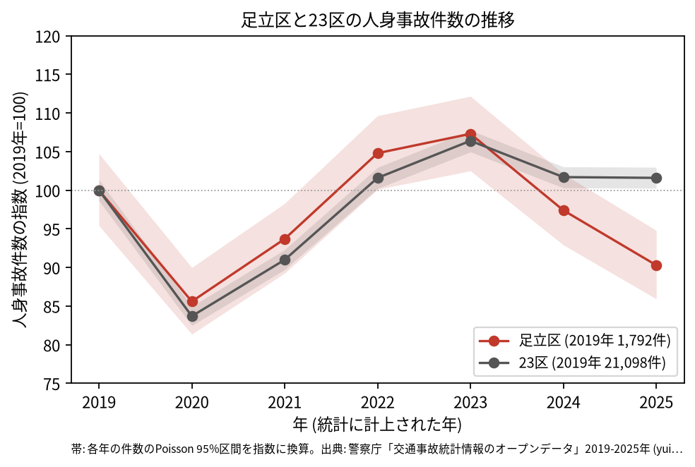
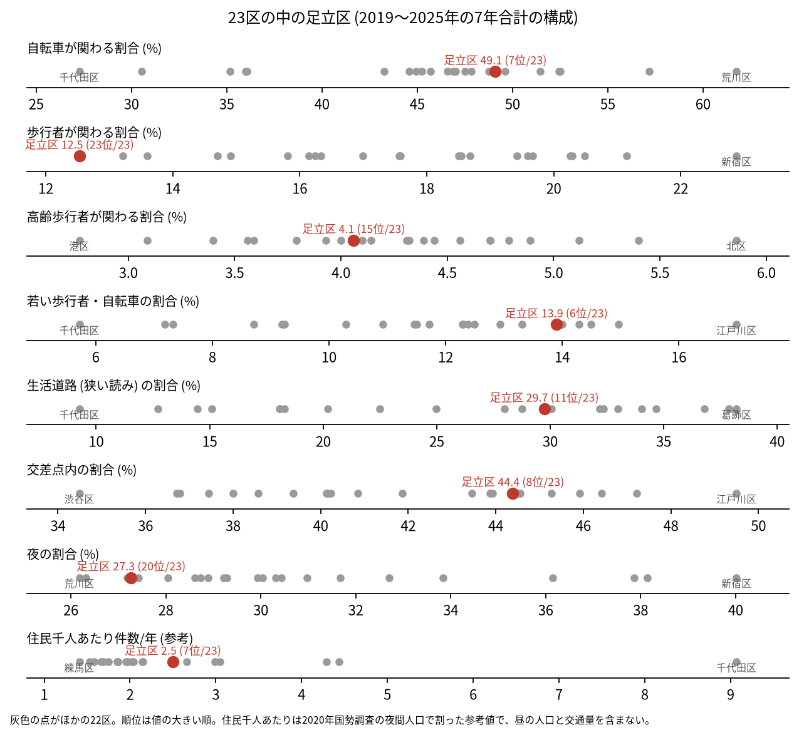
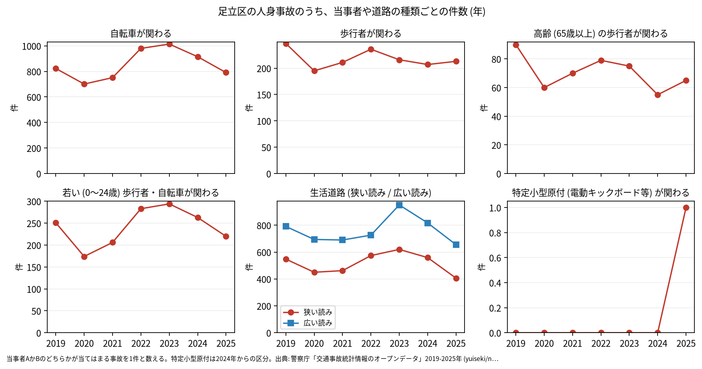

# 区の交通安全担当のための報告: 足立区の交通事故の傾向

## 問い

足立区の人身事故は 2019〜2025 年にどう推移し、23 区の中でどんな特徴があり、施策をどこに向ける材料になるか。

## 結論

- 件数: 7 年で 12,169 件、死者 59 人、負傷者 13,473 人です。2020 年に 1,534 件 (2019 年を 100 として 85.6) まで減り、23 区全体 (83.7) とほぼ同じ下がり方でした。2023 年は 1,922 件 (107.3) まで増え、2025 年は 1,618 件 (90.3) です。2025 年の 95% 区間 (1540.1〜1698.8 件) は 2019 年の区間 (1710.0〜1876.9 件) と重ならないので、2025 年は 2019 年より減ったと言えます。23 区全体の 2025 年は 101.6 で、足立区の減り方は 23 区全体と違います。

- 23 区の中の位置: 足立区の事故は、自転車が関わる割合が 49.1% で 23 区の 7 位、若い歩行者と自転車が 13.9% で 6 位と高く、歩行者が関わる割合は 12.5% で 23 区で最も低い (23 位) です。生活道路 (狭い読み) の割合は 29.7% で 11 位、広い読みでは 43.8% で 8 位です。交差点内は 44.4% (8 位)、夜は 27.3% (20 位) でした。

- 施策への読み方: 2026-09-01 からの生活道路の法定速度 30 km/h は、足立区の事故のうち 29.7〜43.8% (読み方による) に当たります。路線で分けると、区道が 7,497 件、主要地方道 (都道) が 2,275 件、一般都道が 977 件、国道 (4 号) が 741 件、首都高速が 191 件です。事故の多い地点の上位 15 は、10 地点で最も近い道が環七通りです (地点は [道路安全診断の報告](road-safety-auditor.md))。これは効果の予測ではなく、どの道路で事故が起きているかの構成です。
- 区分ごとの推移: 自転車が関わる事故は 2019 年に 823 件、2023 年に 1,014 件まで増え、2025 年は 791 件でした。特定小型原付 (電動キックボードなど) が関わる事故は、区分のできた 2024 年に 0 件、2025 年に 1 件です。

- 死亡事故: 59 件で、亡くなったのは歩行者 26 人、自転車 13 人、二輪車 10 人などです。亡くなった歩行者 26 人のうち 17 人が 65 歳以上でした。当事者 A (過失の重い側) は貨物車が 25 件、自家用の乗用車が 24 件です。19〜5 時台に起きた事故が 28 件、0〜5 時台が 16 件でした。

| 年 | 当事者 A | 当事者 B | 亡くなった人 | 時 |
|---|---|---|---|---:|
| 2020 | 貨物車 | 歩行者 (75 歳以上) | 歩行者 | 9 |
| 2021 | 貨物車 | 歩行者 (75 歳以上) | 歩行者 | 6 |
| 2022 | 貨物車 | 歩行者 (75 歳以上) | 歩行者 | 10 |
| 2022 | 貨物車 | 歩行者 (75 歳以上) | 歩行者 | 17 |
| 2025 | 貨物車 | 歩行者 (75 歳以上) | 歩行者 | 20 |
| 2025 | 貨物車 | 歩行者 (75 歳以上) | 歩行者 | 16 |

表は、当事者 A が貨物車で、75 歳以上の歩行者が亡くなった事故の抜き出しです。59 件 ([summary.txt](../outputs/summary.txt)) の全ては [deaths.csv](../outputs/deaths.csv) にあります。

- 人口あたり: 2020 年の住民千人あたりの年の件数は 2.5 件で 23 区の 7 位ですが、分母に昼の人口と通過する車が入らないため、区の比較の主な指標にしていません。

## データ

警察庁「交通事故統計情報のオープンデータ」を加工した `yuiseki/npa-traffic-accidents` 版 `389500a` の本票。足立区は `市区町村コード` 121 の 12,169 件、23 区は 144,716 件。年はファイルの年 (統計に計上された年)。区の人口は 2020 年国勢調査 (`jp-admin-2026-09` 版 `e6c87b1`)。詳しくは [共通の報告](../report.md)。

## 方法

区分は、当事者 A か B のどちらかが当てはまる事故を 1 件と数えました。生活道路は `車道幅員` で決め、狭い読み (5.5 m 未満の単路と、小と小の交差点) と、広い読み (5.5 m 未満の道とより広い道の交差点も含む) を並べました。年の区間は件数の Poisson の 95% 区間 (Garwood) です。23 区の順位は 7 年合計の割合の大きい順です。

## 確かめていないこと

- 2023 年から 2025 年に減った理由 (施策、人や車の動きの変化など) は調べていません。
- 区の施策 (ゾーン 30、自転車の通行帯など) の効果は推定していません。割合の順位は施策の評価ではありません。
- 重傷と軽傷の区別、物損事故は、このデータにありません。
