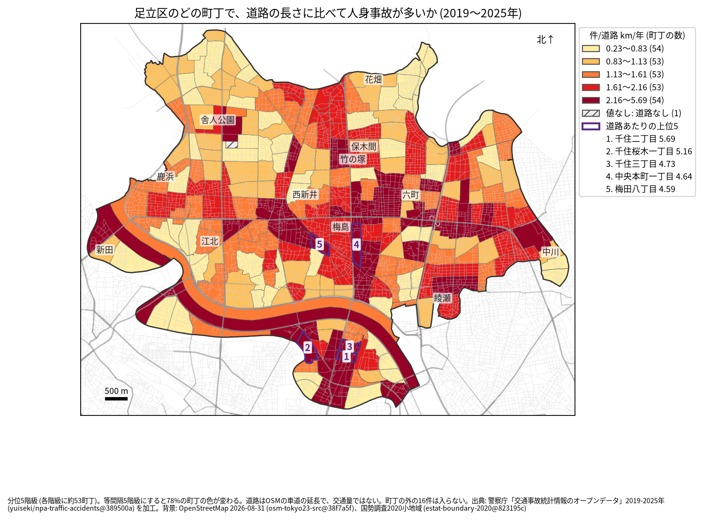
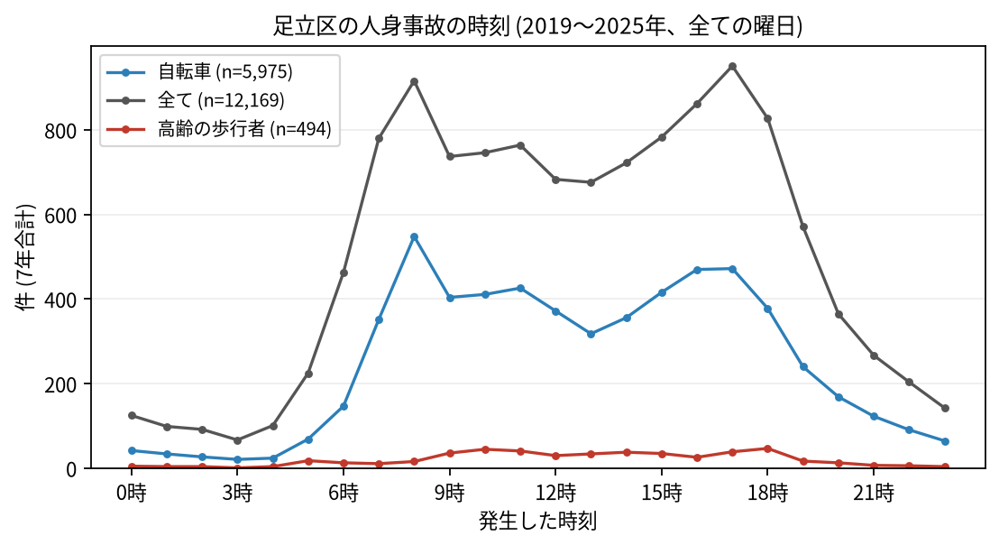

# 住民のための報告: 足立区で、いつ、どこで事故が起きているか

## 問い

足立区に住む人が、自分の町で、いつ、どんな事故に気をつければよいか。2019〜2025 年の警察記録の人身事故から調べました。

## 結論

- 足立区では 7 年で 12,169 件の人身事故があり、59 人が亡くなりました。年に 1,534〜1,922 件です。
- 町ごと: 道路 1 km あたりの事故が多いのは、千住二丁目 (年 5.69 件)、千住桜木一丁目 (5.16 件)、千住三丁目 (4.73 件)、中央本町一丁目 (4.64 件)、梅田八丁目 (4.59 件) です。件数そのものが最も多いのは宮城二丁目 (7 年で 238 件) と鹿浜二丁目 (213 件) で、どちらも荒川に沿う広い町丁です。環七通りに沿う町に色の濃い町が並びます。

色は分位 5 階級で、各色に約 53 の町が入ります。等間隔の階級にすると 78% の町の色が変わるので、色の差より、自分の町が上の階級か下の階級かを見てください。

- 時間: 事故は朝 8 時台 (916 件) と夕方 17 時台 (951 件) に多く、17 時台が最多です。自転車が関わる事故は 8 時台 (548 件) が最も多く、高齢の歩行者が関わる事故は 18 時台 (47 件) と 10 時台 (45 件) が多い時間でした。

- 誰が: 自転車が関わる事故が全体の 49.1% で、最も多い区分です。自転車に乗る人は、車やトラックとの事故 (2,877 件) に加え、自転車だけの事故 (転倒や物への衝突、1,757 件) にも気をつけてください。歩行者が関わる事故は 12.5% です。
- 亡くなった人: 歩行者 26 人のうち 17 人が 65 歳以上でした。死亡事故の 28 件は 19〜5 時台に起きています。暗い時間に道を渡るときは特に注意が要ります。

## データ

警察庁「交通事故統計情報のオープンデータ」を加工した `yuiseki/npa-traffic-accidents` 版 `389500a` の本票、足立区の 12,169 件 (2019〜2025 年のファイル)。町の境界は 2020 年国勢調査の小地域 (268 町丁)、道路は OpenStreetMap 2026-08-31。詳しくは [共通の報告](../report.md)。

## 方法

事故の地点を町丁の境界に入れて数え、町丁の中の車道の長さ (OSM) と 7 年で割りました。区の境界の近くで町丁の外に落ちた 16 件は町の値に入っていません。時刻は事故の起きた時で、7 年の合計です。

## 確かめていないこと

- 道路の長さは、通る車や人の数ではありません。千住の値が高いのは、人と車が多いためかもしれません。
- 自分の町の事故が少なくても、物損事故やヒヤリハットはこのデータにありません。
- 事故の位置の精度は分かりません。町の境界の近くの事故は、隣の町に数えられている可能性があります。
