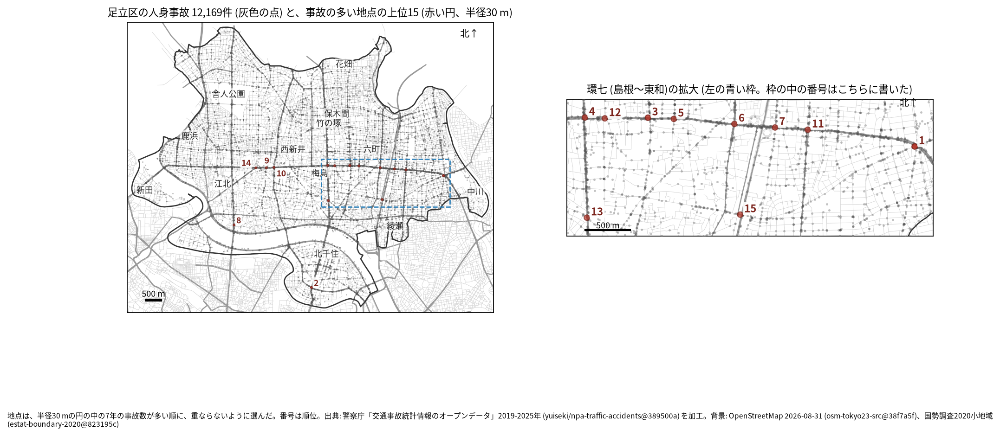
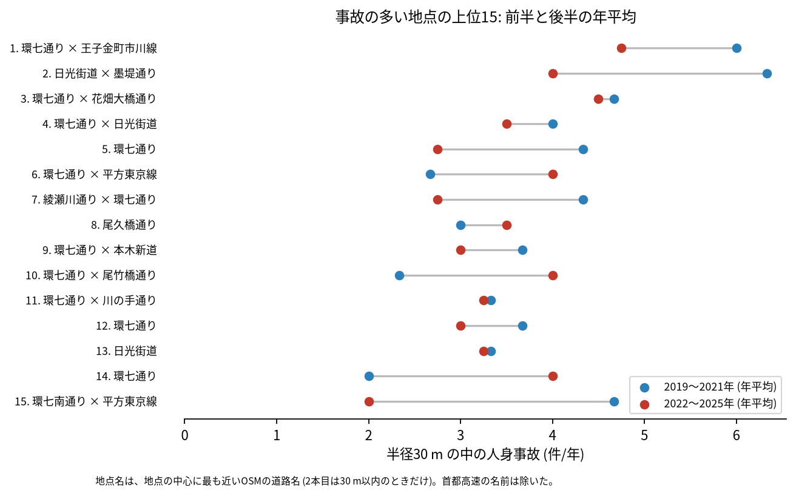
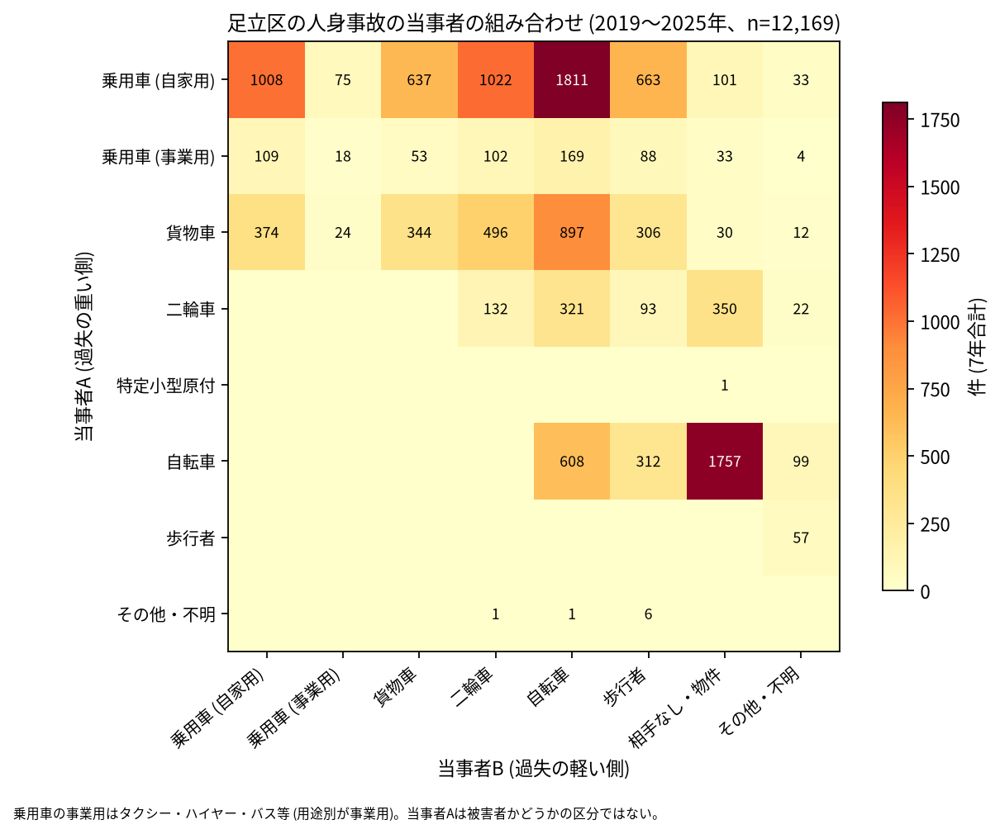

# 道路安全診断のための報告: 足立区で事故の集まる地点

## 問い

足立区で 2019〜2025 年の人身事故が集まる地点はどこで、そこでは誰と誰の事故が多いか。現地診断の候補を選ぶ材料にします。

## 結論

- 半径 30 m の円の中の 7 年の件数で選んだ上位 15 地点は、22〜37 件です。15 のうち 10 地点で中心に最も近い道は環七通りで、島根から東和までの環七通りに沿って並びます。ほかは日光街道 (2 位の千住宮元町と 13 位の梅田七丁目)、尾久橋通り (8 位の扇一丁目)、綾瀬川通り (7 位)、環七南通り (15 位) です。

| 順位 | 近い道路 (OSM) | 件数 | 前半 件/年 | 後半 件/年 | 交差点内 | 信号あり | 多い組み合わせ (A × B) |
|---:|---|---:|---:|---:|---:|---:|---|
| 1 | 環七通り × 王子金町市川線 | 37 | 6.00 | 4.75 | 30 | 36 | 乗用車 (自家用) × 自転車 |
| 2 | 日光街道 × 墨堤通り | 35 | 6.33 | 4.00 | 27 | 33 | 乗用車 (自家用) × 自転車 |
| 3 | 環七通り × 花畑大橋通り | 32 | 4.67 | 4.50 | 18 | 23 | 乗用車 (自家用) × 二輪車 |
| 4 | 環七通り × 日光街道 | 26 | 4.00 | 3.50 | 16 | 19 | 乗用車 (自家用) × 自転車 |
| 5 | 環七通り | 24 | 4.33 | 2.75 | 11 | 17 | 乗用車 (自家用) × 二輪車 |
| 6 | 環七通り × 平方東京線 | 24 | 2.67 | 4.00 | 17 | 19 | 乗用車 (自家用) × 二輪車 |
| 7 | 綾瀬川通り × 環七通り | 24 | 4.33 | 2.75 | 16 | 17 | 乗用車 (自家用) × 貨物車 |
| 8 | 尾久橋通り | 23 | 3.00 | 3.50 | 11 | 0 | 乗用車 (自家用) × 自転車 |
| 9 | 環七通り × 本木新道 | 23 | 3.67 | 3.00 | 19 | 21 | 乗用車 (自家用) × 乗用車 (自家用) |
| 10 | 環七通り × 尾竹橋通り | 23 | 2.33 | 4.00 | 17 | 19 | 乗用車 (自家用) × 二輪車 |

前半は 2019〜2021 年、後半は 2022〜2025 年。11〜15 位と、歩行者、自転車、夜の件数は [hotspots.csv](../outputs/hotspots.csv) にあります。道路名は地点の中心に最も近い OSM の道路名で、2 本目は 1 本目と交わる向き (30 度以上) の道のうち最も近いもので、30 m 以内のときだけ書きました (首都高速の名前は除いた)。

- 信号の無い地点: 8 位 (尾久橋通り、扇一丁目) と 12 位 (環七通り、平野一丁目) は、信号ありの事故が 0 件です。8 位は 23 件のうち 21 件、12 位は 23 件のうち 14 件に自転車が関わります。
- 続いているか: 上位 15 は全て前半と後半の両方に事故があります。2 位 (6.33 から 4.00 件/年) と 15 位 (4.67 から 2.00 件/年) は後半に減り、10 位 (2.33 から 4.00 件/年) と 14 位 (2.00 から 4.00 件/年) は増えました。上位は 7 年合計で選んだので、後半が下がって見えやすい (平均への回帰) ことに注意してください。

- 組み合わせ: 当事者 A が乗用車か貨物車で B が自転車の事故は 2,877 件です。自転車の単独 (相手なし・物件) が 1,757 件、自転車どうしが 608 件、自転車と歩行者 (自転車が A) が 312 件ありました。上位 15 のうち 7 地点で、最も多い組は自家用の乗用車と自転車でした。事業用の乗用車 (タクシー、ハイヤー、バスなど) は 576 件で当事者 A です。

- 半径を変えると: 20 m の上位 15 の中心が、30 m の上位 15 の中心から 30 m 以内にあるのは 8 地点、50 m でも 8 地点でした。環七通りの交差点は件数の近い地点が並ぶので、半径で入れ替わります。順位は読まず、環七通りの連なりとして見てください。
- 首都高速: 区の首都高速の事故は 191 件ですが、上位 15 の円には 1 件も入っていません。首都高速の事故を除いて選び直しても、15 地点が全て残ります。

## データ

警察庁「交通事故統計情報のオープンデータ」を加工した `yuiseki/npa-traffic-accidents` 版 `389500a` の本票、足立区 (`市区町村コード` 121) の 12,169 件。道路名は OpenStreetMap 2026-08-31 (`osm-tokyo23-src-2026-08` 版 `38f7a5f`)。詳しくは [共通の報告](../report.md)。

## 方法

事故の点を EPSG:6677 (メートル) に変換し、半径 30 m の円の中の件数が最も多い事故の点を中心に選び、その円の事故を除いて次を選ぶ手順を 15 回くり返しました。30 m はコード表の「交差点付近」(交差点の側端から 30 m 以内) の幅です。信号ありは `信号機` が 3 灯式、押ボタン式、歩車分式の点灯。組み合わせは当事者 A (過失の重い側) と B の種別で、乗用車は `用途別` で事業用と自家用に分けました。

## 確かめていないこと

- 交通量で割っていません。件数の多い交差点が、車の多さに比べて危険かは分かりません。
- 事故の型 (出会い頭、右折、追突)、違反の種類、重傷と軽傷の区別は、このデータにありません。現地で確かめてください。
- 位置の精度は分かりません。数十 m のずれで地点の件数は変わります。
- 偶然でもこの程度の集まりが生まれるか (順位の有意さ) は調べていません。
