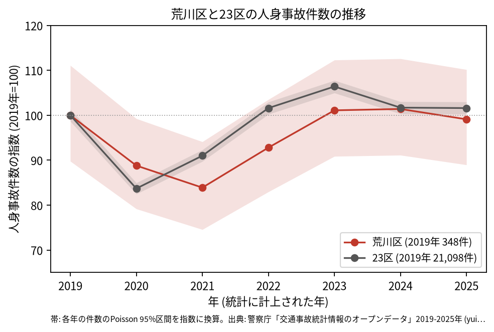
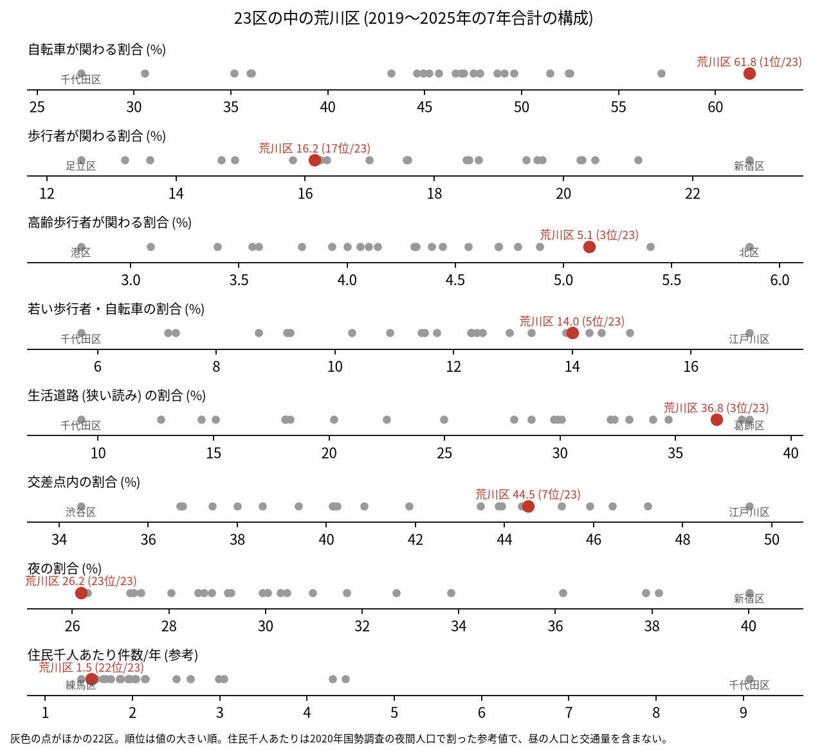
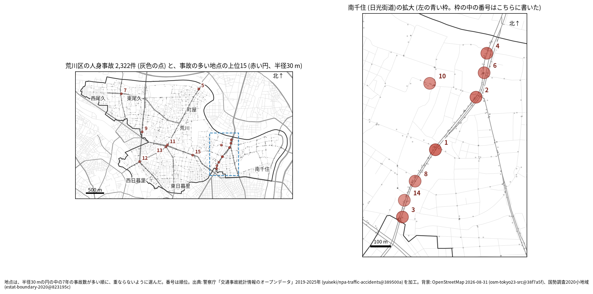
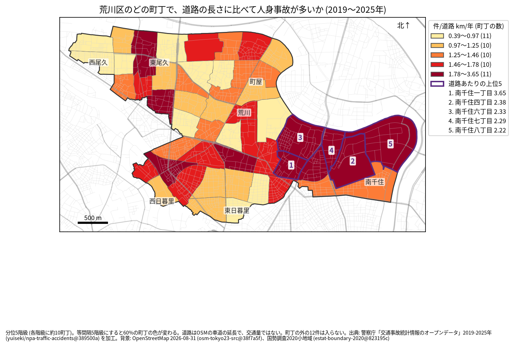
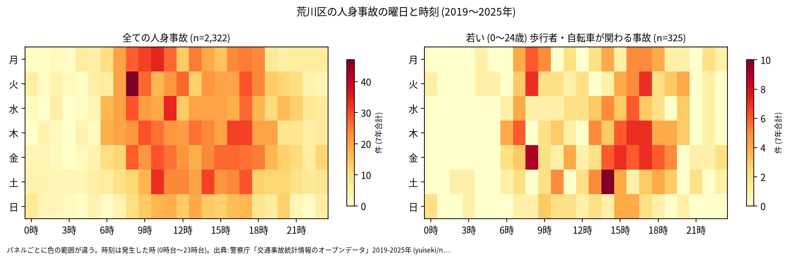
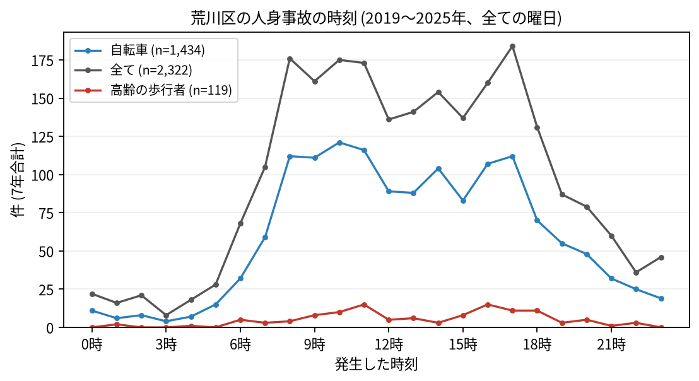
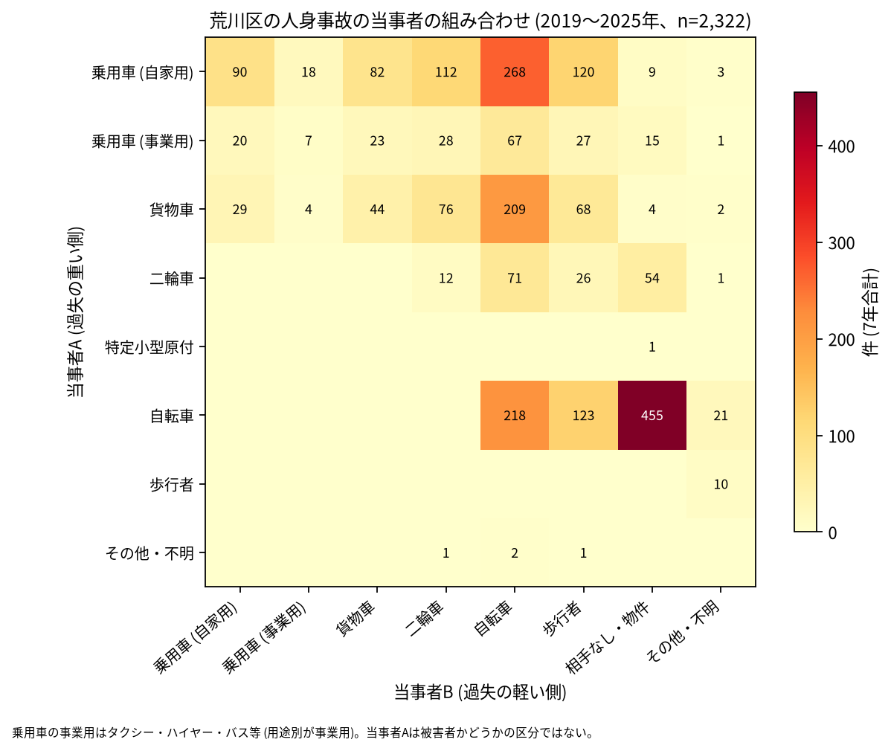

# 荒川区の交通事故 2019〜2025 年: 図で読む要点

## 問い

2019〜2025 年の警察記録の人身事故で、荒川区の事故はいつ、どこで、誰が関わって起きているか。

## 結論

### 要点

| # | 要点 | 数字 | 図 |
|---:|---|---|---|
| 1 | 件数は 2020〜2021 年に減り、2023 年に戻った。2019 年より増えた、減ったとは言えない | 7 年で 2,322 件、死者 9 人、負傷者 2,509 人。指数 (2019 年=100) は 2021 年 83.9、2025 年 99.1 ([yearly.csv](outputs/yearly.csv)、[summary.txt](outputs/summary.txt)) | [図 1](#図-1-件数の推移) |
| 2 | 自転車が関わる事故の割合が 23 区で最も高い | 61.8% (23 区の 1 位)。自転車の単独 (相手なし・物件) の事故が 455 件 ([wards.csv](outputs/wards.csv)、[summary.txt](outputs/summary.txt)) | [図 2](#図-2-23-区の中の荒川区)、[図 6](#図-6-誰と誰の事故か) |
| 3 | 生活道路の事故の割合が高い | 狭い読み 36.8% (3 位)、広い読み 49.8% (1 位) ([summary.txt](outputs/summary.txt)、[analysis.json](outputs/analysis.json)) | [図 2](#図-2-23-区の中の荒川区) |
| 4 | 集まる場所は南千住の日光街道 | 事故の多い地点の上位 15 のうち 7 地点で最も近い道が日光街道。道路あたりの上位 5 町丁は全て南千住 ([summary.txt](outputs/summary.txt)、[towns.csv](outputs/towns.csv)) | [図 3](#図-3-事故の集まる地点)、[図 4](#図-4-町丁ごとの事故) |
| 5 | 夜の事故の割合は 23 区で最も低い。死亡事故は少なく、偏りは言えない | 夜 26.2% (23 位)。死者 9 人のうち歩行者 5 人、自転車 3 人、二輪車 1 人 ([summary.txt](outputs/summary.txt)) | [表 1](#表-1-死亡事故) |

### 読み手ごとに知るべきこと

| 読み手 | 結論 | 検討する材料 | 詳しく |
|---|---|---|---|
| 区の交通安全担当 | 生活道路の法定速度 30 km/h (2026-09-01 から) が当たる事故は 36.8〜49.8% (読み方による) で、23 区の上位。事故の 61.8% に自転車が関わる | 生活道路と自転車、南千住の日光街道 | [municipality.md](reports/municipality.md) |
| 学校と PTA | 若い (0〜24 歳) 歩行者と自転車の事故は 325 件 (14.0%、5 位)。最も多いのは 16 時台と 17 時台で、朝より下校から夕方が多い | 学校の円の中で、平日 14〜17 時台の点が並ぶ道 | [school-pta.md](reports/school-pta.md) |
| 道路安全診断 | 上位 15 のうち 1〜4 位、6 位、8 位、14 位は南千住の日光街道 (国道 4 号) の上。1 位は 25 件 | 日光街道の連なる地点、後半に増えた 3 位と 9 位、前半に多かった 5 位 | [road-safety-auditor.md](reports/road-safety-auditor.md) |
| 住民 | 道路あたりで多いのは南千住一丁目 (年 3.651 件/道路 km)、南千住四丁目 (2.385 件)。事故は 8 時台から 17 時台まで多く、17 時台が最多 | 自分の町の色、自転車の単独事故 | [resident.md](reports/resident.md) |

### 図 1: 件数の推移

2020 年 (88.8) と 2021 年 (83.9) に下がり、2023 年 (101.1) に戻った。23 区全体の落ち込みは 2020 年 (83.7) が底で、荒川区は 1 年遅い。どの年の 95% 区間も 2019 年の区間 (312.4〜386.6 件) と重なるので、増減とは書かない。

### 図 2: 23 区の中の荒川区

赤い点が荒川区。自転車 (61.8%、1 位)、生活道路の狭い読み (36.8%、3 位)、高齢の歩行者 (5.1%、3 位)、若い歩行者・自転車 (14.0%、5 位) が高く、夜 (26.2%、23 位) と歩行者 (16.2%、17 位) が低い。住民千人あたり (1.53 件/年、22 位) は昼の人口を含まない参考値。

### 図 3: 事故の集まる地点

半径 30 m の円の中の 7 年の件数で選んだ上位 15 (12〜25 件)。番号は順位で、南千住の 8 地点 (日光街道の 7 地点と若宮八幡通りの 10 位) は右の拡大図に番号を書いた。

| 順位 | 近い道路 (OSM) | 町丁 | 件数 | 前半 件/年 | 後半 件/年 |
|---:|---|---|---:|---:|---:|
| 1 | 日光街道 | 南千住五丁目 | 25 | 3.00 | 4.00 |
| 2 | 日光街道 × 山谷通り | 南千住六丁目 | 21 | 2.33 | 3.50 |
| 3 | 日光街道 | 南千住二丁目 | 19 | 1.33 | 3.75 |
| 4 | 日光街道 | 南千住六丁目 | 19 | 2.33 | 3.00 |
| 5 | 尾竹橋通り | 町屋六丁目 | 18 | 4.00 | 1.50 |

前半は 2019〜2021 年、後半は 2022〜2025 年。道路の名前が 1 本だけの地点は、30 m 以内に交わる向きの道が無かった。半径を 20 m にすると上位 15 のうち 11 地点、50 m でも 11 地点が残る。6〜15 位は [hotspots.csv](outputs/hotspots.csv)。

### 図 4: 町丁ごとの事故

町丁の事故数を、OSM の車道の延長と 7 年で割った値。紫の枠が上位 5 (南千住一丁目、南千住四丁目、南千住六丁目、南千住七丁目、南千住八丁目)。分位と等間隔で 60% の町丁の色が変わるので ([town-rate-quantile.json](outputs/town-rate-quantile.json))、色の細かい差は読まない。道路の長さは交通量ではない。

### 図 5: いつ起きるか

全体は平日の 8〜17 時台に広く多く、最多は 17 時台 (184 件)、次が 8 時台 (176 件)。若い歩行者と自転車は 14〜17 時台に寄り、最多は 16 時台と 17 時台 (34 件ずつ)。

自転車は 10 時台 (121 件)、高齢の歩行者は 11 時台と 16 時台 (15 件ずつ) が最多。

### 図 6: 誰と誰の事故か

最も多いのは自転車の単独 (相手なし・物件) の 455 件、次が自家用の乗用車 (A) と自転車 (B) の 268 件、自転車どうしの 218 件、貨物車と自転車の 209 件。当事者 A は過失の重い側で、被害者とは限らない。

### 表 1: 死亡事故

| 亡くなった人 | 人数 | 特徴 |
|---|---:|---|
| 歩行者 | 5 | 65 歳以上は 1 人 |
| 自転車 | 3 | |
| 二輪車 | 1 | |

9 件のうち 19〜5 時台が 4 件、0〜5 時台が 1 件。当事者 A は貨物車と自家用の乗用車が 3 件ずつ。数が少ないので傾向とは断定しない。全件は [deaths.csv](outputs/deaths.csv)。

### 読み方で変わる答え

| 読み方 | 主 | 別の読み方 |
|---|---|---|
| 荒川区の事故 | `市区町村コード` 118 の 2,322 件 | 点が区の面に入る事故。両方に当てはまるのは 2,310 件、コードだけ 12 件、面だけ 43 件 ([analysis.json](outputs/analysis.json)、区コードは [wards.csv](outputs/wards.csv)) |
| 生活道路 | 狭い読み 36.8% (3 位) | 広い読み 49.8% (1 位) |
| 地点の半径 | 30 m | 20 m で 11 地点、50 m で 11 地点が残る |
| 首都高速の事故 | 含める | 区の首都高速の事故は 0 件で、除いても 15 地点が全部同じ ([analysis.json](outputs/analysis.json)) |
| 町丁の階級 | 分位 5 階級 | 等間隔で 60%、Jenks で 58% の町丁の色が変わる |

## データ

- 人身事故: 警察庁「交通事故統計情報のオープンデータ」を加工した `yuiseki/npa-traffic-accidents` 版 `389500aae5cec45f1311163f70db6a5f05867838` (配布元の取得 2026-10-02) の本票。年はファイルの年 (統計に計上された年)。東京の本票 205,541 行、荒川区 2,322 件、23 区 144,716 件。位置の無い行は 0。物損事故は含まない。
- 区の面と人口: `yuiseki/jp-admin-2026-09` 版 `e6c87b1`。町丁: 2020 年国勢調査の小地域 `yuiseki/estat-boundary-2020` 版 `823195c` (52 町丁、217,475 人。水面調査区と名前の無い単位は無い)。学校 35 校と道路: OpenStreetMap 2026-08-31、`yuiseki/osm-tokyo23-src-2026-08` 版 `38f7a5f`。
- 道具: DuckDB 2.0.0 (spatial)、matplotlib、`analysis-visualize` の `cjk_font.py`、`classify_map.py`、`context_map.py`。流した日 2026-11-03。
- 出典の表示: 警察庁ウェブサイト (https://www.npa.go.jp/publications/statistics/koutsuu/opendata/index_opendata.html) の交通事故統計情報のオープンデータを加工して作成。国勢調査の小地域境界と人口、OpenStreetMap (© OpenStreetMap contributors) を加工して使用。

## 方法

- 台東区の分析 ([台東区の報告](../taito-accident-trends-by-role/report.md)) と同じスクリプトで、区コードと区に固有の定数だけを直した。読み方は結果を見る前に [計画](EXPERIMENT_PLAN.md) で固定し、実行は [記録](EXPERIMENT_TRACKER.md) に残した。生活道路は `車道幅員` が 01、02、11 (狭い読み)、広い読みは 14、17 を足す。歩行者や自転車が関わるかは当事者 A と B の両方で見て、1 件を 1 回数えた。
- 距離は EPSG:6677 (メートル) で測った。町丁の道路あたりの上位 5 には、道路が 0.5 km より短い町丁を数えない (荒川区には無い)。地点は、半径 30 m の中の件数が最も多い点を中心に選び、その円の事故を除いて次を選ぶ手順を 15 回くり返した。地点の名前は、中心に最も近い道と、それと 30 度以上の向きで交わる道のうち 30 m 以内で最も近い道。
- 地図は `analysis-visualize` の map-context に合わせ、地名と道路を重ね、凡例を地図の外に置き、強調した単位に番号を付けた。描いた町丁の数 (52) を分析の数と照らし、文字の重なりと、地名や番号が円や学校の印を隠す重なりは、3 枚の地図で 0 件 (地名 3 つと番号 1 つの位置を、1 回目の図を見て直した)。背景の道路 (OGC:CRS84) と町丁 (JGD2000) の差は、線の幅より小さいとして変換せずに重ねた。
- 関門: 予測と回帰をしないので、評価の分け方と残差の確認は要らない。単位の間の相関を結論にしないので、Moran's I と格子の掃引は省いた。推移は 23 区全体を基準にし、年の件数に Poisson の 95% 区間を付けた。対策の効果は推定していない。
- 再実行は [README.md](README.md)。数値は [outputs/](outputs/) の CSV、来歴は [analysis.json](outputs/analysis.json)。

## 確かめていないこと

- 交通量、昼の人口、駅で乗り換える人の数で割っていない。南千住の日光街道の件数の多さは、車の多さかもしれない。
- 自転車の単独事故 (455 件) と自転車の割合 (61.8%) が 23 区で高い理由は調べていない。自転車の使われ方の違いか、記録のされ方の違い (どの事故を人身事故として届け、どう当事者を付けるか) かは、このデータでは分けられない。
- 位置の精度は分からない。30 m の地点と町丁の境界の近くの事故は、数十 m のずれで入れ替わる。日光街道の 1〜4 位は、拡大図のとおり 1 本の道に沿って並び、交差点内の事故が少ない地点 (4 位は 19 件のうち 2 件) もある。同じ区間の事故が、隣り合う地点に分かれている可能性がある。
- 首都高速が区の中を通らないことは、外の知識 (計画に書いた) と、首都高速の事故が 0 件であることでだけ確かめた。都電荒川線との事故は分けて数えていない。
- 事故の型 (出会い頭、追突)、重傷と軽傷の区別、物損事故、ヒヤリハットは、このデータに無い。
- 0〜24 歳より細かい年齢は無く、小学生だけは数えられない。
- 地点の上位は 7 年で選び、同じ 7 年で前半と後半を比べたので、後半が下がって見えやすい (平均への回帰)。
