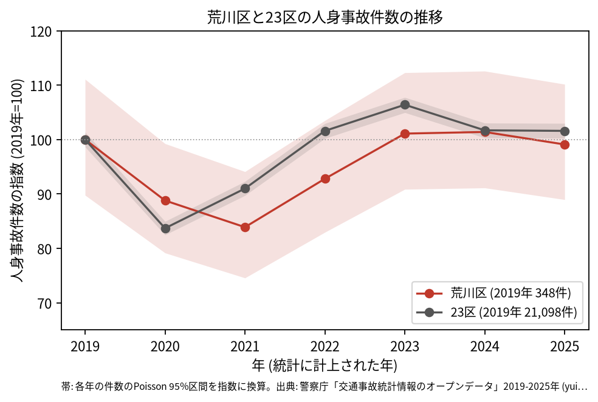
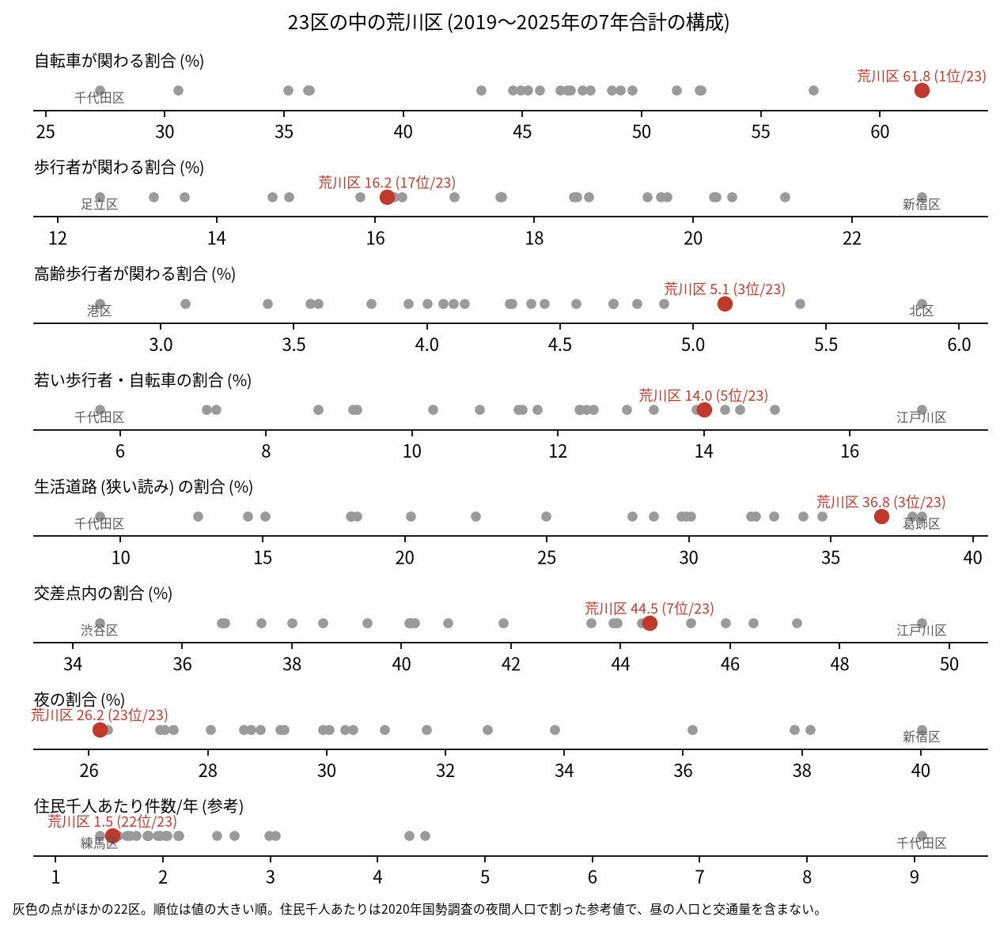
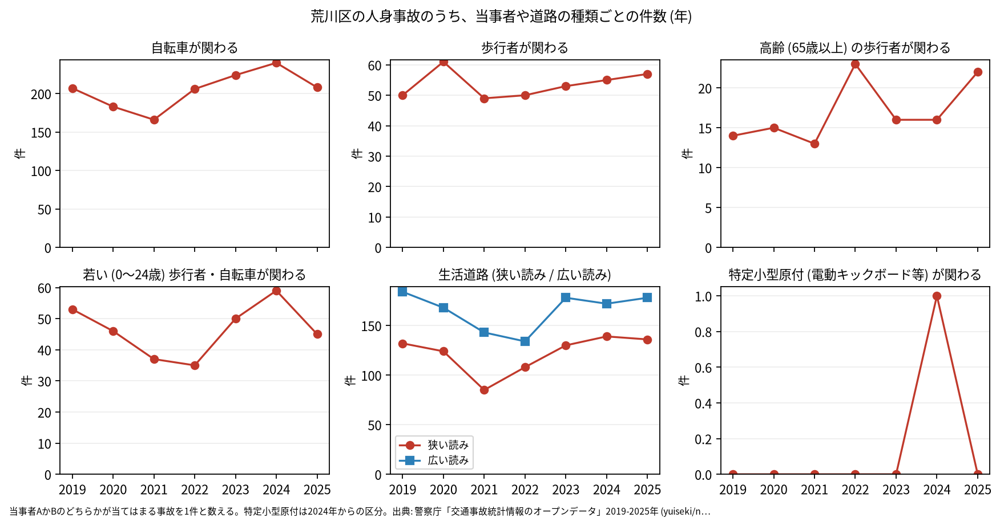

# 区の交通安全担当のための報告: 荒川区の交通事故の傾向

## 問い

荒川区の人身事故は 2019〜2025 年にどう推移し、23 区の中でどんな特徴があり、施策をどこに向ける材料になるか。

## 結論

- 件数: 7 年で 2,322 件、死者 9 人、負傷者 2,509 人です。2020 年に 309 件 (2019 年を 100 として 88.8)、2021 年に 292 件 (83.9) まで減り、2023 年は 352 件 (101.1) に戻りました。2025 年は 345 件 (99.1) です。23 区全体は 2020 年 (83.7) が底で、荒川区の底は 1 年遅れています。どの年の 95% 区間も 2019 年の区間 (312.4〜386.6 件) と重なるので、2019 年より増えた、減ったとは言えません。

- 23 区の中の位置: 荒川区の事故は、自転車と生活道路に寄っています。自転車が関わる割合は 61.8% で 23 区の 1 位、生活道路の割合は狭い読みで 36.8% (3 位)、広い読みで 49.8% (1 位) です。高齢の歩行者が関わる割合は 5.1% で 3 位、若い歩行者と自転車は 14.0% で 5 位です。夜の割合 (26.2%) は 23 位、歩行者が関わる割合 (16.2%) は 17 位で、低い側です。交差点内の割合は 44.5% で 7 位です。

- 施策への読み方: 2026-09-01 からの生活道路の法定速度 30 km/h は、荒川区の事故のうち 36.8〜49.8% (読み方による) に当たり、23 区の中では当たる割合の大きい区です。路線の種類では、区道の事故が 7 年で 1,183 件と最も多く、国道 (日光街道、国道 4 号) は 187 件です ([summary.txt](../outputs/summary.txt))。ただし事故の集まる地点の上位は南千住の日光街道に並びます (地点は [道路安全診断の報告](road-safety-auditor.md))。これは効果の予測ではなく、どの道路で事故が起きているかの構成です。
- 自転車: 自転車が関わる事故は、2021 年が 166 件、2024 年が 240 件、2025 年が 208 件で、2025 年は 2019 年 (207 件) とほぼ同じ水準です。区間を付けていないので、年の差を増減とは書きません。自転車の単独 (相手なし・物件) の事故が 455 件あり、組み合わせの中で最も多い組です。特定小型原付 (電動キックボードなど) が関わる事故は、区分のできた 2024 年に 1 件、2025 年に 0 件でした。

- 死亡事故: 9 件で、亡くなったのは歩行者 5 人、自転車 3 人、二輪車 1 人です。亡くなった歩行者 5 人のうち 65 歳以上は 1 人でした。9 件は少なく、偏りを傾向と断定できる数ではありません。

| 年 | 当事者 A | 当事者 B | 亡くなった人 | 時 |
|---|---|---|---|---:|
| 2019 | その他・不明 | 歩行者 (35〜44 歳) | 歩行者 | 20 |
| 2019 | 貨物車 | 自転車 (55〜64 歳) | 自転車 | 9 |
| 2020 | 乗用車 (自家用) | 歩行者 (55〜64 歳) | 歩行者 | 21 |
| 2021 | 貨物車 | 自転車 (65 歳以上) | 自転車 | 13 |
| 2021 | 貨物車 | 歩行者 (0〜24 歳) | 歩行者 | 12 |
| 2022 | 乗用車 (自家用) | 二輪車 (55〜64 歳) | 二輪車 | 20 |
| 2023 | 乗用車 (自家用) | 歩行者 (75 歳以上) | 歩行者 | 15 |
| 2023 | 自転車 | 相手なし・物件 | 自転車 | 16 |
| 2024 | 乗用車 (事業用) | 歩行者 (45〜54 歳) | 歩行者 | 3 |

9 件の全て ([deaths.csv](../outputs/deaths.csv)) です。

- 人口あたり: 2020 年の住民千人あたりの年の件数は 1.53 件で 23 区の 22 位ですが、分母に昼の人口や通過する車が入らないため、区の比較の主な指標にしていません。

## データ

警察庁「交通事故統計情報のオープンデータ」を加工した `yuiseki/npa-traffic-accidents` 版 `389500a` の本票。荒川区は `市区町村コード` 118 の 2,322 件、23 区は 144,716 件。年はファイルの年 (統計に計上された年)。区の人口は 2020 年国勢調査 (`jp-admin-2026-09` 版 `e6c87b1`)。詳しくは [共通の報告](../report.md)。

## 方法

区分は、当事者 A か B のどちらかが当てはまる事故を 1 件と数えました。生活道路は `車道幅員` で決め、狭い読み (5.5 m 未満の単路と、小と小の交差点) と、広い読み (5.5 m 未満の道とより広い道の交差点も含む) を並べました。年の区間は件数の Poisson の 95% 区間 (Garwood) です。23 区の順位は 7 年合計の割合の大きい順です。路線の種類は `路線コード` の範囲で分けました。

## 確かめていないこと

- 2020〜2021 年の減り方と、自転車の割合と自転車の単独事故が 23 区で高い理由は調べていません。
- 区の施策 (ゾーン 30、自転車の通行帯など) の効果は推定していません。割合の順位は施策の評価ではありません。
- 重傷と軽傷の区別、物損事故は、このデータにありません。
