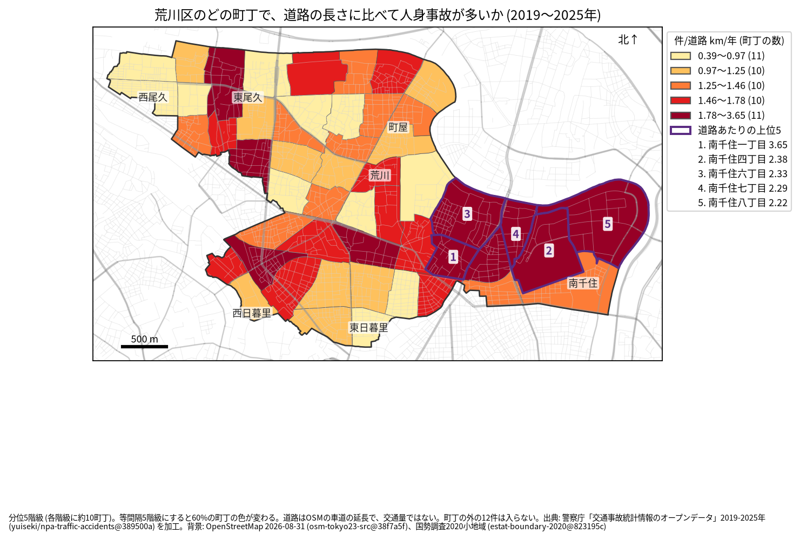
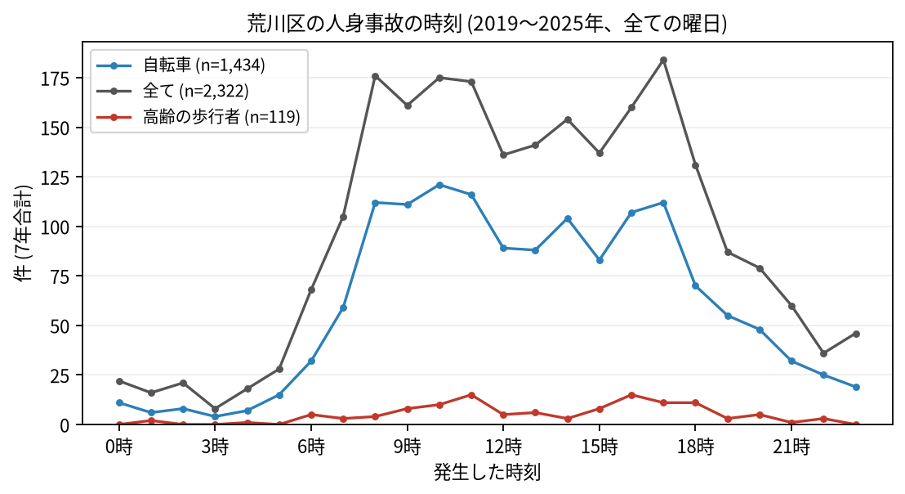

# 住民のための報告: 荒川区で、いつ、どこで事故が起きているか

## 問い

荒川区に住む人が、自分の町で、いつ、どんな事故に気をつければよいか。2019〜2025 年の警察記録の人身事故から調べました。

## 結論

- 荒川区では 7 年で 2,322 件の人身事故があり、9 人が亡くなりました。年に 292〜353 件です。
- 町ごと: 道路 1 km あたりの事故が多いのは、南千住一丁目 (年 3.651 件)、南千住四丁目 (2.385 件)、南千住六丁目 (2.33 件)、南千住七丁目 (2.295 件)、南千住八丁目 (2.22 件) で、上位 5 つが全て南千住です。件数そのものが最も多いのも南千住六丁目 (7 年で 146 件) でした。

色は分位 5 階級で、各色に約 10 の町が入ります。等間隔の階級にすると 60% の町の色が変わるので ([town-rate-quantile.json](../outputs/town-rate-quantile.json))、色の差より、自分の町が上の階級か下の階級かを見てください。

- 時間: 事故は朝 8 時台から増え、夕方 17 時台まで高い水準が続きます。最も多いのは 17 時台 (184 件)、次が 8 時台 (176 件) です。自転車が関わる事故は 10 時台 (121 件) に、高齢の歩行者が関わる事故は 11 時台と 16 時台 (15 件ずつ) に最も多く起きています。

- 誰が: 自転車が関わる事故が全体の 61.8% で、23 区で最も高い割合です。自転車に乗る人は、車やトラックとの事故 (544 件) に加え、自転車だけの事故 (転倒や物への衝突、455 件) と自転車どうしの事故 (218 件) にも気をつけてください。歩行者が関わる事故は 16.2% です。
- 亡くなった人: 9 人のうち 5 人が歩行者、3 人が自転車に乗っていた人でした。

## データ

警察庁「交通事故統計情報のオープンデータ」を加工した `yuiseki/npa-traffic-accidents` 版 `389500a` の本票、荒川区の 2,322 件 (2019〜2025 年のファイル)。町の境界は 2020 年国勢調査の小地域 (52 町丁)、道路は OpenStreetMap 2026-08-31。詳しくは [共通の報告](../report.md)。

## 方法

事故の地点を町丁の境界に入れて数え、町丁の中の車道の長さ (OSM) と 7 年で割りました。区の境界の近くで町丁の外に落ちた 12 件は町の値に入っていません。時刻は事故の起きた時で、7 年の合計です。

## 確かめていないこと

- 道路の長さは、通る車や人の数ではありません。南千住の値が高いのは、日光街道を通る車が多いためかもしれません。
- 自分の町の事故が少なくても、物損事故やヒヤリハットはこのデータにありません。
- 事故の位置の精度は分かりません。町の境界の近くの事故は、隣の町に数えられている可能性があります。
