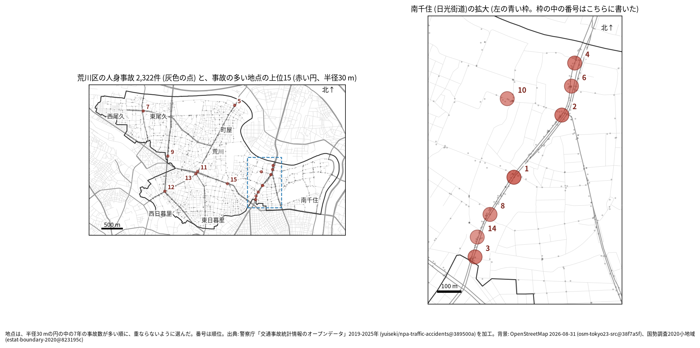
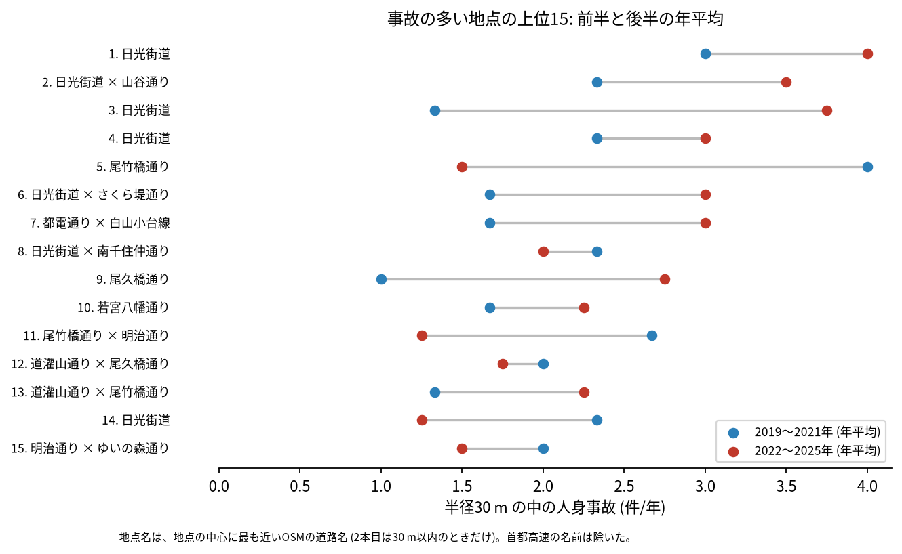
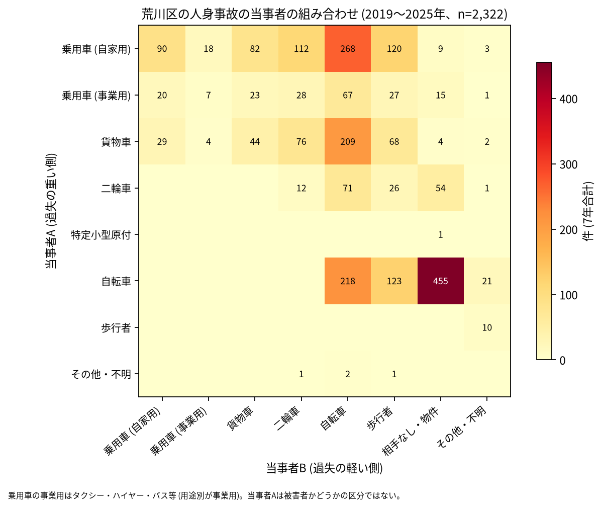

# 道路安全診断のための報告: 荒川区で事故の集まる地点

## 問い

荒川区で 2019〜2025 年の人身事故が集まる地点はどこで、そこでは誰と誰の事故が多いか。現地診断の候補を選ぶ材料にします。

## 結論

- 半径 30 m の円の中の 7 年の件数で選んだ上位 15 地点は、12〜25 件です。15 のうち 7 は、最も近い道が南千住の日光街道 (国道 4 号) で、1〜4 位はすべてここです。ほかの地点の最も近い道は、尾竹橋通り (5 位、11 位)、都電通り (7 位)、尾久橋通り (9 位)、若宮八幡通り (10 位)、道灌山通り (12 位、13 位)、明治通り (15 位) です。

| 順位 | 近い道路 (OSM) | 件数 | 前半 件/年 | 後半 件/年 | 交差点内 | 信号あり | 多い組み合わせ (A × B) |
|---:|---|---:|---:|---:|---:|---:|---|
| 1 | 日光街道 | 25 | 3.00 | 4.00 | 16 | 21 | 乗用車 (自家用) × 二輪車 |
| 2 | 日光街道 × 山谷通り | 21 | 2.33 | 3.50 | 6 | 11 | 乗用車 (自家用) × 自転車 |
| 3 | 日光街道 | 19 | 1.33 | 3.75 | 10 | 10 | 自転車 × 相手なし・物件 |
| 4 | 日光街道 | 19 | 2.33 | 3.00 | 2 | 6 | 自転車 × 相手なし・物件 |
| 5 | 尾竹橋通り | 18 | 4.00 | 1.50 | 10 | 9 | 自転車 × 相手なし・物件 |
| 6 | 日光街道 × さくら堤通り | 17 | 1.67 | 3.00 | 14 | 13 | 乗用車 (自家用) × 二輪車 |
| 7 | 都電通り × 白山小台線 | 17 | 1.67 | 3.00 | 11 | 13 | 乗用車 (自家用) × 自転車 |
| 8 | 日光街道 × 南千住仲通り | 15 | 2.33 | 2.00 | 7 | 6 | 自転車 × 自転車 |
| 9 | 尾久橋通り | 14 | 1.00 | 2.75 | 5 | 11 | 乗用車 (自家用) × 乗用車 (自家用) |
| 10 | 若宮八幡通り | 14 | 1.67 | 2.25 | 7 | 8 | 二輪車 × 相手なし・物件 |

前半は 2019〜2021 年、後半は 2022〜2025 年。11〜15 位と、歩行者、自転車、夜の件数は [hotspots.csv](../outputs/hotspots.csv) にあります。道路名は地点の中心に最も近い OSM の道路名で、2 本目は 1 本目と交わる向き (30 度以上) の道のうち最も近いもので、30 m 以内のときだけ書きました (首都高速の名前は除いた。荒川区に首都高速の事故は 0 件)。1、3、4 位は 30 m 以内に交わる向きの道が無く、4 位は 19 件のうち交差点内が 2 件です。

- 続いているか: 上位 15 は全て前半と後半の両方に事故があります。5 位 (4.00 から 1.50 件/年) と 11 位 (2.67 から 1.25 件/年) は後半に減り、3 位 (1.33 から 3.75 件/年) と 9 位 (1.00 から 2.75 件/年) は増えました。上位は 7 年合計で選んだので、後半が下がって見えやすい (平均への回帰) ことに注意してください。

- 組み合わせ: 区全体で最も多い組は自転車の単独 (相手なし・物件) で 455 件です。当事者 A が乗用車か貨物車で B が自転車の事故は 544 件、自転車どうしが 218 件、自転車と歩行者 (自転車が A) が 123 件ありました。上位 15 のうち 3 位、4 位、5 位、13 位は自転車の単独が最も多い組でした。事業用の乗用車 (タクシー、ハイヤー、バスなど) は 188 件で当事者 A です。

- 半径を変えると: 20 m の上位 15 の中心が、30 m の上位 15 の中心から 30 m 以内にあるのは 11 地点、50 m でも 11 地点でした。日光街道の地点は 1 本の道に沿って並ぶので、半径を変えると隣り合う地点が 1 つにまとまったり分かれたりします。順位は細かく読まないでください。

## データ

警察庁「交通事故統計情報のオープンデータ」を加工した `yuiseki/npa-traffic-accidents` 版 `389500a` の本票、荒川区 (`市区町村コード` 118) の 2,322 件。道路名は OpenStreetMap 2026-08-31 (`osm-tokyo23-src-2026-08` 版 `38f7a5f`)。詳しくは [共通の報告](../report.md)。

## 方法

事故の点を EPSG:6677 (メートル) に変換し、半径 30 m の円の中の件数が最も多い事故の点を中心に選び、その円の事故を除いて次を選ぶ手順を 15 回くり返しました。30 m はコード表の「交差点付近」(交差点の側端から 30 m 以内) の幅です。信号ありは `信号機` が 3 灯式、押ボタン式、歩車分式の点灯。組み合わせは当事者 A (過失の重い側) と B の種別で、乗用車は `用途別` で事業用と自家用に分けました。

## 確かめていないこと

- 交通量で割っていません。件数の多い地点が、車の多さに比べて危険かは分かりません。
- 事故の型 (出会い頭、右折、追突)、違反の種類、重傷と軽傷の区別は、このデータにありません。現地で確かめてください。
- 位置の精度は分かりません。数十 m のずれで地点の件数は変わります。日光街道の地点は、同じ区間の事故が 2 つの地点に分かれている可能性があります。
- 都電荒川線の踏切や軌道との関わりは、数えていません。
- 偶然でもこの程度の集まりが生まれるか (順位の有意さ) は調べていません。
