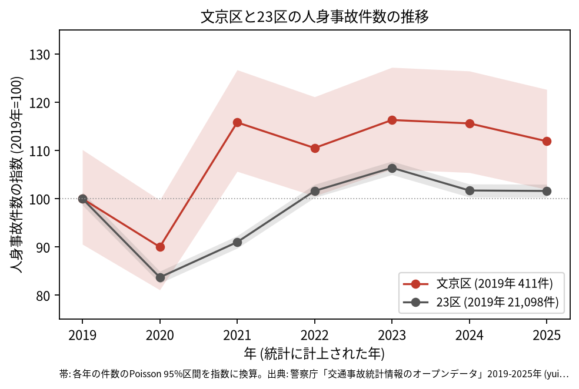
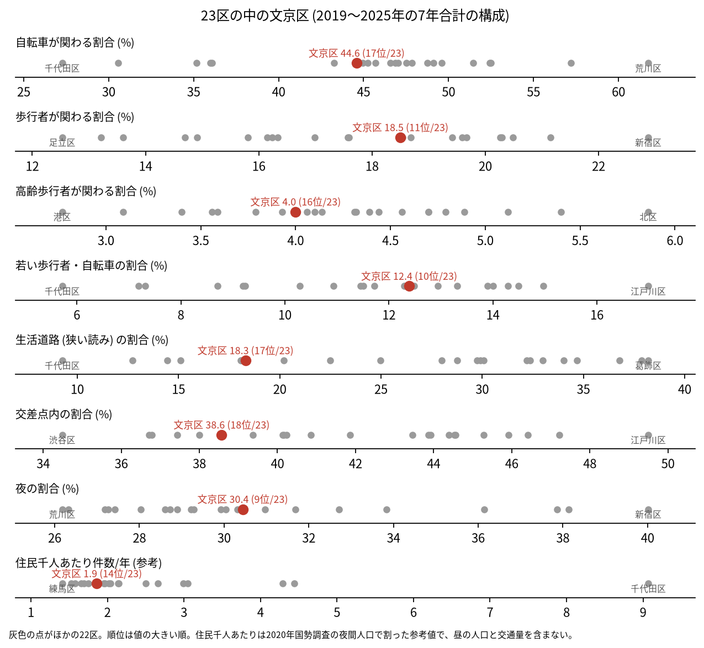
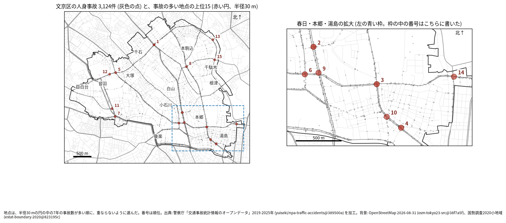
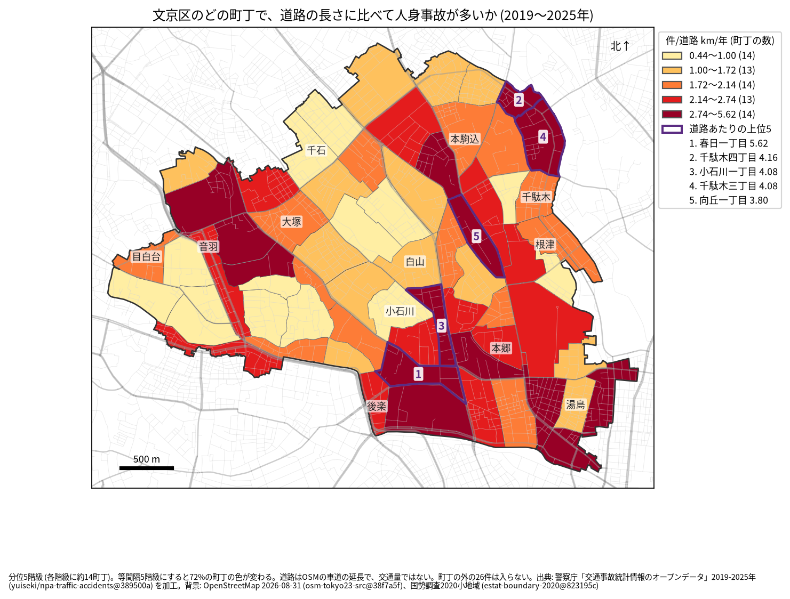
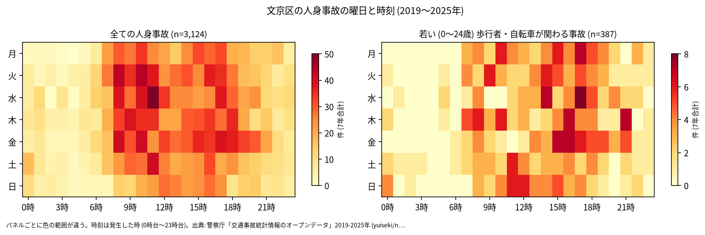
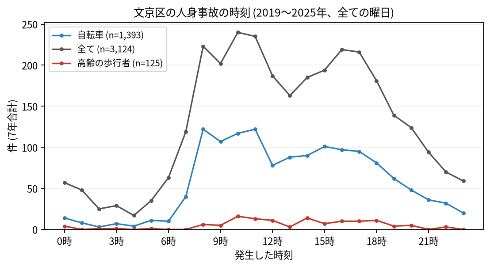
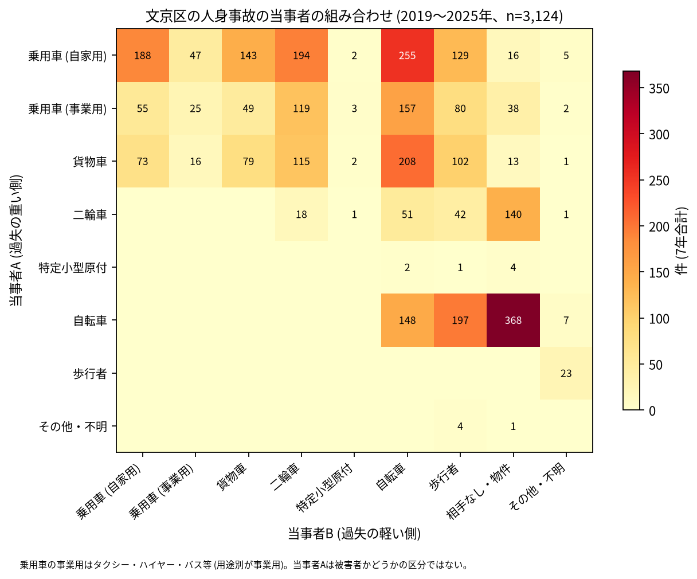

# 文京区の交通事故 2019〜2025 年: 図で読む要点

## 問い

2019〜2025 年の警察記録の人身事故で、文京区の事故はいつ、どこで、誰が関わって起きているか。

## 結論

### 要点

| # | 要点 | 数字 | 図 |
|---:|---|---|---|
| 1 | 件数は 2020 年に減り、2021 年からは 2019 年より上の水準にある。ただし区間が重なり、2019 年より増えたとは言えない | 7 年で 3,124 件、死者 10 人、負傷者 3,395 人。指数 (2019 年=100) は 2020 年 90.0、2025 年 111.9 ([yearly.csv](outputs/yearly.csv)、[summary.txt](outputs/summary.txt)) | [図 1](#図-1-件数の推移) |
| 2 | 事故の構成は 23 区の中ほどで、交差点内と生活道路はどちらも少ない側。若い歩行者と自転車はやや多い側 | 交差点内 38.6% (23 区の 18 位)、生活道路 18.3% (17 位)、若い歩行者・自転車 12.4% (10 位) ([wards.csv](outputs/wards.csv)、[analysis.json](outputs/analysis.json)) | [図 2](#図-2-23-区の中の文京区) |
| 3 | 事故の集まる地点は春日・本郷・湯島と千石の幹線の交差点、道路あたりで多い町丁は春日一丁目と千駄木 | 上位 1 位は不忍通り × 白山通り (千石一丁目、34 件)。道路あたりの 1 位は春日一丁目 (年 5.624 件/道路 km) ([hotspots.csv](outputs/hotspots.csv)、[towns.csv](outputs/towns.csv)) | [図 3](#図-3-事故の集まる地点)、[図 4](#図-4-町丁ごとの事故) |
| 4 | 事故の半分近くに自転車が関わり、最も多い組み合わせは自転車の単独 | 44.6%。自転車 (A) と相手なし・物件の事故が 368 件、車やトラックが当事者 A で自転車が B の事故が 620 件 ([summary.txt](outputs/summary.txt)) | [図 6](#図-6-誰と誰の事故か) |
| 5 | 死亡事故は 10 件で、亡くなった人は二輪車が最も多い | 二輪車 5 人、歩行者 3 人 (3 人とも 65 歳以上)、自転車 2 人。当事者 A が貨物車の事故が 5 件、0〜5 時台が 5 件 ([summary.txt](outputs/summary.txt)) | [表 1](#表-1-死亡事故) |

### 読み手ごとに知るべきこと

| 読み手 | 結論 | 検討する材料 | 詳しく |
|---|---|---|---|
| 区の交通安全担当 | 生活道路の法定速度 30 km/h (2026-09-01 から) が当たるのは事故の 18.3〜29.9% (読み方による)。上位の地点は白山通り、本郷通り、春日通り、不忍通りの交差点 | 幹線の交差点、自転車の単独事故、二輪車の死亡事故 | [municipality.md](reports/municipality.md) |
| 学校と PTA | 若い (0〜24 歳) 歩行者と自転車の事故は 387 件。最も多いのは 17 時台。0〜24 歳には大学生が入る | 学校の円の中で、平日 14〜17 時台の点が並ぶ道 | [school-pta.md](reports/school-pta.md) |
| 道路安全診断 | 上位は不忍通り × 白山通り (34 件)、白山通り (西片一丁目、29 件)、本郷通り × 春日通り (27 件) | 後半に増えた 1〜4 位、春日・本郷・湯島に並ぶ地点 | [road-safety-auditor.md](reports/road-safety-auditor.md) |
| 住民 | 道路あたりで多いのは春日一丁目 (年 5.624 件/道路 km)、千駄木四丁目 (4.164 件)。事故は 8 時台から 17 時台まで多く、10 時台が最多 | 自分の町の色、自転車の単独事故、二輪車 | [resident.md](reports/resident.md) |

### 図 1: 件数の推移

2020 年の落ち込み (90.0) は 23 区全体 (83.7) より浅く、2021 年に 115.8 まで戻った。2025 年の 95% 区間 (418.9〜504.0 件) は 2019 年 (372.2〜452.7 件) と重なるので、増加とは書かない。23 区全体の 2025 年は 101.6 ([yearly.csv](outputs/yearly.csv))。

### 図 2: 23 区の中の文京区

赤い点が文京区。若い歩行者・自転車 (10 位) と夜 (30.4%、9 位) がやや高く、交差点内 (18 位)、生活道路 (17 位)、自転車 (44.6%、17 位)、高齢の歩行者 (4.0%、16 位) が低い側 ([summary.txt](outputs/summary.txt)、[analysis.json](outputs/analysis.json))。住民千人あたり (1.86 件/年、14 位) は昼の人口を含まない参考値 ([wards.csv](outputs/wards.csv))。台東区は交差点内 45.9% で 4 位だった ([台東区の summary.txt](../taito-accident-trends-by-role/outputs/summary.txt)、[台東区の analysis.json](../taito-accident-trends-by-role/outputs/analysis.json))。

### 図 3: 事故の集まる地点

半径 30 m の円の中の 7 年の件数で選んだ上位 15 (17〜34 件)。番号は順位で、春日・本郷・湯島の地点 (2、3、4、6、9、10、14 位) は右の拡大図に番号を書いた ([hotspots-map.json](outputs/hotspots-map.json))。

| 順位 | 近い道路 (OSM) | 町丁 | 件数 | 前半 件/年 | 後半 件/年 |
|---:|---|---|---:|---:|---:|
| 1 | 不忍通り × 白山通り | 千石一丁目 | 34 | 4.33 | 5.25 |
| 2 | 白山通り × 補助第95号線 | 西片一丁目 | 29 | 3.33 | 4.75 |
| 3 | 本郷通り × 春日通り | 本郷二丁目 | 27 | 3.0 | 4.5 |
| 4 | 本郷通り × 蔵前橋通り | 湯島一丁目 | 25 | 2.67 | 4.25 |
| 5 | 春日通り × 不忍通り | 大塚三丁目 | 23 | 4.33 | 2.5 |

前半は 2019〜2021 年、後半は 2022〜2025 年。6〜15 位は [hotspots.csv](outputs/hotspots.csv)。半径を 20 m にすると上位 15 のうち 12 地点、50 m でも 12 地点が残る ([analysis.json](outputs/analysis.json))。

### 図 4: 町丁ごとの事故

町丁の事故数を、OSM の車道の延長と 7 年で割った値。紫の枠が上位 5 (春日一丁目、千駄木四丁目、小石川一丁目、千駄木三丁目、向丘一丁目)。分位と等間隔で 72% の町丁の色が変わるので、色の細かい差は読まない ([town-rate.json](outputs/town-rate.json))。道路の長さは交通量ではない。

### 図 5: いつ起きるか

全体は平日の 8〜17 時台に広く多く、最多は 10 時台 (240 件)。若い歩行者と自転車は 14〜18 時台に寄り、最多は 17 時台 (36 件) ([summary.txt](outputs/summary.txt))。

自転車は 8 時台と 11 時台 (どちらも 122 件)、高齢の歩行者は 10 時台 (16 件) が最多 ([summary.txt](outputs/summary.txt))。

### 図 6: 誰と誰の事故か

最も多いのは自転車 (A) の単独 (相手なし・物件) の 368 件、次が自家用の乗用車 (A) と自転車 (B) の 255 件、貨物車と自転車の 208 件。二輪車の単独 (相手なし・物件) も 140 件ある ([summary.txt](outputs/summary.txt))。当事者 A は過失の重い側で、被害者とは限らない。

### 表 1: 死亡事故

| 亡くなった人 | 人数 | 特徴 |
|---|---:|---|
| 二輪車 | 5 | |
| 歩行者 | 3 | 3 人とも 65 歳以上 |
| 自転車 | 2 | |

10 件のうち 0〜5 時台が 5 件、当事者 A が貨物車の事故が 5 件 ([summary.txt](outputs/summary.txt))。数が少ないので傾向とは断定しない。全件は [deaths.csv](outputs/deaths.csv)。

### 読み方で変わる答え

| 読み方 | 主 | 別の読み方 |
|---|---|---|
| 文京区の事故 | `市区町村コード` 105 の 3,124 件 | 点が区の面に入る事故。両方に当てはまるのは 3,098 件 ([analysis.json](outputs/analysis.json)) |
| 生活道路 | 狭い読み 18.3% (17 位) | 広い読み 29.9% (18 位) ([summary.txt](outputs/summary.txt)) |
| 地点の半径 | 30 m | 20 m で 12 地点、50 m で 12 地点が残る ([analysis.json](outputs/analysis.json)) |
| 町丁の階級 | 分位 5 階級 | 等間隔で 72% の町丁の色が変わる ([town-rate.json](outputs/town-rate.json)) |

## データ

- 人身事故: 警察庁「交通事故統計情報のオープンデータ」を加工した `yuiseki/npa-traffic-accidents` 版 `389500aae5cec45f1311163f70db6a5f05867838` (配布元の取得 2026-10-02) の本票。年はファイルの年 (統計に計上された年)。文京区 3,124 件、23 区 144,716 件。位置の無い行は 0。物損事故は含まない。東京の本票は 2026-11-03 に同じピンで取ったもの (205,541 行) を使った。
- 区の面と人口: `yuiseki/jp-admin-2026-09` 版 `e6c87b1`。町丁: 2020 年国勢調査の小地域 `yuiseki/estat-boundary-2020` 版 `823195c` (68 町丁、240,069 人)。学校 39 校と道路: OpenStreetMap 2026-08-31、`yuiseki/osm-tokyo23-src-2026-08` 版 `38f7a5f`。
- 道具: DuckDB 2.0.0 (spatial)、matplotlib、`analysis-visualize` の `cjk_font.py`、`classify_map.py`、`context_map.py` (2026-11-03)。
- 出典の表示: 警察庁ウェブサイト (https://www.npa.go.jp/publications/statistics/koutsuu/opendata/index_opendata.html) の交通事故統計情報のオープンデータを加工して作成。国勢調査の小地域境界と人口、OpenStreetMap (© OpenStreetMap contributors) を加工して使用。

## 方法

- 読み方は結果を見る前に [計画](EXPERIMENT_PLAN.md) で固定し、実行は [記録](EXPERIMENT_TRACKER.md) に残した。読み方、区画、判断の規則は台東区の分析と同じ。生活道路は `車道幅員` が 01、02、11 (狭い読み)、広い読みは 14、17 を足す。歩行者や自転車が関わるかは当事者 A と B の両方で見て、1 件を 1 回数えた。23 区の順位は、区コード 105 で文京区の行を引いて数えた。
- 距離は EPSG:6677 (メートル) で測った。地点は、半径 30 m の中の件数が最も多い点を中心に選び、その円の事故を除いて次を選ぶ手順を 15 回くり返した。
- 地図は `analysis-visualize` の map-context に合わせ、地名と道路を重ね、凡例を地図の外に置き、強調した単位に番号を付けた。描いた町丁の数 (68) を分析の数と照らし、文字の重なりは 3 枚の地図で 0 件 ([town-rate.json](outputs/town-rate.json))。背景の道路 (OGC:CRS84) と町丁 (JGD2000) の差は、線の幅より小さいとして変換せずに重ねた。
- 関門: 予測と回帰をしないので、評価の分け方と残差の確認は要らない。単位の間の相関を結論にしないので、Moran's I と格子の掃引は省いた。推移は 23 区全体を基準にし、年の件数に Poisson の 95% 区間を付けた。対策の効果は推定していない。
- 結果を見た後に変えたのは図だけ (推移の図の縦軸の範囲と、地図の 12 位の番号の位置)。値と選び方は変えていない。
- 再実行は [README.md](README.md)。数値は [outputs/](outputs/) の CSV、来歴は [analysis.json](outputs/analysis.json)。

## 確かめていないこと

- 交通量、昼の人口、通学と通勤で区に来る人の数で割っていない。幹線の交差点の件数の多さは、人と車の多さかもしれない。
- 位置の精度は分からない。30 m の地点と町丁の境界の近くの事故は、数十 m のずれで入れ替わる。
- 事故の型 (出会い頭、追突)、重傷と軽傷の区別、物損事故、ヒヤリハットは、このデータに無い。
- 0〜24 歳より細かい年齢は無く、小学生だけは数えられない。文京区は大学が多い (外の知識で、この分析では数えていない) ので、若い人の事故に大学生がどれだけ入るかは分からない。
- 地点の上位は 7 年で選び、同じ 7 年で前半と後半を比べたので、後半が下がって見えやすい (平均への回帰)。
