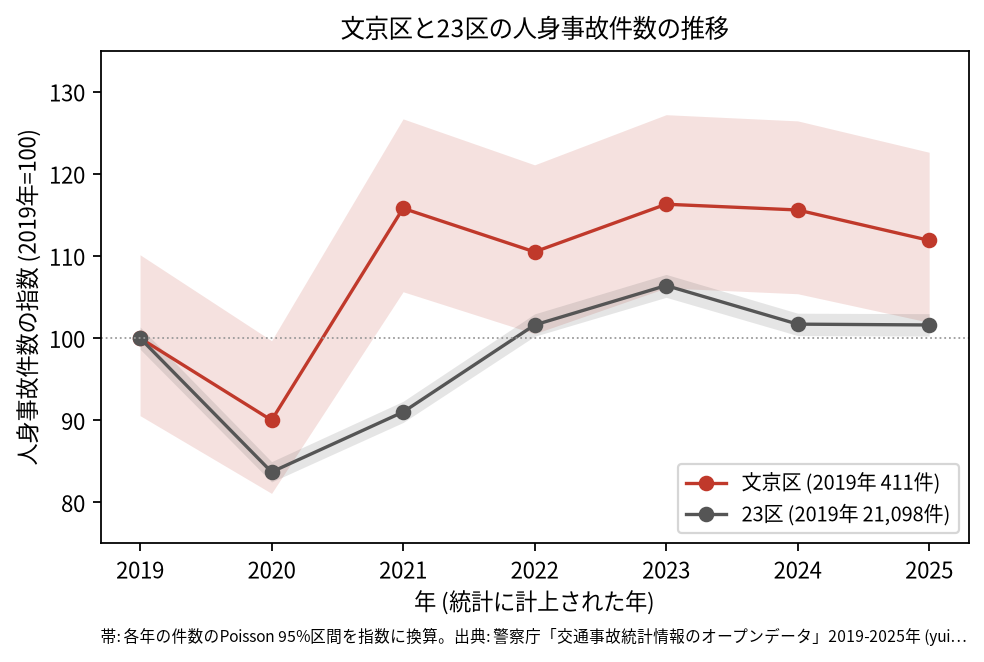
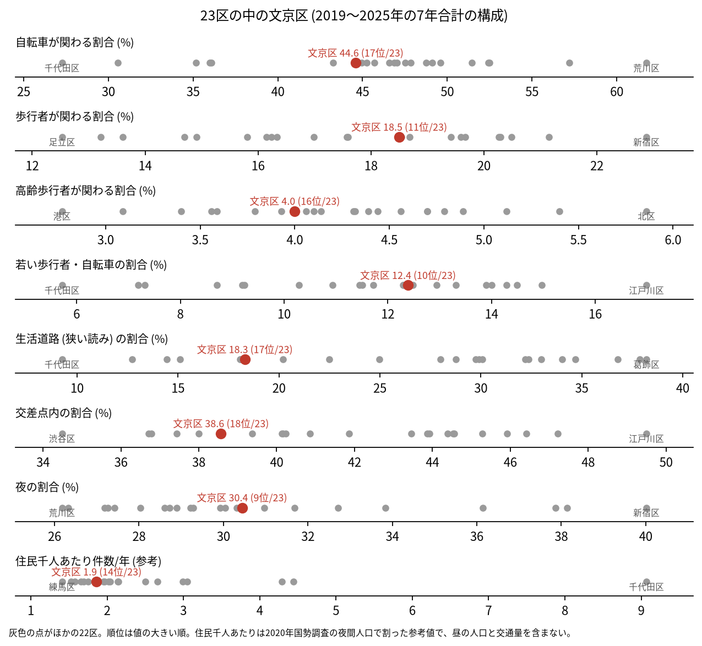
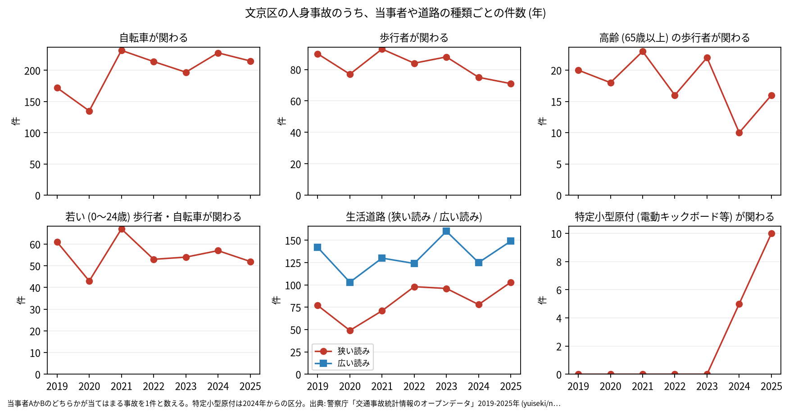

# 区の交通安全担当のための報告: 文京区の交通事故の傾向

## 問い

文京区の人身事故は 2019〜2025 年にどう推移し、23 区の中でどんな特徴があり、施策をどこに向ける材料になるか。

## 結論

- 件数: 7 年で 3,124 件、死者 10 人、負傷者 3,395 人です ([summary.txt](../outputs/summary.txt))。2020 年に 370 件 (2019 年を 100 として 90.0) まで減りましたが、23 区全体 (83.7) ほどは下がりませんでした。2021 年は 476 件 (115.8) で、2025 年は 460 件 (111.9) です。2025 年の 95% 区間 (418.9〜504.0 件) は 2019 年の区間 (372.2〜452.7 件) と重なるので、2019 年より増えたとは言えません ([yearly.csv](../outputs/yearly.csv))。

- 23 区の中の位置: 文京区の事故の構成は、23 区の中ほどにあります。交差点内の割合は 38.6% で 23 区の 18 位、生活道路 (狭い読み) の割合は 18.3% で 17 位、広い読みでは 29.9% で 18 位です。若い歩行者と自転車が関わる割合は 12.4% で 10 位、夜の割合は 30.4% で 9 位とやや高い側です。自転車が関わる割合 (44.6%) は 17 位、高齢の歩行者 (4.0%) は 16 位です ([summary.txt](../outputs/summary.txt)、[analysis.json](../outputs/analysis.json))。

- 施策への読み方: 2026-09-01 からの生活道路の法定速度 30 km/h は、文京区の事故のうち 18.3〜29.9% (読み方による) に当たります ([summary.txt](../outputs/summary.txt))。事故の多い地点の上位は、白山通り、本郷通り、春日通り、不忍通りの交差点です (地点は [道路安全診断の報告](road-safety-auditor.md))。これは効果の予測ではなく、どの道路で事故が起きているかの構成です。
- 区分ごとの推移: 自転車が関わる事故は 2021 年から年 197〜232 件で、2019 年 (172 件) より多い年が続きますが、年ごとの区間はこの報告では検定していません。特定小型原付 (電動キックボードなど) が関わる事故は、区分のできた 2024 年に 5 件、2025 年に 10 件でした ([yearly.csv](../outputs/yearly.csv))。

- 死亡事故: 10 件のうち、亡くなったのは二輪車 5 人、歩行者 3 人、自転車 2 人です。亡くなった歩行者 3 人は 3 人とも 65 歳以上でした。当事者 A (過失の重い側) が貨物車の事故が 5 件、0〜5 時台に起きた事故が 5 件です ([summary.txt](../outputs/summary.txt))。10 件は少なく、偏りを傾向と断定できる数ではありません。

| 年 | 当事者 A | 当事者 B | 亡くなった人 | 時 |
|---|---|---|---|---:|
| 2020 | 貨物車 | 二輪車 (55〜64 歳) | 二輪車 | 12 |
| 2022 | 貨物車 | 二輪車 (45〜54 歳) | 二輪車 | 5 |
| 2023 | 貨物車 | 二輪車 (25〜34 歳) | 二輪車 | 10 |
| 2024 | 乗用車 (事業用) | 二輪車 (0〜24 歳) | 二輪車 | 20 |
| 2024 | 乗用車 (自家用、75 歳以上) | 二輪車 (25〜34 歳) | 二輪車 | 5 |

表は、二輪車の人が亡くなった 5 件の抜き出しです。10 件の全ては [deaths.csv](../outputs/deaths.csv) にあります。

- 人口あたり: 2020 年の住民千人あたりの年の件数は 1.86 件で 23 区の 14 位ですが、分母に昼の人口、通学と通勤で区に来る人、通過する車が入らないため、区の比較の主な指標にしていません ([wards.csv](../outputs/wards.csv))。

## データ

警察庁「交通事故統計情報のオープンデータ」を加工した `yuiseki/npa-traffic-accidents` 版 `389500a` の本票。文京区は `市区町村コード` 105 の 3,124 件、23 区は 144,716 件。年はファイルの年 (統計に計上された年)。区の人口は 2020 年国勢調査 (`jp-admin-2026-09` 版 `e6c87b1`)。詳しくは [共通の報告](../report.md)。

## 方法

区分は、当事者 A か B のどちらかが当てはまる事故を 1 件と数えました。生活道路は `車道幅員` で決め、狭い読み (5.5 m 未満の単路と、小と小の交差点) と、広い読み (5.5 m 未満の道とより広い道の交差点も含む) を並べました。年の区間は件数の Poisson の 95% 区間 (Garwood) です。23 区の順位は 7 年合計の割合の大きい順で、文京区の行は区コード 105 で引きました。読み方と区分は台東区の報告と同じです。

## 確かめていないこと

- 2021 年以降の件数が 2019 年より高い水準にある理由は調べていません。区間が重なるので、記録の揺れで説明できる範囲です。
- 区の施策 (ゾーン 30、自転車の通行帯など) の効果は推定していません。割合の順位は施策の評価ではありません。
- 重傷と軽傷の区別、物損事故は、このデータにありません。
