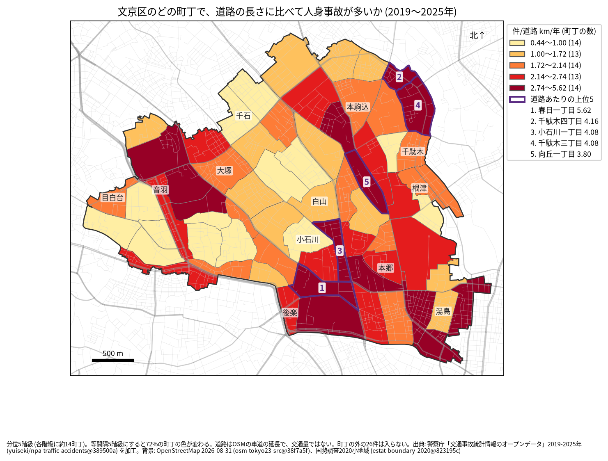
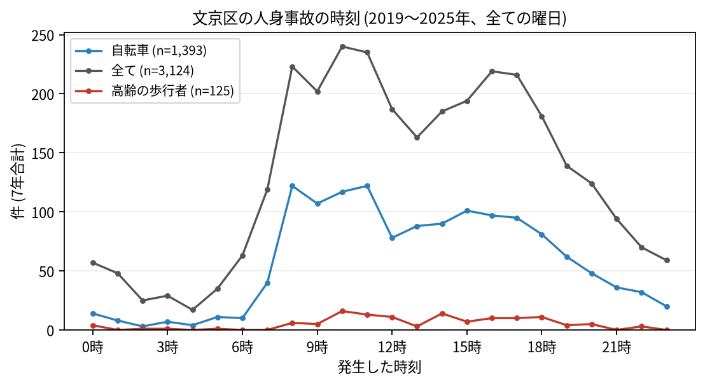

# 住民のための報告: 文京区で、いつ、どこで事故が起きているか

## 問い

文京区に住む人が、自分の町で、いつ、どんな事故に気をつければよいか。2019〜2025 年の警察記録の人身事故から調べました。

## 結論

- 文京区では 7 年で 3,124 件の人身事故があり、10 人が亡くなりました。年に 370〜478 件です ([yearly.csv](../outputs/yearly.csv))。
- 町ごと: 道路 1 km あたりの事故が多いのは、春日一丁目 (年 5.624 件)、千駄木四丁目 (4.164 件)、小石川一丁目 (4.084 件)、千駄木三丁目 (4.081 件)、向丘一丁目 (3.802 件) です。件数そのものが最も多いのは本郷三丁目 (7 年で 126 件) でした ([towns.csv](../outputs/towns.csv))。春日、後楽、本郷、湯島の区の南東と、千駄木、本駒込に色の濃い町が並びます (地図の色から読みました)。

色は分位 5 階級で、各色に 13〜14 の町が入ります。等間隔の階級にすると 72% の町の色が変わるので ([town-rate.json](../outputs/town-rate.json))、色の差より、自分の町が上の階級か下の階級かを見てください。

- 時間: 事故は朝 8 時台から増え、夕方 17 時台まで高い水準が続きます。最も多いのは 10 時台 (240 件) です。自転車が関わる事故は 8 時台と 11 時台 (どちらも 122 件) に多く、高齢の歩行者が関わる事故は 10 時台 (16 件) が最も多い時間でした ([summary.txt](../outputs/summary.txt))。

- 誰が: 自転車が関わる事故が全体の 44.6% で、最も多い区分です。自転車に乗る人は、車やトラックとの事故 (620 件) に加え、自転車だけの事故 (転倒や物への衝突、368 件) にも気をつけてください。自転車だけの事故は、当事者の組み合わせの中で最も多い組です。歩行者が関わる事故は 18.5% です ([summary.txt](../outputs/summary.txt))。
- 亡くなった人: 10 人のうち 5 人が二輪車 (オートバイなど)、3 人が歩行者で、歩行者の 3 人は 3 人とも 65 歳以上でした。死亡事故の 5 件は 0〜5 時台に起きています ([summary.txt](../outputs/summary.txt))。

## データ

警察庁「交通事故統計情報のオープンデータ」を加工した `yuiseki/npa-traffic-accidents` 版 `389500a` の本票、文京区の 3,124 件 (2019〜2025 年のファイル)。町の境界は 2020 年国勢調査の小地域 (68 町丁)、道路は OpenStreetMap 2026-08-31。詳しくは [共通の報告](../report.md)。

## 方法

事故の地点を町丁の境界に入れて数え、町丁の中の車道の長さ (OSM) と 7 年で割りました。区の境界の近くで町丁の外に落ちた 26 件は町の値に入っていません ([analysis.json](../outputs/analysis.json))。時刻は事故の起きた時で、7 年の合計です。

## 確かめていないこと

- 道路の長さは、通る車や人の数ではありません。春日や本郷の値が高いのは、人と車が多いためかもしれません。
- 自分の町の事故が少なくても、物損事故やヒヤリハットはこのデータにありません。
- 事故の位置の精度は分かりません。町の境界の近くの事故は、隣の町に数えられている可能性があります。
