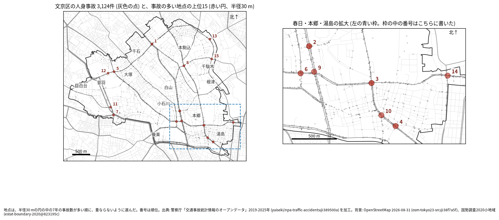
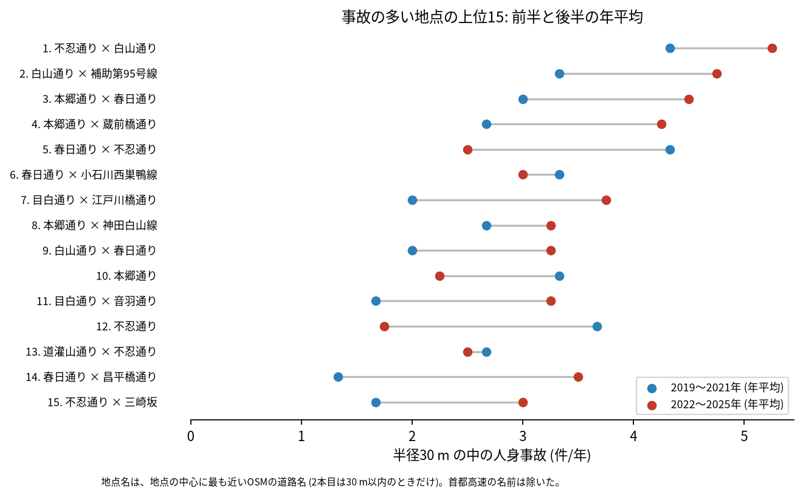
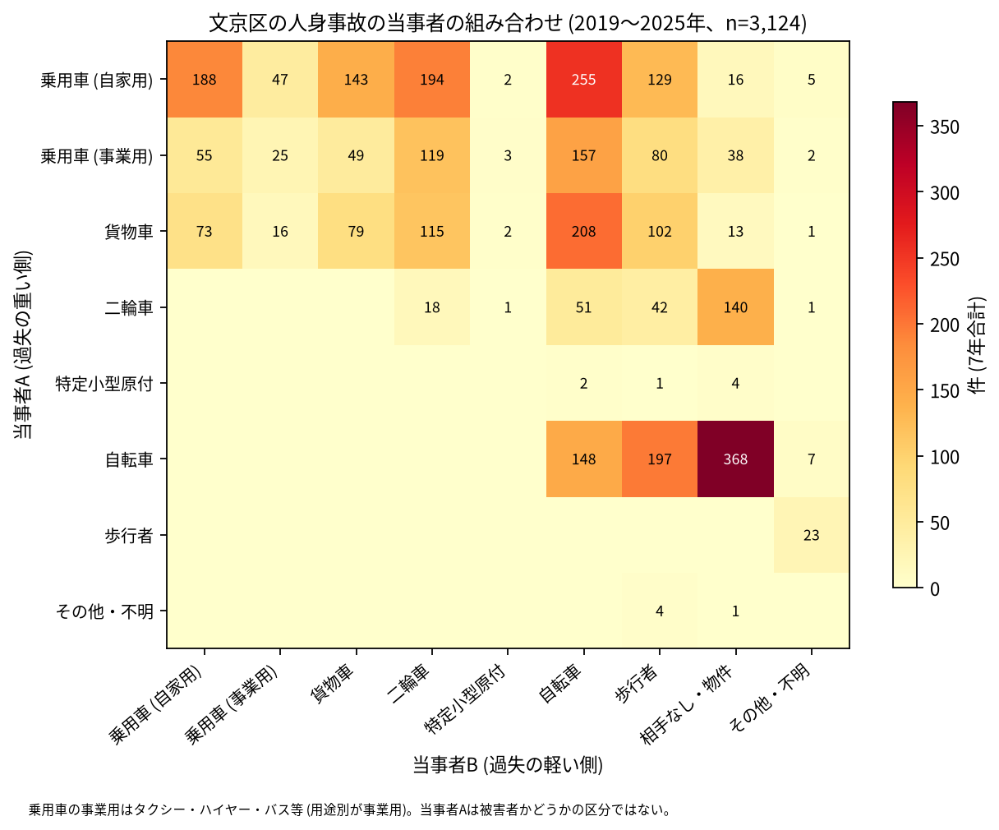

# 道路安全診断のための報告: 文京区で事故の集まる地点

## 問い

文京区で 2019〜2025 年の人身事故が集まる地点はどこで、そこでは誰と誰の事故が多いか。現地診断の候補を選ぶ材料にします。

## 結論

- 半径 30 m の円の中の 7 年の件数で選んだ上位 15 地点は、17〜34 件です。15 のうち 7 は春日、本郷、湯島 (白山通り、本郷通り、春日通りが交わる区の南東) にあり、ほかは千石と大塚 (不忍通り)、関口と音羽 (目白通り)、向丘と千駄木 (本郷通り、不忍通り) です ([hotspots.csv](../outputs/hotspots.csv)、[hotspots-map.json](../outputs/hotspots-map.json))。

| 順位 | 近い道路 (OSM) | 件数 | 前半 件/年 | 後半 件/年 | 交差点内 | 信号あり | 多い組み合わせ (A × B) |
|---:|---|---:|---:|---:|---:|---:|---|
| 1 | 不忍通り × 白山通り | 34 | 4.33 | 5.25 | 33 | 33 | 乗用車 (自家用) × 二輪車 |
| 2 | 白山通り × 補助第95号線 | 29 | 3.33 | 4.75 | 25 | 27 | 貨物車 × 自転車 |
| 3 | 本郷通り × 春日通り | 27 | 3.0 | 4.5 | 21 | 24 | 貨物車 × 乗用車 (自家用) |
| 4 | 本郷通り × 蔵前橋通り | 25 | 2.67 | 4.25 | 23 | 25 | 乗用車 (事業用) × 乗用車 (自家用) |
| 5 | 春日通り × 不忍通り | 23 | 4.33 | 2.5 | 21 | 23 | 乗用車 (自家用) × 自転車 |
| 6 | 春日通り × 小石川西巣鴨線 | 22 | 3.33 | 3.0 | 19 | 19 | 乗用車 (自家用) × 二輪車 |
| 7 | 目白通り × 江戸川橋通り | 21 | 2.0 | 3.75 | 16 | 20 | 乗用車 (事業用) × 自転車 |
| 8 | 本郷通り × 神田白山線 | 21 | 2.67 | 3.25 | 12 | 16 | 乗用車 (自家用) × 自転車 |
| 9 | 白山通り × 春日通り | 19 | 2.0 | 3.25 | 11 | 11 | 乗用車 (自家用) × 乗用車 (自家用) |
| 10 | 本郷通り (本郷三丁目) | 19 | 3.33 | 2.25 | 18 | 18 | 乗用車 (自家用) × 自転車 |

前半は 2019〜2021 年、後半は 2022〜2025 年。11〜15 位と、歩行者、自転車、夜の件数は [hotspots.csv](../outputs/hotspots.csv) にあります。道路名は地点の中心に最も近い OSM の道路名で、2 本目は 30 m 以内のときだけ書きました (首都高速の名前は除いた)。「補助第95号線」「小石川西巣鴨線」「神田白山線」は OSM に付いている名前のままです。多い組み合わせは、最も多い組でも 1 地点で 2〜6 件しかなく、地点ごとの組み合わせの偏りは読めません。

- 続いているか: 上位 15 は全て前半と後半の両方に事故があります。1〜4 位は後半に増え (1 位は 4.33 から 5.25 件/年、4 位は 2.67 から 4.25 件/年)、5 位 (4.33 から 2.5 件/年) と 12 位 (3.67 から 1.75 件/年) は減りました。上位は 7 年合計で選んだので、後半が下がって見えやすい (平均への回帰) ことに注意してください。区全体の件数も 2021 年から 2019 年より高い水準にあるので ([yearly.csv](../outputs/yearly.csv))、地点の後半の増え方は区全体の動きと合わせて読んでください。

- 組み合わせ: 区全体で最も多いのは自転車 (A) の単独 (相手なし・物件) の 368 件です。当事者 A が乗用車か貨物車で B が自転車の事故は 620 件、自転車と歩行者 (自転車が A) が 197 件、自転車どうしが 148 件ありました。二輪車の単独 (相手なし・物件) は 140 件です。事業用の乗用車 (タクシー、ハイヤー、バスなど) は 528 件で当事者 A です ([summary.txt](../outputs/summary.txt))。

- 半径を変えると: 20 m の上位 15 の中心が、30 m の上位 15 の中心から 30 m 以内にあるのは 12 地点、50 m でも 12 地点でした ([analysis.json](../outputs/analysis.json))。上位に入る交差点の多くは、半径を変えても保たれます。

## データ

警察庁「交通事故統計情報のオープンデータ」を加工した `yuiseki/npa-traffic-accidents` 版 `389500a` の本票、文京区 (`市区町村コード` 105) の 3,124 件。道路名は OpenStreetMap 2026-08-31 (`osm-tokyo23-src-2026-08` 版 `38f7a5f`)。詳しくは [共通の報告](../report.md)。

## 方法

事故の点を EPSG:6677 (メートル) に変換し、半径 30 m の円の中の件数が最も多い事故の点を中心に選び、その円の事故を除いて次を選ぶ手順を 15 回くり返しました。30 m はコード表の「交差点付近」(交差点の側端から 30 m 以内) の幅です。信号ありは `信号機` が 3 灯式、押ボタン式、歩車分式の点灯。組み合わせは当事者 A (過失の重い側) と B の種別で、乗用車は `用途別` で事業用と自家用に分けました。

## 確かめていないこと

- 交通量で割っていません。件数の多い交差点が、車の多さに比べて危険かは分かりません。
- 事故の型 (出会い頭、右折、追突)、違反の種類、重傷と軽傷の区別は、このデータにありません。現地で確かめてください。
- 位置の精度は分かりません。数十 m のずれで地点の件数は変わります。春日の 6 位と 9 位は春日通りの上で隣り合っていて (拡大図)、同じ交差点の事故が 2 つの地点に分かれている可能性があります。
- 偶然でもこの程度の集まりが生まれるか (順位の有意さ) は調べていません。
