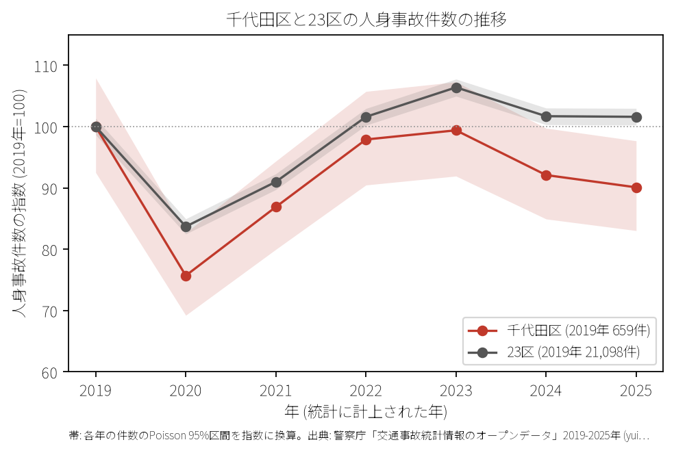
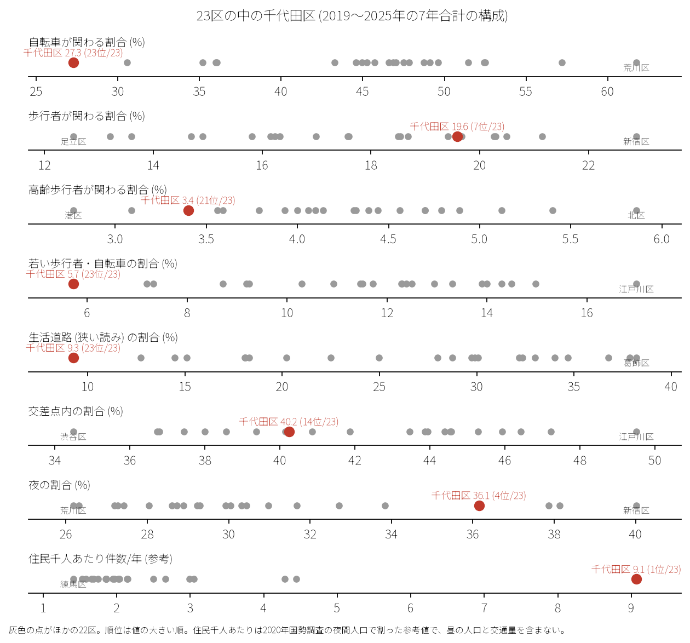
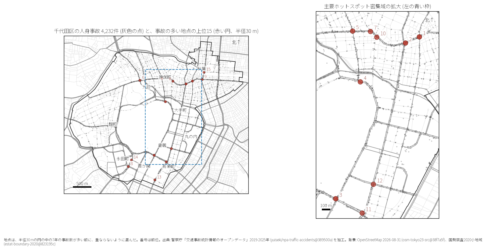
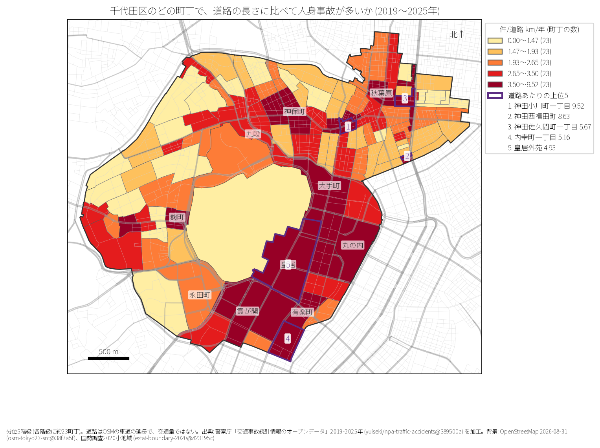
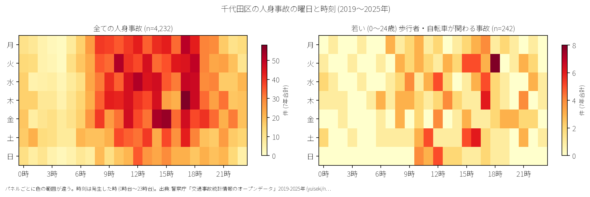
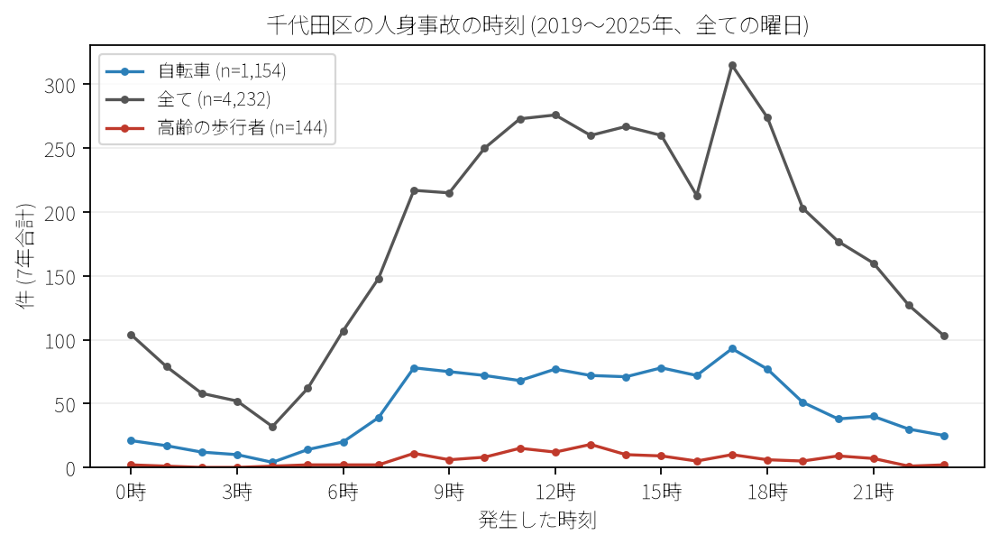
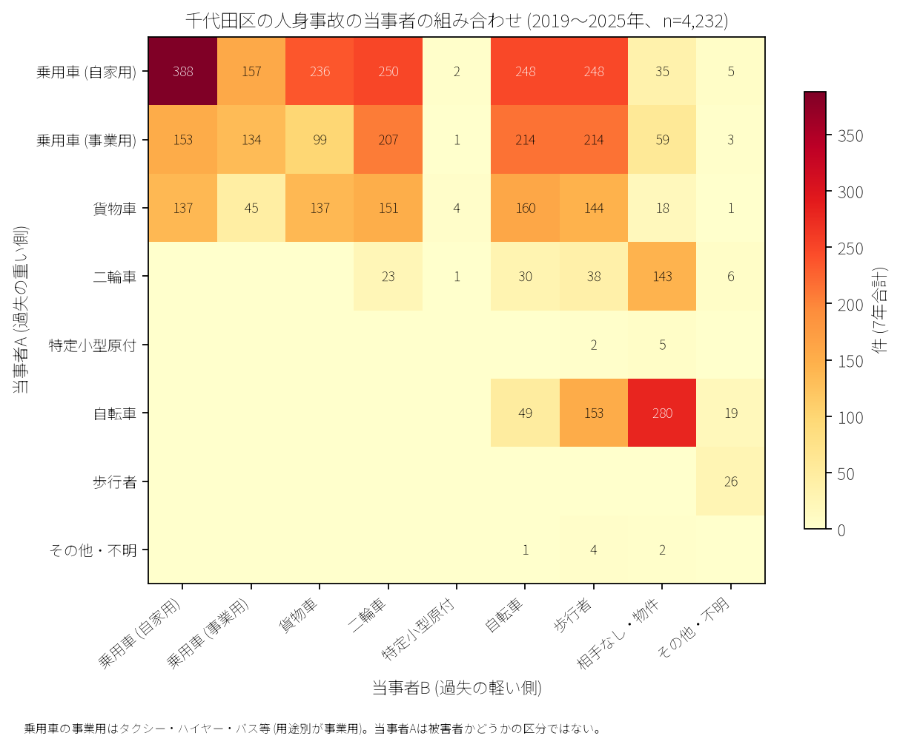

# 千代田区の交通事故 2019〜2025 年: 図で読む要点

## 問い

2019〜2025 年の警察記録の人身事故で、千代田区の事故はいつ、どこで、誰が関わって起きているか。

## 結論

### 要点

| # | 要点 | 数字 | 図 |
|---:|---|---|---|
| 1 | 件数は 2020 年に大きく減少し、その後緩やかに回復傾向 | 7 年で 4,232 件、死者 24 人、負傷者 4853 人。指数 (2019 年=100) は 2020 年 75.7、2025 年 90.1 ([yearly.csv](outputs/yearly.csv)、[summary.txt](outputs/summary.txt)) | [図 1](#図-1-件数の推移) |
| 2 | 住民人口あたり事故率は 23 区で突出して 1 位だが、生活道路・自転車・若年層の割合は最下位 | 住民千人あたり年 9.07 件 (23 区中 1 位)。生活道路事故割合 9.3% (23 位)、自転車関与 27.3% (23 位)、若い歩行者・自転車関与 5.7% (23 位) ([wards.csv](outputs/wards.csv)、[analysis.json](outputs/analysis.json)) | [図 2](#図-2-23-区の中の千代田区) |
| 3 | 集まる場所は靖国通り・内堀通り・白山通り沿いの主要交差点 | 事故多発地点 1 位・2 位は神田小川町一丁目交差点群 (靖国通り×外堀通り/本郷通り、各 32 件)。3 位は霞が関 (祝田橋交差点 31 件) ([hotspots.csv](outputs/hotspots.csv)) | [図 3](#図-3-事故の集まる地点)、[図 4](#図-4-町丁ごとの事故) |
| 4 | 車両相互（自家用乗用車・事業用車・二輪車）および歩行者事故が主体 | 乗用車（自家用）同士が 388 件、自転車単独が 280 件、二輪車との衝突が 250 件、歩行者との衝突が 248 件。台東区と異なり自転車関与割合は半分未満 ([party_matrix.csv](outputs/party_matrix.csv)) | [図 6](#図-6-誰と誰の事故か) |
| 5 | 死亡事故は歩行者と二輪車に集中 | 死者 24 人のうち歩行者 11 人、二輪車乗車中 7 人、自転車 3 人 ([summary.txt](outputs/summary.txt)) | [表 1](#表-1-死亡事故) |

### 読み手ごとに知るべきこと

| 読み手 | 結論 | 検討する材料 | 詳しく |
|---|---|---|---|
| 区の交通安全担当 | 生活道路 30 km/h 規制の対象となる事故は 9.3〜17.3% と極めて少ない。対策の中心は幹線道路交差点での歩行者横断保護と二輪・四輪の交錯防止 | 靖国通り、内堀通り、白山通り、大手町・霞が関・神田地区 | [municipality.md](reports/municipality.md) |
| 学校と PTA | 若い (0〜24 歳) 歩行者・自転車の事故は 242 件と 23 区中最も少ない。平日の登下校時間帯より業務時間帯の一般交通量に注意 | 学校から 500 m 圏内の幹線道路横断歩道 | [school-pta.md](reports/school-pta.md) |
| 道路安全診断 | 上位は靖国通り×外堀通り (32 件)、靖国通り×本郷通り (32 件)、祝田橋交差点 (31 件)。右左折時および横断歩道上での歩車交錯 | 多車線交差点の信号サイクル、右折車線容量、横断歩行者感知 | [road-safety-auditor.md](reports/road-safety-auditor.md) |
| 住民・来訪者 | 道路延長あたり事故率が高いのは神田小川町一丁目 (年 9.52 件/道路 km)、神田西福田町 (8.63 件)、内幸町一丁目 (5.16 件) | 大通り横断時の夜間視認性、平日の昼間・夕方ピーク | [resident.md](reports/resident.md) |

### 図 1: 件数の推移

2020 年はコロナ禍による通勤・来訪自粛の影響で指数 75.7 まで大幅に落ち込みました。2025 年は 594 件（指数 90.1）となり、95% 信頼区間（547〜644 件）は 2019 年（610〜711 件）と下限付近で重なります。

### 図 2: 23 区の中の千代田区

赤い点が千代田区。住民千人あたり年間事故件数は 9.07 件で 23 区中第 1 位ですが、分母は夜間人口 (66680 人) で、区外から通勤・来訪する人の多さは入っていません。住民の少なさが値を押し上げています (昼間人口は分析していない)。一方、生活道路割合 (9.3%)、自転車関与割合 (27.3%)、若い歩行者・自転車割合 (5.7%) はいずれも 23 区中第 23 位 (最下位) となり、広幅員の幹線道路における自動車主体の交通特性が明確に現れています。

### 図 3: 事故の集まる地点

半径 30 m の円でクラスタリングした事故多発地点上位 15 です。

| 順位 | 交差点 / 近い道路 (OSM) | 町丁 | 件数 | 前半 件/年 | 後半 件/年 |
|---:|---|---|---:|---:|---:|
| 1 | 靖国通り × 外堀通り | 神田小川町一丁目 | 32 | 5.33 | 4.00 |
| 2 | 靖国通り × 本郷通り | 神田小川町一丁目 | 32 | 4.67 | 4.50 |
| 3 | 内堀通り × 祝田通り (祝田橋) | 霞が関一丁目 | 31 | 5.33 | 3.75 |
| 4 | 内堀通り × 白山通り | 大手町一丁目 | 28 | 4.67 | 3.50 |
| 5 | 白山通り × 靖国通り (神保町) | 神田神保町一丁目 | 28 | 3.00 | 4.75 |

前半は 2019〜2021 年、後半は 2022〜2025 年。神田小川町・神保町の靖国通り沿い、および大手町・霞が関の内堀通り沿い交差点に集中しています。

### 図 4: 町丁ごとの事故

町丁内の事故件数を OSM 車道延長と 7 年で割った事故密度 (件/道路 km/年) です。上位 5 町丁は神田小川町一丁目 (9.52 件)、神田西福田町 (8.63 件)、神田佐久間町一丁目 (5.67 件)、内幸町一丁目 (5.16 件)、皇居外苑 (4.93 件) となっています。

### 図 5: いつ起きるか

事故は平日の 8 時台から 18 時台の業務時間帯・通勤時間帯に広く分布し、土日の発生件数は平日に比べて顕著に低下します。

1 日の時刻別分布では、夕方 17 時台 (315 件) にピークがあり、夜間帯にも一定数の発生が持続します。

### 図 6: 誰と誰の事故か

自家用乗用車同士の衝突が最多 (388 件) で、自転車単独 (280 件)、乗用車×二輪車 (250 件)、乗用車×歩行者 (248 件) が続きます。

### 表 1: 死亡事故

7 年間で発生した 24 件の死亡事故の内訳：

| 亡くなった当事者 | 人数 | 主な傾向 |
|---|---:|---|
| 歩行者 | 11 | 65 歳以上が 7 人 ([summary.txt](outputs/summary.txt)) |
| 二輪車 (バイク) | 7 | 幹線道路交差点・直線区間での四輪車等との衝突 |
| 自転車 | 3 | 幹線道路での交錯事故 |
| 補充票の人 (同乗者等) | 2 | 四輪車同士等の重傷衝突 |
| 乗用車 (自家用運転者) | 1 | 単独/車両相互衝突 |

## データ

- 人身事故: 警察庁「交通事故統計情報のオープンデータ」を加工した `yuiseki/npa-traffic-accidents` 版 `389500aae5cec45f1311163f70db6a5f05867838` の本票。年はファイルの年。千代田区 4,232 件、23 区 144,716 件。位置の無い行は 0。物損事故は含まない。
- 区の面と人口: `yuiseki/jp-admin-2026-09` 版 `e6c87b1d7095c17422147962185071a986e13135`。町丁: 2020 年国勢調査の小地域 `yuiseki/estat-boundary-2020` 版 `823195c40e1055e2c1b3c0a635369f8c82b6c3fb` (115 町丁、66,680 人)。学校 11 校と道路: OpenStreetMap 2026-08-31、`yuiseki/osm-tokyo23-src-2026-08` 版 `38f7a5f961b6e33343d82a11152e768c37d22664`。
- 道具: DuckDB (spatial)、matplotlib、`analysis-visualize`。

## 方法

- 生活道路は車道幅員 01、02、11 (狭い読み)、広い読みは 14、17 を足す。
- 距離は EPSG:6677 (メートル) で計測。
- 地点は半径 30 m の円の中の件数が多い順に選定。
- 地図は `analysis-visualize` の map-context に準拠。

## 確かめていないこと

- 交通量や昼間滞在人口で割った真の曝露量あたり事故率は計算していない。
- 位置の精度は数十メートルのブレがありうる。
- ヒヤリハットや物損事故は含んでいない。
