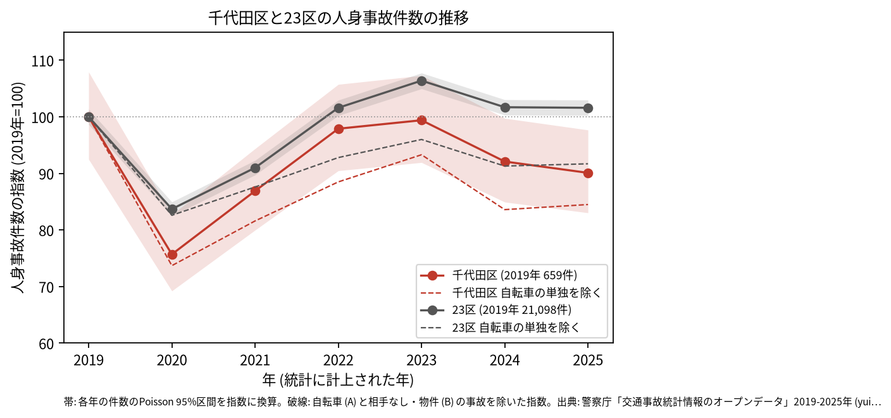
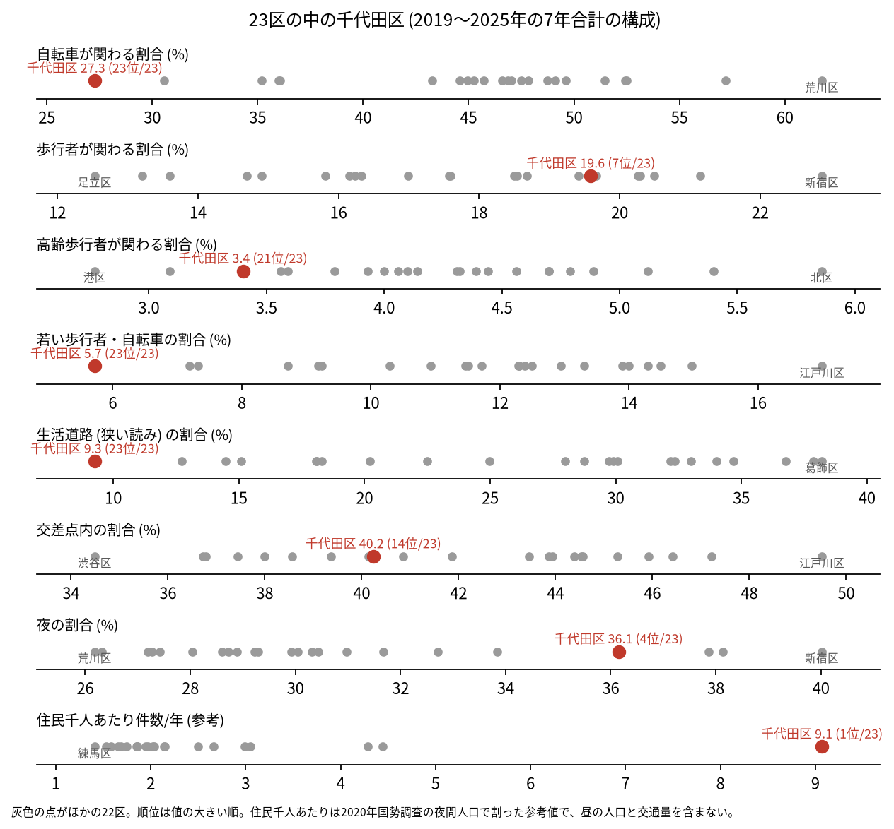
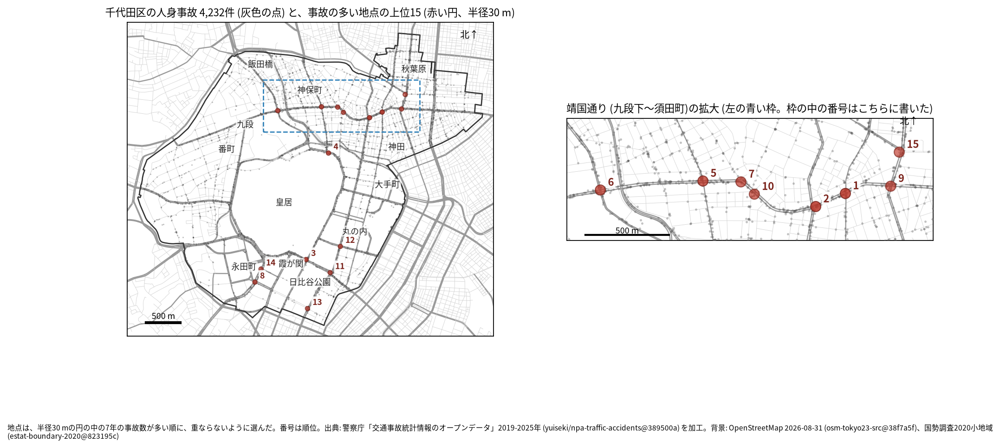
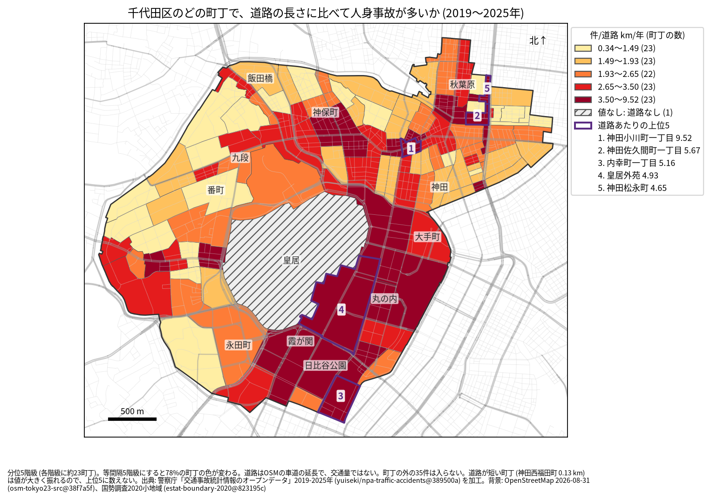
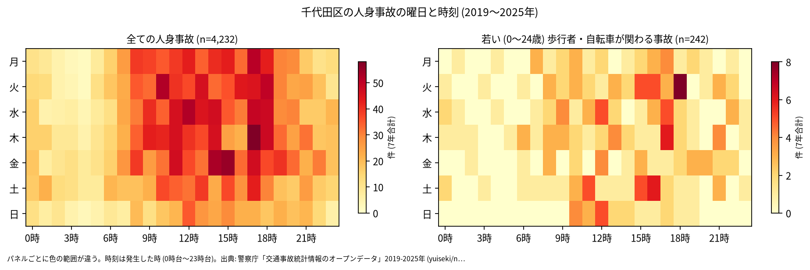
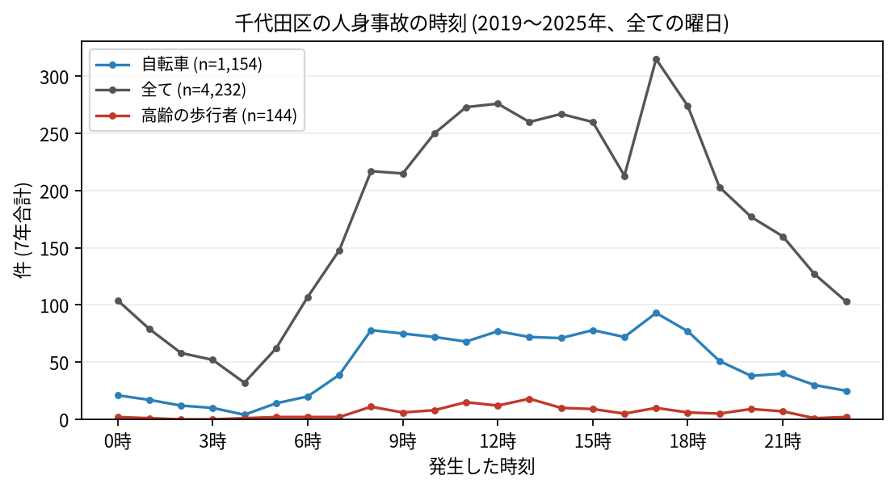
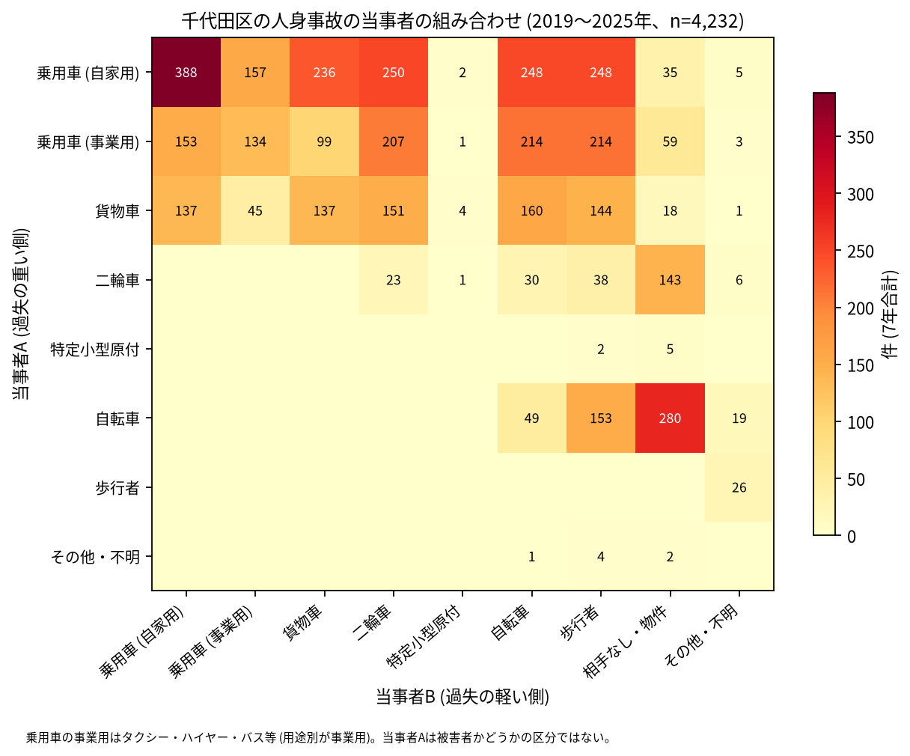

# 千代田区の交通事故 2019〜2025 年: 図で読む要点

## 問い

2019〜2025 年の警察記録の人身事故で、千代田区の事故はいつ、どこで、誰が関わって起きているか。

## 結論

### 要点

| # | 要点 | 数字 | 図 |
|---:|---|---|---|
| 1 | 件数は 2020 年に大きく減り、2023 年にほぼ戻った。2019 年より減ったとは言えない | 7 年で 4,232 件、死者 24 人、負傷者 4,853 人。指数 (2019 年=100) は 2020 年 75.7、2023 年 99.4、2025 年 90.1 ([yearly.csv](outputs/yearly.csv)、[summary.txt](outputs/summary.txt)) | [図 1](#図-1-件数の推移) |
| 2 | 自転車、若い人、生活道路の関わる割合が 23 区で最も低く、夜の割合が高い | 自転車 27.3%、若い歩行者・自転車 5.7%、生活道路 9.3% がどれも 23 位、夜 36.1% が 4 位 ([wards.csv](outputs/wards.csv)、[analysis.json](outputs/analysis.json)) | [図 2](#図-2-23-区の中の千代田区) |
| 3 | 事故の多い地点は靖国通りに並ぶ | 上位 15 地点のうち 8 が靖国通りの九段下〜須田町の拡大図に入り、6 地点は最も近い道が靖国通り ([hotspots-map.json](outputs/hotspots-map.json)、[summary.txt](outputs/summary.txt)) | [図 3](#図-3-事故の集まる地点) |
| 4 | 道路あたりで多いのは神田と、日比谷・皇居外苑 | 上位 5 町丁は神田小川町一丁目 9.52、神田佐久間町一丁目 5.67、内幸町一丁目 5.16、皇居外苑 4.93、神田松永町 4.65 件/道路 km/年 ([towns.csv](outputs/towns.csv)) | [図 4](#図-4-町丁ごとの事故) |
| 5 | 死亡事故は歩行者と二輪車と、夜から夜明けと、貨物車に偏る | 死者 24 人のうち歩行者 11 人 (65 歳以上 7 人)、二輪車 7 人。19〜5 時台が 14 件、当事者 A が貨物車の事故が 10 件 ([summary.txt](outputs/summary.txt)) | [表 1](#表-1-死亡事故) |

### 読み手ごとに知るべきこと

| 読み手 | 結論 | 検討する材料 | 詳しく |
|---|---|---|---|
| 区の交通安全担当 | 生活道路の法定速度 30 km/h (2026-09-01 から) が当たるのは事故の 9.3〜17.3% (読み方による) で、どちらも 23 区で最も低い。件数の多くは靖国通り、内堀通り、日比谷通りなどの幹線 | 幹線の交差点、夜の事故、タクシーなど事業用の車、死亡事故の歩行者と二輪車 | [municipality.md](reports/municipality.md) |
| 学校と PTA | 若い (0〜24 歳) 歩行者と自転車の事故は 242 件。最も多いのは 17 時台 (23 件) | 学校の円の中で、平日の 7〜8 時台と 14〜17 時台の 67 件の点が並ぶ道 | [school-pta.md](reports/school-pta.md) |
| 道路安全診断 | 上位は靖国通り × 外堀通り (32 件)、靖国通り × 本郷通り (32 件)、内堀通り × 祝田通り (31 件)。靖国通りの九段下〜須田町に 8 地点が並ぶ | 後半に増えた 5 位、8 位、10 位。首都高速の高架と地下の事故 250 件 | [road-safety-auditor.md](reports/road-safety-auditor.md) |
| 住民 | 道路あたりで多いのは神田小川町一丁目 (年 9.52 件/道路 km)。事故は 8 時台から 18 時台まで多く、17 時台が最多 (315 件) | 自分の町の色、夜に大通りを渡るとき、自転車の単独事故 | [resident.md](reports/resident.md) |

### 図 1: 件数の推移

2020 年の落ち込み (75.7) は 23 区全体 (83.7) より深い。2023 年は 99.4 まで戻った。2025 年の 95% 区間 (547.2〜643.7 件) は 2019 年 (609.6〜711.3 件) と重なるので、減少とは書かない。

### 図 2: 23 区の中の千代田区

赤い点が千代田区。自転車 (27.3%)、若い歩行者・自転車 (5.7%)、生活道路 (9.3%) がどれも 23 区の 23 位で、夜 (36.1%) は 4 位、歩行者 (19.6%) は 7 位。住民千人あたり (9.07 件/年、1 位) は、分母が 2020 年の住民 66,680 人で、昼の人口を含まない参考値。

### 図 3: 事故の集まる地点

半径 30 m の円の中の 7 年の件数で選んだ上位 15 (21〜32 件)。番号は順位で、靖国通りの 8 地点は右の拡大図に番号を書いた。

| 順位 | 近い道路 (OSM) | 町丁 | 件数 | 前半 件/年 | 後半 件/年 |
|---:|---|---|---:|---:|---:|
| 1 | 靖国通り × 外堀通り | 神田小川町一丁目 | 32 | 5.33 | 4.00 |
| 2 | 靖国通り × 本郷通り | 神田小川町一丁目 | 32 | 4.67 | 4.50 |
| 3 | 内堀通り × 祝田通り | 霞が関一丁目 | 31 | 5.33 | 3.75 |
| 4 | 内堀通り | 大手町一丁目 | 28 | 4.67 | 3.50 |
| 5 | 白山通り × 靖国通り | 神田神保町一丁目 | 28 | 3.00 | 4.75 |

前半は 2019〜2021 年、後半は 2022〜2025 年。半径を 20 m にすると上位 15 のうち 12 地点、50 m では 10 地点が残る。6〜15 位は [hotspots.csv](outputs/hotspots.csv)。

### 図 4: 町丁ごとの事故

町丁の事故数を、OSM の車道の延長と 7 年で割った値。紫の枠が上位 5 (神田小川町一丁目、神田佐久間町一丁目、内幸町一丁目、皇居外苑、神田松永町)。分位と等間隔で 78% の町丁の色が変わるので、色の細かい差は読まない。皇居 (町丁「千代田」) は中に車道が無く、値なし。件数そのものが最も多いのは大手町一丁目 (213 件)。道路の長さは交通量ではない。

### 図 5: いつ起きるか

全体は平日の 8〜18 時台に広く多く、最多は 17 時台 (315 件)。若い歩行者と自転車は件数が少なく (242 件)、最多は 17 時台 (23 件)。

自転車は 17 時台 (93 件)、高齢の歩行者は 13 時台 (18 件) が最多。

### 図 6: 誰と誰の事故か

最も多いのは自家用の乗用車どうし (388 件)、次が自転車の単独 (相手なし・物件) の 280 件、自家用の乗用車 (A) と二輪車 (B) の 250 件。事業用の乗用車 (タクシー、ハイヤー、バスなど) が当事者 A の事故は 1,084 件。当事者 A は過失の重い側で、被害者とは限らない。

### 表 1: 死亡事故

| 亡くなった人 | 人数 | 特徴 |
|---|---:|---|
| 歩行者 | 11 | 65 歳以上が 7 人 |
| 二輪車 | 7 | |
| 自転車 | 3 | |
| 乗用車 (自家用) | 1 | |
| 補充票の人 (当事者 A、B 以外) | 2 | |

24 件のうち 19〜5 時台が 14 件、当事者 A が貨物車の事故が 10 件。数が少ないので傾向とは断定しない。全件は [deaths.csv](outputs/deaths.csv)。

### 読み方で変わる答え

| 読み方 | 主 | 別の読み方 |
|---|---|---|
| 千代田区の事故 | `市区町村コード` 101 の 4,232 件 | 点が区の面に入る事故。両方に当てはまるのは 4,197 件、コードだけ 35 件、面だけ 30 件 ([analysis.json](outputs/analysis.json)、[wards.csv](outputs/wards.csv)) |
| 生活道路 | 狭い読み 9.3% (23 位) | 広い読み 17.3% (23 位) ([wards.csv](outputs/wards.csv)) |
| 件数の推移 (台東区の R019 で型に入った読み) | 全ての人身事故 | 自転車 (A) と相手なし・物件 (B) の事故を除くと、2025 年の指数は千代田区 84.5、23 区 91.7。この事故は千代田区で 2019 年 6 件、2022 年 67 件、2025 年 42 件 ([yearly.csv](outputs/yearly.csv)、[analysis.json](outputs/analysis.json)) |
| 地点の半径 | 30 m | 20 m で 12 地点、50 m で 10 地点が残る ([analysis.json](outputs/analysis.json)) |
| 高速道路の事故 (型の並べる読み) | 含める | 除いても 14 地点が残る。高速道路の事故は区で 251 件 (首都高速 250 件、高速自動車国道 1 件)、上位 15 の円には 14 位の 3 件 ([analysis.json](outputs/analysis.json)、[summary.txt](outputs/summary.txt)) |
| 町丁の階級 | 分位 5 階級 | 等間隔で 78% の町丁の色が変わる ([town-rate-quantile.json](outputs/town-rate-quantile.json)) |

## データ

- 人身事故: 警察庁「交通事故統計情報のオープンデータ」を加工した `yuiseki/npa-traffic-accidents` 版 `389500aae5cec45f1311163f70db6a5f05867838` (配布元の取得 2026-10-02) の本票。年はファイルの年 (統計に計上された年)。千代田区 4,232 件、23 区 144,716 件。位置の無い行は 0。物損事故は含まない。
- 区の面と人口: `yuiseki/jp-admin-2026-09` 版 `e6c87b1`。町丁: 2020 年国勢調査の小地域 `yuiseki/estat-boundary-2020` 版 `823195c` (116 行、KEY_CODE でまとめて 115 町丁、66,680 人)。学校 11 校と道路: OpenStreetMap 2026-08-31、`yuiseki/osm-tokyo23-src-2026-08` 版 `38f7a5f`。
- 道具: DuckDB (spatial、版は [analysis.json](outputs/analysis.json))、matplotlib、`analysis-visualize` の `cjk_font.py`、`classify_map.py`、`context_map.py`。
- 出典の表示: 警察庁ウェブサイト (https://www.npa.go.jp/publications/statistics/koutsuu/opendata/index_opendata.html) の交通事故統計情報のオープンデータを加工して作成。国勢調査の小地域境界と人口、OpenStreetMap (© OpenStreetMap contributors) を加工して使用。

## 方法

- 台東区の分析 ([taito-accident-trends-by-role](../taito-accident-trends-by-role/report.md)) と同じ読み方、区画、判断の規則で流した。読み方は結果を見る前に [計画](EXPERIMENT_PLAN.md) で固定し、実行は [記録](EXPERIMENT_TRACKER.md) に残した。生活道路は `車道幅員` が 01、02、11 (狭い読み)、広い読みは 14、17 を足す。歩行者や自転車が関わるかは当事者 A と B の両方で見て、1 件を 1 回数えた。
- 年齢はデータの年齢層で読む。若い人は 01 (0〜24 歳)、高齢の人は 65 (65〜74 歳) と 75 (75 歳以上)。
- 距離は EPSG:6677 (メートル) で測った。町丁の道路あたりの上位 5 には、道路が 0.5 km より短い町丁を数えない (1 件で値が大きく振れるため。塗りは同じ式。神田西福田町が当たる)。地点は、半径 30 m の中の件数が最も多い点を中心に選び、その円の事故を除いて次を選ぶ手順を 15 回くり返した。地点の名前は、中心に最も近い道と、それと 30 度以上の向きで交わる道のうち最も近い道 (どちらも 30 m 以内のときだけ)。
- 地図は `analysis-visualize` の map-context に合わせ、地名と道路を重ね、凡例を地図の外に置き、強調した単位に番号を付けた。描いた町丁の数 (115) を分析の数と照らし、文字の重なりと、地名や番号が円や学校の印を隠す重なりは、3 枚の地図で 0 件 (地名 3 つの位置を直した後)。背景の道路 (OGC:CRS84) と町丁 (JGD2000) の差は、線の幅より小さいとして変換せずに重ねた。
- 関門: 予測と回帰をしないので、評価の分け方と残差の確認は要らない。単位の間の相関を結論にしないので、Moran's I と格子の掃引は省いた。推移は 23 区全体を基準にし、年の件数に Poisson の 95% 区間を付けた。対策の効果は推定していない。
- 再実行は [README.md](README.md)。数値は [outputs/](outputs/) の CSV、来歴は [analysis.json](outputs/analysis.json)。

## 確かめていないこと

- 交通量、昼の人口、勤め人と来訪者の数で割っていない。丸の内、大手町、霞が関、神田には住民よりはるかに多くの人が通う (外の知識、このデータでは測っていない) ので、住民千人あたりの値と件数の多さは、人と車の多さかもしれない。
- 位置の精度は分からない。30 m の地点と町丁の境界の近くの事故は、数十 m のずれで入れ替わる。首都高速の高架や地下の事故は、平面では下や上の道路の事故と同じ場所に落ちる。
- 事故の型 (出会い頭、追突)、重傷と軽傷の区別、物損事故、ヒヤリハットは、このデータに無い。
- 0〜24 歳より細かい年齢は無く、小学生だけは数えられない。千代田区の若い人の事故には大学生が多く含まれうる (外の知識、確かめていない)。
- 地点の上位は 7 年で選び、同じ 7 年で前半と後半を比べたので、後半が下がって見えやすい (平均への回帰)。
