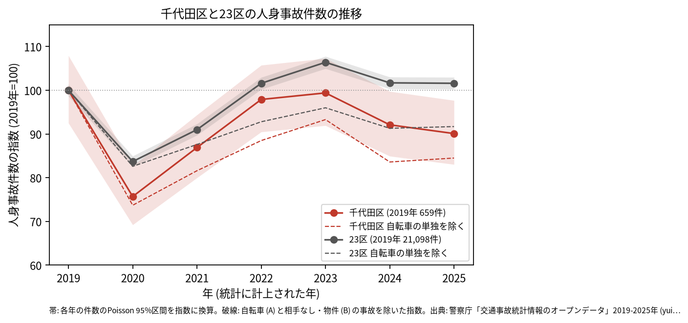
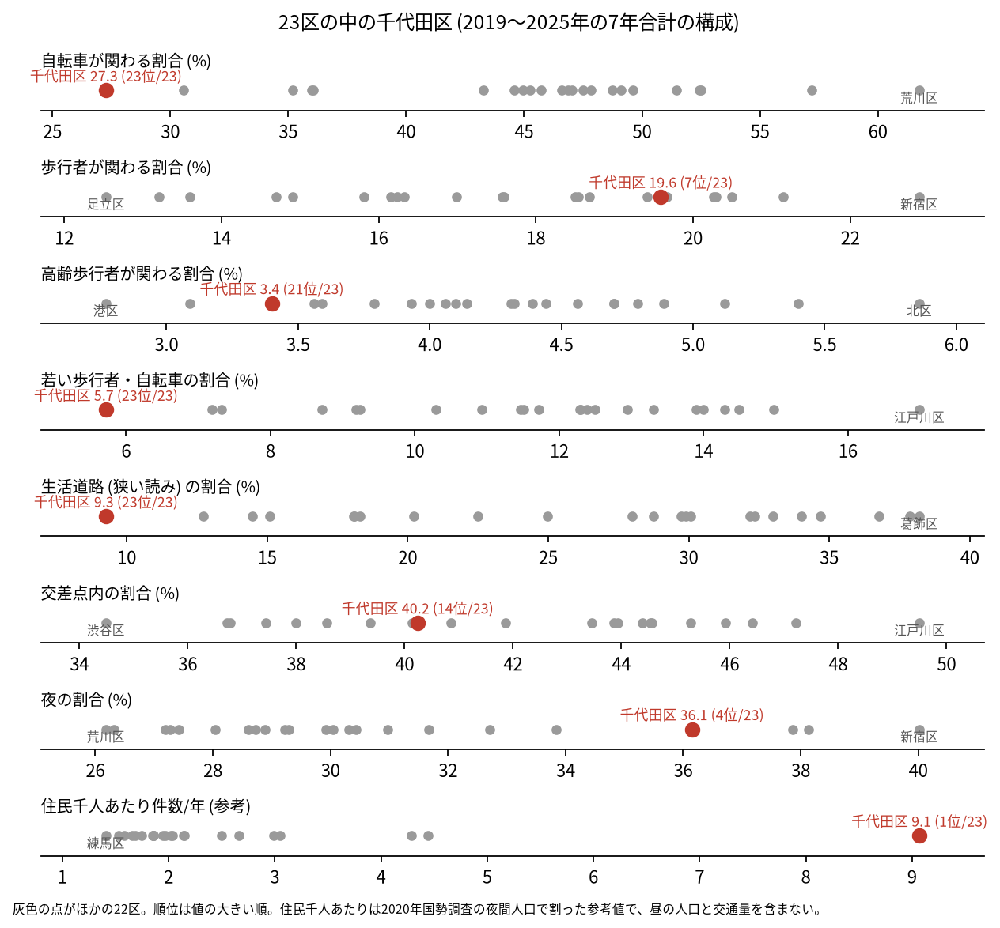
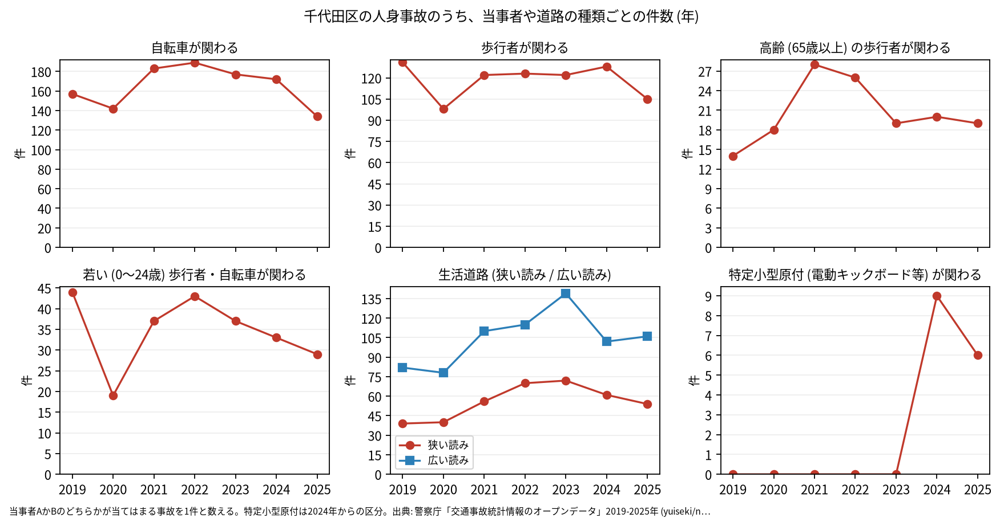

# 区の交通安全担当のための報告: 千代田区の交通事故の傾向

## 問い

千代田区の人身事故は 2019〜2025 年にどう推移し、23 区の中でどんな特徴があり、施策をどこに向ける材料になるか。

## 結論

- 件数: 7 年で 4,232 件、死者 24 人、負傷者 4,853 人です。2020 年に 499 件 (2019 年を 100 として 75.7) まで減り、23 区全体 (83.7) より大きく下がりました。2023 年は 655 件 (99.4) まで戻り、2025 年は 594 件 (90.1) です。2025 年の 95% 区間 (547.2〜643.7 件) は 2019 年の区間 (609.6〜711.3 件) と重なるので、2019 年より減ったとは言えません。

- 23 区の中の位置: 千代田区の事故は、幹線に寄っています。生活道路 (狭い読み) の割合は 9.3% で 23 区の 23 位、広い読みでも 17.3% で 23 位です。自転車が関わる割合 (27.3%) と、若い歩行者と自転車の割合 (5.7%) も 23 位で、高齢の歩行者 (3.4%) は 21 位です。逆に、夜の割合は 36.1% で 4 位、歩行者が関わる割合は 19.6% で 7 位です。交差点内の割合 (40.2%) は 14 位で、23 区の中ほどです。

- 施策への読み方: 2026-09-01 からの生活道路の法定速度 30 km/h は、千代田区の事故のうち 9.3〜17.3% (読み方による) にしか当たりません。千代田区で件数の多くを占めるのは、靖国通り、内堀通り、日比谷通り、国会通りなどの幹線です (地点は [道路安全診断の報告](road-safety-auditor.md))。路線の種類では、主要地方道 (都道) が 1,478 件、区道が 1,150 件、首都高速が 250 件でした。これは効果の予測ではなく、どの道路で事故が起きているかの構成です。
- 区分ごとの推移: 自転車が関わる事故は 2019 年に 157 件、2022 年に 189 件、2025 年に 134 件でした。特定小型原付 (電動キックボードなど) が関わる事故は、区分のできた 2024 年に 9 件、2025 年に 6 件でした。

- 死亡事故: 24 件のうち、亡くなったのは歩行者 11 人、二輪車 7 人、自転車 3 人、乗用車 1 人、補充票の人 (当事者 A と B 以外) 2 人です。亡くなった歩行者 11 人のうち 7 人が 65 歳以上でした。当事者 A (過失の重い側) が貨物車の事故が 10 件、19〜5 時台に起きた事故が 14 件です。24 件は少なく、偏りを傾向と断定できる数ではありません。

| 年 | 当事者 A | 当事者 B | 亡くなった人 | 時 |
|---|---|---|---|---:|
| 2020 | 貨物車 | 歩行者 (75 歳以上) | 歩行者 | 13 |
| 2020 | 貨物車 | 歩行者 (75 歳以上) | 歩行者 | 18 |
| 2022 | 貨物車 | 歩行者 (65〜74 歳) | 歩行者 | 11 |
| 2024 | 貨物車 | 歩行者 (35〜44 歳) | 歩行者 | 0 |
| 2025 | 貨物車 | 歩行者 (75 歳以上) | 歩行者 | 1 |

表は、当事者 A が貨物車で、歩行者が亡くなった 5 件の抜き出しです。24 件 ([summary.txt](../outputs/summary.txt)) の全ては [deaths.csv](../outputs/deaths.csv) にあります。

- 人口あたり: 2020 年の住民千人あたりの年の件数は 9.07 件で 23 区の 1 位ですが、分母の住民は 66,680 人で、昼の人口、勤め人、来訪者、通過する車が入らないため、区の比較の主な指標にしていません。

## データ

警察庁「交通事故統計情報のオープンデータ」を加工した `yuiseki/npa-traffic-accidents` 版 `389500a` の本票。千代田区は `市区町村コード` 101 の 4,232 件、23 区は 144,716 件。年はファイルの年 (統計に計上された年)。区の人口は 2020 年国勢調査 (`jp-admin-2026-09` 版 `e6c87b1`)。詳しくは [共通の報告](../report.md)。

## 方法

区分は、当事者 A か B のどちらかが当てはまる事故を 1 件と数えました。生活道路は `車道幅員` で決め、狭い読み (5.5 m 未満の単路と、小と小の交差点) と、広い読み (5.5 m 未満の道とより広い道の交差点も含む) を並べました。夜は `昼夜` の夜の区分です。年の区間は件数の Poisson の 95% 区間 (Garwood) です。23 区の順位は 7 年合計の割合の大きい順です。

## 確かめていないこと

- 2020 年の減り方が 23 区より大きい理由 (通勤や人出の減少など) は調べていません。
- 自転車や生活道路の割合が低い理由 (道路の幅、自転車の通行量) は調べていません。割合は構成で、自転車の事故が少ないという意味ではありません。
- 区の施策 (ゾーン 30、自転車の通行帯など) の効果は推定していません。割合の順位は施策の評価ではありません。
- 重傷と軽傷の区別、物損事故は、このデータにありません。
