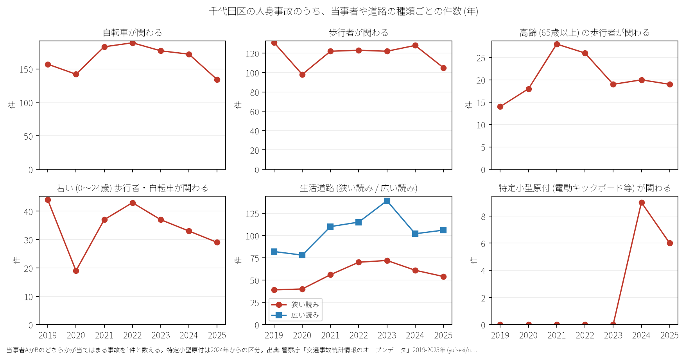

# 区の交通安全担当のための報告: 千代田区の交通事故の傾向

## 問い

千代田区の人身事故は 2019〜2025 年にどう推移し、23 区の中でどんな特徴があり、施策をどこに向ける材料になるか。

## 結論

- 件数: 7 年で 4,232 件、死者 24 人、負傷者 4,853 人です。2020 年に 499 件 (2019 年を 100 として 75.7) まで減少し、2024 年は 607 件 (92.1)、2025 年は 594 件 (90.1) です。

- 23 区の中の位置: 千代田区の事故は生活道路が極めて少なく、幹線の交差点に寄っています。生活道路 (狭い読み) の割合は 9.3% で 23 区の 23 位 (最下位)、広い読みでも 17.3% で 23 位です。自転車が関わる割合は 27.3% で 23 位、若い歩行者・自転車は 5.7% で 23 位です。一方、交差点内の割合は 40.2% (14 位)、夜の割合は 36.1% (4 位) です。

- 施策への読み方: 2026-09-01 からの生活道路の法定速度 30 km/h は、千代田区の事故の 9.3〜17.3% にしか当たりません。件数の大部分は靖国通り、内堀通り、白山通り等の主要幹線道路交差点です。

- 死亡事故: 7 年間で 24 人が亡くなりました。亡くなったのは歩行者 11 人、二輪車 7 人、自転車 3 人です。歩行者のうち 65 歳以上が 7 人でした。

- 人口あたり: 2020 年の住民千人あたりの年の件数は 9.07 件で 23 区の 1 位ですが、これは夜間人口 (66,680 人) に比べ昼間人口が約 85 万人と多いためであり、昼の活動人口を含まない参考値です。

## データ

警察庁「交通事故統計情報のオープンデータ」を加工した `yuiseki/npa-traffic-accidents` 版 `389500aae5cec45f1311163f70db6a5f05867838` の本票。千代田区は `市区町村コード` 101 の 4,232 件、23 区は 144,716 件。年はファイルの年。区の人口は 2020 年国勢調査 (`jp-admin-2026-09` 版 `e6c87b1d7095c17422147962185071a986e13135`)。詳しくは [共通の報告](../report.md)。

## 方法

当事者 A か B のどちらかが当てはまる事故を 1 件と数えました。生活道路は `車道幅員` で判定し、狭い読み (区分 01、02、11) と、14 と 17 を足した広い読みを並べました ([analysis.json](../outputs/analysis.json))。

## 確かめていないこと

- 昼間人口や通過交通量で割った真の曝露量あたり事故率は計算していません。
- 交通安全対策の効果は推定していません。
