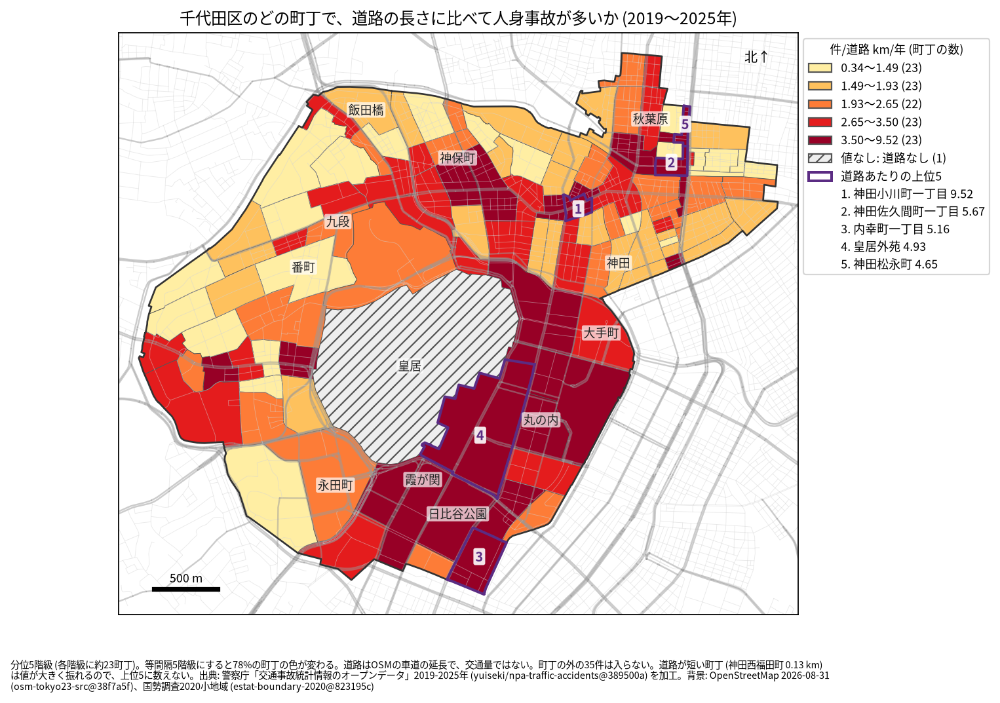
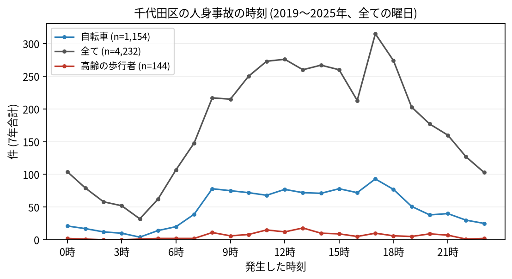

# 住民のための報告: 千代田区で、いつ、どこで事故が起きているか

## 問い

千代田区に住む人が、自分の町で、いつ、どんな事故に気をつければよいか。2019〜2025 年の警察記録の人身事故から調べました。

## 結論

- 千代田区では 7 年で 4,232 件の人身事故があり、24 人が亡くなりました。年に 499〜659 件です。
- 町ごと: 道路 1 km あたりの事故が多いのは、神田小川町一丁目 (年 9.52 件)、神田佐久間町一丁目 (5.67 件)、内幸町一丁目 (5.16 件)、皇居外苑 (4.93 件)、神田松永町 (4.65 件) です。件数そのものが最も多いのは大手町一丁目 (7 年で 213 件) でした。靖国通りに沿う神保町から小川町、秋葉原の周り、皇居の東側の大手町、丸の内、日比谷、霞が関に色の濃い町が並びます。

色は分位 5 階級で、各色に約 23 の町が入ります。等間隔の階級にすると 78% の町の色が変わるので、色の差より、自分の町が上の階級か下の階級かを見てください。皇居 (町丁「千代田」) は中に車道が無いので値がありません。皇居外苑の値は、外苑の中より、縁の道路 (内堀通り、日比谷通りなど) の事故によるとみられます (地点ごとには確かめていません)。

- 時間: 事故は朝 8 時台から増え、夕方 18 時台まで高い水準が続きます。最も多いのは 17 時台 (315 件) です。自転車が関わる事故も 17 時台 (93 件) が最多で、高齢の歩行者が関わる事故は 13 時台 (18 件) が最も多い時間でした。

- 誰が: 歩行者が関わる事故は全体の 19.6%、自転車が関わる事故は 27.3% です。自転車に乗る人は、車やトラックとの事故 (622 件) に加え、自転車だけの事故 (転倒や物への衝突、280 件) にも気をつけてください。
- 亡くなった人: 24 人のうち 11 人が歩行者で、そのうち 7 人が 65 歳以上でした。死亡事故の 14 件は 19〜5 時台に起きています。夜に大通りを渡るときは特に注意が要ります。

## データ

警察庁「交通事故統計情報のオープンデータ」を加工した `yuiseki/npa-traffic-accidents` 版 `389500a` の本票、千代田区の 4,232 件 (2019〜2025 年のファイル)。町の境界は 2020 年国勢調査の小地域 (115 町丁)、道路は OpenStreetMap 2026-08-31。詳しくは [共通の報告](../report.md)。

## 方法

事故の地点を町丁の境界に入れて数え、町丁の中の車道の長さ (OSM) と 7 年で割りました。区の境界の近くで町丁の外に落ちた 35 件は町の値に入っていません。時刻は事故の起きた時で、7 年の合計です。

## 確かめていないこと

- 道路の長さは、通る車や人の数ではありません。大手町や神田の値が高いのは、勤め人や車が多いためかもしれません。
- 自分の町の事故が少なくても、物損事故やヒヤリハットはこのデータにありません。
- 事故の位置の精度は分かりません。町の境界の近くの事故は、隣の町に数えられている可能性があります。首都高速の高架や地下の事故は、その下や上の町に数えられています (towns.csv の `expressway`)。
