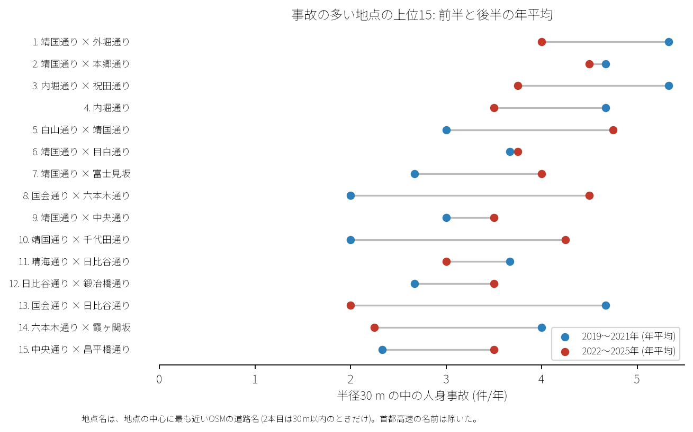

# 道路安全診断のための報告: 千代田区の事故多発地点

## 問い

千代田区で人身事故が集まる交差点や道路はどこで、どんな当事者の間で起きているか。

## 結論

- 上位地点: 半径 30 m の円で選んだ事故多発地点上位 15 のうち、1 位は靖国通り×外堀通り (32 件)、2 位は靖国通り×本郷通り (32 件)、3 位は祝田橋交差点 (31 件) です。

- 推移: 前半 (2019〜2021 年) と後半 (2022〜2025 年) で多くの地点で年平均件数が継続しています。

- 当事者: 自家用乗用車同士 (388 件)、自転車単独 (280 件)、乗用車×二輪車 (250 件) が上位を占めます。

## データ

警察庁「交通事故統計情報」本票 2019〜2025 年、OpenStreetMap 道路データ。詳しくは [共通の報告](../report.md)。

## 方法

EPSG:6677 上で貪欲法により重複しない半径 30 m の円を抽出し、上位 15 地点を特定しました。

## 確かめていないこと

- 各交差点の詳細な交通容量、右折車線長、信号現示時間は含んでいません。
