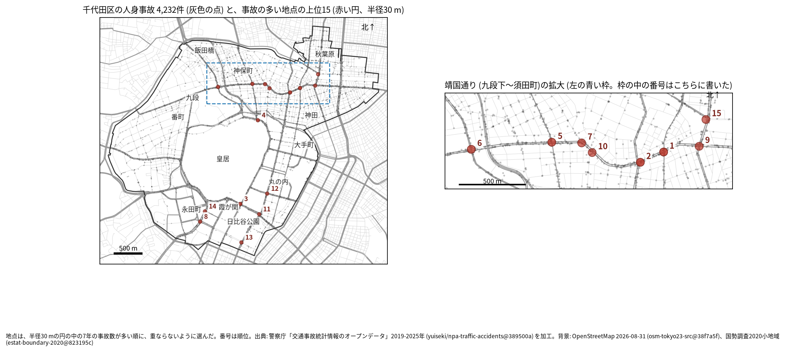
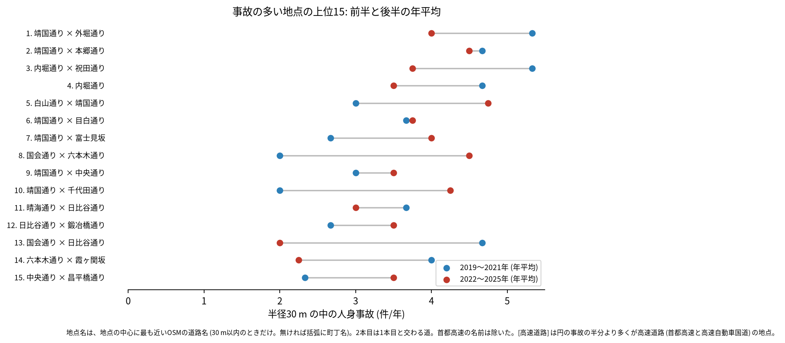
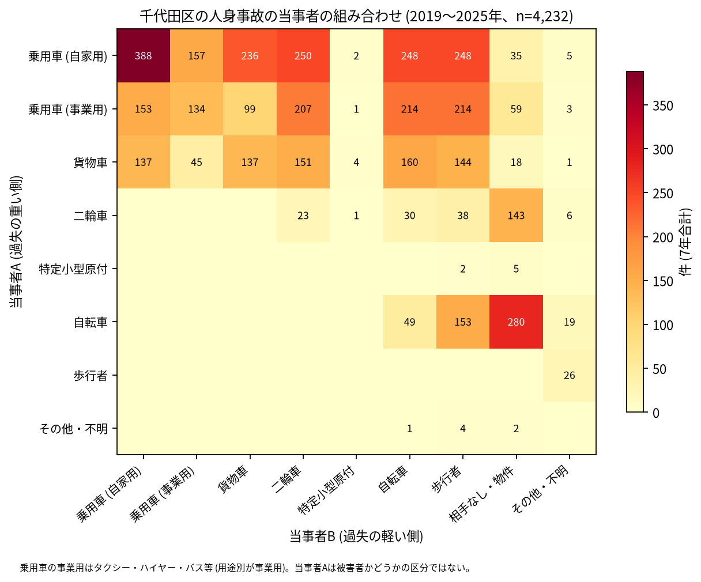

# 道路安全診断のための報告: 千代田区で事故の集まる地点

## 問い

千代田区で 2019〜2025 年の人身事故が集まる地点はどこで、そこでは誰と誰の事故が多いか。現地診断の候補を選ぶ材料にします。

## 結論

- 半径 30 m の円の中の 7 年の件数で選んだ上位 15 地点は、21〜32 件です。15 のうち 8 は靖国通りの九段下から須田町まで (神保町、小川町を通る範囲) にあり、ほかは皇居の東と南 (内堀通り、日比谷通り、晴海通り)、霞が関 (国会通り、六本木通り)、外神田 (中央通り) です。

| 順位 | 近い道路 (OSM) | 件数 | 前半 件/年 | 後半 件/年 | 交差点内 | 信号あり | 多い組み合わせ (A × B) |
|---:|---|---:|---:|---:|---:|---:|---|
| 1 | 靖国通り × 外堀通り | 32 | 5.33 | 4.00 | 30 | 31 | 貨物車 × 歩行者 |
| 2 | 靖国通り × 本郷通り | 32 | 4.67 | 4.50 | 25 | 29 | 乗用車 (自家用) × 自転車 |
| 3 | 内堀通り × 祝田通り | 31 | 5.33 | 3.75 | 25 | 29 | 乗用車 (自家用) × 乗用車 (自家用) |
| 4 | 内堀通り | 28 | 4.67 | 3.50 | 6 | 16 | 乗用車 (自家用) × 乗用車 (事業用) |
| 5 | 白山通り × 靖国通り | 28 | 3.00 | 4.75 | 16 | 23 | 乗用車 (自家用) × 乗用車 (自家用) |
| 6 | 靖国通り × 目白通り | 26 | 3.67 | 3.75 | 14 | 18 | 自転車 × 相手なし・物件 |
| 7 | 靖国通り × 富士見坂 | 24 | 2.67 | 4.00 | 11 | 13 | 二輪車 × 相手なし・物件 |
| 8 | 国会通り × 六本木通り | 24 | 2.00 | 4.50 | 20 | 24 | 乗用車 (自家用) × 乗用車 (自家用) |
| 9 | 靖国通り × 中央通り | 23 | 3.00 | 3.50 | 21 | 22 | 乗用車 (自家用) × 自転車 |
| 10 | 靖国通り × 千代田通り | 23 | 2.00 | 4.25 | 14 | 16 | 乗用車 (事業用) × 自転車 |

前半は 2019〜2021 年、後半は 2022〜2025 年。11〜15 位と、歩行者、自転車、夜の件数は [hotspots.csv](../outputs/hotspots.csv) にあります。道路名は地点の中心に最も近い OSM の道路名 (30 m 以内のときだけ) で、2 本目は 1 本目と交わる向き (30 度以上) の道のうち最も近いもので、30 m 以内のときだけ書きました (首都高速の名前は除いた)。4 位は交わる道が 30 m 以内に無く、28 件のうち交差点内は 6 件です。単路の区間として見てください。

- 続いているか: 上位 15 は全て前半と後半の両方に事故があります。13 位 (4.67 から 2.00 件/年) と 14 位 (4.00 から 2.25 件/年) は後半に減り、8 位 (2.00 から 4.50 件/年)、10 位 (2.00 から 4.25 件/年)、5 位 (3.00 から 4.75 件/年) は増えました。上位は 7 年合計で選んだので、後半が下がって見えやすい (平均への回帰) ことに注意してください。

- 組み合わせ: 区全体で最も多いのは自家用の乗用車どうし (388 件) で、自転車の単独 (相手なし・物件) が 280 件、自家用の乗用車と二輪車が 250 件です。当事者 A が乗用車か貨物車で B が自転車の事故は 622 件でした。事業用の乗用車 (タクシー、ハイヤー、バスなど) は 1,084 件で当事者 A です。上位の地点ごとに最も多い組み合わせでも 3〜10 件 ([hotspots.csv](../outputs/hotspots.csv) の `top_combo_n`) で、地点の性格を決めるほどの数ではありません。

- 半径を変えると: 20 m の上位 15 の中心が、30 m の上位 15 の中心から 30 m 以内にあるのは 12 地点、50 m では 10 地点でした。靖国通りでは 8 地点が近い間隔で並んでいて、半径で隣り合う地点がまとまったり分かれたりします。順位は細かく読まないでください。
- 首都高速: 区の首都高速の事故は 250 件です。上位 15 の円に入る高速道路の事故は 14 位の 3 件だけで、高速道路の事故を除いて選び直しても、上位 15 のうち 14 地点が 30 m 以内に残ります。

## データ

警察庁「交通事故統計情報のオープンデータ」を加工した `yuiseki/npa-traffic-accidents` 版 `389500a` の本票、千代田区 (`市区町村コード` 101) の 4,232 件。道路名は OpenStreetMap 2026-08-31 (`osm-tokyo23-src-2026-08` 版 `38f7a5f`)。詳しくは [共通の報告](../report.md)。

## 方法

事故の点を EPSG:6677 (メートル) に変換し、半径 30 m の円の中の件数が最も多い事故の点を中心に選び、その円の事故を除いて次を選ぶ手順を 15 回くり返しました。30 m はコード表の「交差点付近」(交差点の側端から 30 m 以内) の幅です。信号ありは `信号機` が 3 灯式、押ボタン式、歩車分式の点灯。組み合わせは当事者 A (過失の重い側) と B の種別で、乗用車は `用途別` で事業用と自家用に分けました。高速道路は `路線コード` 4000〜5499 (首都高速と高速自動車国道) です。

## 確かめていないこと

- 交通量で割っていません。件数の多い交差点が、車の多さに比べて危険かは分かりません。
- 事故の型 (出会い頭、右折、追突)、違反の種類、重傷と軽傷の区別は、このデータにありません。現地で確かめてください。
- 位置の精度は分かりません。数十 m のずれで地点の件数は変わります。
- 偶然でもこの程度の集まりが生まれるか (順位の有意さ) は調べていません。
