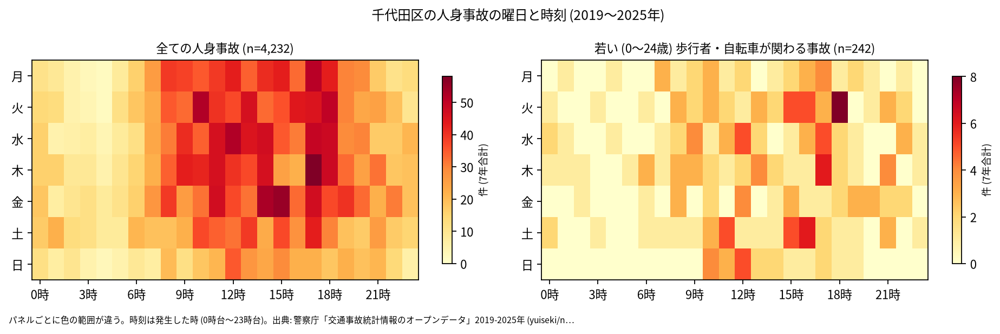
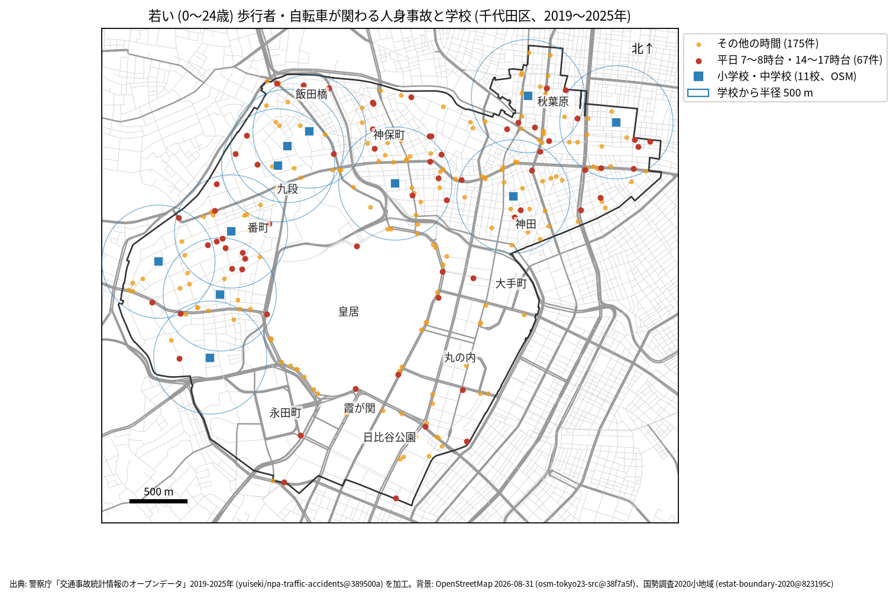

# 学校と PTA のための報告: 学校の周りの若い歩行者と自転車の事故

## 問い

千代田区の学校の周り (半径 500 m) で、若い歩行者と自転車が関わる人身事故は、いつ、どこで起きているか。通学路の合同点検で見る場所と時間を選ぶ材料にします。

## 結論

- このデータで子どもだけを数えることはできません。年齢は年齢層で、最も若い区分が 0〜24 歳です。この報告の「若い」は 0〜24 歳で、大学生や若い社会人を含みます。千代田区には御茶ノ水、神保町、九段に大学が多く (外の知識、確かめていない)、その学生が含まれうることに注意してください。
- 千代田区で、若い歩行者か自転車が関わる人身事故は 7 年で 242 件 (全体の 5.7%、23 区で 23 位) でした。年では 19 件 (2020 年) から 44 件 (2019 年) です。
- 時間: 曜日を問わず多いのは 17 時台 (23 件)、12 時台と 16 時台 (20 件) です。平日 (月〜金) に限ると、17 時台 19 件、18 時台 15 件、12 時台 14 件、16 時台 13 件でした。登校の朝より、昼から夕方の時間帯に多く起きています。

- 場所: 学校から 500 m の円の中の件数が多いのは、神田一橋中学校 31 件、千代田小学校 27 件、昌平小学校 25 件、麹町小学校 24 件、九段小学校 23 件です。円は重なるので、学校ごとの件数は足せません。靖国通りや秋葉原に近い学校は、区全体の事故が多い場所に円がかかるため、件数が大きくなります。

| 学校 (OSM の名前) | 500 m 以内の若い歩行者・自転車 | うち平日 7〜8 時台 | うち平日 14〜17 時台 |
|---|---:|---:|---:|
| 千代田区立神田一橋中学校 | 31 | 0 | 6 |
| 千代田区立 千代田小学校 | 27 | 1 | 4 |
| 千代田区立 昌平小学校 | 25 | 1 | 6 |
| 千代田区立麹町小学校 | 24 | 2 | 8 |
| 千代田区立 九段小学校 | 23 | 2 | 10 |
| 千代田区立 和泉小学校 | 19 | 3 | 3 |

11 校の全ては [schools.csv](../outputs/schools.csv) にあります。

赤い点 (平日の 7〜8 時台と 14〜17 時台、67 件) が、通学の時間に近い事故です。点検では、学校の円の中で赤い点が並ぶ道を、通学路の地図と重ねて見ることを勧めます。番町と麹町の学校の円の中にも赤い点がまとまっています。

- 7 年で、平日の朝 (7〜8 時台) に 1 つの学校の円の中で起きた若い人の事故は 0〜3 件です。件数が少ないので、学校の順位より、点の位置を手がかりにしてください。

## データ

警察庁「交通事故統計情報のオープンデータ」を加工した `yuiseki/npa-traffic-accidents` 版 `389500a` の本票、千代田区の 4,232 件 (2019〜2025 年のファイル)。学校は OpenStreetMap 2026-08-31 (`osm-tokyo23-src-2026-08` 版 `38f7a5f`) の、名前が「小学校」「中学校」で終わる 11 校 (「旧」で始まる閉校した学校は除く。千代田区には無い)。私立の学校 (暁星小学校、白百合学園小学校) を含みます。中等教育学校など、名前が「中学校」で終わらない学校は入っていません。詳しくは [共通の報告](../report.md)。

## 方法

当事者 A か B が歩行者か自転車 (駆動補助機付を含む) で、その同じ当事者の年齢層が 0〜24 歳の事故を数えました。学校の位置は OSM の面の重心 (名前ごとに平均) で、円は直線 500 m (EPSG:6677 で測った) です。時刻は発生した時、平日は月曜から金曜で、祝日は分けていません。

## 確かめていないこと

- 小学生か、通学中かは分かりません。被害者か加害者かも区別していません (当事者 A は過失の重い側)。
- 学校の位置は校門ではなく、500 m は道のりではありません。通学路の線とは重ねていません。
- ヒヤリハットと物損事故は入っていません。点検では、学校が集めている危険な場所の情報と合わせて使ってください。
