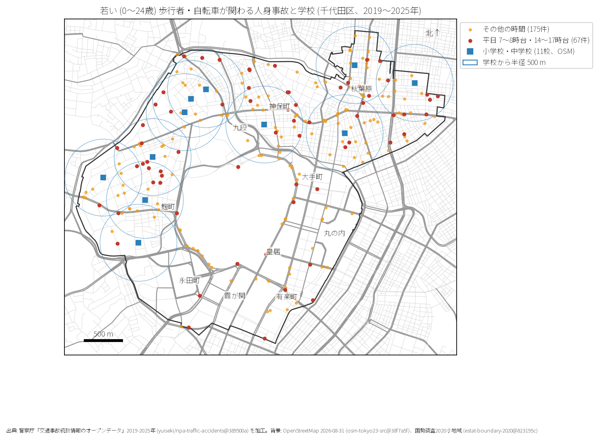

# 学校と PTA のための報告: 千代田区の若い歩行者と自転車の事故

## 問い

千代田区の若い (0〜24 歳) 歩行者と自転車の事故は、いつ、どの学校の周りで起きているか。

## 結論

- 件数: 7 年間で若い歩行者・自転車が関わる事故は 242 件です。23 区全体の中で割合 (5.7%) は最も低く 23 位です。
- 時刻: 最も多いのは 17 時台 (23 件) で、夕方に集中します。登校時間帯の平日 7〜8 時台は 18 件です。
- 学校周辺: 小学校・中学校 11 校の半径 500 m 圏内には 67 件の平日ピーク時事故が含まれます。

## データ

警察庁「交通事故統計情報」本票 2019〜2025 年、OpenStreetMap 2026-08-31 の小中学校 11 校。詳しくは [共通の報告](../report.md)。

## 方法

OSM の学校敷地・地点から直線距離 500 m (EPSG:6677) の円を描き、若年層事故を重ねました。

## 確かめていないこと

- 通学路の指定ルートや児童生徒の実際の通行量は含んでいません。
- 0〜24 歳を一括しており、小学生・中学生単独の抽出はデータ制約上行っていません。
