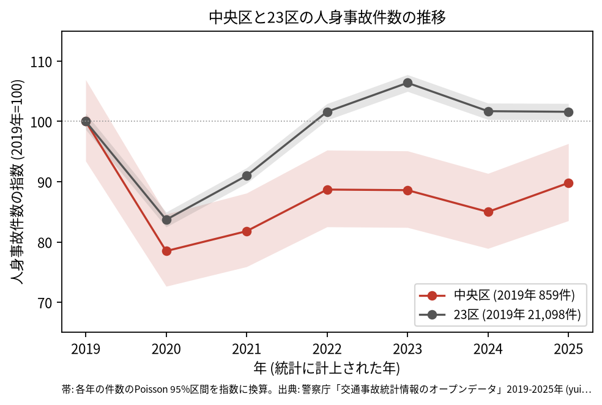
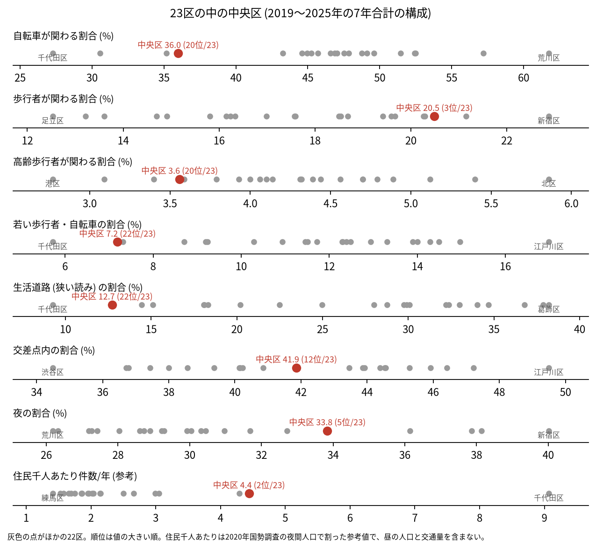
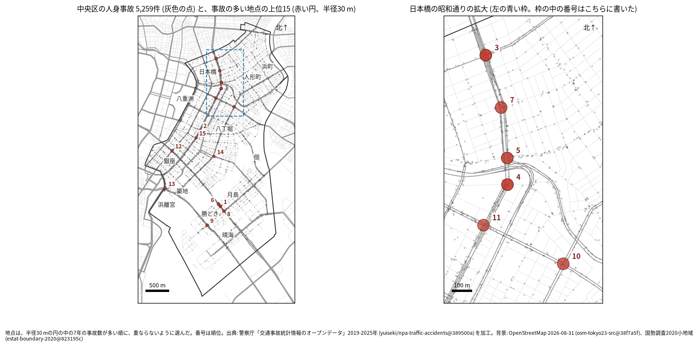
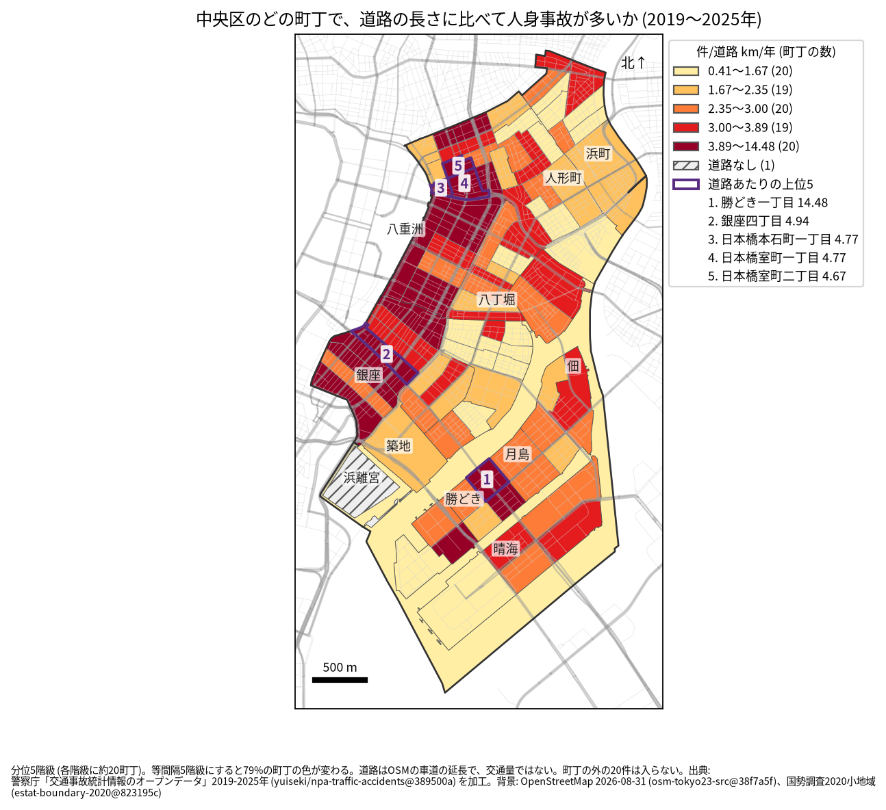
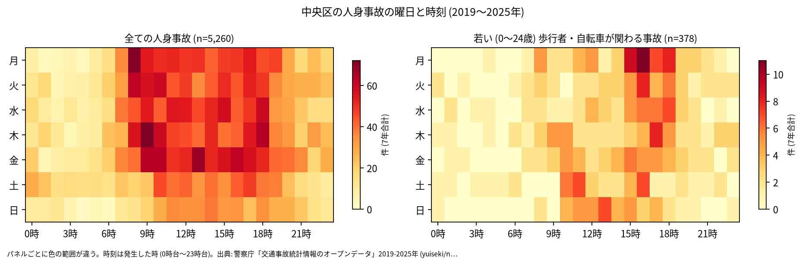
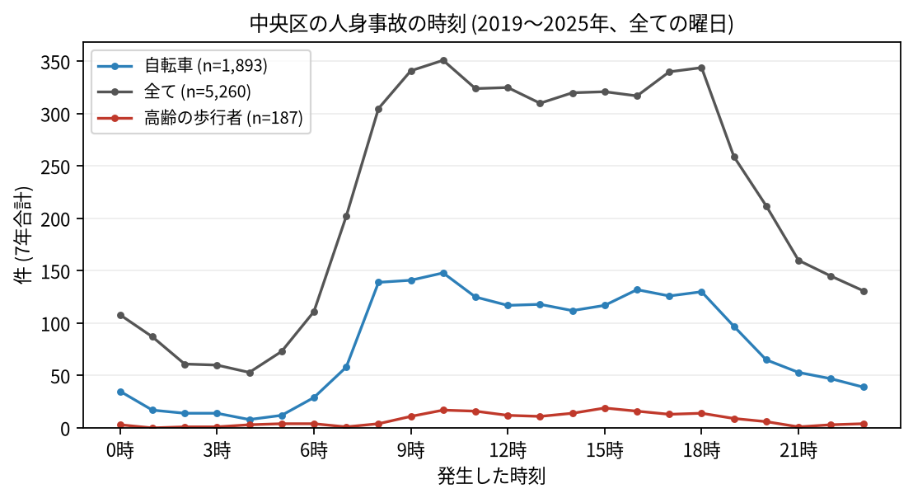
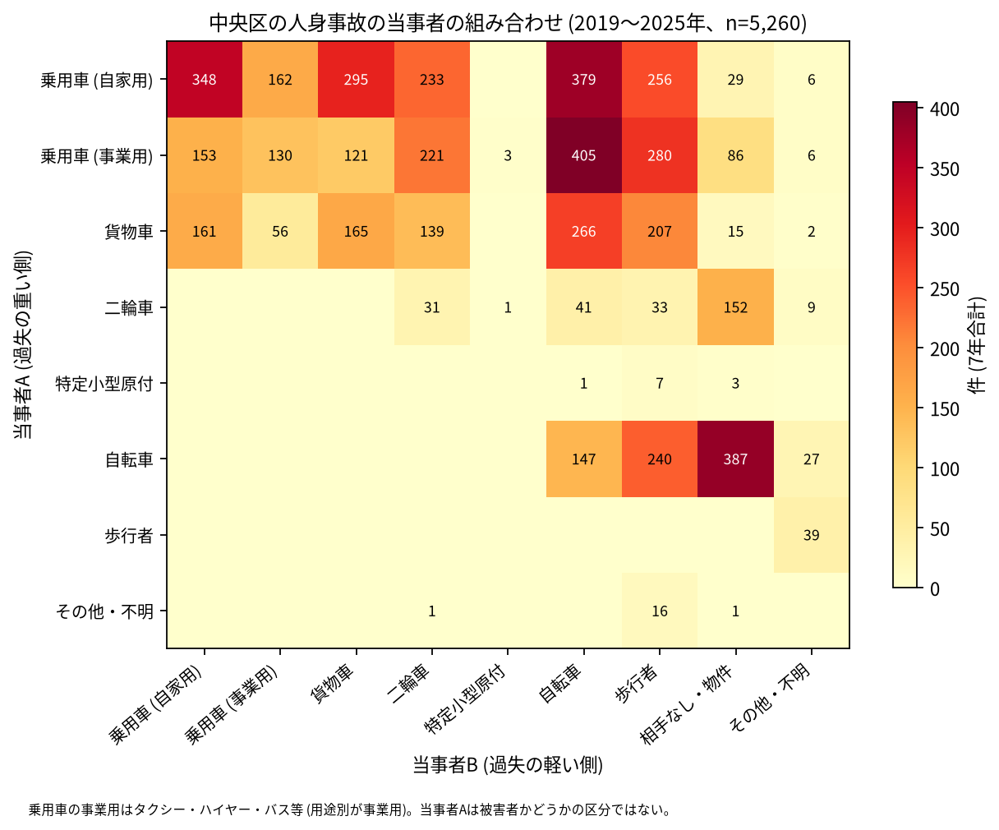

# 中央区の交通事故 2019〜2025 年: 図で読む要点

## 問い

2019〜2025 年の警察記録の人身事故で、中央区の事故はいつ、どこで、誰が関わって起きているか。

## 結論

### 要点

| # | 要点 | 数字 | 図 |
|---:|---|---|---|
| 1 | 件数は 2020、2021、2024 年に 2019 年より少なかった。2022、2023、2025 年は 2019 年と区間が重なり、減ったとは言えない。23 区全体は 2022 年から 2019 年の水準に戻った | 7 年で 5,260 件、死者 15 人、負傷者 5,998 人。指数 (2019 年=100) は 2020 年 78.5、2025 年 89.8。23 区全体の 2025 年は 101.6 ([yearly.csv](outputs/yearly.csv)、[summary.txt](outputs/summary.txt)) | [図 1](#図-1-件数の推移) |
| 2 | 歩行者と夜の事故の割合が高く、生活道路と若い人の割合は低い | 歩行者 20.5% (23 区の 3 位)、夜 33.8% (5 位)、生活道路 12.7% (22 位)、若い歩行者・自転車 7.2% (22 位) ([wards.csv](outputs/wards.csv)、[analysis.json](outputs/analysis.json)) | [図 2](#図-2-23-区の中の中央区) |
| 3 | 集まる場所は日本橋の昭和通りと、勝どきの晴海通り | 事故の多い地点の上位 15 のうち 6 つが日本橋の昭和通りの拡大の範囲、1 位 (40 件) は勝どきの晴海通り × 西仲通り。道路あたりの町丁の 1 位は勝どき一丁目 (年 14.48 件/道路 km) ([hotspots.csv](outputs/hotspots.csv)、[hotspots-map.json](outputs/hotspots-map.json)、[towns.csv](outputs/towns.csv)) | [図 3](#図-3-事故の集まる地点)、[図 4](#図-4-町丁ごとの事故) |
| 4 | 当事者 A で最も多いのは乗用車で、事業用 (タクシーなど) と自転車の組み合わせが最多 | 事業用の乗用車 (A) と自転車 (B) が 405 件、自転車の単独 (相手なし・物件) が 387 件。事業用の乗用車が当事者 A の事故 1,405 件 ([summary.txt](outputs/summary.txt)) | [図 6](#図-6-誰と誰の事故か) |
| 5 | 死亡事故は二輪車と、単独の事故に偏る | 死亡事故 15 件で亡くなったのは二輪車 8 人、歩行者 3 人。当事者 B が相手なし・物件の事故が 7 件、0〜5 時台が 6 件 ([summary.txt](outputs/summary.txt)) | [表 1](#表-1-死亡事故) |

### 読み手ごとに知るべきこと

| 読み手 | 結論 | 検討する材料 | 詳しく |
|---|---|---|---|
| 区の交通安全担当 | 生活道路の法定速度 30 km/h (2026-09-01 から) が当たるのは事故の 12.7〜22.7% (読み方による、23 区の 22 位)。件数の多くは昭和通り、晴海通りなどの幹線 | 幹線の交差点、事業用の乗用車と自転車、二輪車の死亡事故 | [municipality.md](reports/municipality.md) |
| 学校と PTA | 若い (0〜24 歳) 歩行者と自転車の事故は 378 件。最も多いのは 16 時台で、朝より下校から夕方が多い | 月島と勝どきの学校の円の中の晴海通りと清澄通り | [school-pta.md](reports/school-pta.md) |
| 道路安全診断 | 上位は晴海通り × 西仲通り (40 件)、昭和通り × 鍛冶橋通り (39 件)、江戸通り × 昭和通り (37 件)。首都高速の事故を除いても上位 15 は全て残る | 日本橋の昭和通りに並ぶ 6 地点、後半に減った 9 位と 12 位 | [road-safety-auditor.md](reports/road-safety-auditor.md) |
| 住民 | 道路あたりで多いのは勝どき一丁目 (年 14.48 件/道路 km)、銀座四丁目 (4.94 件)。事故は 8 時台から 18 時台まで多く、10 時台が最多 | 自分の町の色、晴海通りを渡るとき、自転車の単独事故 | [resident.md](reports/resident.md) |

### 図 1: 件数の推移

2020 年の落ち込み (78.5) は 23 区全体 (83.7) より深い。2019 年の 95% 区間 (802.5〜918.4 件) と重ならないのは 2020 年 (624.1〜726.9 件)、2021 年 (652.0〜756.9 件)、2024 年 (678.0〜784.9 件) で、この 3 年は減ったと書ける。2022、2023、2025 年 (717.5〜827.4 件) は重なるので、減ったとは書かない。23 区全体は 2022 年に 101.6 まで戻ったが、中央区は 88.7 だった。

### 図 2: 23 区の中の中央区

赤い点が中央区。歩行者 (3 位) と夜 (5 位) が高く、自転車 (36.0%、20 位)、高齢の歩行者 (3.6%、20 位)、生活道路 (22 位)、若い歩行者・自転車 (22 位) が低い。交差点内 (41.9%) は 12 位で中ほど。住民千人あたり (4.44 件/年、2 位) は昼の人口を含まない参考値。比べると、台東区の自転車の割合は 0.4687 ([台東区の wards.csv](../taito-accident-trends-by-role/outputs/wards.csv) の share_bike)。

### 図 3: 事故の集まる地点

半径 30 m の円の中の 7 年の件数で選んだ上位 15 (22〜40 件)。番号は順位で、日本橋の昭和通りの 6 地点 (3、4、5、7、10、11 位) は右の拡大図に番号を書いた。勝どきの 4 地点 (1、6、8、9 位) は本図で番号の位置をずらした。

| 順位 | 近い道路 (OSM) | 町丁 | 件数 | 前半 件/年 | 後半 件/年 |
|---:|---|---|---:|---:|---:|
| 1 | 晴海通り × 西仲通り | 勝どき一丁目 | 40 | 7.00 | 4.75 |
| 2 | 昭和通り × 鍛冶橋通り | 京橋二丁目 | 39 | 5.67 | 5.50 |
| 3 | 江戸通り × 昭和通り | 日本橋本町三丁目 | 37 | 5.00 | 5.50 |
| 4 | 昭和通り | 日本橋一丁目 | 36 | 4.00 | 6.00 |
| 5 | 昭和通り | 日本橋本町一丁目 | 33 | 4.67 | 4.75 |

前半は 2019〜2021 年、後半は 2022〜2025 年。2 本目の道路名は 30 m 以内のときだけ書いた。半径を 20 m にしても 50 m にしても上位 15 のうち 12 地点が残り、首都高速の事故を除くと 15 地点全てが残る。6〜15 位は [hotspots.csv](outputs/hotspots.csv)。

### 図 4: 町丁ごとの事故

町丁の事故数を、OSM の車道の延長と 7 年で割った値。紫の枠が上位 5 (勝どき一丁目、銀座四丁目、日本橋本石町一丁目、日本橋室町一丁目、日本橋室町二丁目)。勝どき一丁目 (14.48) は 2 位の銀座四丁目 (4.94) から大きく離れている。分位と等間隔で 79% の町丁の色が変わるので、色の細かい差は読まない。斜線の浜離宮庭園は道路が無く値なし。月島、勝どき、佃を囲む淡い色の面は水面調査区 (川と海の面) で、橋の上などの 86 件が入る。道路の長さは交通量ではない。

### 図 5: いつ起きるか

全体は平日の 8〜18 時台に広く多い。若い歩行者と自転車は 15〜18 時台に寄り、最多は 16 時台 (44 件)。

全体は 10 時台 (351 件) と 18 時台 (344 件)、自転車は 10 時台 (148 件)、高齢の歩行者は 15 時台 (19 件) が最多。

### 図 6: 誰と誰の事故か

最も多いのは事業用の乗用車 (A) と自転車 (B) の 405 件、次が自転車の単独 (相手なし・物件) の 387 件、自家用の乗用車と自転車の 379 件。事業用の乗用車と歩行者は 280 件。当事者 A は過失の重い側で、被害者とは限らない。

### 表 1: 死亡事故

| 亡くなった人 | 人数 | 特徴 |
|---|---:|---|
| 二輪車 | 8 | |
| 歩行者 | 3 | 65 歳以上が 1 人 |
| 乗用車 (自家用) | 2 | |
| 貨物車 | 1 | |
| その他・不明 | 1 | |

15 件のうち、当事者 B が相手なし・物件 (単独の事故) が 7 件、0〜5 時台が 6 件、19〜5 時台が 9 件。数が少ないので傾向とは断定しない。全件は [deaths.csv](outputs/deaths.csv)。

### 読み方で変わる答え

| 読み方 | 主 | 別の読み方 |
|---|---|---|
| 中央区の事故 | `市区町村コード` 102 の 5,260 件 | 点が区の面に入る事故。両方に当てはまるのは 5,239 件 |
| 生活道路 | 狭い読み 12.7% (22 位) | 広い読み 22.7% (22 位) |
| 地点の半径 | 30 m | 20 m で 12 地点、50 m で 12 地点が残る |
| 地点の首都高速 | 全ての事故 | 首都高速の 295 件を除くと 15 地点全てが残る |
| 町丁の階級 | 分位 5 階級 | 等間隔で 79% の町丁の色が変わる |

## データ

- 人身事故: 警察庁「交通事故統計情報のオープンデータ」を加工した `yuiseki/npa-traffic-accidents` 版 `389500aae5cec45f1311163f70db6a5f05867838` (配布元の取得 2026-10-02) の本票。年はファイルの年 (統計に計上された年)。中央区 5,260 件、23 区 144,716 件。位置の無い行は 1 件で、地図と町丁と地点は位置のある 5,259 件で数えた。物損事故は含まない。
- 区の面と人口: `yuiseki/jp-admin-2026-09` 版 `e6c87b1`。町丁: 2020 年国勢調査の小地域 `yuiseki/estat-boundary-2020` 版 `823195c` (101 行を KEY_CODE でまとめた 99 町丁、169,179 人)。学校 21 校と道路: OpenStreetMap 2026-08-31、`yuiseki/osm-tokyo23-src-2026-08` 版 `38f7a5f`。
- 道具: DuckDB 2.0.0 (spatial)、matplotlib、`analysis-visualize` の `cjk_font.py`、`classify_map.py`、`context_map.py`。実行は 2026-11-03。
- 出典の表示: 警察庁ウェブサイト (https://www.npa.go.jp/publications/statistics/koutsuu/opendata/index_opendata.html) の交通事故統計情報のオープンデータを加工して作成。国勢調査の小地域境界と人口、OpenStreetMap (© OpenStreetMap contributors) を加工して使用。

## 方法

- 型は台東区の分析 ([taito-accident-trends-by-role](../taito-accident-trends-by-role/README.md)) と同じ。読み方は結果を見る前に [計画](EXPERIMENT_PLAN.md) で固定し、実行は [記録](EXPERIMENT_TRACKER.md) に残した。生活道路は `車道幅員` が 01、02、11 (狭い読み)、広い読みは 14、17 を足す。歩行者や自転車が関わるかは当事者 A と B の両方で見て、1 件を 1 回数えた。
- 距離は EPSG:6677 (メートル) で測った。地点は、半径 30 m の中の件数が最も多い点を中心に選び、その円の事故を除いて次を選ぶ手順を 15 回くり返した。中央区で足した読みとして、首都高速 (`路線コード` 5000〜5499) の事故を除いて同じ手順で選び、主の上位 15 の中心から 30 m 以内に残る数を数えた (渋谷区の計画と同じ形)。
- 地図は `analysis-visualize` の map-context に合わせ、地名と道路を重ね、凡例を地図の外に置き、強調した単位に番号を付けた。描いた町丁の数 (99) を分析の数と照らし、文字の重なりと、地名が円や学校の印を隠す重なりは、3 枚の地図で 0 件。町丁は穴を残して塗った (水面調査区が月島、勝どき、佃を囲むため)。背景の道路 (OGC:CRS84) と町丁 (JGD2000) の差は、線の幅より小さいとして変換せずに重ねた。
- 関門: 予測と回帰をしないので、評価の分け方と残差の確認は要らない。単位の間の相関を結論にしないので、Moran's I と格子の掃引は省いた。推移は 23 区全体を基準にし、年の件数に Poisson の 95% 区間を付けた。対策の効果は推定していない。
- 再実行は [README.md](README.md)。数値は [outputs/](outputs/) の CSV、来歴は [analysis.json](outputs/analysis.json)。

## 確かめていないこと

- 交通量、昼の人口、来訪者の数で割っていない。日本橋、銀座、勝どきの件数の多さは、人と車の多さかもしれない。住民千人あたりの 2 位は、住民より多い勤め人と買い物客を分母に含まない (外の知識で、このデータでは測れない)。
- 2020 年の国勢調査の後の住民の増減 (晴海など) は分母に入れていない。町丁の値の分母は道路の長さで、人口は使っていない。
- 位置の精度は分からない。30 m の地点と町丁の境界の近くの事故は、数十 m のずれで入れ替わる。橋の上の事故は水面調査区に入る。
- 事故の型 (出会い頭、追突)、重傷と軽傷の区別、物損事故、ヒヤリハットは、このデータに無い。
- 0〜24 歳より細かい年齢は無く、小学生だけは数えられない。
- 地点の上位は 7 年で選び、同じ 7 年で前半と後半を比べたので、後半が下がって見えやすい (平均への回帰)。
