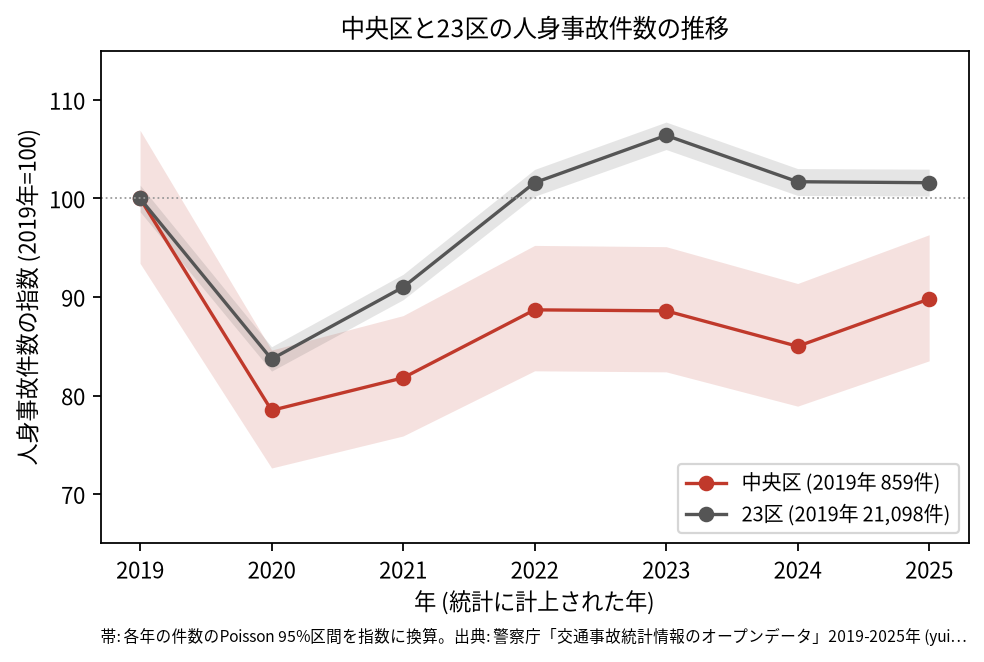
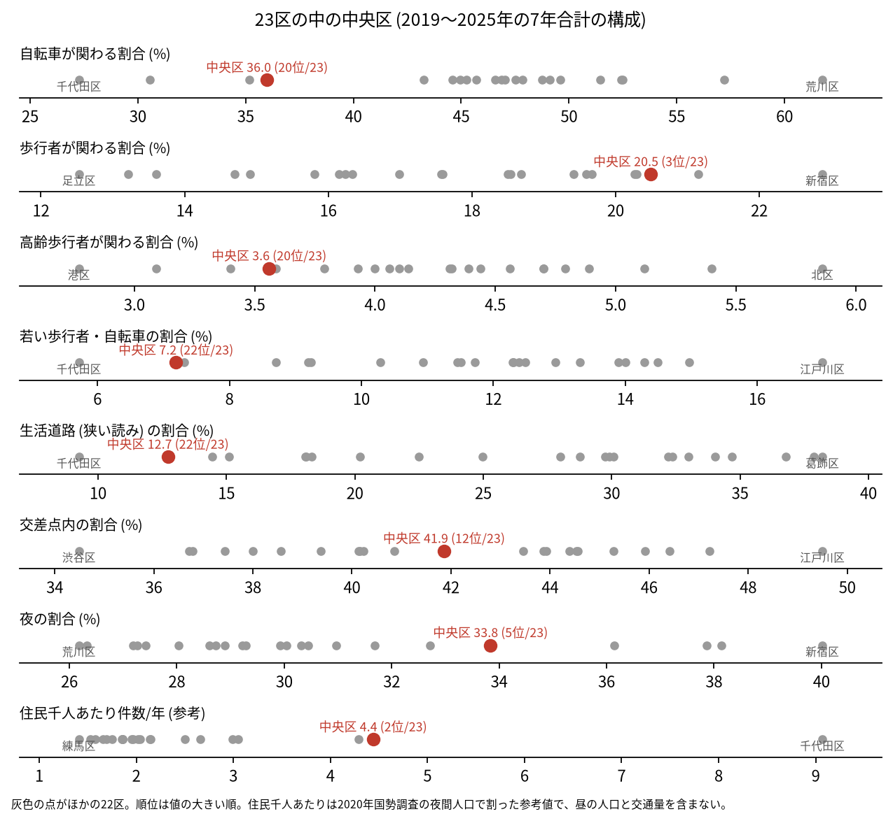
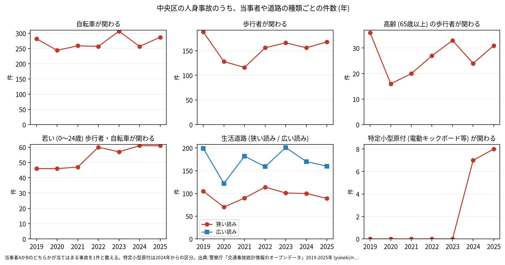

# 区の交通安全担当のための報告: 中央区の交通事故の傾向

## 問い

中央区の人身事故は 2019〜2025 年にどう推移し、23 区の中でどんな特徴があり、施策をどこに向ける材料になるか。

## 結論

- 件数: 7 年で 5,260 件、死者 15 人、負傷者 5,998 人です。2020 年に 674 件 (2019 年を 100 として 78.5) まで減り、23 区全体 (83.7) より大きく下がりました。その後は 2022 年 762 件 (88.7)、2025 年 771 件 (89.8) で、23 区全体 (2025 年 101.6) ほどには戻っていません。2019 年の 95% 区間 (802.5〜918.4 件) と重ならないのは 2020 年、2021 年、2024 年 (678.0〜784.9 件) で、この 3 年は 2019 年より少なかったと言えます。2025 年の区間 (717.5〜827.4 件) は 2019 年と重なるので、2025 年が減ったとは言えません。

- 23 区の中の位置: 中央区の事故は、歩行者が関わる割合 (20.5%、23 区の 3 位) と夜の割合 (33.8%、5 位) が高い区です。生活道路 (狭い読み) の割合は 12.7% で 22 位、広い読みでも 22.7% で 22 位です。自転車が関わる割合 (36.0%) は 20 位、高齢の歩行者 (3.6%) は 20 位、若い歩行者と自転車 (7.2%) は 22 位と低い側です。交差点内の割合 (41.9%) は 12 位で中ほどです。

- 施策への読み方: 2026-09-01 からの生活道路の法定速度 30 km/h は、中央区の事故のうち 12.7〜22.7% (読み方による) にしか当たりません。件数の多くは、日本橋の昭和通り、勝どきの晴海通り、京橋と銀座の幹線の交差点にあります (地点は [道路安全診断の報告](road-safety-auditor.md))。これは効果の予測ではなく、どの道路で事故が起きているかの構成です。
- 当事者: 当事者 A (過失の重い側) が事業用の乗用車 (タクシー、ハイヤー、バスなど) の事故は 1,405 件で、事業用の乗用車と自転車の組み合わせ (405 件) が最も多い組です ([summary.txt](../outputs/summary.txt))。
- 区分ごとの推移: 自転車が関わる事故は年 244〜307 件、歩行者が関わる事故は 2021 年の 116 件から 2025 年の 168 件です。特定小型原付 (電動キックボードなど) が関わる事故は、区分のできた 2024 年に 7 件、2025 年に 8 件でした。

- 死亡事故: 15 件のうち、亡くなったのは二輪車 8 人、歩行者 3 人、乗用車 (自家用) 2 人、貨物車 1 人、その他・不明 1 人です。当事者 B が相手なし・物件 (単独の事故) の死亡事故が 7 件、0〜5 時台に起きた事故が 6 件です。15 件は少なく、偏りを傾向と断定できる数ではありません。

| 年 | 当事者 A | 当事者 B | 亡くなった人 | 時 |
|---|---|---|---|---:|
| 2020 | 貨物車 | 二輪車 (0〜24 歳) | 二輪車 | 23 |
| 2021 | 二輪車 (55〜64 歳) | 相手なし・物件 | 二輪車 | 6 |
| 2021 | 貨物車 | 二輪車 (45〜54 歳) | 二輪車 | 8 |
| 2022 | 乗用車 (自家用) | 二輪車 (45〜54 歳) | 二輪車 | 6 |
| 2023 | 二輪車 (65 歳以上) | 相手なし・物件 | 二輪車 | 5 |
| 2024 | 二輪車 (35〜44 歳) | 相手なし・物件 | 二輪車 | 5 |
| 2025 | 貨物車 | 二輪車 (65 歳以上) | 二輪車 | 17 |
| 2025 | 乗用車 (自家用) | 二輪車 (25〜34 歳) | 二輪車 | 17 |

表は、二輪車の人が亡くなった 8 件の抜き出しです。15 件 ([summary.txt](../outputs/summary.txt)) の全ては [deaths.csv](../outputs/deaths.csv) にあります。

- 人口あたり: 2020 年の住民千人あたりの年の件数は 4.44 件で 23 区の 2 位ですが、分母に昼の人口、来訪者、通過する車が入らないため、区の比較の主な指標にしていません。

## データ

警察庁「交通事故統計情報のオープンデータ」を加工した `yuiseki/npa-traffic-accidents` 版 `389500a` の本票。中央区は `市区町村コード` 102 の 5,260 件、23 区は 144,716 件。年はファイルの年 (統計に計上された年)。区の人口は 2020 年国勢調査 (`jp-admin-2026-09` 版 `e6c87b1`)。詳しくは [共通の報告](../report.md)。

## 方法

区分は、当事者 A か B のどちらかが当てはまる事故を 1 件と数えました。生活道路は `車道幅員` で決め、狭い読み (5.5 m 未満の単路と、小と小の交差点) と、広い読み (5.5 m 未満の道とより広い道の交差点も含む) を並べました。年の区間は件数の Poisson の 95% 区間 (Garwood) です。23 区の順位は 7 年合計の割合の大きい順です。

## 確かめていないこと

- 2020 年の減り方が 23 区より大きく、その後の戻りが小さい理由 (人出や勤め方の変化など) は調べていません。
- 区の施策 (ゾーン 30、自転車の通行帯など) の効果は推定していません。割合の順位は施策の評価ではありません。
- 重傷と軽傷の区別、物損事故は、このデータにありません。
