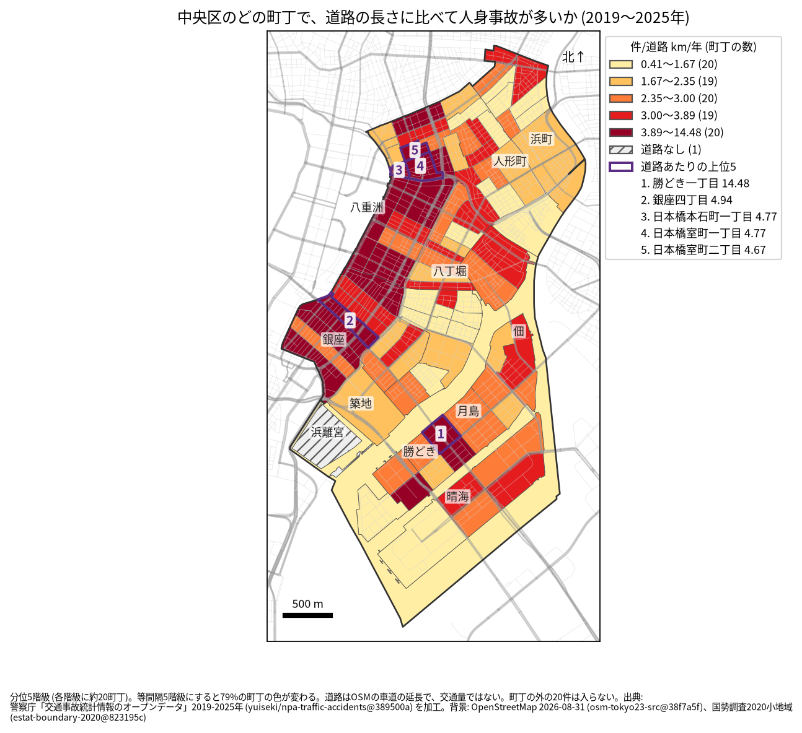
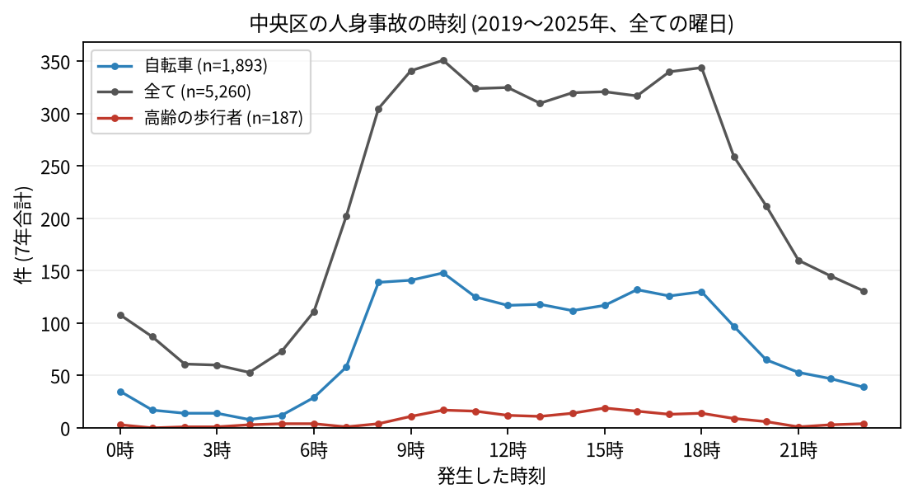

# 住民のための報告: 中央区で、いつ、どこで事故が起きているか

## 問い

中央区に住む人が、自分の町で、いつ、どんな事故に気をつければよいか。2019〜2025 年の警察記録の人身事故から調べました。

## 結論

- 中央区では 7 年で 5,260 件の人身事故があり、15 人が亡くなりました。年に 674〜859 件です。
- 町ごと: 道路 1 km あたりの事故が多いのは、勝どき一丁目 (年 14.48 件)、銀座四丁目 (4.94 件)、日本橋本石町一丁目 (4.77 件)、日本橋室町一丁目 (4.77 件) です。勝どき一丁目は 2 位から大きく離れた値で、件数そのものも最も多い町でした (7 年で 161 件)。次に件数が多いのは銀座八丁目 (150 件)、銀座一丁目 (140 件) です。銀座、京橋、八重洲から日本橋にかけて色の濃い町が並びます。

色は分位 5 階級で、各色に約 20 の町が入ります。等間隔の階級にすると 79% の町の色が変わるので、色の差より、自分の町が上の階級か下の階級かを見てください。月島、勝どき、佃を囲む淡い色の面は川と海の面 (水面調査区) で、橋の上などの事故 86 件が入っています。

- 時間: 事故は朝 8 時台から増え、夕方 18 時台まで高い水準が続きます。最も多いのは 10 時台 (351 件)、次が 18 時台 (344 件) です。自転車が関わる事故は 10 時台 (148 件) に、高齢の歩行者が関わる事故は 15 時台 (19 件) に最も多く起きました。

- 誰が: 自転車が関わる事故が全体の 36.0%、歩行者が関わる事故が 20.5% です。歩行者の割合は 23 区で 3 番目に高い区です。自転車に乗る人は、車やトラックとの事故 (1,050 件) に加え、自転車だけの事故 (転倒や物への衝突、387 件) にも気をつけてください。
- 亡くなった人: 15 人のうち 8 人が二輪車 (バイクなど) に乗っていた人、3 人が歩行者でした。単独の事故 (相手が物件か無い事故) が 7 件です。

## データ

警察庁「交通事故統計情報のオープンデータ」を加工した `yuiseki/npa-traffic-accidents` 版 `389500a` の本票、中央区の 5,260 件 (2019〜2025 年のファイル)。町の境界は 2020 年国勢調査の小地域 (99 町丁)、道路は OpenStreetMap 2026-08-31。詳しくは [共通の報告](../report.md)。

## 方法

事故の地点を町丁の境界に入れて数え、町丁の中の車道の長さ (OSM) と 7 年で割りました。区の境界の近くで町丁の外に落ちた 20 件と、位置の無い 1 件は町の値に入っていません。浜離宮庭園は道路が無いので値がありません。時刻は事故の起きた時で、7 年の合計です。

## 確かめていないこと

- 道路の長さは、通る車や人の数ではありません。勝どきや銀座の値が高いのは、人と車が多いためかもしれません。
- 自分の町の事故が少なくても、物損事故やヒヤリハットはこのデータにありません。
- 事故の位置の精度は分かりません。町の境界の近くの事故は、隣の町に数えられている可能性があります。
