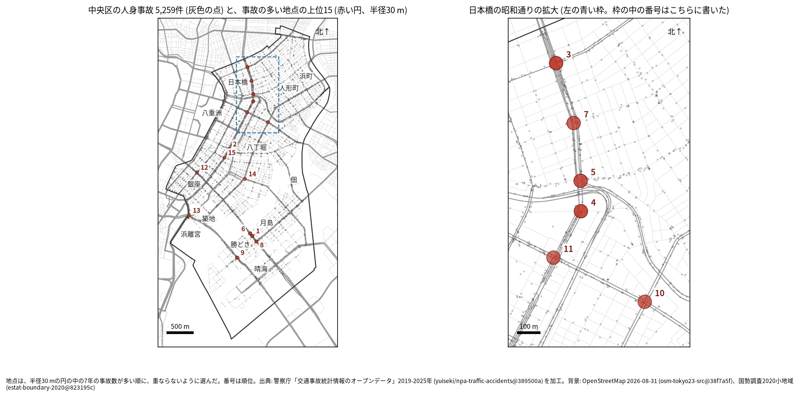
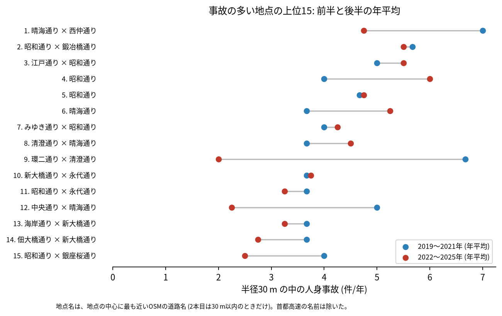
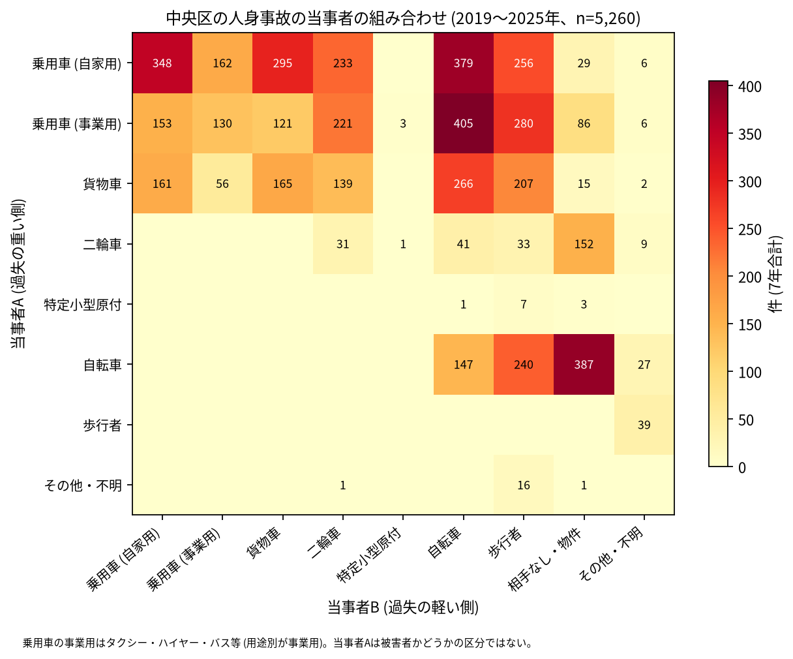

# 道路安全診断のための報告: 中央区で事故の集まる地点

## 問い

中央区で 2019〜2025 年の人身事故が集まる地点はどこで、そこでは誰と誰の事故が多いか。現地診断の候補を選ぶ材料にします。

## 結論

- 半径 30 m の円の中の 7 年の件数で選んだ上位 15 地点は、22〜40 件です。6 地点 (3、4、5、7、10、11 位) は日本橋の昭和通りとその周り (江戸通り、永代通りとの交差) にあり、4 地点 (1、6、8、9 位) は勝どきの晴海通り、清澄通り、環二通りにあります。ほかは京橋と銀座 (2、12、13、15 位) と、入船 (14 位) です。

| 順位 | 近い道路 (OSM) | 件数 | 前半 件/年 | 後半 件/年 | 交差点内 | 信号あり | 多い組み合わせ (A × B) |
|---:|---|---:|---:|---:|---:|---:|---|
| 1 | 晴海通り × 西仲通り | 40 | 7.00 | 4.75 | 19 | 22 | 自転車 × 歩行者 |
| 2 | 昭和通り × 鍛冶橋通り | 39 | 5.67 | 5.50 | 28 | 30 | 乗用車 (自家用) × 自転車 |
| 3 | 江戸通り × 昭和通り | 37 | 5.00 | 5.50 | 30 | 31 | 乗用車 (自家用) × 二輪車 |
| 4 | 昭和通り | 36 | 4.00 | 6.00 | 20 | 29 | 貨物車 × 二輪車 |
| 5 | 昭和通り | 33 | 4.67 | 4.75 | 20 | 24 | 乗用車 (自家用) × 乗用車 (事業用) |
| 6 | 晴海通り | 32 | 3.67 | 5.25 | 6 | 1 | 自転車 × 相手なし・物件 |
| 7 | みゆき通り × 昭和通り | 29 | 4.00 | 4.25 | 17 | 21 | 乗用車 (自家用) × 自転車 |
| 8 | 清澄通り × 晴海通り | 29 | 3.67 | 4.50 | 23 | 26 | 自転車 × 歩行者 |
| 9 | 環二通り × 清澄通り | 28 | 6.67 | 2.00 | 20 | 22 | 乗用車 (事業用) × 歩行者 |
| 10 | 新大橋通り × 永代通り | 26 | 3.67 | 3.75 | 18 | 22 | 乗用車 (自家用) × 乗用車 (自家用) |

前半は 2019〜2021 年、後半は 2022〜2025 年。11〜15 位と、歩行者、自転車、夜の件数は [hotspots.csv](../outputs/hotspots.csv) にあります。道路名は地点の中心に最も近い OSM の道路名で、2 本目は 30 m 以内のときだけ書きました (首都高速の名前は除いた)。7 位の「みゆき通り」は、日本橋本町一丁目の地点に最も近い OSM の道路の名前をそのまま書いたものです。

- 勝どきの地点: 1 位は 40 件のうち自転車が関わる事故が 24 件、歩行者が関わる事故が 14 件です。6 位は交差点内が 6 件、信号ありが 1 件と交差点の事故の少ない晴海通りの地点で、自転車の関わる事故が 32 件のうち 24 件、多い組み合わせは自転車の単独です。
- 続いているか: 上位 15 は全て前半と後半の両方に事故があります。9 位 (6.67 から 2.00 件/年) と 12 位 (中央通り × 晴海通り、5.00 から 2.25 件/年) は後半に減り、4 位 (4.00 から 6.00 件/年) と 6 位 (3.67 から 5.25 件/年) は増えました。上位は 7 年合計で選んだので、後半が下がって見えやすい (平均への回帰) ことに注意してください。

- 首都高速: 中央区の事故のうち首都高速 (`路線コード` 5000〜5499) は 295 件です。上位 15 の事故に入る首都高速の事故は 1 件 (5 位) だけで、首都高速の事故を除いて選び直しても、上位 15 の全てが元の中心から 30 m 以内に残りました ([analysis.json](../outputs/analysis.json))。地上の交差点の候補は、高架の事故で入れ替わっていません。
- 組み合わせ: 当事者 A が乗用車か貨物車で B が自転車の事故は 1,050 件です。最も多いのは事業用の乗用車 (タクシー、ハイヤー、バスなど) と自転車の 405 件で、事業用の乗用車は 1,405 件で当事者 A です。自転車の単独 (相手なし・物件) が 387 件、自転車と歩行者 (自転車が A) が 240 件ありました。

- 半径を変えると: 20 m の上位 15 の中心が、30 m の上位 15 の中心から 30 m 以内にあるのは 12 地点、50 m でも 12 地点でした。日本橋の昭和通りでは、4 位と 5 位の中心が隣り合って並んでいて (拡大図)、同じ交差点の事故が 2 つの地点に分かれている可能性があります。順位は細かく読まないでください。

## データ

警察庁「交通事故統計情報のオープンデータ」を加工した `yuiseki/npa-traffic-accidents` 版 `389500a` の本票、中央区 (`市区町村コード` 102) の 5,260 件。道路名は OpenStreetMap 2026-08-31 (`osm-tokyo23-src-2026-08` 版 `38f7a5f`)。詳しくは [共通の報告](../report.md)。

## 方法

事故の点を EPSG:6677 (メートル) に変換し、半径 30 m の円の中の件数が最も多い事故の点を中心に選び、その円の事故を除いて次を選ぶ手順を 15 回くり返しました。30 m はコード表の「交差点付近」(交差点の側端から 30 m 以内) の幅です。首都高速を除いた読みは、`路線コード` 5000〜5499 の事故を除いて同じ手順で選びました。信号ありは `信号機` が 3 灯式、押ボタン式、歩車分式の点灯。組み合わせは当事者 A (過失の重い側) と B の種別で、乗用車は `用途別` で事業用と自家用に分けました。

## 確かめていないこと

- 交通量で割っていません。件数の多い交差点が、車の多さに比べて危険かは分かりません。
- 事故の型 (出会い頭、右折、追突)、違反の種類、重傷と軽傷の区別は、このデータにありません。現地で確かめてください。
- 位置の精度は分かりません。数十 m のずれで地点の件数は変わります。
- 偶然でもこの程度の集まりが生まれるか (順位の有意さ) は調べていません。
