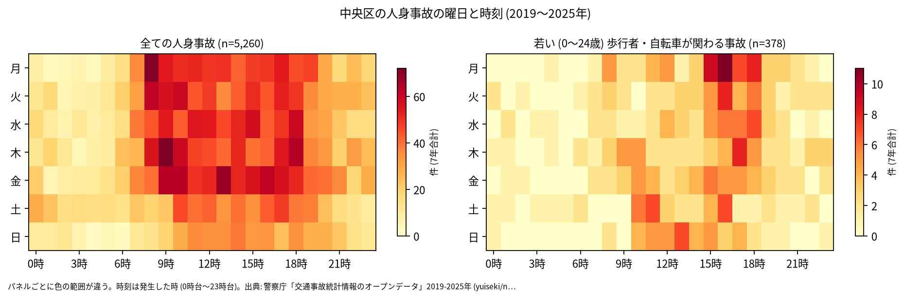
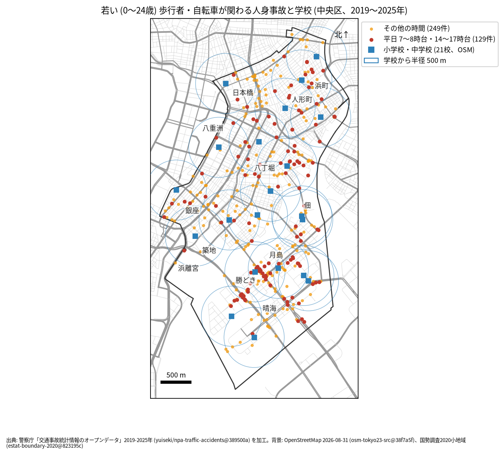

# 学校と PTA のための報告: 学校の周りの若い歩行者と自転車の事故

## 問い

中央区の学校の周り (半径 500 m) で、若い歩行者と自転車が関わる人身事故は、いつ、どこで起きているか。通学路の合同点検で見る場所と時間を選ぶ材料にします。

## 結論

- このデータで子どもだけを数えることはできません。年齢は年齢層で、最も若い区分が 0〜24 歳です。この報告の「若い」は 0〜24 歳で、大学生や若い社会人を含みます。
- 中央区で、若い歩行者か自転車が関わる人身事故は 7 年で 378 件 (全体の 7.2%、23 区で 22 位) でした。年では 46 件 (2019 年、2020 年) から 61 件 (2024 年、2025 年) です。
- 時間: 曜日を問わず多いのは 16 時台 (44 件)、15 時台 (37 件)、17 時台 (35 件)、18 時台 (33 件) です。平日 (月〜金) に限ると、16 時台 34 件、17 時台と 18 時台が 30 件、15 時台 28 件でした。登校の朝より、下校から夕方の時間帯に多く起きています。

- 場所: 学校から 500 m の円の中の件数が多いのは、月島第二小学校 83 件、月島第一小学校 79 件で、3 位の明正小学校と晴海中学校 (35 件) から大きく離れています。この 2 校の円は、事故の多い地点の 1 位 (晴海通り × 西仲通り、勝どき一丁目) を含む勝どきの交差点にかかります (地点は [道路安全診断の報告](road-safety-auditor.md))。円は重なるので、学校ごとの件数は足せません。

| 学校 (OSM の名前) | 500 m 以内の若い歩行者・自転車 | うち平日 7〜8 時台 | うち平日 14〜17 時台 |
|---|---:|---:|---:|
| 中央区立月島第二小学校 | 83 | 5 | 27 |
| 中央区立月島第一小学校 | 79 | 5 | 22 |
| 中央区立明正小学校 | 35 | 2 | 14 |
| 中央区立晴海中学校 | 35 | 4 | 9 |
| 中央区立月島第三小学校 | 31 | 3 | 11 |
| 中央区立 久松小学校 | 30 | 5 | 10 |
| 中央区立豊海小学校 | 29 | 3 | 11 |

21 校の全ては [schools.csv](../outputs/schools.csv) にあります。

赤い点 (平日の 7〜8 時台と 14〜17 時台、129 件) が、通学の時間に近い事故です。点検では、学校の円の中で赤い点が並ぶ道 (勝どきの晴海通りと清澄通りなど) を、通学路の地図と重ねて見ることを勧めます。

- 7 年で、平日の朝 (7〜8 時台) に 1 つの学校の円の中で起きた若い人の事故は 0〜5 件です。件数が少ないので、学校の順位より、点の位置を手がかりにしてください。

## データ

警察庁「交通事故統計情報のオープンデータ」を加工した `yuiseki/npa-traffic-accidents` 版 `389500a` の本票、中央区の 5,260 件 (2019〜2025 年のファイル)。学校は OpenStreetMap 2026-08-31 (`osm-tokyo23-src-2026-08` 版 `38f7a5f`) の、名前が「小学校」「中学校」で終わる 21 校。名前が 1 つの「晴海西小学校・晴海西中学校」は 1 校として数えました。詳しくは [共通の報告](../report.md)。

## 方法

当事者 A か B が歩行者か自転車 (駆動補助機付を含む) で、その同じ当事者の年齢層が 0〜24 歳の事故を数えました。学校の位置は OSM の面の重心 (名前ごとに平均) で、円は直線 500 m (EPSG:6677 で測った) です。時刻は発生した時、平日は月曜から金曜で、祝日は分けていません。

## 確かめていないこと

- 小学生か、通学中かは分かりません。被害者か加害者かも区別していません (当事者 A は過失の重い側)。
- 学校の位置は校門ではなく、500 m は道のりではありません。通学路の線とは重ねていません。
- 晴海西小学校・晴海西中学校は 2024 年の開校 (外の知識、確かめていない) で、7 年の全てに学校があったわけではありません。
- ヒヤリハットと物損事故は入っていません。点検では、学校が集めている危険な場所の情報と合わせて使ってください。
