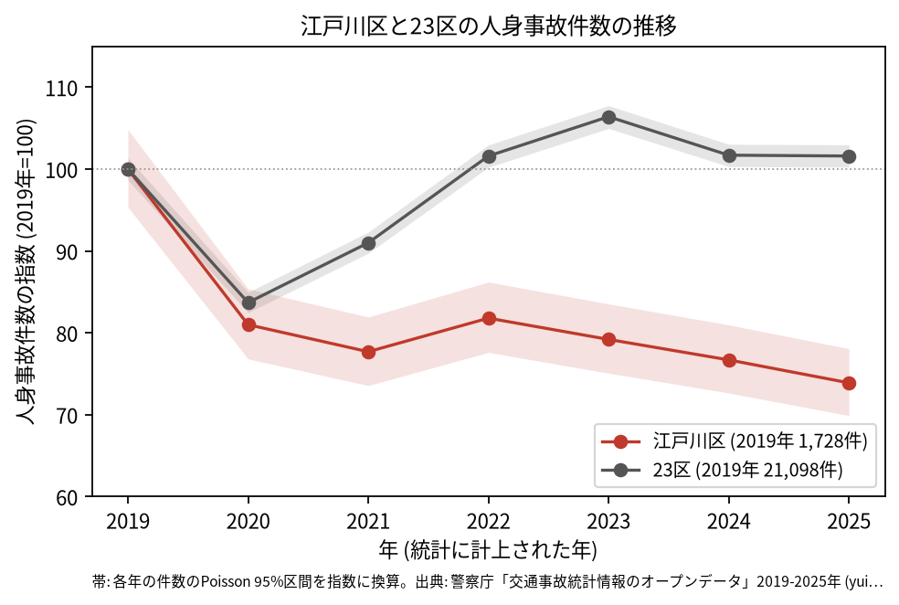
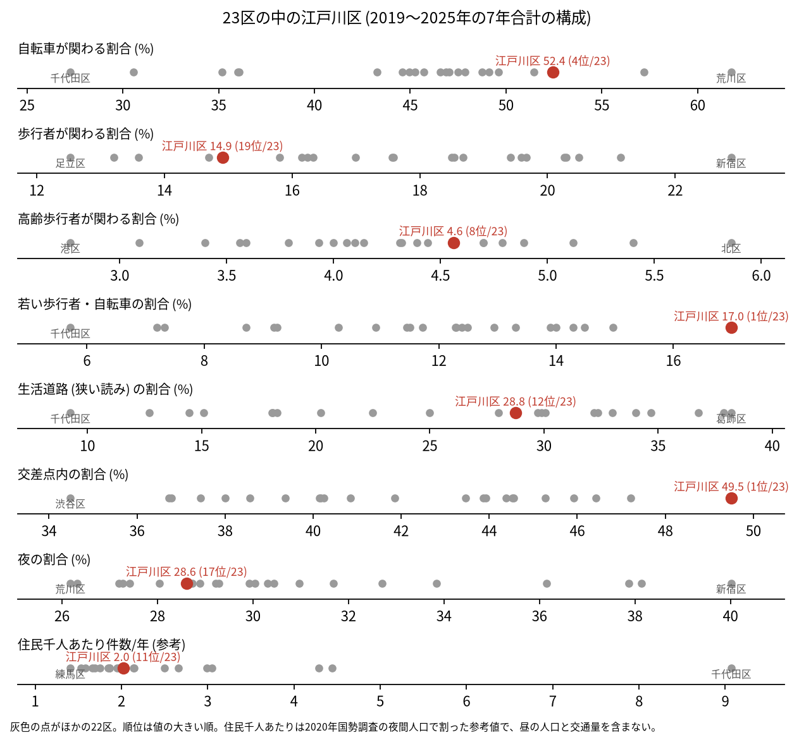
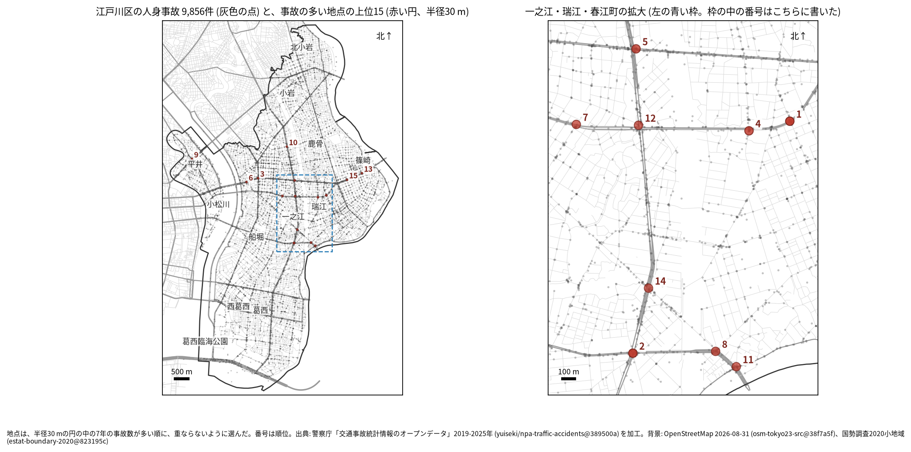
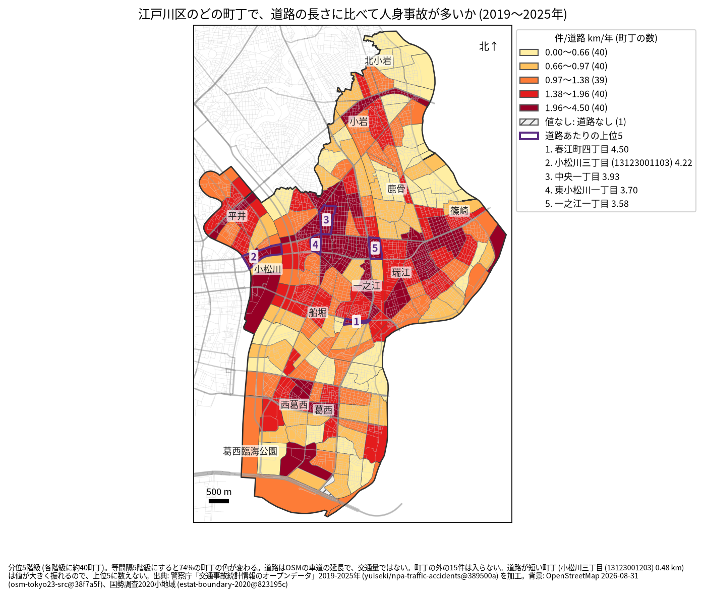
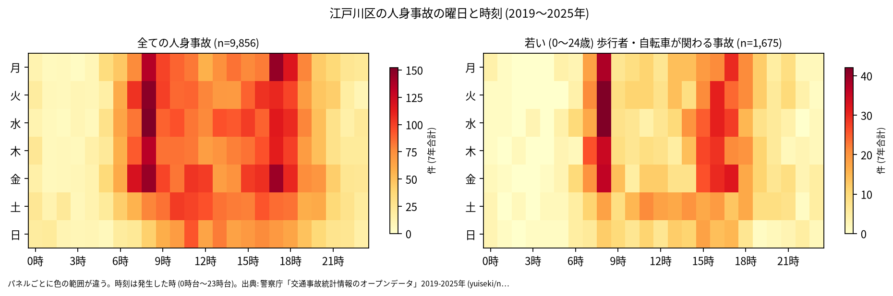
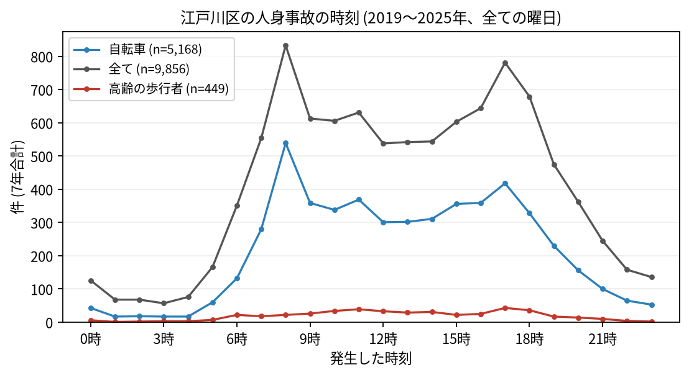
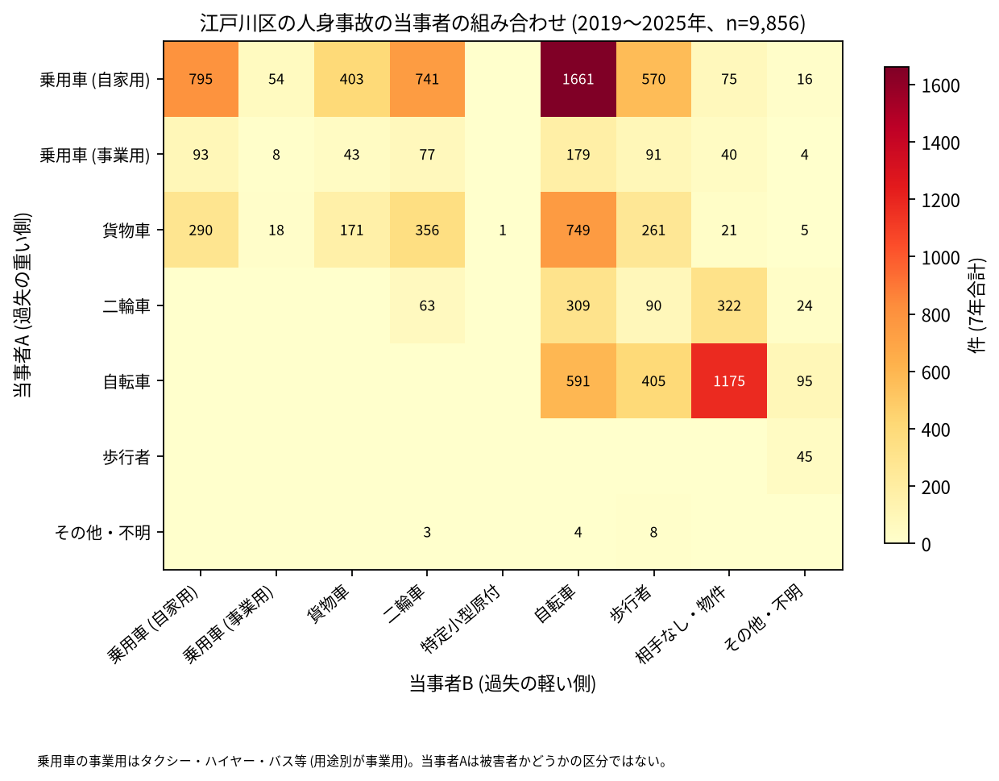

# 江戸川区の交通事故 2019〜2025 年: 図で読む要点

## 問い

2019〜2025 年の警察記録の人身事故で、江戸川区の事故はいつ、どこで、誰が関わって起きているか。

## 結論

### 要点

| # | 要点 | 数字 | 図 |
|---:|---|---|---|
| 1 | 件数は 2019 年から減り、23 区全体が 2019 年の水準に戻ったのと違って、戻っていない | 7 年で 9,856 件、死者 42 人、負傷者 11,018 人 ([summary.txt](outputs/summary.txt))。指数 (2019 年=100) は 2020 年 81.0、2025 年 73.9。23 区全体の 2025 年は 101.6 ([yearly.csv](outputs/yearly.csv)) | [図 1](#図-1-件数の推移) |
| 2 | 交差点の事故と、若い歩行者・自転車の事故の割合が 23 区で最も高い | 交差点内 49.5% (1 位)、若い (0〜24 歳) 歩行者・自転車 17.0% (1 位)、自転車 52.4% (4 位) ([wards.csv](outputs/wards.csv)、[analysis.json](outputs/analysis.json)) | [図 2](#図-2-23-区の中の江戸川区) |
| 3 | 集まる場所は一之江・瑞江・春江町と、京葉道路 (国道 14 号) と環七通り | 事故の多い地点の上位 15 のうち 9 が一之江・瑞江・春江町の範囲 ([hotspots-map.json](outputs/hotspots-map.json))。1 位は瑞江一丁目の 56 件 ([hotspots.csv](outputs/hotspots.csv)) | [図 3](#図-3-事故の集まる地点)、[図 4](#図-4-町丁ごとの事故) |
| 4 | 事故の半分に自転車が関わり、自転車の単独の事故が多い | 自家用の乗用車 (A) と自転車 (B) が 1,661 件、自転車の単独 (相手なし・物件) が 1,175 件 ([summary.txt](outputs/summary.txt)) | [図 6](#図-6-誰と誰の事故か) |
| 5 | 死亡事故では歩行者と自転車が多く亡くなっている | 死亡事故 42 件。亡くなった歩行者 17 人 (65 歳以上が 11 人)、自転車 13 人。0〜5 時台は 10 件 ([summary.txt](outputs/summary.txt)) | [表 1](#表-1-死亡事故) |

### 読み手ごとに知るべきこと

| 読み手 | 結論 | 検討する材料 | 詳しく |
|---|---|---|---|
| 区の交通安全担当 | 件数は 2019 年から減った (2025 年の指数 73.9)。生活道路の法定速度 30 km/h (2026-09-01 から) が当たるのは事故の 28.8〜43.3% (読み方による) | 幹線の交差点、自転車、高齢の歩行者と自転車の死亡事故 | [municipality.md](reports/municipality.md) |
| 学校と PTA | 若い (0〜24 歳) 歩行者と自転車の事故は 1,675 件で、23 区で最も割合が高い。最も多いのは 8 時台 (223 件) | 学校の円の中で、平日 7〜8 時台と 14〜17 時台の点が並ぶ道 | [school-pta.md](reports/school-pta.md) |
| 道路安全診断 | 上位は瑞江一丁目の区道の交差点 (56 件)、新大橋通り × 環七通り (38 件)、京葉道路 × 千葉街道 (38 件)。上位 15 に首都高速の事故は無い | 後半に増えた地点 (1 位、4〜6 位、10 位、13 位、14 位)、一之江・瑞江・春江町に並ぶ地点 | [road-safety-auditor.md](reports/road-safety-auditor.md) |
| 住民 | 道路あたりで多いのは春江町四丁目 (年 4.50 件/道路 km)、小松川三丁目 (4.22 件)、中央一丁目 (3.93 件)。事故は 8 時台と 17 時台に山がある | 自分の町の色、朝の自転車、自転車だけの転倒 | [resident.md](reports/resident.md) |

### 図 1: 件数の推移

2020 年に江戸川区は 81.0、23 区全体は 83.7 まで下がった。23 区全体は 2022 年に 101.6 へ戻ったが、江戸川区は 80 前後のまま下がり続け、2025 年は 73.9。2025 年の 95% 区間 (1,207.9〜1,349.0 件) は 2019 年 (1,647.5〜1,811.4 件) と重ならないので、減ったと書ける ([yearly.csv](outputs/yearly.csv))。区のコードの付け方の年ごとの差は 0〜2 件で ([analysis.json](outputs/analysis.json) の `by_year_coded_vs_inside`)、減り方はコードの付け方の変化では説明できない。

### 図 2: 23 区の中の江戸川区

赤い点が江戸川区。交差点内 (49.5%) と若い歩行者・自転車 (17.0%) が 1 位、自転車 (52.4%) が 4 位と高く、歩行者 (14.9%、19 位) と夜 (28.6%、17 位) が低い。生活道路 (狭い読み) は 28.8% で 12 位。住民千人あたり (2.02 件/年、11 位) は昼の人口を含まない参考値 ([wards.csv](outputs/wards.csv)、[analysis.json](outputs/analysis.json))。

### 図 3: 事故の集まる地点

半径 30 m の円の中の 7 年の件数で選んだ上位 15 (23〜56 件)。番号は順位で、一之江・瑞江・春江町の 9 地点は右の拡大図に番号を書いた。

| 順位 | 近い道路 (OSM) | 町丁 | 件数 | 前半 件/年 | 後半 件/年 |
|---:|---|---|---:|---:|---:|
| 1 | 名前のある道が近くに無い (区道の交差点) | 瑞江一丁目 | 56 | 7.00 | 8.75 |
| 2 | 新大橋通り × 環七通り | 春江町四丁目 | 38 | 5.67 | 5.25 |
| 3 | 京葉道路 × 千葉街道 | 東小松川一丁目 | 38 | 5.33 | 5.50 |
| 4 | 名前のある道が近くに無い (区道の交差点) | 春江町三丁目 | 32 | 3.67 | 5.25 |
| 5 | 京葉道路 × 環七通り | 西一之江二丁目 | 30 | 3.00 | 5.25 |

前半は 2019〜2021 年、後半は 2022〜2025 年。1 位と 4 位の `road_1` は hotspots.csv では京葉道路だが、中心から数百 m 離れていたので (記録 R006 の診断、型は 1 本目の道の距離を限らない)、表では道路名を書かない。1 位の円の 56 件のうち 53 件は区道、53 件は交差点内 ([hotspots.csv](outputs/hotspots.csv))。半径を 20 m にすると上位 15 のうち 11 地点、50 m では 10 地点が残る ([analysis.json](outputs/analysis.json))。6〜15 位は [hotspots.csv](outputs/hotspots.csv)。

### 図 4: 町丁ごとの事故

町丁の事故数を、OSM の車道の延長と 7 年で割った値。紫の枠が上位 5 (春江町四丁目、小松川三丁目、中央一丁目、東小松川一丁目、一之江一丁目)。分位と等間隔で 74% の町丁の色が変わるので、色の細かい差は読まない ([town-rate-quantile.json](outputs/town-rate-quantile.json))。道路の長さは交通量ではない。小松川三丁目は 2 つの単位に分かれていて、道路の短いほう (0.479 km) は上位 5 に数えない ([towns.csv](outputs/towns.csv))。

### 図 5: いつ起きるか

全体は朝 8 時台 (833 件) と夕方 17 時台 (781 件) に山がある。若い歩行者と自転車は 8 時台 (223 件) が最多で、次が 16 時台 (175 件) ([summary.txt](outputs/summary.txt))。

自転車は 8 時台 (539 件)、高齢の歩行者は 17 時台 (43 件) が最多 ([summary.txt](outputs/summary.txt))。

### 図 6: 誰と誰の事故か

最も多いのは自家用の乗用車 (A) と自転車 (B) の 1,661 件、次が自転車の単独 (相手なし・物件) の 1,175 件、自家用の乗用車どうしの 795 件。当事者 A が乗用車か貨物車で B が自転車の事故は 2,589 件 ([summary.txt](outputs/summary.txt))。当事者 A は過失の重い側で、被害者とは限らない。

### 表 1: 死亡事故

| 亡くなった人 | 人数 | 特徴 |
|---|---:|---|
| 歩行者 | 17 | 65 歳以上が 11 人 |
| 自転車 | 13 | |
| 二輪車 | 6 | |
| 乗用車 (自家用) | 3 | |
| 補充票の人 | 3 | 当事者 A、B のどちらでもない人 |

42 件のうち 0〜5 時台が 10 件、当事者 A が自家用の乗用車の事故が 18 件、貨物車が 17 件 ([summary.txt](outputs/summary.txt))。数が少ないので傾向とは断定しない。全件は [deaths.csv](outputs/deaths.csv)。

### 読み方で変わる答え

| 読み方 | 主 | 別の読み方 |
|---|---|---|
| 江戸川区の事故 | `市区町村コード` 123 の 9,856 件 | 点が区の面に入る事故。両方に当てはまるのは 9,841 件 ([analysis.json](outputs/analysis.json)、[wards.csv](outputs/wards.csv)) |
| 生活道路 | 狭い読み 28.8% (12 位) | 広い読み 43.3% (10 位) ([wards.csv](outputs/wards.csv)、[analysis.json](outputs/analysis.json)) |
| 地点の半径 | 30 m | 20 m で 11 地点、50 m で 10 地点が残る ([analysis.json](outputs/analysis.json)) |
| 首都高速の事故 | 含める | 除いても 15 地点が全部残る。首都高速の事故は区で 119 件、上位 15 の円には 0 件 ([analysis.json](outputs/analysis.json)) |
| 町丁の階級 | 分位 5 階級 | 等間隔で 74%、Jenks で 76% の町丁の色が変わる ([town-rate-quantile.json](outputs/town-rate-quantile.json)) |

## データ

- 人身事故: 警察庁「交通事故統計情報のオープンデータ」を加工した `yuiseki/npa-traffic-accidents` 版 `389500aae5cec45f1311163f70db6a5f05867838` (配布元の取得 2026-10-02) の本票。年はファイルの年 (統計に計上された年)。江戸川区 9,856 件、23 区 144,716 件。位置の無い行は 0。物損事故は含まない。
- 区の面と人口: `yuiseki/jp-admin-2026-09` 版 `e6c87b1`。町丁: 2020 年国勢調査の小地域 `yuiseki/estat-boundary-2020` 版 `823195c` (200 単位、697,932 人。水面調査区は無い)。学校 103 校と道路: OpenStreetMap 2026-08-31、`yuiseki/osm-tokyo23-src-2026-08` 版 `38f7a5f`。
- 道具: DuckDB 2.0.0 (spatial)、matplotlib、`analysis-visualize` の `cjk_font.py`、`classify_map.py`、`context_map.py`。スクリプトは台東区の型 (2026-11-03 の版) を写し、区に固有の定数だけを直した。
- 出典の表示: 警察庁ウェブサイト (https://www.npa.go.jp/publications/statistics/koutsuu/opendata/index_opendata.html) の交通事故統計情報のオープンデータを加工して作成。国勢調査の小地域境界と人口、OpenStreetMap (© OpenStreetMap contributors) を加工して使用。

## 方法

- 読み方は結果を見る前に [計画](EXPERIMENT_PLAN.md) で固定し、実行は [記録](EXPERIMENT_TRACKER.md) に残した。読み方と区画は台東区と同じ (区どうしを比べるため)。生活道路は `車道幅員` が 01、02、11 (狭い読み)、広い読みは 14、17 を足す。歩行者や自転車が関わるかは当事者 A と B の両方で見て、1 件を 1 回数えた。
- 距離は EPSG:6677 (メートル) で測った。町丁の道路あたりの上位 5 には、道路が 0.5 km より短い町丁を数えない (塗りは同じ式)。地点は、半径 30 m の中の件数が最も多い点を中心に選び、その円の事故を除いて次を選ぶ手順を 15 回くり返した。地点の名前は、中心に最も近い道と、それと 30 度以上の向きで交わる道のうち 30 m 以内で最も近い道。1 本目の道は距離を限らないので、1 位と 4 位は町丁で呼んだ (記録 R006)。
- 地図は `analysis-visualize` の map-context に合わせ、地名と道路を重ね、凡例を地図の外に置き、強調した単位に番号を付けた。描いた町丁の数 (200) を分析の数と照らした。文字の重なりと、地名や番号が円や学校の印を隠す重なりは、地名を動かした後に 3 枚の地図で 0 件 (記録 R009)。背景の道路 (OGC:CRS84) と町丁 (JGD2000) の差は、線の幅より小さいとして変換せずに重ねた。
- 関門: 予測と回帰をしないので、評価の分け方と残差の確認は要らない。単位の間の相関を結論にしないので、Moran's I と格子の掃引は省いた。推移は 23 区全体を基準にし、年の件数に Poisson の 95% 区間を付けた。対策の効果は推定していない。
- 再実行は [README.md](README.md)。数値は [outputs/](outputs/) の CSV、来歴は [analysis.json](outputs/analysis.json)。

## 確かめていないこと

- 交通量、昼の人口、来訪者の数で割っていない。幹線の交差点の件数の多さは、車の多さかもしれない。
- 件数が 23 区全体と違って減り続けた理由 (人口や交通量の変化、施策など) は調べていない。
- 位置の精度は分からない。30 m の地点と町丁の境界の近くの事故は、数十 m のずれで入れ替わる。
- 1 位と 4 位の地点がどの交差点か (首都高速の高架の下の道か) は、OSM の名前の無い道で、地図の上では確かめていない。
- 事故の型 (出会い頭、追突)、重傷と軽傷の区別、物損事故、ヒヤリハットは、このデータに無い。
- 0〜24 歳より細かい年齢は無く、小学生だけは数えられない。
- 地点の上位は 7 年で選び、同じ 7 年で前半と後半を比べたので、後半が下がって見えやすい (平均への回帰)。
