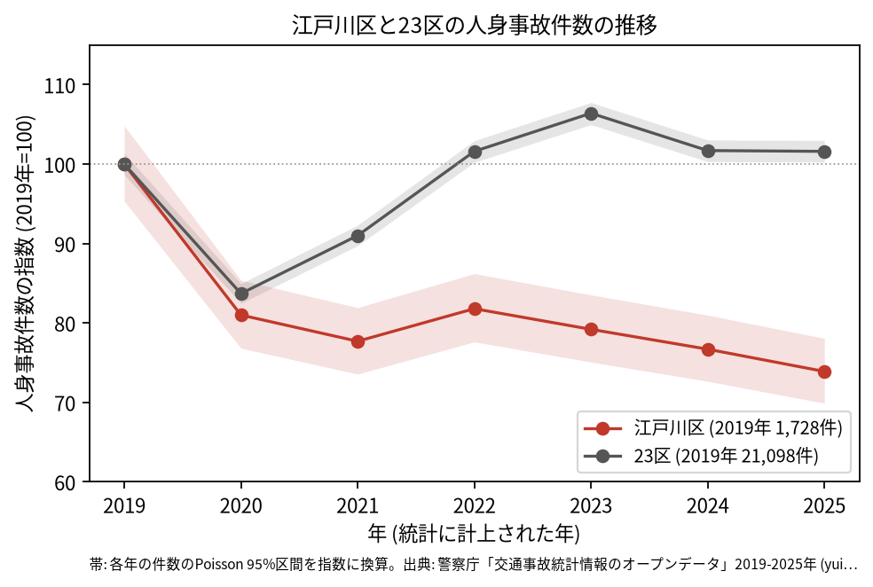
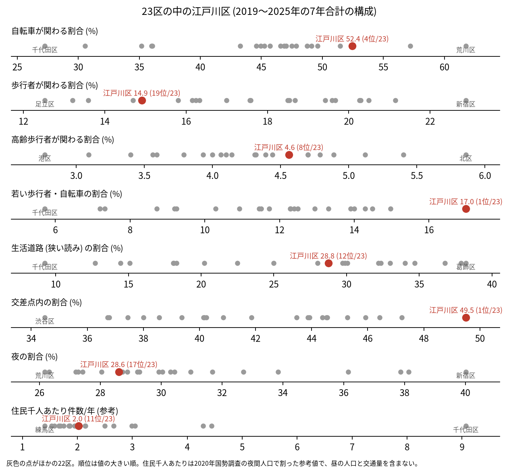
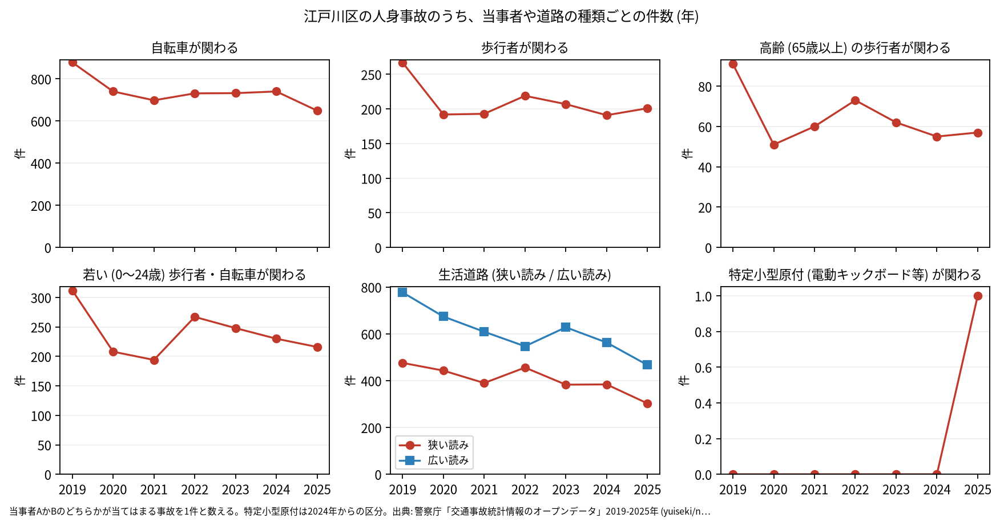

# 区の交通安全担当のための報告: 江戸川区の交通事故の傾向

## 問い

江戸川区の人身事故は 2019〜2025 年にどう推移し、23 区の中でどんな特徴があり、施策をどこに向ける材料になるか。

## 結論

- 件数: 7 年で 9,856 件、死者 42 人、負傷者 11,018 人です。2019 年の 1,728 件から、2020 年に 1,400 件 (2019 年を 100 として 81.0) に減り、その後も 2022 年の 81.8 を除いて下がり続け、2025 年は 1,277 件 (73.9) でした。23 区全体は 2022 年から 2019 年の水準に戻っています (2025 年 101.6)。2025 年の 95% 区間 (1,207.9〜1,349.0 件) は 2019 年の区間 (1,647.5〜1,811.4 件) と重ならないので、2019 年より減ったと言えます ([yearly.csv](../outputs/yearly.csv))。

- 23 区の中の位置: 江戸川区の事故は、交差点と自転車と若い人に寄っています。交差点内の割合は 49.5% で 23 区の 1 位、若い (0〜24 歳) 歩行者と自転車が関わる割合は 17.0% で 1 位、自転車が関わる割合は 52.4% で 4 位です。歩行者が関わる割合は 14.9% で 19 位、高齢の歩行者は 4.6% で 8 位です。生活道路 (狭い読み) の割合は 28.8% で 12 位、広い読みでは 43.3% で 10 位と、23 区の中ほどです ([wards.csv](../outputs/wards.csv)、[analysis.json](../outputs/analysis.json))。

- 施策への読み方: 2026-09-01 からの生活道路の法定速度 30 km/h は、江戸川区の事故のうち 28.8〜43.3% (読み方による) に当たります。残りの多くは幹線の交差点で、事故の多い地点は京葉道路 (国道 14 号)、環七通り、新大橋通りと、一之江・瑞江・春江町の範囲に並びます (地点は [道路安全診断の報告](road-safety-auditor.md))。これは効果の予測ではなく、どの道路で事故が起きているかの構成です。
- 区分ごとの推移: 自転車が関わる事故は 2019 年の 878 件から 2025 年の 649 件へ、歩行者が関わる事故は 267 件から 201 件へ、生活道路 (狭い読み) は 476 件から 303 件へ減りました。特定小型原付 (電動キックボードなど) が関わる事故は、区分のできた 2024 年に 0 件、2025 年に 1 件で、23 区全体 (2024 年 237 件、2025 年 272 件) と比べてごく少数です ([yearly.csv](../outputs/yearly.csv))。

- 死亡事故: 42 件で、亡くなったのは歩行者 17 人、自転車 13 人、二輪車 6 人、自家用の乗用車 3 人、補充票の人 (当事者 A、B のどちらでもない人) 3 人です。亡くなった歩行者 17 人のうち 11 人が 65 歳以上でした。当事者 A (過失の重い側) が自家用の乗用車の事故が 18 件、貨物車の事故が 17 件、0〜5 時台に起きた事故は 10 件です ([summary.txt](../outputs/summary.txt))。42 件は少なく、偏りを傾向と断定できる数ではありません。

| 年 | 当事者 A | 当事者 B | 時 |
|---|---|---|---:|
| 2019 | 貨物車 | 自転車 (75 歳以上) | 11 |
| 2019 | 貨物車 | 自転車 (65〜74 歳) | 9 |
| 2019 | 乗用車 (自家用) | 自転車 (75 歳以上) | 7 |
| 2020 | 乗用車 (自家用) | 自転車 (0〜24 歳) | 11 |
| 2021 | 貨物車 | 自転車 (75 歳以上) | 11 |
| 2022 | 乗用車 (自家用) | 自転車 (55〜64 歳) | 11 |
| 2023 | 貨物車 | 自転車 (75 歳以上) | 16 |
| 2023 | 貨物車 | 自転車 (45〜54 歳) | 13 |
| 2024 | 乗用車 (自家用) | 自転車 (0〜24 歳) | 16 |
| 2024 | 自転車 (35〜44 歳) | 相手なし・物件 | 6 |
| 2024 | 乗用車 (自家用) | 自転車 (35〜44 歳) | 21 |
| 2025 | 貨物車 | 自転車 (55〜64 歳) | 8 |
| 2025 | 貨物車 | 自転車 (75 歳以上) | 10 |

表は、自転車の人が亡くなった 13 件の抜き出しです。日中の、車やトラックとの事故が多く見えます。42 件の全ては [deaths.csv](../outputs/deaths.csv) にあります。

- 人口あたり: 2020 年の住民千人あたりの年の件数は 2.02 件で 23 区の 11 位ですが、分母に昼の人口や通過する車が入らないため、区の比較の主な指標にしていません ([wards.csv](../outputs/wards.csv)、[analysis.json](../outputs/analysis.json))。

## データ

警察庁「交通事故統計情報のオープンデータ」を加工した `yuiseki/npa-traffic-accidents` 版 `389500a` の本票。江戸川区は `市区町村コード` 123 の 9,856 件、23 区は 144,716 件。年はファイルの年 (統計に計上された年)。区の人口は 2020 年国勢調査 (`jp-admin-2026-09` 版 `e6c87b1`)。詳しくは [共通の報告](../report.md)。

## 方法

区分は、当事者 A か B のどちらかが当てはまる事故を 1 件と数えました。生活道路は `車道幅員` で決め、狭い読み (5.5 m 未満の単路と、小と小の交差点) と、広い読み (5.5 m 未満の道とより広い道の交差点も含む) を並べました。年の区間は件数の Poisson の 95% 区間 (Garwood) です。23 区の順位は 7 年合計の割合の大きい順です。

## 確かめていないこと

- 江戸川区の件数が 23 区全体と違って減り続けた理由 (人口、交通量、施策の変化など) は調べていません。
- 区の施策 (ゾーン 30、自転車の通行帯など) の効果は推定していません。割合の順位は施策の評価ではありません。
- 重傷と軽傷の区別、物損事故は、このデータにありません。
