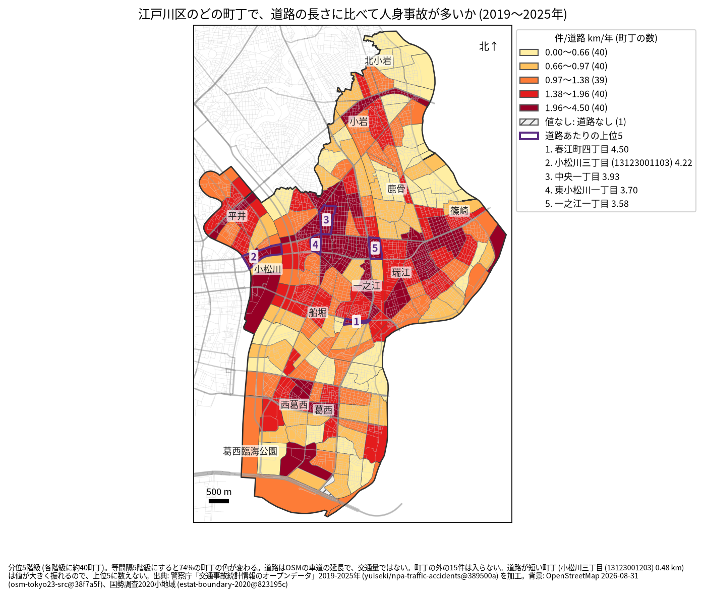
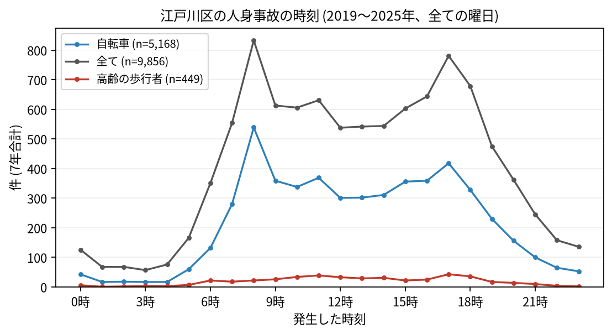

# 住民のための報告: 江戸川区で、いつ、どこで事故が起きているか

## 問い

江戸川区に住む人が、自分の町で、いつ、どんな事故に気をつければよいか。2019〜2025 年の警察記録の人身事故から調べました。

## 結論

- 江戸川区では 7 年で 9,856 件の人身事故があり、42 件の死亡事故がありました ([summary.txt](../outputs/summary.txt))。年に 1,277〜1,728 件で、2019 年から減っています ([yearly.csv](../outputs/yearly.csv))。
- 町ごと: 道路 1 km あたりの事故が多いのは、春江町四丁目 (年 4.50 件)、小松川三丁目 (4.22 件)、中央一丁目 (3.93 件)、東小松川一丁目 (3.70 件)、一之江一丁目 (3.58 件) です ([towns.csv](../outputs/towns.csv))。件数そのものが最も多いのは平井五丁目 (7 年で 224 件) で、次が臨海町六丁目 (211 件) でした ([summary.txt](../outputs/summary.txt))。京葉道路の沿いの小松川から瑞江、篠崎にかけて、色の濃い町が並びます。

色は分位 5 階級で、各色に約 40 の町が入ります。等間隔の階級にすると 74% の町の色が変わるので ([town-rate-quantile.json](../outputs/town-rate-quantile.json))、色の差より、自分の町が上の階級か下の階級かを見てください。春江町四丁目は道に沿った細長い町で、道路の長さに比べて件数が多く出ます。小松川三丁目は 2 つの単位に分かれていて、地図の 2 は大きいほうです。

- 時間: 事故は朝 8 時台 (833 件) と夕方 17 時台 (781 件) に山があります。自転車が関わる事故は 8 時台 (539 件) が最も多く、高齢の歩行者が関わる事故は 17 時台 (43 件) が最も多い時間でした ([summary.txt](../outputs/summary.txt))。

- 誰が: 自転車が関わる事故が全体の 52.4% で、23 区で 4 番目に高い割合です ([wards.csv](../outputs/wards.csv)、[analysis.json](../outputs/analysis.json))。自転車に乗る人は、車やトラックとの事故 (2,589 件) に加え、自転車だけの事故 (転倒や物への衝突、1,175 件) にも気をつけてください ([summary.txt](../outputs/summary.txt))。歩行者が関わる事故は 14.9% です。
- 亡くなった人: 死亡事故 42 件で、歩行者 17 人 (そのうち 11 人が 65 歳以上) と、自転車の人 13 人が亡くなりました ([summary.txt](../outputs/summary.txt))。

## データ

警察庁「交通事故統計情報のオープンデータ」を加工した `yuiseki/npa-traffic-accidents` 版 `389500a` の本票、江戸川区の 9,856 件 (2019〜2025 年のファイル)。町の境界は 2020 年国勢調査の小地域 (200 単位)、道路は OpenStreetMap 2026-08-31。詳しくは [共通の報告](../report.md)。

## 方法

事故の地点を町丁の境界に入れて数え、町丁の中の車道の長さ (OSM) と 7 年で割りました。区の境界の近くで町丁の外に落ちた 15 件は町の値に入っていません ([analysis.json](../outputs/analysis.json))。道路の無い臨海町五丁目は値なしです。時刻は事故の起きた時で、7 年の合計です。

## 確かめていないこと

- 道路の長さは、通る車や人の数ではありません。幹線の通る町の値が高いのは、車が多いためかもしれません。
- 自分の町の事故が少なくても、物損事故やヒヤリハットはこのデータにありません。
- 事故の位置の精度は分かりません。町の境界の近くの事故は、隣の町に数えられている可能性があります。
