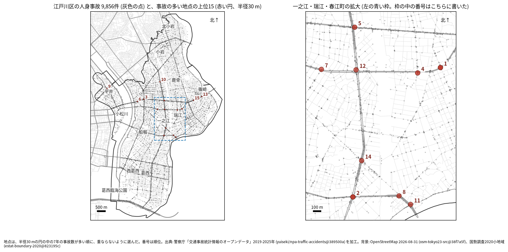
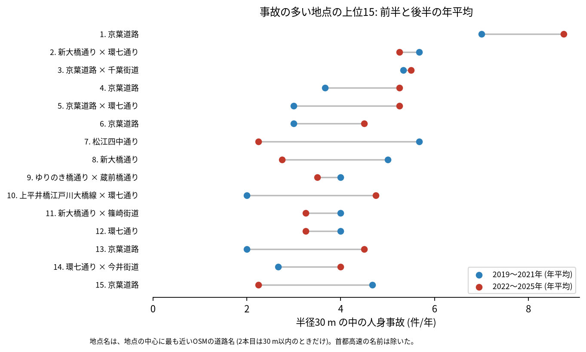
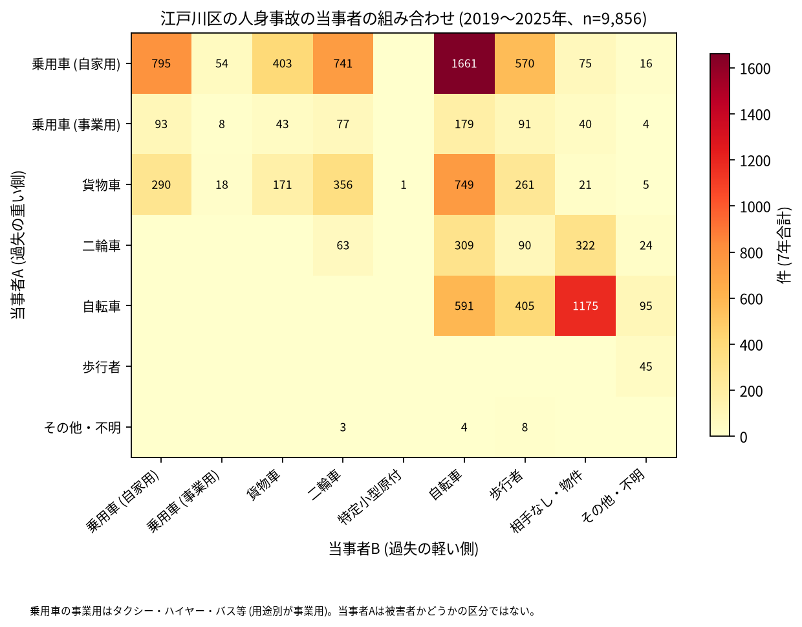

# 道路安全診断のための報告: 江戸川区で事故の集まる地点

## 問い

江戸川区で 2019〜2025 年の人身事故が集まる地点はどこで、そこでは誰と誰の事故が多いか。現地診断の候補を選ぶ材料にします。

## 結論

- 半径 30 m の円の中の 7 年の件数で選んだ上位 15 地点は、23〜56 件です。15 のうち 9 は一之江・瑞江・春江町の範囲 (拡大図) にあり ([hotspots-map.json](../outputs/hotspots-map.json))、ほかは京葉道路 (国道 14 号) の小松川と篠崎の側、平井 (ゆりのき橋通り × 蔵前橋通り)、大杉の環七通りです。上位 15 の最も多い路線は、区道が 6 地点、国道 14 号が 5 地点、主要地方道 (都道) が 4 地点でした ([summary.txt](../outputs/summary.txt))。

| 順位 | 近い道路 (OSM) | 件数 | 前半 件/年 | 後半 件/年 | 交差点内 | 信号あり | 多い組み合わせ (A × B) |
|---:|---|---:|---:|---:|---:|---:|---|
| 1 | 名前のある道が近くに無い (瑞江一丁目) | 56 | 7.00 | 8.75 | 53 | 53 | 乗用車 (自家用) × 乗用車 (自家用) |
| 2 | 新大橋通り × 環七通り | 38 | 5.67 | 5.25 | 26 | 30 | 乗用車 (自家用) × 自転車 |
| 3 | 京葉道路 × 千葉街道 | 38 | 5.33 | 5.50 | 23 | 28 | 乗用車 (自家用) × 自転車 |
| 4 | 名前のある道が近くに無い (春江町三丁目) | 32 | 3.67 | 5.25 | 31 | 32 | 乗用車 (自家用) × 乗用車 (自家用) |
| 5 | 京葉道路 × 環七通り | 30 | 3.00 | 5.25 | 22 | 24 | 乗用車 (自家用) × 自転車 |
| 6 | 京葉道路 | 27 | 3.00 | 4.50 | 15 | 0 | 乗用車 (自家用) × 自転車 |
| 7 | 松江四中通り | 26 | 5.67 | 2.25 | 26 | 25 | 乗用車 (自家用) × 乗用車 (自家用) |
| 8 | 新大橋通り | 26 | 5.00 | 2.75 | 13 | 18 | 二輪車 × 相手なし・物件 |
| 9 | ゆりのき橋通り × 蔵前橋通り | 26 | 4.00 | 3.50 | 18 | 23 | 乗用車 (自家用) × 歩行者 |
| 10 | 上平井橋江戸川大橋線 × 環七通り | 25 | 2.00 | 4.75 | 21 | 23 | 乗用車 (自家用) × 乗用車 (自家用) |

前半は 2019〜2021 年、後半は 2022〜2025 年 ([hotspots.csv](../outputs/hotspots.csv))。11〜15 位と、歩行者、自転車、夜の件数は [hotspots.csv](../outputs/hotspots.csv) にあります。道路名は地点の中心に最も近い OSM の道路名で、2 本目は 1 本目と交わる向き (30 度以上) の道のうち最も近いもので、30 m 以内のときだけ書きました (首都高速の名前は除いた)。1 位と 4 位は、hotspots.csv の 1 本目 (京葉道路) が中心から数百 m 離れていたので (記録 R006 の診断)、町丁で呼びました。中心のすぐ近くにあるのは、OSM で名前の無い道と首都高速 7 号小松川線です。1 位の円の事故の多くは区道の交差点内です (56 件のうち区道 53 件、交差点内 53 件、[hotspots.csv](../outputs/hotspots.csv))。首都高速の事故は区で 119 件ありますが、上位 15 の円には 0 件で、首都高速を除いても 15 地点は変わりません ([analysis.json](../outputs/analysis.json))。

- 6 位 (京葉道路、西小松川町) は、27 件のうち自転車が関わる事故が 25 件、信号ありが 0 件で、ほかの上位と違う形です ([hotspots.csv](../outputs/hotspots.csv))。現地で、信号の無い交差や出入口かを確かめる候補です。
- 続いているか: 上位 15 は全て前半と後半の両方に事故があります。10 位 (2.00 から 4.75 件/年)、13 位 (2.00 から 4.50 件/年)、5 位 (3.00 から 5.25 件/年)、1 位 (7.00 から 8.75 件/年) は後半に増え、7 位 (5.67 から 2.25 件/年) と 15 位 (4.67 から 2.25 件/年) は減りました ([hotspots.csv](../outputs/hotspots.csv))。上位は 7 年合計で選んだので、後半が下がって見えやすい (平均への回帰) ことに注意してください。

- 組み合わせ: 当事者 A が乗用車か貨物車で B が自転車の事故は 2,589 件です。自転車の単独 (相手なし・物件) が 1,175 件、自転車どうしが 591 件、自転車と歩行者 (自転車が A) が 405 件ありました。事業用の乗用車 (タクシー、ハイヤー、バスなど) は 535 件で当事者 A です ([summary.txt](../outputs/summary.txt))。上位 1 位、4 位、7 位、10 位、12 位、13 位では、自家用の乗用車どうしが最も多い組でした ([hotspots.csv](../outputs/hotspots.csv))。

- 半径を変えると: 20 m の上位 15 の中心が、30 m の上位 15 の中心から 30 m 以内にあるのは 11 地点、50 m では 10 地点でした ([analysis.json](../outputs/analysis.json))。上位に入る交差点の多くは保たれますが、順位は細かく読まないでください。

## データ

警察庁「交通事故統計情報のオープンデータ」を加工した `yuiseki/npa-traffic-accidents` 版 `389500a` の本票、江戸川区 (`市区町村コード` 123) の 9,856 件。道路名は OpenStreetMap 2026-08-31 (`osm-tokyo23-src-2026-08` 版 `38f7a5f`)。詳しくは [共通の報告](../report.md)。

## 方法

事故の点を EPSG:6677 (メートル) に変換し、半径 30 m の円の中の件数が最も多い事故の点を中心に選び、その円の事故を除いて次を選ぶ手順を 15 回くり返しました。30 m はコード表の「交差点付近」(交差点の側端から 30 m 以内) の幅です。信号ありは `信号機` が 3 灯式、押ボタン式、歩車分式の点灯。組み合わせは当事者 A (過失の重い側) と B の種別で、乗用車は `用途別` で事業用と自家用に分けました。首都高速は `路線コード` 5000〜5499 です。

## 確かめていないこと

- 交通量で割っていません。件数の多い交差点が、車の多さに比べて危険かは分かりません。
- 1 位と 4 位がどの交差点か (首都高速 7 号小松川線の高架の脇の道か) は、OSM の道に名前が無く、地図と現地では確かめていません。
- 事故の型 (出会い頭、右折、追突)、違反の種類、重傷と軽傷の区別は、このデータにありません。現地で確かめてください。
- 位置の精度は分かりません。数十 m のずれで地点の件数は変わります。
- 偶然でもこの程度の集まりが生まれるか (順位の有意さ) は調べていません。
