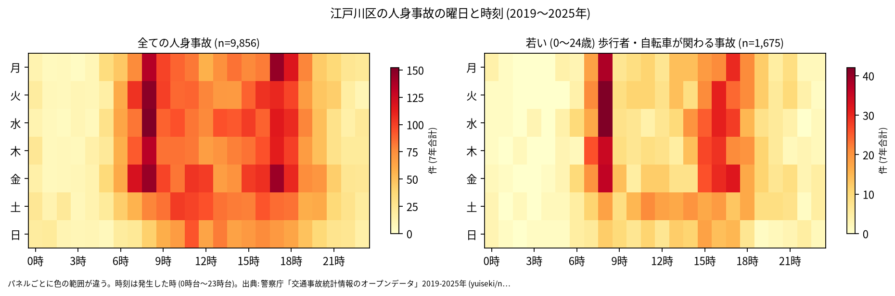
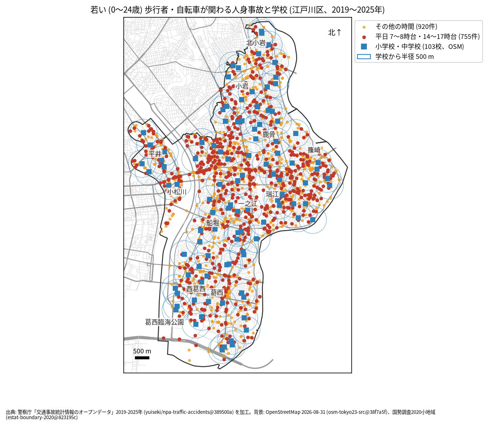

# 学校と PTA のための報告: 学校の周りの若い歩行者と自転車の事故

## 問い

江戸川区の学校の周り (半径 500 m) で、若い歩行者と自転車が関わる人身事故は、いつ、どこで起きているか。通学路の合同点検で見る場所と時間を選ぶ材料にします。

## 結論

- このデータで子どもだけを数えることはできません。年齢は年齢層で、最も若い区分が 0〜24 歳です。この報告の「若い」は 0〜24 歳で、大学生や若い社会人を含みます。
- 江戸川区で、若い歩行者か自転車が関わる人身事故は 7 年で 1,675 件 (全体の 17.0%、23 区で 1 位) でした ([summary.txt](../outputs/summary.txt)、[wards.csv](../outputs/wards.csv)、[analysis.json](../outputs/analysis.json))。年では 194 件 (2021 年) から 312 件 (2019 年) です ([yearly.csv](../outputs/yearly.csv))。
- 時間: 曜日を問わず多いのは 8 時台 (223 件)、16 時台 (175 件)、17 時台 (163 件)、15 時台 (153 件) です。平日 (月〜金) に限ると、8 時台 193 件、16 時台 142 件、17 時台 135 件、15 時台 118 件でした ([summary.txt](../outputs/summary.txt))。最も多いのは登校の時間の 8 時台で、下校から夕方の 15〜17 時台がそれに続きます。

- 場所: 学校から 500 m の円の中の件数が多いのは、松江第三中学校 94 件、第三松江小学校 73 件、大杉小学校 62 件、大杉東小学校 60 件です。円は重なるので、学校ごとの件数は足せません。小松川から一之江にかけての、区全体の事故が多い場所に円がかかる学校は、件数が大きくなります。

| 学校 (OSM の名前) | 500 m 以内の若い歩行者・自転車 | うち平日 7〜8 時台 | うち平日 14〜17 時台 |
|---|---:|---:|---:|
| 江戸川区立松江第三中学校 | 94 | 13 | 33 |
| 江戸川区立第三松江小学校 | 73 | 9 | 23 |
| 江戸川区立大杉小学校 | 62 | 10 | 17 |
| 江戸川区立大杉東小学校 | 60 | 16 | 11 |
| 江戸川区立 瑞江第二中学校 | 57 | 5 | 15 |
| 江戸川区立 春江小学校 | 56 | 11 | 17 |
| 江戸川区立篠崎小学校 | 56 | 15 | 7 |

103 校の全ては [schools.csv](../outputs/schools.csv) にあります。

赤い点 (平日の 7〜8 時台と 14〜17 時台、755 件) が、通学の時間に近い事故です ([school-map.json](../outputs/school-map.json))。点検では、学校の円の中で赤い点が並ぶ道を、通学路の地図と重ねて見ることを勧めます。

- 7 年で、平日の朝 (7〜8 時台) に 1 つの学校の円の中で起きた若い人の事故は 0〜18 件です (最多は小松川第二中学校) ([schools.csv](../outputs/schools.csv))。学校ごとの件数は少ないので、学校の順位より、点の位置を手がかりにしてください。

## データ

警察庁「交通事故統計情報のオープンデータ」を加工した `yuiseki/npa-traffic-accidents` 版 `389500a` の本票、江戸川区の 9,856 件 (2019〜2025 年のファイル)。学校は OpenStreetMap 2026-08-31 (`osm-tokyo23-src-2026-08` 版 `38f7a5f`) の、名前が「小学校」「中学校」で終わる 103 校 (「旧」で始まる閉校した学校は除く)。私立の学校を含みます。詳しくは [共通の報告](../report.md)。

## 方法

当事者 A か B が歩行者か自転車 (駆動補助機付を含む) で、その同じ当事者の年齢層が 0〜24 歳の事故を数えました。学校の位置は OSM の面の重心 (名前ごとに平均) で、円は直線 500 m (EPSG:6677 で測った) です。時刻は発生した時、平日は月曜から金曜で、祝日は分けていません。

## 確かめていないこと

- 小学生か、通学中かは分かりません。被害者か加害者かも区別していません (当事者 A は過失の重い側)。
- 学校の位置は校門ではなく、500 m は道のりではありません。通学路の線とは重ねていません。
- 8 時台の事故に、通勤や通学の高校生、大学生がどれだけ含まれるかは分かりません。
- ヒヤリハットと物損事故は入っていません。点検では、学校が集めている危険な場所の情報と合わせて使ってください。
