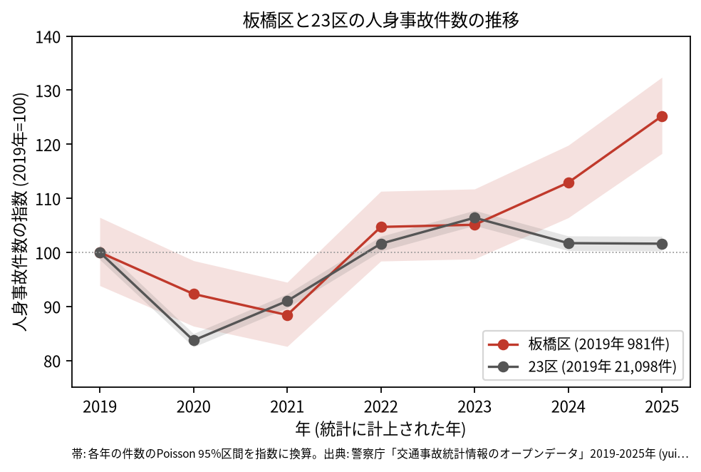
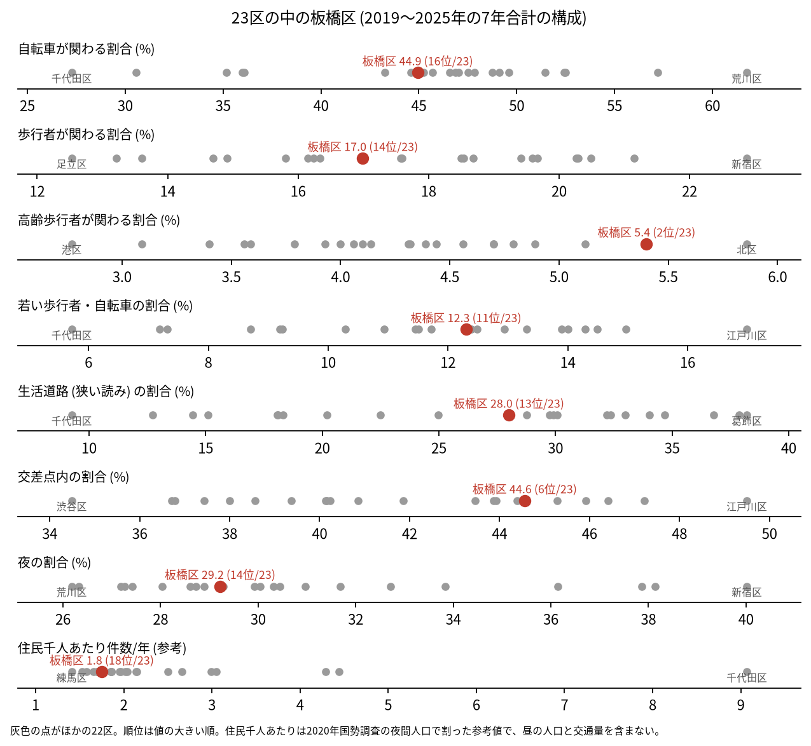
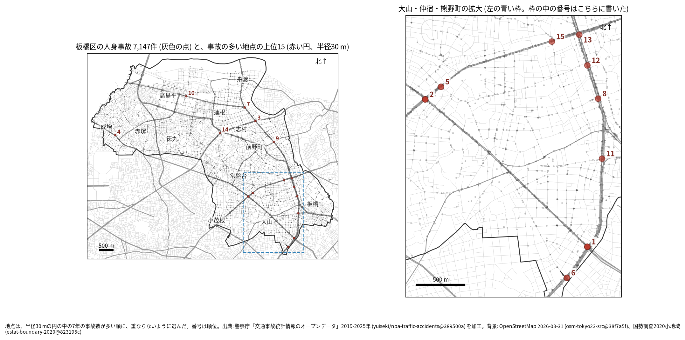
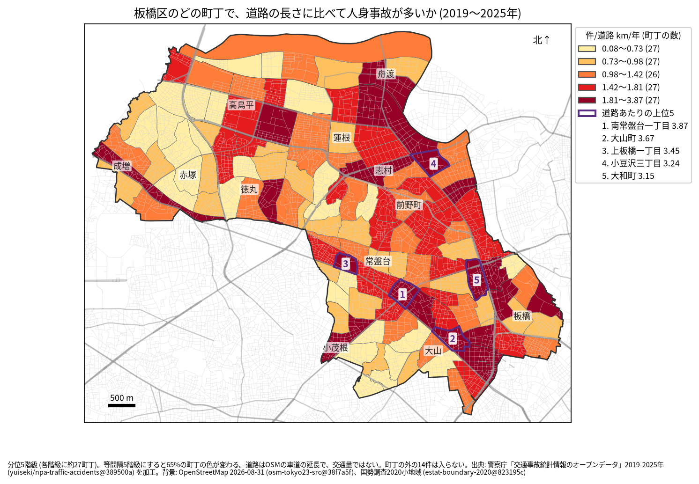
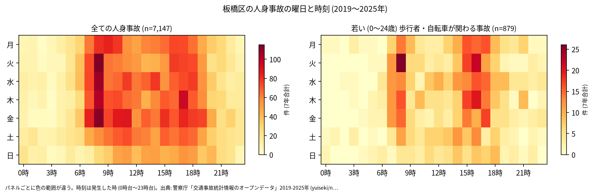
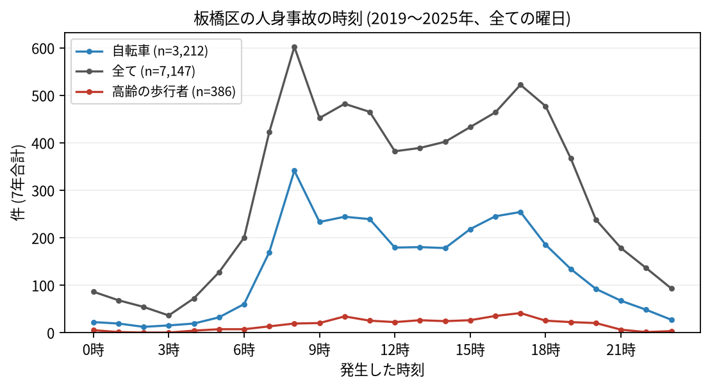
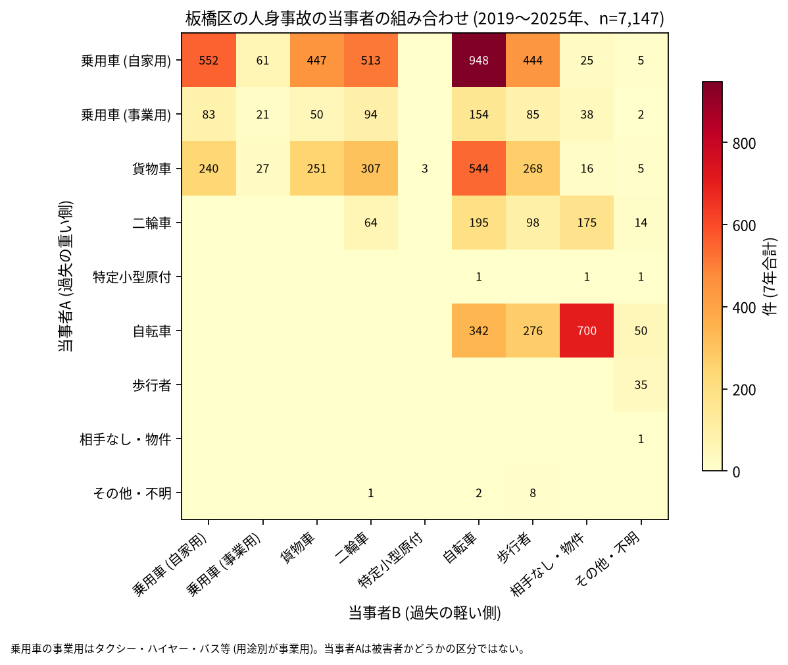

# 板橋区の交通事故 2019〜2025 年: 図で読む要点

## 問い

2019〜2025 年の警察記録の人身事故で、板橋区の事故はいつ、どこで、誰が関わって起きているか。

## 結論

### 要点

| # | 要点 | 数字 | 図 |
|---:|---|---|---|
| 1 | 件数は 2021 年を底に増え、2025 年は 2019 年より多い。23 区全体は 2019 年並み | 7 年で 7,147 件、死者 43 人、負傷者 8,000 人。指数 (2019 年=100) は 2021 年 88.4、2025 年 125.2 (1,228 件)。23 区全体の 2025 年は 101.6 ([yearly.csv](outputs/yearly.csv)、[summary.txt](outputs/summary.txt)) | [図 1](#図-1-件数の推移) |
| 2 | 増えた区分の 1 つは自転車の単独の事故。23 区全体でも同じ年から増えている | 自転車 (A) と相手なし・物件 (B) は 2019 年 23 件、2025 年 216 件。23 区全体は 1,035 件から 3,039 件 ([analysis.json](outputs/analysis.json)) | [図 6](#図-6-誰と誰の事故か) |
| 3 | 高齢の歩行者の関わる割合が 23 区で高い | 高齢の歩行者 5.4% (23 区の 2 位)、交差点内 44.6% (6 位)、生活道路 28.0% (13 位) ([wards.csv](outputs/wards.csv)、[analysis.json](outputs/analysis.json)) | [図 2](#図-2-23-区の中の板橋区) |
| 4 | 集まる場所は川越街道と中山道の交差点 | 1 位の熊野町 (山手通り × 川越街道) が 62 件で、2 位の 41 件より多い。上位 15 のうち 6 地点の最も近い道が中山道 ([hotspots.csv](outputs/hotspots.csv)、[summary.txt](outputs/summary.txt)) | [図 3](#図-3-事故の集まる地点) |
| 5 | 死亡事故は歩行者と貨物車に偏る | 死亡事故 42 件のうち、亡くなったのが歩行者の事故 18 件 (65 歳以上 9 件)、当事者 A が貨物車の事故 22 件 ([summary.txt](outputs/summary.txt)) | [表 1](#表-1-死亡事故) |

### 読み手ごとに知るべきこと

| 読み手 | 結論 | 検討する材料 | 詳しく |
|---|---|---|---|
| 区の交通安全担当 | 2025 年の 1,228 件は 2019 年より多い。生活道路の法定速度 30 km/h (2026-09-01 から) が当たるのは事故の 28.0〜40.3% (読み方による) | 増えた自転車の単独の事故の記録のされ方、高齢の歩行者、幹線の交差点 | [municipality.md](reports/municipality.md) |
| 学校と PTA | 若い (0〜24 歳) 歩行者と自転車の事故は 879 件。最多は 16 時台 (104 件) で、8 時台 (99 件) もほぼ同じ | 学校の円の中で、平日の朝と下校の時間の点が並ぶ道 | [school-pta.md](reports/school-pta.md) |
| 道路安全診断 | 上位は 山手通り (Yamate-dori Avenue) × 川越街道 (62 件)、環七通り × 川越街道 (41 件)、中山道 × 環八通り (32 件) | 1 位の交差点、後半に増えた 5〜7 位、首都高速の高架の下の中山道の地点 | [road-safety-auditor.md](reports/road-safety-auditor.md) |
| 住民 | 道路あたりで多いのは南常盤台一丁目 (年 3.873 件/道路 km)、大山町 (3.67 件)。事故は 8 時台が最多 | 自分の町の色、朝の自転車、夕方の高齢の歩行者 | [resident.md](reports/resident.md) |

### 図 1: 件数の推移

2020 年 (92.3) の落ち込みは 23 区全体 (83.7) より浅い。2022 年から増え、2025 年の 95% 区間 (1160.3〜1298.7 件) は 2019 年 (920.6〜1044.4 件) と重ならないので、増えたと書く。年ごとに、区のコードの件数と点が区の面に入る件数の差は 6 件以内で、区の数え方の変化では説明できない ([analysis.json](outputs/analysis.json))。

### 図 2: 23 区の中の板橋区

赤い点が板橋区。高齢の歩行者 (5.4%、2 位) と交差点内 (44.6%、6 位) が高く、ほかは 23 区の中ほど (自転車 44.9% は 16 位、生活道路 28.0% は 13 位)。住民千人あたり (1.75 件/年、18 位) は昼の人口を含まない参考値。

### 図 3: 事故の集まる地点

半径 30 m の円の中の 7 年の件数で選んだ上位 15 (20〜62 件)。番号は順位で、区の南東の 9 地点は右の拡大図に番号を書いた。

| 順位 | 近い道路 (OSM) | 町丁 | 件数 | 前半 件/年 | 後半 件/年 |
|---:|---|---|---:|---:|---:|
| 1 | 山手通り (Yamate-dori Avenue) × 川越街道 | 熊野町 | 62 | 9.67 | 8.25 |
| 2 | 環七通り × 川越街道 | 南常盤台一丁目 | 41 | 7.33 | 4.75 |
| 3 | 中山道 × 環八通り | 小豆沢三丁目 | 32 | 4.33 | 4.75 |
| 4 | 赤塚高台通り × 川越街道 | 成増二丁目 | 31 | 4.00 | 4.75 |
| 5 | 環七通り × 南ときわ通り | 南常盤台一丁目 | 28 | 3.00 | 4.75 |

前半は 2019〜2021 年、後半は 2022〜2025 年。道路の名前は OSM の名前をそのまま書いた (1 位の 1 本目は、英語を併記した名前が OSM に付いている)。半径を 20 m にしても 50 m にしても、上位 15 のうち 11 地点が残る。6〜15 位は [hotspots.csv](outputs/hotspots.csv)。

### 図 4: 町丁ごとの事故

町丁の事故数を、OSM の車道の延長と 7 年で割った値。紫の枠が上位 5 (南常盤台一丁目、大山町、上板橋一丁目、小豆沢三丁目、大和町)。分位と等間隔で 65% の町丁の色が変わるので、色の細かい差は読まない。道路の長さは交通量ではない。

### 図 5: いつ起きるか

全体は平日の 8 時台が最も多く (平日 518 件)、夕方 17 時台にもう 1 つの山がある。若い歩行者と自転車は 16 時台 (104 件) と 8 時台 (99 件) にほぼ同じ高さの山がある。

自転車は 8 時台 (341 件)、高齢の歩行者は 17 時台 (41 件) が最多。

### 図 6: 誰と誰の事故か

最も多いのは自家用の乗用車 (A) と自転車 (B) の 948 件、次が自転車の単独 (相手なし・物件) の 700 件、乗用車どうしの 552 件、貨物車と自転車の 544 件。当事者 A は過失の重い側で、被害者とは限らない。

自転車の単独の事故は、年ごとに 23 件 (2019 年)、17 件、19 件、112 件 (2022 年)、135 件、178 件、216 件 (2025 年) と、2022 年に跳ねた ([party_by_year.csv](outputs/party_by_year.csv))。23 区全体でも 1,035 件 (2019 年)、1,626 件 (2021 年)、2,817 件 (2022 年)、3,039 件 (2025 年) と増えた ([analysis.json](outputs/analysis.json))。同じ年に 23 区で増えたので、自転車の転倒の増え方だけでなく、自転車の単独の事故の記録のされ方が変わった可能性もある (このデータでは確かめられない)。

### 表 1: 死亡事故

| 亡くなった人 | 死亡事故の件数 | 特徴 |
|---|---:|---|
| 歩行者 | 18 | 65 歳以上が 9 件 |
| 二輪車 | 10 | |
| 自転車 | 8 | |
| 乗用車 (自家用) | 4 | |
| 補充票の人 | 2 | 本票の当事者 A、B ではない人 |

42 件 (死者 43 人) のうち、当事者 A が貨物車の事故が 22 件、0〜5 時台が 9 件。数が少ないので傾向とは断定しない。全件は [deaths.csv](outputs/deaths.csv)。

### 読み方で変わる答え

| 読み方 | 主 | 別の読み方 |
|---|---|---|
| 板橋区の事故 | `市区町村コード` 119 の 7,147 件 | 点が区の面に入る事故。両方に当てはまるのは 7,133 件 ([analysis.json](outputs/analysis.json)) |
| 生活道路 | 狭い読み 28.0% (13 位) | 広い読み 40.3% (12 位) |
| 地点の半径 | 30 m | 20 m でも 50 m でも 11 地点が残る |
| 首都高速の事故 | 含める | 除くと 13 地点が残る。首都高速の事故は区で 173 件、上位 15 の円には 11 件 ([analysis.json](outputs/analysis.json)) |
| 町丁の階級 | 分位 5 階級 | 等間隔で 65%、Jenks で 70% の町丁の色が変わる ([town-rate-quantile.json](outputs/town-rate-quantile.json)) |

## データ

- 人身事故: 警察庁「交通事故統計情報のオープンデータ」を加工した `yuiseki/npa-traffic-accidents` 版 `389500aae5cec45f1311163f70db6a5f05867838` (配布元の取得 2026-10-02) の本票。年はファイルの年 (統計に計上された年)。板橋区 7,147 件、23 区 144,716 件。位置の無い行は 0。物損事故は含まない。
- 区の面と人口: `yuiseki/jp-admin-2026-09` 版 `e6c87b1`。町丁: 2020 年国勢調査の小地域 `yuiseki/estat-boundary-2020` 版 `823195c` (134 町丁、584,483 人)。学校 76 校と道路: OpenStreetMap 2026-08-31、`yuiseki/osm-tokyo23-src-2026-08` 版 `38f7a5f`。
- 道具: DuckDB 2.0.0 (spatial)、matplotlib、`analysis-visualize` の `cjk_font.py`、`classify_map.py`、`context_map.py`。スクリプトは台東区の型 (2026-11-03 版) を写し、区の定数だけを直した。
- 出典の表示: 警察庁ウェブサイト (https://www.npa.go.jp/publications/statistics/koutsuu/opendata/index_opendata.html) の交通事故統計情報のオープンデータを加工して作成。国勢調査の小地域境界と人口、OpenStreetMap (© OpenStreetMap contributors) を加工して使用。

## 方法

- 板橋区の事故は、本票の `市区町村コード` が 119 の事故。読み方は結果を見る前に [計画](EXPERIMENT_PLAN.md) で固定し (台東区と同じ読み方と区画)、実行は [記録](EXPERIMENT_TRACKER.md) に残した。生活道路は `車道幅員` が 01、02、11 (狭い読み)、広い読みは 14、17 を足す。歩行者や自転車が関わるかは当事者 A と B の両方で見て、1 件を 1 回数えた。
- 年齢はデータの年齢層で読む。若い人は 01 (0〜24 歳)、高齢の人は 65 (65〜74 歳) と 75 (75 歳以上)。
- 距離は EPSG:6677 (メートル) で測った。町丁の道路あたりの上位 5 には、道路が 0.5 km より短い町丁を数えない (板橋区には無い)。地点は、半径 30 m の中の件数が最も多い点を中心に選び、その円の事故を除いて次を選ぶ手順を 15 回くり返した。地点の名前は、中心に最も近い道と、それと 30 度以上の向きで交わる道のうち最も近い道 (どちらも 30 m 以内のときだけ)。
- 自転車の単独の事故の年ごとの件数 (23 区全体) は、1 回目の結果を見た後に足した集計 (記録の R010)。
- 地図は `analysis-visualize` の map-context に合わせ、地名と道路を重ね、凡例を地図の外に置き、強調した単位に番号を付けた。描いた町丁の数 (134) を分析の数と照らし、文字の重なりと、地名や番号が円や学校の印を隠す重なりは、3 枚の地図で 0 件 (1 回目に学校の四角を隠した地名 3 つの位置を直した後)。背景の道路 (OGC:CRS84) と町丁 (JGD2000) の差は、線の幅より小さいとして変換せずに重ねた。
- 関門: 予測と回帰をしないので、評価の分け方と残差の確認は要らない。単位の間の相関を結論にしないので、Moran's I と格子の掃引は省いた。推移は 23 区全体を基準にし、年の件数に Poisson の 95% 区間を付けた。対策の効果は推定していない。
- 再実行は [README.md](README.md)。数値は [outputs/](outputs/) の CSV、来歴は [analysis.json](outputs/analysis.json)。

## 確かめていないこと

- 交通量、昼の人口で割っていない。川越街道と中山道の交差点の件数の多さは、車の多さかもしれない。
- 自転車の単独の事故が 2022 年に跳ねた理由 (転倒の増加か、記録や計上の仕方の変化か) は調べていない。2025 年の増加を区の危険の高まりとは読まない。
- 位置の精度は分からない。30 m の地点と町丁の境界の近くの事故は、数十 m のずれで入れ替わる。1 位の熊野町の地点は豊島区との境に近い。
- 首都高速 5 号池袋線の高架は中山道の上を通る (外の知識、未確認)。高架の事故は下の道と同じ位置を持つので、中山道の地点の一部 (8 位 3 件、12 位 3 件) は首都高速の事故を含む。
- 事故の型 (出会い頭、追突)、重傷と軽傷の区別、物損事故、ヒヤリハットは、このデータに無い。
- 0〜24 歳より細かい年齢は無く、小学生だけは数えられない。
- 地点の上位は 7 年で選び、同じ 7 年で前半と後半を比べたので、後半が下がって見えやすい (平均への回帰)。
