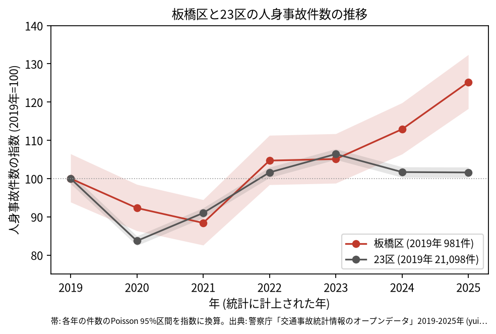
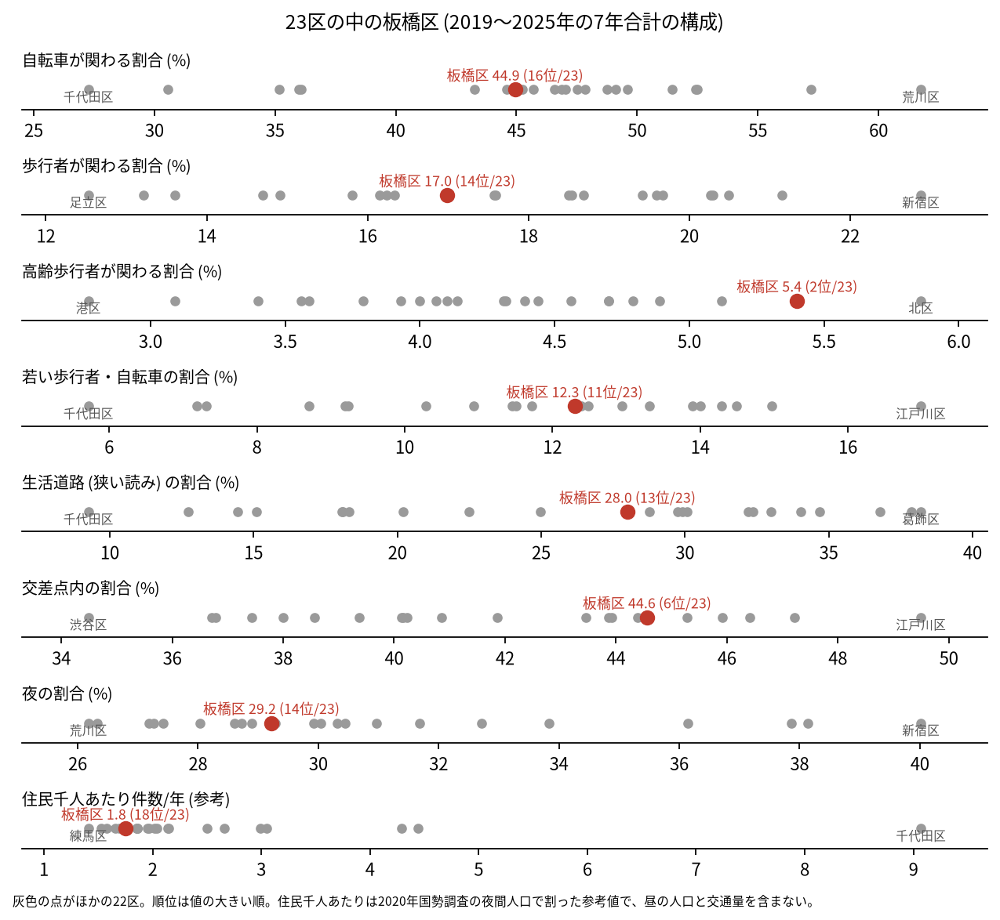
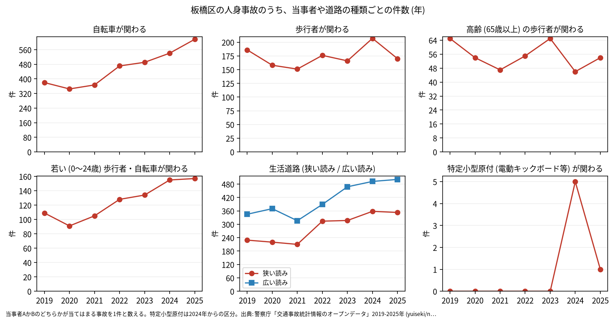

# 区の交通安全担当のための報告: 板橋区の交通事故の傾向

## 問い

板橋区の人身事故は 2019〜2025 年にどう推移し、23 区の中でどんな特徴があり、施策をどこに向ける材料になるか。

## 結論

- 件数: 7 年で 7,147 件、死者 43 人、負傷者 8,000 人です。2021 年に 867 件 (2019 年を 100 として 88.4) まで減り、その後は毎年増えて、2025 年は 1,228 件 (125.2) でした。2025 年の 95% 区間 (1160.3〜1298.7 件) は 2019 年の区間 (920.6〜1044.4 件) と重ならないので、2019 年より増えたと言えます。23 区全体の 2025 年は 101.6 で、2019 年並みです。

- 増えた区分: 自転車が関わる事故は 2019 年 380 件から 2025 年 617 件に増えました。そのうち自転車の単独 (当事者 B が相手なし・物件) の事故は 2019 年 23 件、2021 年 19 件から、2022 年 112 件、2025 年 216 件になりました ([party_by_year.csv](../outputs/party_by_year.csv))。23 区全体でも、同じ事故は 2019 年 1,035 件から 2022 年 2,817 件、2025 年 3,039 件に増えています ([analysis.json](../outputs/analysis.json))。23 区で同じ年に跳ねているので、自転車の転倒が増えただけでなく、単独の事故の記録や計上の仕方が変わった可能性があります。理由はこのデータでは確かめられません。区の施策を評価する前に、警視庁に計上の変化の有無を確かめることを勧めます。
- 23 区の中の位置: 高齢の歩行者が関わる割合は 5.4% で 23 区の 2 位、交差点内の割合は 44.6% で 6 位です。生活道路 (狭い読み) の割合は 28.0% で 13 位、広い読みでは 40.3% で 12 位、自転車が関わる割合 (44.9%) は 16 位、若い歩行者と自転車 (12.3%) は 11 位で、23 区の中ほどです。

- 施策への読み方: 2026-09-01 からの生活道路の法定速度 30 km/h は、板橋区の事故のうち 28.0〜40.3% (読み方による) に当たります。件数の多い地点は川越街道、中山道、環七通り、山手通りの交差点です (地点は [道路安全診断の報告](road-safety-auditor.md))。路線で見ると、7 年で区道の事故が 3,783 件、国道が 1,509 件 (国道 17 号 862 件、国道 254 号 647 件) でした ([summary.txt](../outputs/summary.txt)、[analysis.json](../outputs/analysis.json))。これは効果の予測ではなく、どの道路で事故が起きているかの構成です。
- 区分ごとの推移: 若い歩行者と自転車の事故は 2019 年 109 件から 2025 年 157 件、生活道路 (狭い読み) の事故は 229 件から 353 件に増えました。特定小型原付 (電動キックボードなど) が関わる事故は、区分のできた 2024 年に 5 件、2025 年に 1 件でした。

- 死亡事故: 42 件 (死者 43 人) のうち、亡くなったのが歩行者の事故が 18 件、二輪車が 10 件、自転車が 8 件です。亡くなった歩行者の 18 件のうち 9 件は 65 歳以上でした。当事者 A (過失の重い側) が貨物車の事故が 22 件、0〜5 時台に起きた事故が 9 件です。42 件は少なく、偏りを傾向と断定できる数ではありません。

| 年 | 当事者 A | 当事者 B | 亡くなった人 | 時 |
|---|---|---|---|---:|
| 2019 | 貨物車 | 歩行者 (25〜34 歳) | 歩行者 | 9 |
| 2020 | 貨物車 | 歩行者 (35〜44 歳) | 歩行者 | 15 |
| 2021 | 貨物車 | 歩行者 (75 歳以上) | 歩行者 | 16 |
| 2022 | 貨物車 | 歩行者 (0〜24 歳) | 歩行者 | 3 |
| 2022 | 貨物車 | 歩行者 (75 歳以上) | 歩行者 | 10 |
| 2023 | 貨物車 | 歩行者 (35〜44 歳) | 歩行者 | 20 |
| 2023 | 貨物車 | 歩行者 (65〜74 歳) | 歩行者 | 23 |
| 2024 | 貨物車 | 歩行者 (55〜64 歳) | 歩行者 | 10 |
| 2024 | 貨物車 | 歩行者 (0〜24 歳) | 歩行者 | 2 |
| 2025 | 貨物車 | 歩行者 (75 歳以上) | 歩行者 | 12 |
| 2025 | 貨物車 | 歩行者 (0〜24 歳) | 歩行者 | 15 |

表は、当事者 A が貨物車で、亡くなったのが歩行者の死亡事故の抜き出しです。42 件 ([summary.txt](../outputs/summary.txt)) の全ては [deaths.csv](../outputs/deaths.csv) にあります。年齢は当事者 B の年齢層です。

- 人口あたり: 2020 年の住民千人あたりの年の件数は 1.75 件で 23 区の 18 位ですが、分母に昼の人口と通過する車が入らないため、区の比較の主な指標にしていません。

## データ

警察庁「交通事故統計情報のオープンデータ」を加工した `yuiseki/npa-traffic-accidents` 版 `389500a` の本票。板橋区は `市区町村コード` 119 の 7,147 件、23 区は 144,716 件。年はファイルの年 (統計に計上された年)。区の人口は 2020 年国勢調査 (`jp-admin-2026-09` 版 `e6c87b1`)。詳しくは [共通の報告](../report.md)。

## 方法

区分は、当事者 A か B のどちらかが当てはまる事故を 1 件と数えました。生活道路は `車道幅員` で決め、狭い読み (5.5 m 未満の単路と、小と小の交差点) と、広い読み (5.5 m 未満の道とより広い道の交差点も含む) を並べました。年の区間は件数の Poisson の 95% 区間 (Garwood) です。23 区の順位は 7 年合計の割合の大きい順です。自転車の単独の事故の 23 区全体の年ごとの件数は、1 回目の結果を見た後に足した集計です。

## 確かめていないこと

- 2022 年からの増え方の理由 (自転車の利用の増加、記録や計上の仕方の変化など) は調べていません。
- 区の施策 (ゾーン 30、自転車の通行帯など) の効果は推定していません。割合の順位は施策の評価ではありません。
- 重傷と軽傷の区別、物損事故は、このデータにありません。
