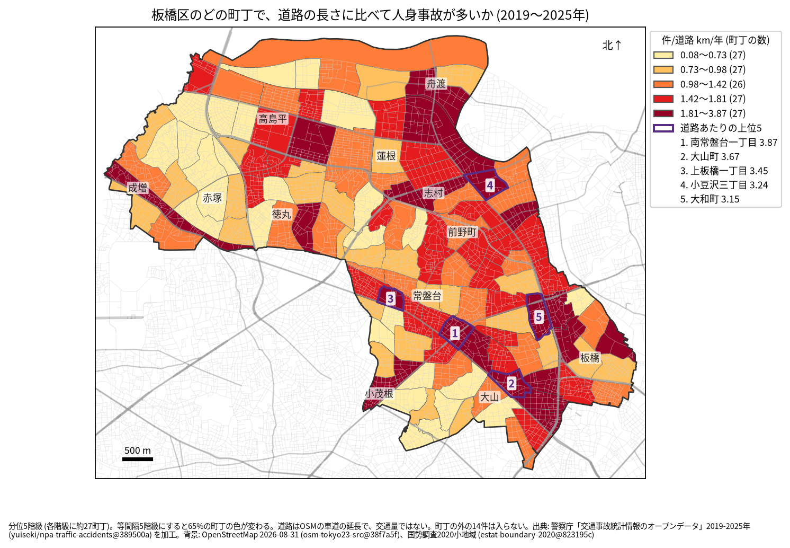
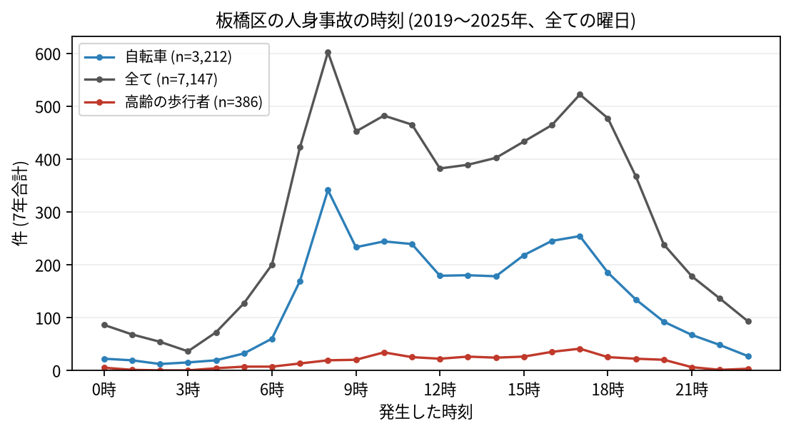

# 住民のための報告: 板橋区で、いつ、どこで事故が起きているか

## 問い

板橋区に住む人が、自分の町で、いつ、どんな事故に気をつければよいか。2019〜2025 年の警察記録の人身事故から調べました。

## 結論

- 板橋区では 7 年で 7,147 件の人身事故があり、43 人が亡くなりました。年に 867〜1,228 件で、2022 年から増えています。
- 町ごと: 道路 1 km あたりの事故が多いのは、南常盤台一丁目 (年 3.873 件)、大山町 (3.67 件)、上板橋一丁目 (3.449 件)、小豆沢三丁目 (3.238 件)、大和町 (3.145 件) です。件数そのものが最も多いのも南常盤台一丁目 (7 年で 169 件) で、仲宿 (162 件)、熊野町 (160 件) が続きます。川越街道と中山道に沿って、色の濃い町が並びます。

色は分位 5 階級で、各色に約 27 の町が入ります。等間隔の階級にすると 65% の町の色が変わるので、色の差より、自分の町が上の階級か下の階級かを見てください。

- 時間: 事故は朝 8 時台が最も多く (602 件)、夕方 17 時台 (522 件) にもう 1 つの山があります。自転車が関わる事故も 8 時台 (341 件) が最も多く、高齢の歩行者が関わる事故は 17 時台 (41 件) が最も多い時間でした。

- 誰が: 自転車が関わる事故が全体の 44.9% で、最も多い区分です。自転車に乗る人は、車やトラックとの事故 (1,646 件) に加え、自転車だけの事故 (転倒や物への衝突、700 件) にも気をつけてください。自転車だけの事故は 2019 年の 23 件から 2025 年の 216 件に増えました (23 区全体でも同じ年から増えていて、記録の仕方が変わった可能性もあります)。歩行者が関わる事故は 17.0% です。
- 亡くなった人: 死亡事故 42 件のうち 18 件で歩行者が亡くなり、そのうち 9 件は 65 歳以上の人でした。高齢の歩行者が関わる事故の割合 (5.4%) は 23 区で 2 番目に高い区です。

## データ

警察庁「交通事故統計情報のオープンデータ」を加工した `yuiseki/npa-traffic-accidents` 版 `389500a` の本票、板橋区の 7,147 件 (2019〜2025 年のファイル)。町の境界は 2020 年国勢調査の小地域 (134 町丁)、道路は OpenStreetMap 2026-08-31。詳しくは [共通の報告](../report.md)。

## 方法

事故の地点を町丁の境界に入れて数え、町丁の中の車道の長さ (OSM) と 7 年で割りました。区の境界の近くで町丁の外に落ちた 14 件は町の値に入っていません。時刻は事故の起きた時で、7 年の合計です。

## 確かめていないこと

- 道路の長さは、通る車や人の数ではありません。川越街道と中山道の沿いの町の値が高いのは、車が多いためかもしれません。
- 自分の町の事故が少なくても、物損事故やヒヤリハットはこのデータにありません。
- 事故の位置の精度は分かりません。町の境界の近くの事故は、隣の町に数えられている可能性があります。
