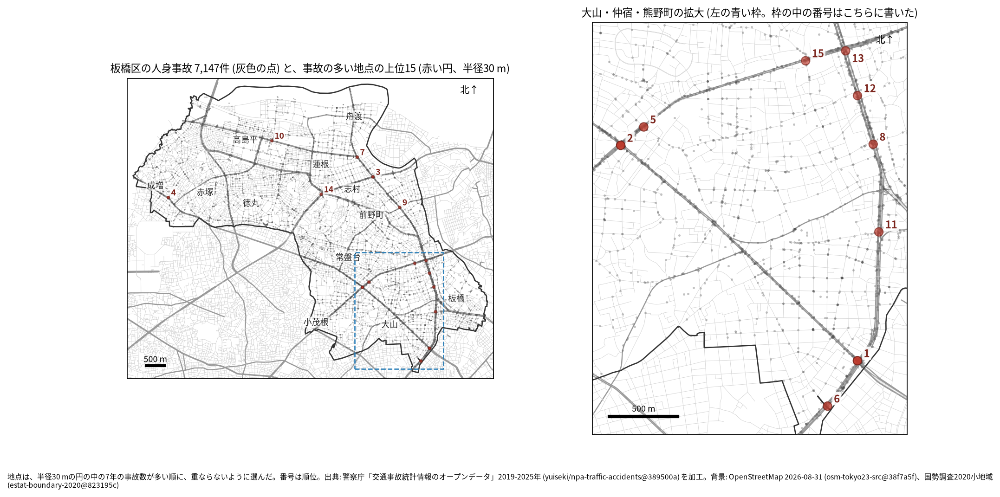
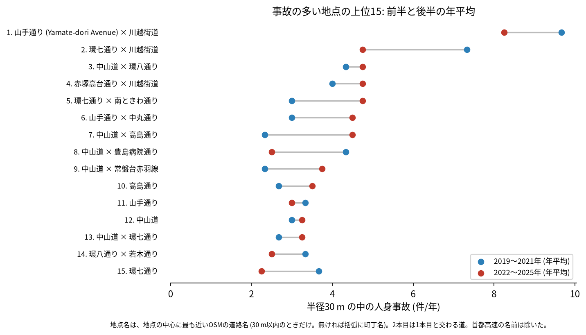
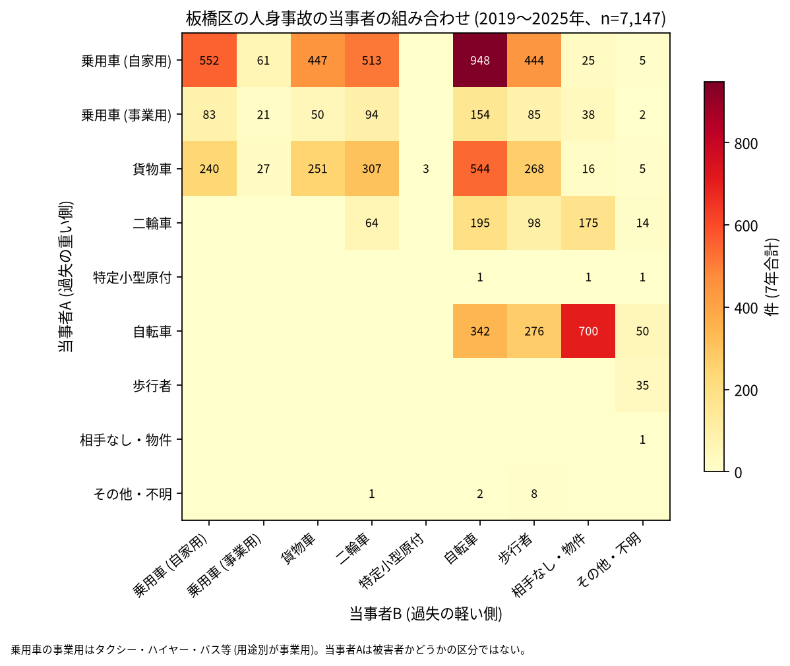

# 道路安全診断のための報告: 板橋区で事故の集まる地点

## 問い

板橋区で 2019〜2025 年の人身事故が集まる地点はどこで、そこでは誰と誰の事故が多いか。現地診断の候補を選ぶ材料にします。

## 結論

- 半径 30 m の円の中の 7 年の件数で選んだ上位 15 地点は、20〜62 件です。1 位の熊野町の交差点 (山手通り × 川越街道) は 62 件で、2 位 (41 件) より大きく多い地点です。上位 15 のうち 6 地点は中山道 (国道 17 号)、3 地点は環七通りが最も近い道で、川越街道 (国道 254 号) が 2 本目に入る地点が 1、2、4 位です。

| 順位 | 近い道路 (OSM) | 件数 | 前半 件/年 | 後半 件/年 | 交差点内 | 信号あり | 首都高速 | 多い組み合わせ (A × B) |
|---:|---|---:|---:|---:|---:|---:|---:|---|
| 1 | 山手通り (Yamate-dori Avenue) × 川越街道 | 62 | 9.67 | 8.25 | 55 | 58 | 1 | 乗用車 (自家用) × 乗用車 (自家用) |
| 2 | 環七通り × 川越街道 | 41 | 7.33 | 4.75 | 33 | 38 | 0 | 乗用車 (自家用) × 自転車 |
| 3 | 中山道 × 環八通り | 32 | 4.33 | 4.75 | 29 | 29 | 0 | 乗用車 (自家用) × 自転車 |
| 4 | 赤塚高台通り × 川越街道 | 31 | 4.00 | 4.75 | 17 | 20 | 0 | 乗用車 (自家用) × 二輪車 |
| 5 | 環七通り × 南ときわ通り | 28 | 3.00 | 4.75 | 12 | 23 | 0 | 乗用車 (自家用) × 自転車 |
| 6 | 山手通り × 中丸通り | 27 | 3.00 | 4.50 | 19 | 23 | 1 | 貨物車 × 歩行者 |
| 7 | 中山道 × 高島通り | 25 | 2.33 | 4.50 | 11 | 17 | 0 | 乗用車 (自家用) × 二輪車 |
| 8 | 中山道 × 豊島病院通り | 23 | 4.33 | 2.50 | 11 | 12 | 3 | 乗用車 (自家用) × 二輪車 |
| 9 | 中山道 × 常盤台赤羽線 | 22 | 2.33 | 3.75 | 17 | 19 | 0 | 乗用車 (自家用) × 乗用車 (自家用) |
| 10 | 高島通り | 22 | 2.67 | 3.50 | 18 | 20 | 0 | 乗用車 (自家用) × 二輪車 |

前半は 2019〜2021 年、後半は 2022〜2025 年。11〜15 位と、歩行者、自転車、夜の件数は [hotspots.csv](../outputs/hotspots.csv) にあります。道路名は地点の中心に最も近い OSM の道路名 (30 m 以内のときだけ) で、2 本目は 1 本目と交わる向き (30 度以上) の道のうち最も近いもので、30 m 以内のときだけ書きました (首都高速の名前は除いた)。1 位の 1 本目は、OSM の名前に英語が併記されたものがそのまま出ています。多い組み合わせは、円の中で最も多い組で、件数は 3〜16 件と少ない組です。

- 続いているか: 上位 15 は全て前半と後半の両方に事故があります。2 位 (7.33 から 4.75 件/年) と 8 位 (4.33 から 2.50 件/年) は後半に減り、7 位 (2.33 から 4.50 件/年)、5 位 (3.00 から 4.75 件/年)、6 位 (3.00 から 4.50 件/年) は増えました。上位は 7 年合計で選んだので、後半が下がって見えやすい (平均への回帰) ことに注意してください。

- 首都高速: 区の首都高速の事故は 7 年で 173 件、上位 15 の円の中に 11 件あり、8 位と 12 位 (どちらも中山道) が 3 件ずつです。首都高速 5 号池袋線の高架は中山道の上を通る (外の知識) ので、中山道の地点には高架の上の事故が混ざります。首都高速の事故を除いて地点を選び直すと、上位 15 のうち 13 地点が 30 m 以内に残りました ([analysis.json](../outputs/analysis.json))。
- 組み合わせ: 当事者 A が乗用車か貨物車で B が自転車の事故は 1,646 件です。自転車の単独 (相手なし・物件) が 700 件、自転車どうしが 342 件、自転車と歩行者 (自転車が A) が 276 件ありました。事業用の乗用車 (タクシー、ハイヤー、バスなど) は 527 件で当事者 A です。

- 半径を変えると: 20 m の上位 15 の中心が、30 m の上位 15 の中心から 30 m 以内にあるのは 11 地点、50 m でも 11 地点でした。上位に入る交差点の多くは保たれますが、残りの地点は半径で入れ替わります。順位は細かく読まないでください。

## データ

警察庁「交通事故統計情報のオープンデータ」を加工した `yuiseki/npa-traffic-accidents` 版 `389500a` の本票、板橋区 (`市区町村コード` 119) の 7,147 件。道路名は OpenStreetMap 2026-08-31 (`osm-tokyo23-src-2026-08` 版 `38f7a5f`)。詳しくは [共通の報告](../report.md)。

## 方法

事故の点を EPSG:6677 (メートル) に変換し、半径 30 m の円の中の件数が最も多い事故の点を中心に選び、その円の事故を除いて次を選ぶ手順を 15 回くり返しました。30 m はコード表の「交差点付近」(交差点の側端から 30 m 以内) の幅です。信号ありは `信号機` が 3 灯式、押ボタン式、歩車分式の点灯。組み合わせは当事者 A (過失の重い側) と B の種別で、乗用車は `用途別` で事業用と自家用に分けました。首都高速は `路線コード` 5000〜5499 です。

## 確かめていないこと

- 交通量で割っていません。件数の多い交差点が、車の多さに比べて危険かは分かりません。
- 事故の型 (出会い頭、右折、追突)、違反の種類、重傷と軽傷の区別は、このデータにありません。現地で確かめてください。
- 位置の精度は分かりません。数十 m のずれで地点の件数は変わります。1 位の熊野町の地点は豊島区との境に近く、境の向こう側の事故は、豊島区のコードが付いていればここに入っていません。
- 偶然でもこの程度の集まりが生まれるか (順位の有意さ) は調べていません。
