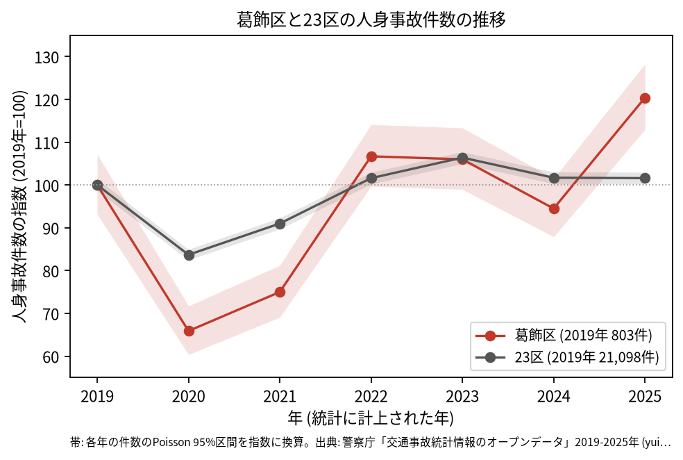
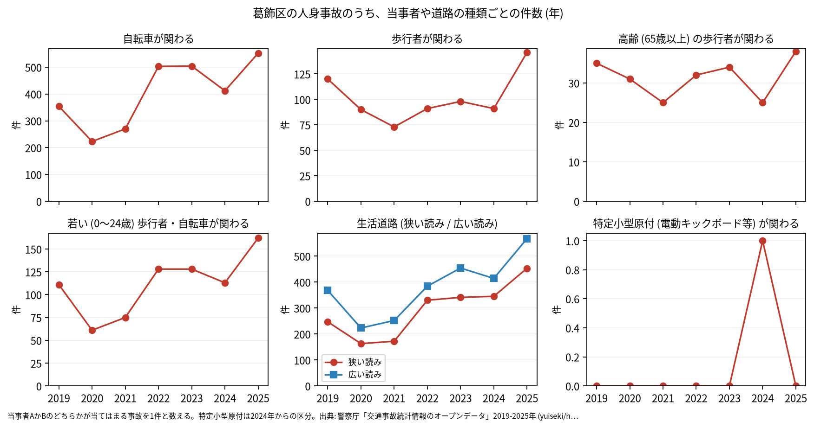
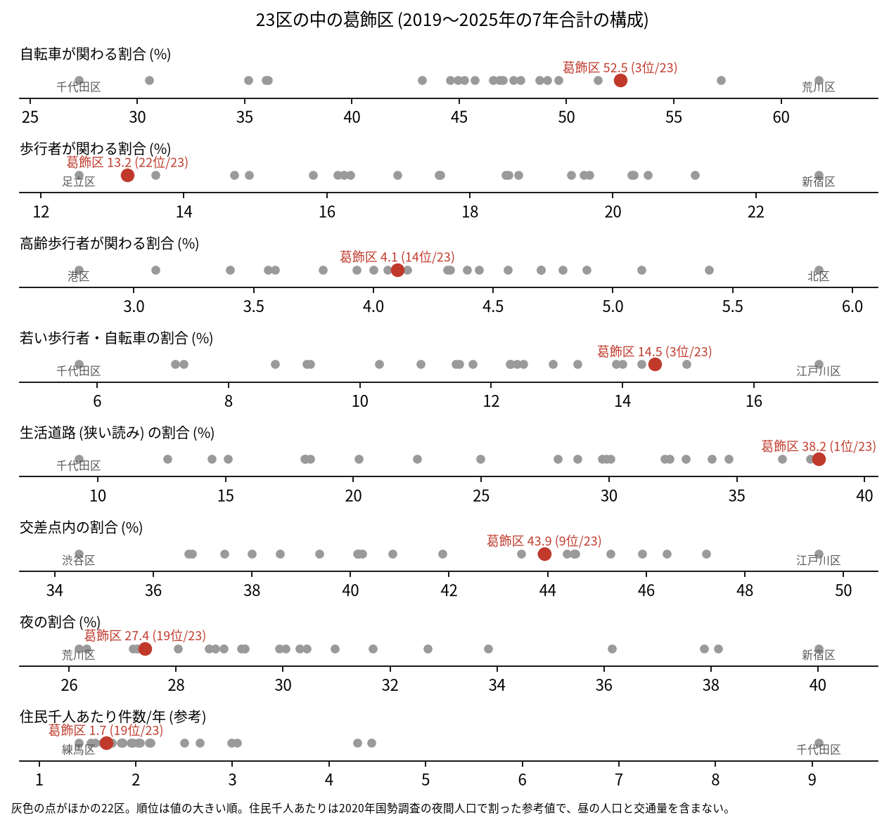
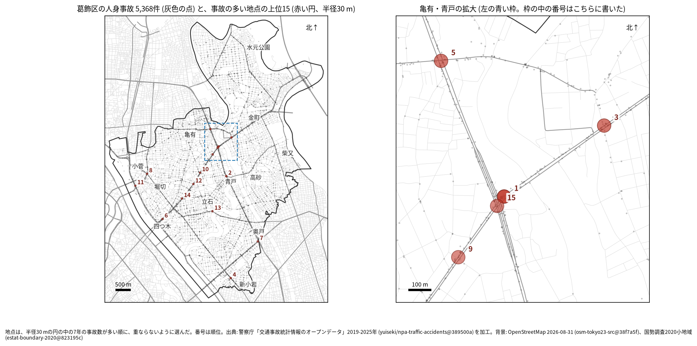
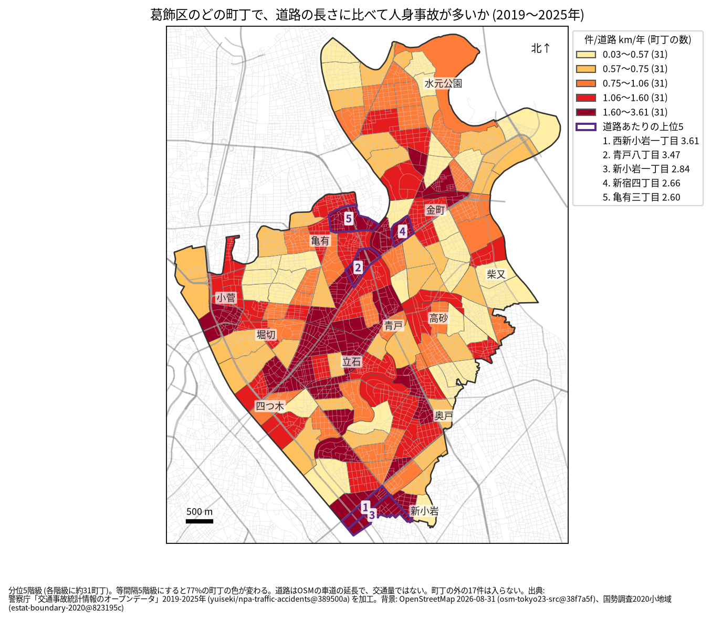
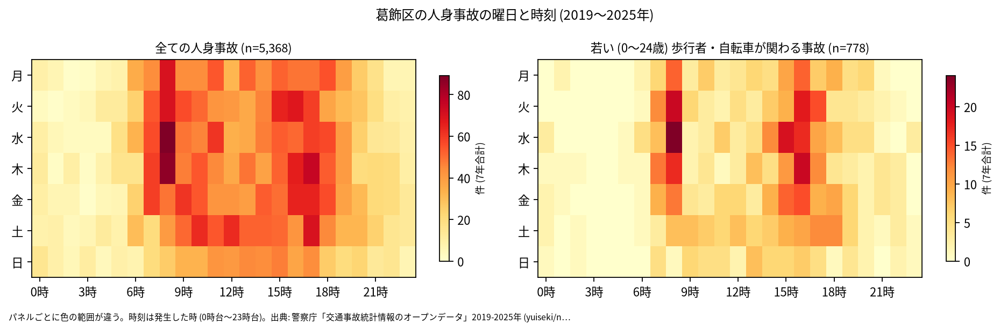
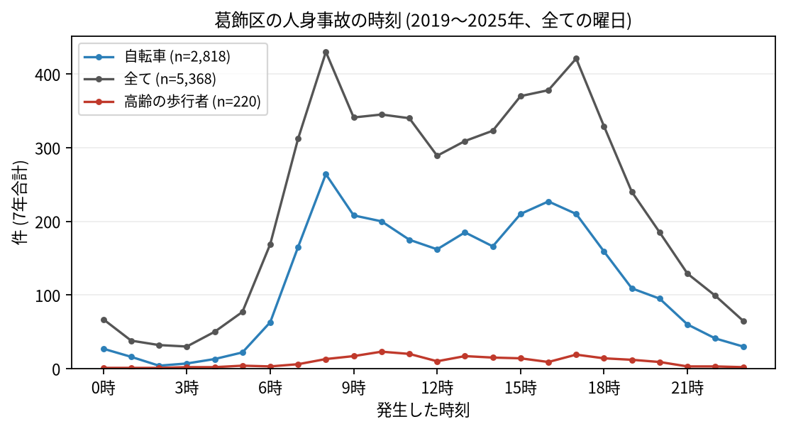
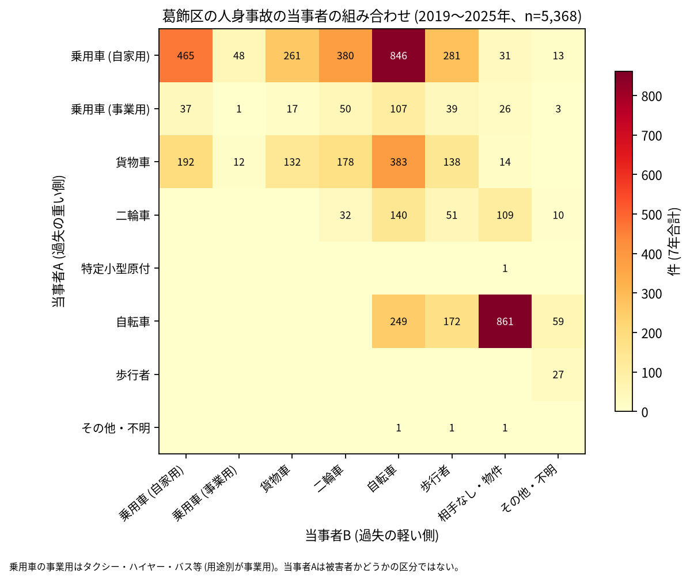

# 葛飾区の交通事故 2019〜2025 年: 図で読む要点

## 問い

2019〜2025 年の警察記録の人身事故で、葛飾区の事故はいつ、どこで、誰が関わって起きているか。

## 結論

### 要点

| # | 要点 | 数字 | 図 |
|---:|---|---|---|
| 1 | 件数は 2020 年に大きく減り、2022 年に戻り、2025 年は 2019 年より増えた | 7 年で 5,368 件、死者 27 人、負傷者 5,921 人。指数 (2019 年=100) は 2020 年 65.9、2025 年 120.4。2025 年の区間 907.0〜1029.9 件は 2019 年の 748.4〜860.5 件と重ならない ([yearly.csv](outputs/yearly.csv)、[summary.txt](outputs/summary.txt)) | [図 1](#図-1-件数の推移) |
| 2 | 事故の半分に自転車が関わり、生活道路の割合は 23 区で最も高い | 自転車 52.5% (23 区の 3 位)、生活道路 (狭い読み) 38.2% (1 位)、若い歩行者・自転車 14.5% (3 位) ([wards.csv](outputs/wards.csv)、[analysis.json](outputs/analysis.json)) | [図 2](#図-2-23-区の中の葛飾区) |
| 3 | 事故の多い地点は水戸街道 (国道 6 号) に並ぶ | 上位 15 のうち 8 地点で最多の路線が国道 6 号、1 位は青戸八丁目の水戸街道 (37 件) ([hotspots.csv](outputs/hotspots.csv)、[summary.txt](outputs/summary.txt)) | [図 3](#図-3-事故の集まる地点) |
| 4 | 最も多い組み合わせは自転車の単独事故 | 自転車 (A) と相手なし・物件の 861 件、自家用の乗用車 (A) と自転車 (B) の 846 件 ([summary.txt](outputs/summary.txt)) | [図 6](#図-6-誰と誰の事故か) |
| 5 | 亡くなった人は自転車と二輪車と歩行者に分かれる | 死者 27 人のうち自転車 8 人、二輪車 8 人、歩行者 7 人 (65 歳以上が 3 人) ([summary.txt](outputs/summary.txt)) | [表 1](#表-1-死亡事故) |

### 読み手ごとに知るべきこと

| 読み手 | 結論 | 検討する材料 | 詳しく |
|---|---|---|---|
| 区の交通安全担当 | 生活道路の法定速度 30 km/h (2026-09-01 から) が当たるのは事故の 38.2〜49.6% (読み方による) で、23 区で最も広く当たる区の 1 つ。2025 年は 2019 年より増えた | 生活道路の自転車、2022 年からの自転車の増加、水戸街道 | [municipality.md](reports/municipality.md) |
| 学校と PTA | 若い (0〜24 歳) 歩行者と自転車の事故は 778 件。平日は 8 時台 (88 件) と 16 時台 (84 件) に多く、朝の登校の時間も多い | 学校の円の中で、平日 7〜8 時台と 14〜17 時台の点が並ぶ道 | [school-pta.md](reports/school-pta.md) |
| 道路安全診断 | 上位は水戸街道 (青戸八丁目、37 件)、環七通り × 青戸銀座通り (28 件)、水戸街道 (新宿四丁目、22 件)、平和橋通り (新小岩二丁目、22 件) | 水戸街道の亀有・青戸から四つ木までの地点、後半に増えた 13 位と 6 位 | [road-safety-auditor.md](reports/road-safety-auditor.md) |
| 住民 | 道路あたりで多いのは西新小岩一丁目 (年 3.61 件/道路 km)、青戸八丁目 (3.47 件)。事故は 8 時台と 17 時台が山 | 自分の町の色、朝の通勤と通学の時間、自転車の単独事故 | [resident.md](reports/resident.md) |

### 図 1: 件数の推移

2020 年の落ち込み (65.9) は 23 区全体 (83.7) より深い。2022 年 (106.7) と 2023 年 (106.0) の区間は 2019 年と重なるので増えたとは書かないが、2025 年 (967 件、120.4) の 95% 区間 (907.0〜1029.9 件) は 2019 年 (748.4〜860.5 件) と重ならない。23 区全体の 2025 年は 101.6。年ごとに、区のコードで数えた件数と点が区の面に入る件数の差は 5 件以内で ([analysis.json](outputs/analysis.json))、増え方はコードの付け方の変化では説明できない。

自転車が関わる事故は 2021 年の 270 件から 2022 年に 503 件へ増え、2025 年は 552 件 ([yearly.csv](outputs/yearly.csv))。

### 図 2: 23 区の中の葛飾区

赤い点が葛飾区。生活道路 (狭い読み、1 位)、自転車 (3 位)、若い歩行者・自転車 (3 位) が高く、歩行者 (13.2%、22 位) と夜 (27.4%、19 位) が低い。住民千人あたり (1.69 件/年、19 位) は昼の人口を含まない参考値。

### 図 3: 事故の集まる地点

半径 30 m の円の中の 7 年の件数で選んだ上位 15 (16〜37 件)。番号は順位で、亀有・青戸の 5 地点 (1、3、5、9、15 位) は右の拡大図に番号を書いた。

| 順位 | 近い道路 (OSM) | 町丁 | 件数 | 前半 件/年 | 後半 件/年 |
|---:|---|---|---:|---:|---:|
| 1 | 水戸街道 | 青戸八丁目 | 37 | 6.33 | 4.5 |
| 2 | 環七通り × 青戸銀座通り | 青戸六丁目 | 28 | 3.0 | 4.75 |
| 3 | 水戸街道 | 新宿四丁目 | 22 | 3.0 | 3.25 |
| 4 | 平和橋通り | 新小岩二丁目 | 22 | 3.67 | 2.75 |
| 5 | 千住新宿町線 × 環七通り | 亀有三丁目 | 21 | 2.33 | 3.5 |

前半は 2019〜2021 年、後半は 2022〜2025 年。2 本目の道が無い地点は、1 本目と交わる向きの道が 30 m 以内に無い。半径を 20 m にすると上位 15 のうち 11 地点、50 m では 12 地点が残る。6〜15 位は [hotspots.csv](outputs/hotspots.csv)。

### 図 4: 町丁ごとの事故

町丁の事故数を、OSM の車道の延長と 7 年で割った値。紫の枠が上位 5 (西新小岩一丁目、青戸八丁目、新小岩一丁目、新宿四丁目、亀有三丁目)。分位と等間隔で 77% の町丁の色が変わるので、色の細かい差は読まない ([town-rate-quantile.json](outputs/town-rate-quantile.json))。道路の長さは交通量ではない。

### 図 5: いつ起きるか

全体は平日の朝 8 時台と夕方 15〜17 時台の 2 つの山がある。若い歩行者と自転車は 16 時台 (101 件) と 8 時台 (97 件) が多い ([summary.txt](outputs/summary.txt))。

全体の最多は 8 時台 (430 件)、次が 17 時台 (421 件)。自転車は 8 時台 (264 件)、高齢の歩行者は 10 時台 (23 件) が最多。

### 図 6: 誰と誰の事故か

最も多いのは自転車の単独 (相手なし・物件) の 861 件、次が自家用の乗用車 (A) と自転車 (B) の 846 件、自家用の乗用車どうしの 465 件。車やトラックが当事者 A で自転車が B の事故は 1,336 件 ([summary.txt](outputs/summary.txt))。当事者 A は過失の重い側で、被害者とは限らない。

### 表 1: 死亡事故

| 亡くなった人 | 人数 | 特徴 |
|---|---:|---|
| 自転車 | 8 | |
| 二輪車 | 8 | |
| 歩行者 | 7 | 65 歳以上が 3 人 |
| 乗用車 (自家用) | 2 | |
| 貨物車 | 1 | |
| 補充票の人 | 1 | 亡くなった人が当事者 A でも B でもない (補充票に載る人) |

27 件のうち当事者 A が自家用の乗用車の事故が 13 件、貨物車が 12 件。19〜5 時台が 12 件 ([summary.txt](outputs/summary.txt))。数が少ないので傾向とは断定しない。全件は [deaths.csv](outputs/deaths.csv)。

### 読み方で変わる答え

| 読み方 | 主 | 別の読み方 |
|---|---|---|
| 葛飾区の事故 | `市区町村コード` 122 の 5,368 件 | 点が区の面に入る事故。両方に当てはまるのは 5,351 件 |
| 生活道路 | 狭い読み 38.2% (1 位) | 広い読み 49.6% (2 位) |
| 地点の半径 | 30 m | 20 m で 11 地点、50 m で 12 地点が残る |
| 首都高速の事故 | 含める | 除くと 15 地点のうち 14 地点が残る。首都高速の事故は区で 132 件、上位 15 の円には 15 件で、全て 11 位 (堀切四丁目) の円 ([analysis.json](outputs/analysis.json)) |
| 町丁の階級 | 分位 5 階級 | 等間隔で 77% の町丁の色が変わる |

## データ

- 人身事故: 警察庁「交通事故統計情報のオープンデータ」を加工した `yuiseki/npa-traffic-accidents` 版 `389500aae5cec45f1311163f70db6a5f05867838` (配布元の取得 2026-10-02) の本票。年はファイルの年 (統計に計上された年)。葛飾区 5,368 件、23 区 144,716 件。位置の無い行は 0。物損事故は含まない。
- 区の面と人口: `yuiseki/jp-admin-2026-09` 版 `e6c87b1`。町丁: 2020 年国勢調査の小地域 `yuiseki/estat-boundary-2020` 版 `823195c` (155 町丁、453,093 人)。学校 74 校と道路: OpenStreetMap 2026-08-31、`yuiseki/osm-tokyo23-src-2026-08` 版 `38f7a5f`。
- 道具: DuckDB (spatial、版は [analysis.json](outputs/analysis.json))、matplotlib、`analysis-visualize` の `cjk_font.py`、`classify_map.py`、`context_map.py`。
- 出典の表示: 警察庁ウェブサイト (https://www.npa.go.jp/publications/statistics/koutsuu/opendata/index_opendata.html) の交通事故統計情報のオープンデータを加工して作成。国勢調査の小地域境界と人口、OpenStreetMap (© OpenStreetMap contributors) を加工して使用。

## 方法

- 読み方は結果を見る前に [計画](EXPERIMENT_PLAN.md) で固定し、実行は [記録](EXPERIMENT_TRACKER.md) に残した。読み方、区画、判断の規則は台東区 ([taito-accident-trends-by-role](../taito-accident-trends-by-role/report.md)) と同じ。生活道路は `車道幅員` が 01、02、11 (狭い読み)、広い読みは 14、17 を足す。歩行者や自転車が関わるかは当事者 A と B の両方で見て、1 件を 1 回数えた。
- 距離は EPSG:6677 (メートル) で測った。町丁の道路あたりの上位 5 には、道路が 0.5 km より短い町丁を数えない (葛飾区には無い)。地点は、半径 30 m の中の件数が最も多い点を中心に選び、その円の事故を除いて次を選ぶ手順を 15 回くり返した。地点の名前は、中心に最も近い道と、それと 30 度以上の向きで交わる道のうち最も近い道 (30 m 以内のときだけ)。首都高速の名前は道路名に使わない。
- 結果を見た後に足した集計: 地点の上位 15 の路線と道路名の数え上げ、路線の種類ごとの 7 年の件数 (summarize.py、記録 R003)。
- 地図は `analysis-visualize` の map-context に合わせ、地名と道路を重ね、凡例を地図の外に置き、強調した単位に番号を付けた。描いた町丁の数 (155) を分析の数と照らし、文字の重なりと、地名が円や学校の印を隠す重なりは、3 枚の地図で 0 件 (1 回目の図で 5 つの地名が印を隠したので、置く町丁を変えた。記録 R009)。背景の道路 (OGC:CRS84) と町丁 (JGD2000) の差は、線の幅より小さいとして変換せずに重ねた。
- 関門: 予測と回帰をしないので、評価の分け方と残差の確認は要らない。単位の間の相関を結論にしないので、Moran's I と格子の掃引は省いた。推移は 23 区全体を基準にし、年の件数に Poisson の 95% 区間を付けた。対策の効果は推定していない。
- 再実行は [README.md](README.md)。数値は [outputs/](outputs/) の CSV、来歴は [analysis.json](outputs/analysis.json)。

## 確かめていないこと

- 交通量、昼の人口で割っていない。水戸街道と環七通りの件数の多さは、車の多さかもしれない。
- 2021 年から 2022 年に自転車の事故が増えた理由 (自転車の利用、記録の仕方) は調べていない。区のコードと面の件数の差が小さいことだけを確かめた。
- 位置の精度は分からない。30 m の地点と町丁の境界の近くの事故は、数十 m のずれで入れ替わる。1 位と 15 位は同じ青戸八丁目の水戸街道の上で隣り合い、同じ交差点の事故が 2 つの地点に分かれている可能性がある。
- 事故の型 (出会い頭、追突)、重傷と軽傷の区別、物損事故、ヒヤリハットは、このデータに無い。
- 0〜24 歳より細かい年齢は無く、小学生だけは数えられない。
- 地点の上位は 7 年で選び、同じ 7 年で前半と後半を比べたので、後半が下がって見えやすい (平均への回帰)。
