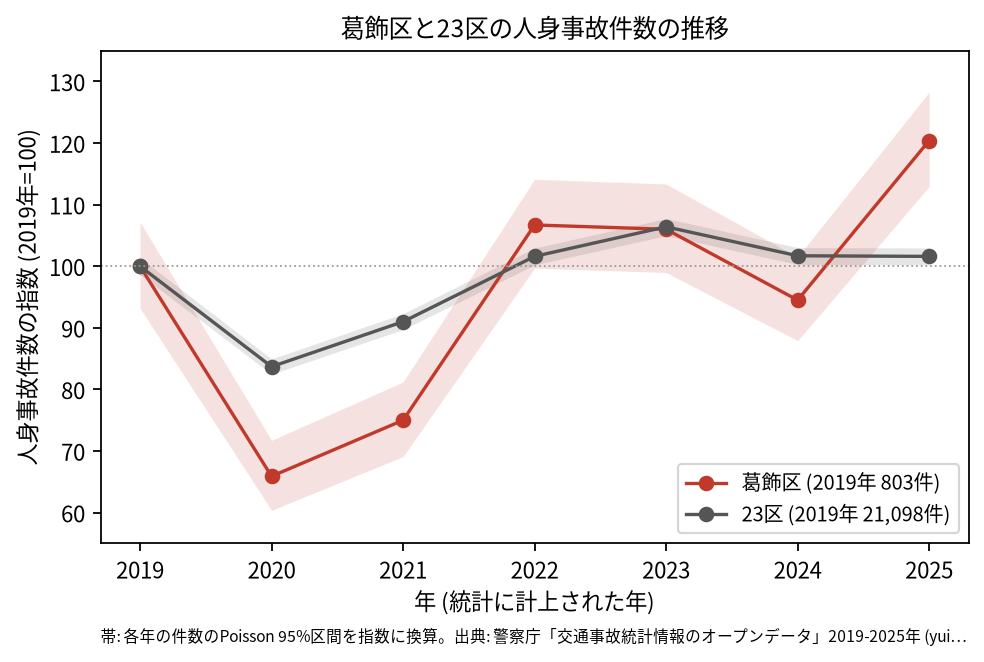
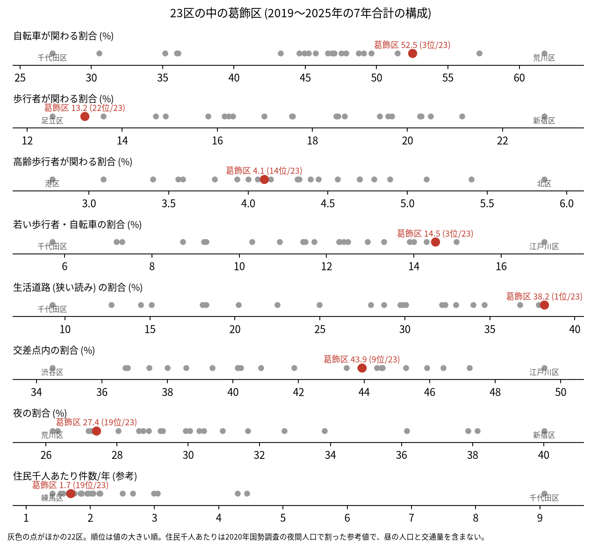
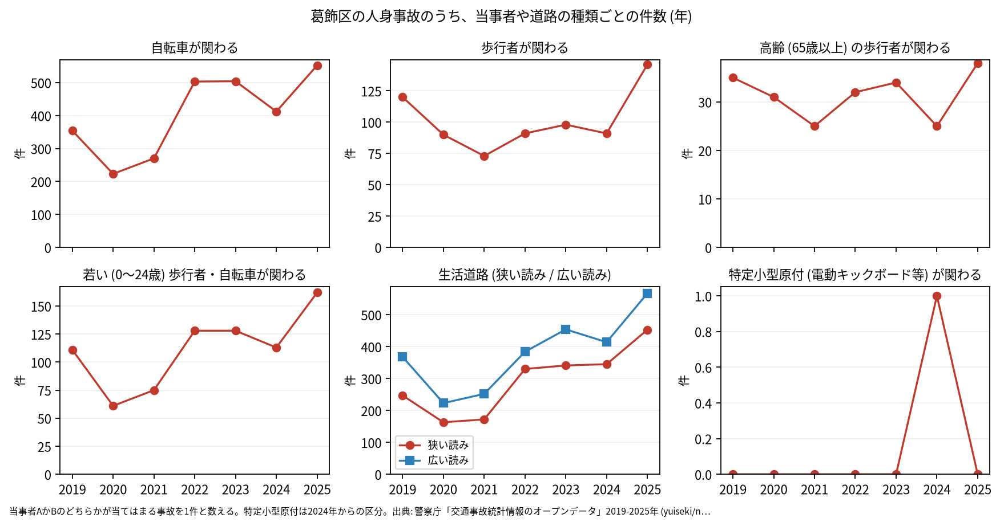

# 区の交通安全担当のための報告: 葛飾区の交通事故の傾向

## 問い

葛飾区の人身事故は 2019〜2025 年にどう推移し、23 区の中でどんな特徴があり、施策をどこに向ける材料になるか。

## 結論

- 件数: 7 年で 5,368 件、死者 27 人、負傷者 5,921 人です。2020 年に 529 件 (2019 年を 100 として 65.9) まで減り、23 区全体 (83.7) より大きく下がりました。2022 年は 857 件 (106.7) まで戻り、2025 年は 967 件 (120.4) でした。2025 年の 95% 区間 (907.0〜1029.9 件) は 2019 年の区間 (748.4〜860.5 件) と重ならないので、2025 年は 2019 年より増えたと言えます。23 区全体の 2025 年は 101.6 です。年ごとに、区のコードで数えた件数と、点が区の面に入る件数の差は 5 件以内で、増え方はコードの付け方の変化では説明できません。

- 23 区の中の位置: 葛飾区の事故は、自転車と生活道路に寄っています。自転車が関わる割合は 52.5% で 23 区の 3 位、生活道路 (狭い読み) の割合は 38.2% で 1 位、広い読みでも 49.6% で 2 位です。若い歩行者と自転車は 14.5% で 3 位です。歩行者が関わる割合は 13.2% で 22 位、高齢の歩行者は 4.1% で 14 位、交差点内は 43.9% で 9 位です。

- 施策への読み方: 2026-09-01 からの生活道路の法定速度 30 km/h は、葛飾区の事故のうち 38.2〜49.6% (読み方による) に当たり、23 区で最も広く当たる区の 1 つです。これは効果の予測ではなく、どの道路で事故が起きているかの構成です。一方で、事故の多い地点は水戸街道 (国道 6 号) と環七通りに並びます (地点は [道路安全診断の報告](road-safety-auditor.md))。国道 6 号の事故は 7 年で 556 件でした ([analysis.json](../outputs/analysis.json))。
- 区分ごとの推移: 自転車が関わる事故は 2021 年の 270 件から 2022 年に 503 件へ増え、2025 年は 552 件でした。生活道路 (狭い読み) の事故も 2019 年の 247 件から 2025 年に 453 件へ増えています ([yearly.csv](../outputs/yearly.csv))。特定小型原付 (電動キックボードなど) が関わる事故は、2024 年に 1 件、2025 年に 0 件でした。

- 死亡事故: 27 件のうち、亡くなったのは自転車 8 人、二輪車 8 人、歩行者 7 人、乗用車の人 2 人、貨物車の人 1 人、補充票の人 1 人です。亡くなった歩行者 7 人のうち 3 人が 65 歳以上でした。当事者 A (過失の重い側) は自家用の乗用車が 13 件、貨物車が 12 件です。27 件は少なく、偏りを傾向と断定できる数ではありません。

| 年 | 当事者 A | 当事者 B | 亡くなった人 | 時 |
|---|---|---|---|---:|
| 2019 | 貨物車 | 自転車 (45〜54 歳) | 自転車 | 10 |
| 2019 | 貨物車 | 自転車 (55〜64 歳) | 自転車 | 22 |
| 2020 | 乗用車 (自家用) | 自転車 (55〜64 歳) | 自転車 | 6 |
| 2022 | 乗用車 (自家用) | 自転車 (75 歳以上) | 自転車 | 18 |
| 2022 | 貨物車 | 自転車 (35〜44 歳) | 自転車 | 7 |
| 2023 | 貨物車 | 自転車 (75 歳以上) | 自転車 | 13 |
| 2024 | 乗用車 (自家用) | 自転車 (45〜54 歳) | 自転車 | 0 |
| 2025 | 貨物車 | 自転車 (55〜64 歳) | 自転車 | 8 |

表は、自転車の人が亡くなった 8 件の抜き出しです。27 件 ([summary.txt](../outputs/summary.txt)) の全ては [deaths.csv](../outputs/deaths.csv) にあります。

- 人口あたり: 2020 年の住民千人あたりの年の件数は 1.69 件で 23 区の 19 位ですが、分母に昼の人口や通過する車が入らないため、区の比較の主な指標にしていません。

## データ

警察庁「交通事故統計情報のオープンデータ」を加工した `yuiseki/npa-traffic-accidents` 版 `389500a` の本票。葛飾区は `市区町村コード` 122 の 5,368 件、23 区は 144,716 件。年はファイルの年 (統計に計上された年)。区の人口は 2020 年国勢調査 (`jp-admin-2026-09` 版 `e6c87b1`)。詳しくは [共通の報告](../report.md)。

## 方法

区分は、当事者 A か B のどちらかが当てはまる事故を 1 件と数えました。生活道路は `車道幅員` で決め、狭い読み (5.5 m 未満の単路と、小と小の交差点) と、広い読み (5.5 m 未満の道とより広い道の交差点も含む) を並べました。年の区間は件数の Poisson の 95% 区間 (Garwood) です。23 区の順位は 7 年合計の割合の大きい順です。

## 確かめていないこと

- 2022 年に自転車の事故が増えた理由 (自転車の利用の増加、記録の仕方の変化など) は調べていません。
- 区の施策 (ゾーン 30、自転車の通行帯など) の効果は推定していません。割合の順位は施策の評価ではありません。
- 重傷と軽傷の区別、物損事故は、このデータにありません。
