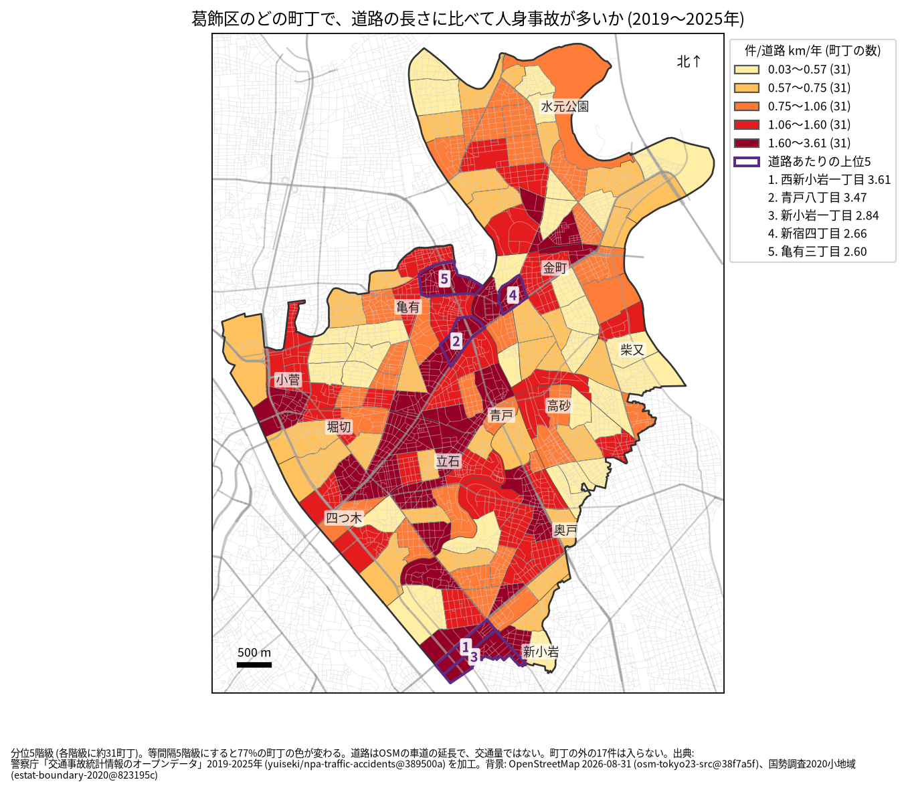
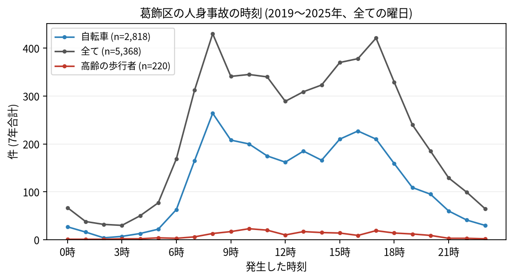

# 住民のための報告: 葛飾区で、いつ、どこで事故が起きているか

## 問い

葛飾区に住む人が、自分の町で、いつ、どんな事故に気をつければよいか。2019〜2025 年の警察記録の人身事故から調べました。

## 結論

- 葛飾区では 7 年で 5,368 件の人身事故があり、27 人が亡くなりました。年に 529〜967 件で、2025 年が最も多い年でした。
- 町ごと: 道路 1 km あたりの事故が多いのは、西新小岩一丁目 (年 3.61 件)、青戸八丁目 (3.47 件)、新小岩一丁目 (2.84 件)、新宿四丁目 (2.66 件)、亀有三丁目 (2.60 件) です。件数そのものが最も多いのは亀有三丁目 (7 年で 148 件)、次が青戸八丁目 (143 件)、堀切四丁目 (140 件) でした。新小岩、水戸街道の沿い (四つ木から青戸、亀有、金町)、立石の周りに色の濃い町が並びます。

色は分位 5 階級で、各色に 31 の町が入ります。等間隔の階級にすると 77% の町の色が変わるので、色の差より、自分の町が上の階級か下の階級かを見てください。

- 時間: 事故は朝 7 時台から増え、8 時台 (430 件) と 17 時台 (421 件) が山です。自転車が関わる事故も 8 時台 (264 件) が最も多く、高齢の歩行者が関わる事故は 10 時台 (23 件) が最も多い時間でした。

- 誰が: 自転車が関わる事故が全体の 52.5% で、23 区で 3 番目に高い割合です。自転車に乗る人は、車やトラックとの事故 (1,336 件) に加え、自転車だけの事故 (転倒や物への衝突、861 件) にも気をつけてください。自転車だけの事故は、組み合わせの中で最も多い組です。歩行者が関わる事故は 13.2% です。
- 亡くなった人: 27 人のうち 8 人が自転車、8 人が二輪車、7 人が歩行者 (うち 3 人が 65 歳以上) でした。
- 道: 事故の 38.2% は、幅 5.5 m 未満の生活道路で起きています (23 区で最も高い割合)。家の近くの細い道でも、自転車と車の出会いに注意が要ります。

## データ

警察庁「交通事故統計情報のオープンデータ」を加工した `yuiseki/npa-traffic-accidents` 版 `389500a` の本票、葛飾区の 5,368 件 (2019〜2025 年のファイル)。町の境界は 2020 年国勢調査の小地域 (155 町丁)、道路は OpenStreetMap 2026-08-31。詳しくは [共通の報告](../report.md)。

## 方法

事故の地点を町丁の境界に入れて数え、町丁の中の車道の長さ (OSM) と 7 年で割りました。区の境界の近くで町丁の外に落ちた 17 件は町の値に入っていません。時刻は事故の起きた時で、7 年の合計です。

## 確かめていないこと

- 道路の長さは、通る車や人の数ではありません。水戸街道や環七通りの沿いの値が高いのは、車が多いためかもしれません。
- 自分の町の事故が少なくても、物損事故やヒヤリハットはこのデータにありません。
- 事故の位置の精度は分かりません。町の境界の近くの事故は、隣の町に数えられている可能性があります。
