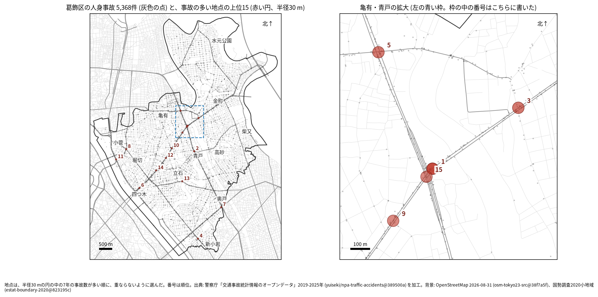
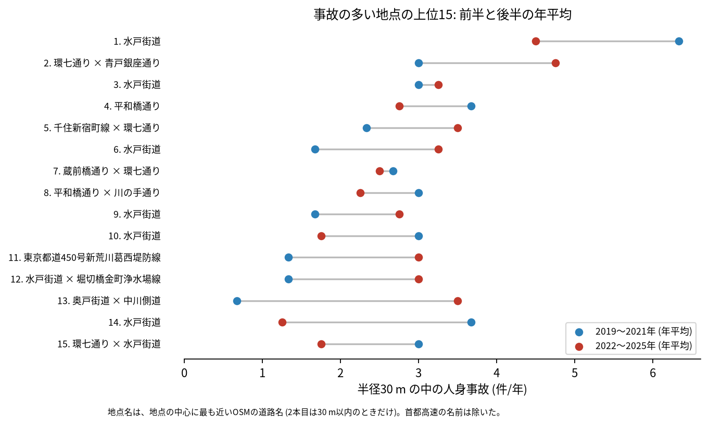
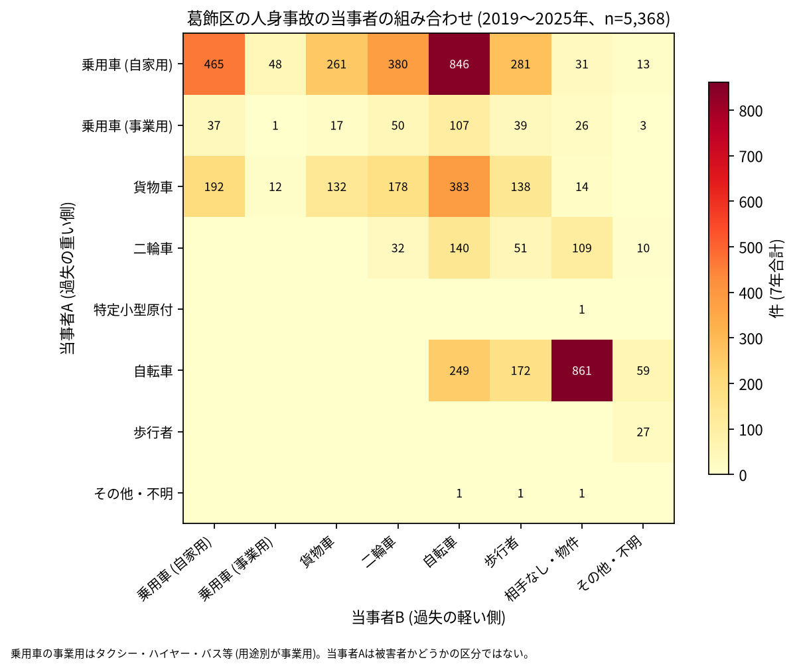

# 道路安全診断のための報告: 葛飾区で事故の集まる地点

## 問い

葛飾区で 2019〜2025 年の人身事故が集まる地点はどこで、そこでは誰と誰の事故が多いか。現地診断の候補を選ぶ材料にします。

## 結論

- 半径 30 m の円の中の 7 年の件数で選んだ上位 15 地点は、16〜37 件です。15 のうち 8 地点で、円の中の最多の路線が国道 6 号 (水戸街道) でした ([summary.txt](../outputs/summary.txt))。水戸街道の地点は、四つ木 (6 位、14 位) から白鳥 (10 位、12 位)、青戸 (1 位、9 位、15 位) を通り、新宿 (3 位) まで並びます。ほかは環七通りの交差点 (2 位、5 位、7 位)、平和橋通り (4 位、8 位)、奥戸街道 (13 位)、荒川沿いの首都高速 (11 位) です。

| 順位 | 近い道路 (OSM) | 件数 | 前半 件/年 | 後半 件/年 | 交差点内 | 信号あり | 多い組み合わせ (A × B) |
|---:|---|---:|---:|---:|---:|---:|---|
| 1 | 水戸街道 (青戸八丁目) | 37 | 6.33 | 4.5 | 23 | 29 | 乗用車 (自家用) × 自転車 |
| 2 | 環七通り × 青戸銀座通り | 28 | 3.0 | 4.75 | 20 | 27 | 乗用車 (自家用) × 乗用車 (自家用) |
| 3 | 水戸街道 (新宿四丁目) | 22 | 3.0 | 3.25 | 16 | 20 | 乗用車 (自家用) × 自転車 |
| 4 | 平和橋通り (新小岩二丁目) | 22 | 3.67 | 2.75 | 13 | 17 | 乗用車 (自家用) × 自転車 |
| 5 | 千住新宿町線 × 環七通り | 21 | 2.33 | 3.5 | 13 | 17 | 乗用車 (自家用) × 自転車 |
| 6 | 水戸街道 (四つ木四丁目) | 18 | 1.67 | 3.25 | 8 | 14 | 乗用車 (自家用) × 歩行者 |
| 7 | 蔵前橋通り × 環七通り | 18 | 2.67 | 2.5 | 15 | 14 | 乗用車 (自家用) × 自転車 |
| 8 | 平和橋通り × 川の手通り | 18 | 3.0 | 2.25 | 10 | 14 | 乗用車 (自家用) × 貨物車 |
| 9 | 水戸街道 (青戸八丁目) | 16 | 1.67 | 2.75 | 2 | 5 | 乗用車 (自家用) × 自転車 |
| 10 | 水戸街道 (白鳥四丁目) | 16 | 3.0 | 1.75 | 9 | 11 | 乗用車 (自家用) × 二輪車 |

前半は 2019〜2021 年、後半は 2022〜2025 年。11〜15 位と、歩行者、自転車、夜の件数は [hotspots.csv](../outputs/hotspots.csv) にあります。道路名は地点の中心に最も近い OSM の道路名で、2 本目は 1 本目と交わる向き (30 度以上) の道のうち最も近いもので、30 m 以内のときだけ書きました (首都高速の名前は除いた)。2 本目の無い地点は、交わる道が 30 m 以内に無い地点で、括弧に町丁を添えました。

- 首都高速: 11 位 (堀切四丁目) の円の 16 件のうち 15 件は首都高速の事故で、道路名の「東京都道450号新荒川葛西堤防線」は、高架の下の一般道の名前です。首都高速の事故 (区で 132 件) を除いて地点を選び直すと、15 地点のうち 14 地点が残ります ([analysis.json](../outputs/analysis.json))。11 位は首都高速の上の事故の集まりとして読み、一般道の現地診断の候補からは外してください。
- 続いているか: 上位 15 は全て前半と後半の両方に事故があります。13 位 (0.67 から 3.5 件/年) と 6 位 (1.67 から 3.25 件/年) は後半に増え、14 位 (3.67 から 1.25 件/年) と 1 位 (6.33 から 4.5 件/年) は減りました。上位は 7 年合計で選んだので、後半が下がって見えやすい (平均への回帰) ことに注意してください。

- 組み合わせ: 当事者 A が乗用車か貨物車で B が自転車の事故は 1,336 件です。自転車の単独 (相手なし・物件) が 861 件で最も多く、自転車どうしが 249 件、自転車と歩行者 (自転車が A) が 172 件ありました。上位 15 のうち 1、3、4、5、7、9、15 位で、自家用の乗用車と自転車が最も多い組でした。13 位 (奥戸街道 × 中川側道) は、自転車の単独が 16 件のうち 10 件です。

- 半径を変えると: 20 m の上位 15 の中心が、30 m の上位 15 の中心から 30 m 以内にあるのは 11 地点、50 m では 12 地点でした。1 位と 15 位は同じ青戸八丁目の水戸街道の上で隣り合い、半径によって 1 つにまとまったり分かれたりします。順位は細かく読まないでください。

## データ

警察庁「交通事故統計情報のオープンデータ」を加工した `yuiseki/npa-traffic-accidents` 版 `389500a` の本票、葛飾区 (`市区町村コード` 122) の 5,368 件。道路名は OpenStreetMap 2026-08-31 (`osm-tokyo23-src-2026-08` 版 `38f7a5f`)。詳しくは [共通の報告](../report.md)。

## 方法

事故の点を EPSG:6677 (メートル) に変換し、半径 30 m の円の中の件数が最も多い事故の点を中心に選び、その円の事故を除いて次を選ぶ手順を 15 回くり返しました。30 m はコード表の「交差点付近」(交差点の側端から 30 m 以内) の幅です。信号ありは `信号機` が 3 灯式、押ボタン式、歩車分式の点灯。組み合わせは当事者 A (過失の重い側) と B の種別で、乗用車は `用途別` で事業用と自家用に分けました。路線は `路線コード` の上 4 桁で、5000〜5499 を首都高速としました。

## 確かめていないこと

- 交通量で割っていません。件数の多い地点が、車の多さに比べて危険かは分かりません。
- 事故の型 (出会い頭、右折、追突)、違反の種類、重傷と軽傷の区別は、このデータにありません。現地で確かめてください。
- 位置の精度は分かりません。数十 m のずれで地点の件数は変わります。
- 2 本目の道が無い水戸街道の地点が、交差点の事故か、単路の事故かは、道路形状の内訳を地点ごとに見ていません (交差点内の件数だけを表に書きました)。
- 偶然でもこの程度の集まりが生まれるか (順位の有意さ) は調べていません。
