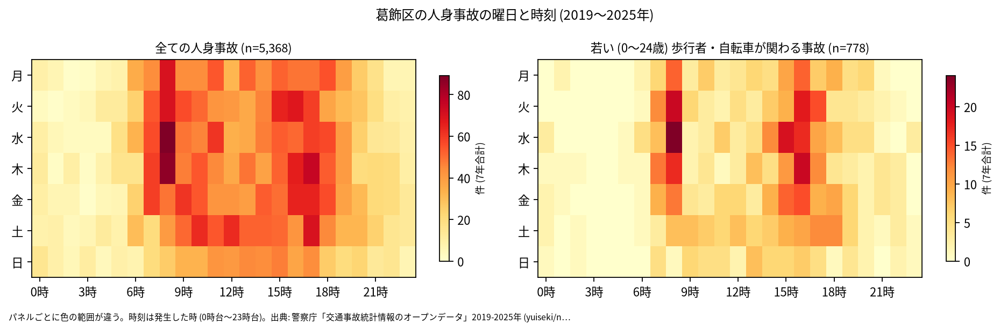
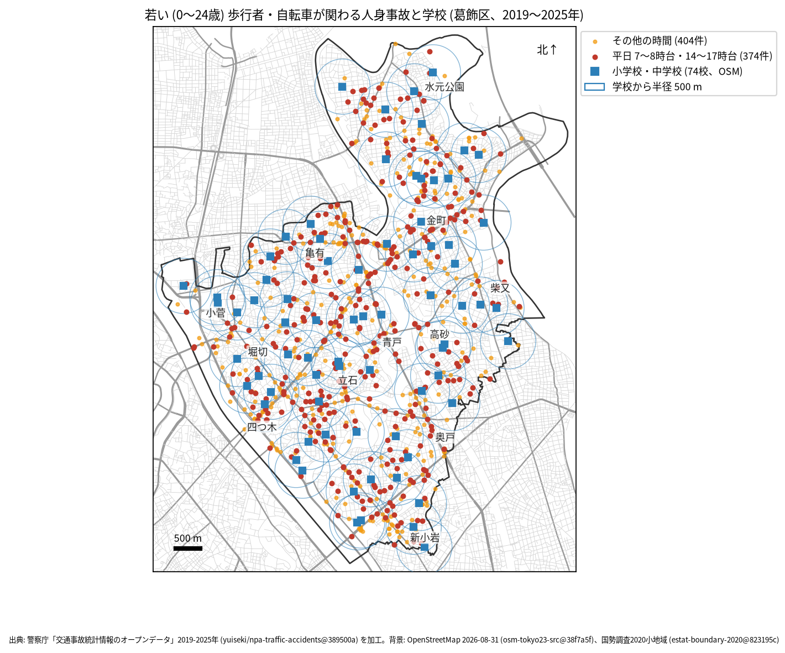

# 学校と PTA のための報告: 学校の周りの若い歩行者と自転車の事故

## 問い

葛飾区の学校の周り (半径 500 m) で、若い歩行者と自転車が関わる人身事故は、いつ、どこで起きているか。通学路の合同点検で見る場所と時間を選ぶ材料にします。

## 結論

- このデータで子どもだけを数えることはできません。年齢は年齢層で、最も若い区分が 0〜24 歳です。この報告の「若い」は 0〜24 歳で、大学生や若い社会人を含みます。
- 葛飾区で、若い歩行者か自転車が関わる人身事故は 7 年で 778 件 (全体の 14.5%、23 区で 3 位) でした。年では 61 件 (2020 年) から 162 件 (2025 年) です ([yearly.csv](../outputs/yearly.csv))。
- 時間: 曜日を問わず多いのは 16 時台 (101 件)、8 時台 (97 件)、15 時台 (78 件) です。平日 (月〜金) に限ると、8 時台 88 件、16 時台 84 件、15 時台 63 件でした ([summary.txt](../outputs/summary.txt))。下校から夕方に加えて、登校の朝 8 時台にも多く起きています。

- 場所: 学校から 500 m の円の中の件数が多いのは、原田小学校と金町中学校の 35 件、本田小学校 34 件、よつぎ小学校・四つ木中学校・花の木小学校の 33 件です。円は重なるので、学校ごとの件数は足せません。葛飾区は学校が多く (74 校)、円の多くが隣の学校の円と重なります。

| 学校 (OSM の名前) | 500 m 以内の若い歩行者・自転車 | うち平日 7〜8 時台 | うち平日 14〜17 時台 |
|---|---:|---:|---:|
| 葛飾区立原田小学校 | 35 | 8 | 6 |
| 葛飾区立金町中学校 | 35 | 8 | 8 |
| 葛飾区立本田小学校 | 34 | 7 | 13 |
| 葛飾区立よつぎ小学校 | 33 | 4 | 10 |
| 葛飾区立四つ木中学校 | 33 | 5 | 11 |
| 葛飾区立花の木小学校 | 33 | 8 | 8 |
| 葛飾区立道上小学校 | 32 | 4 | 9 |

74 校の全ては [schools.csv](../outputs/schools.csv) にあります。

赤い点 (平日の 7〜8 時台と 14〜17 時台、374 件) が、通学の時間に近い事故です。点検では、学校の円の中で赤い点が並ぶ道を、通学路の地図と重ねて見ることを勧めます。

- 7 年で、平日の朝 (7〜8 時台) に 1 つの学校の円の中で起きた若い人の事故は 0〜9 件です。件数が少ないので、学校の順位より、点の位置を手がかりにしてください。

## データ

警察庁「交通事故統計情報のオープンデータ」を加工した `yuiseki/npa-traffic-accidents` 版 `389500a` の本票、葛飾区の 5,368 件 (2019〜2025 年のファイル)。学校は OpenStreetMap 2026-08-31 (`osm-tokyo23-src-2026-08` 版 `38f7a5f`) の、名前が「小学校」「中学校」で終わる 74 校 (「旧」で始まる閉校した学校は除く。葛飾区には無い)。区立でない学校 (東京シューレ葛飾中学校) を含みます。詳しくは [共通の報告](../report.md)。

## 方法

当事者 A か B が歩行者か自転車 (駆動補助機付を含む) で、その同じ当事者の年齢層が 0〜24 歳の事故を数えました。学校の位置は OSM の面の重心 (名前ごとに平均) で、円は直線 500 m (EPSG:6677 で測った) です。時刻は発生した時、平日は月曜から金曜で、祝日は分けていません。

## 確かめていないこと

- 小学生か、通学中かは分かりません。被害者か加害者かも区別していません (当事者 A は過失の重い側)。
- 学校の位置は校門ではなく、500 m は道のりではありません。通学路の線とは重ねていません。
- 朝 8 時台の多さに、通勤の自転車 (0〜24 歳の若い社会人や高校生) がどれだけ入るかは分かりません。
- ヒヤリハットと物損事故は入っていません。点検では、学校が集めている危険な場所の情報と合わせて使ってください。
