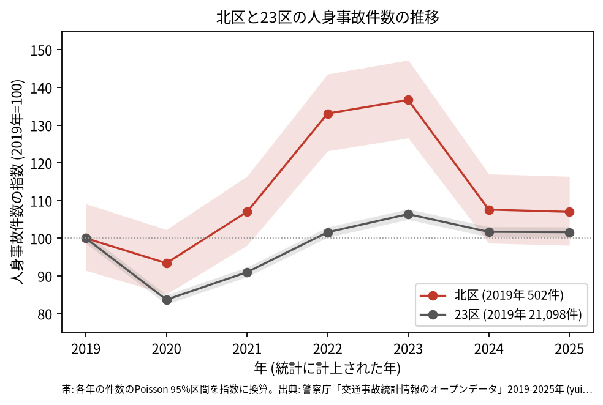
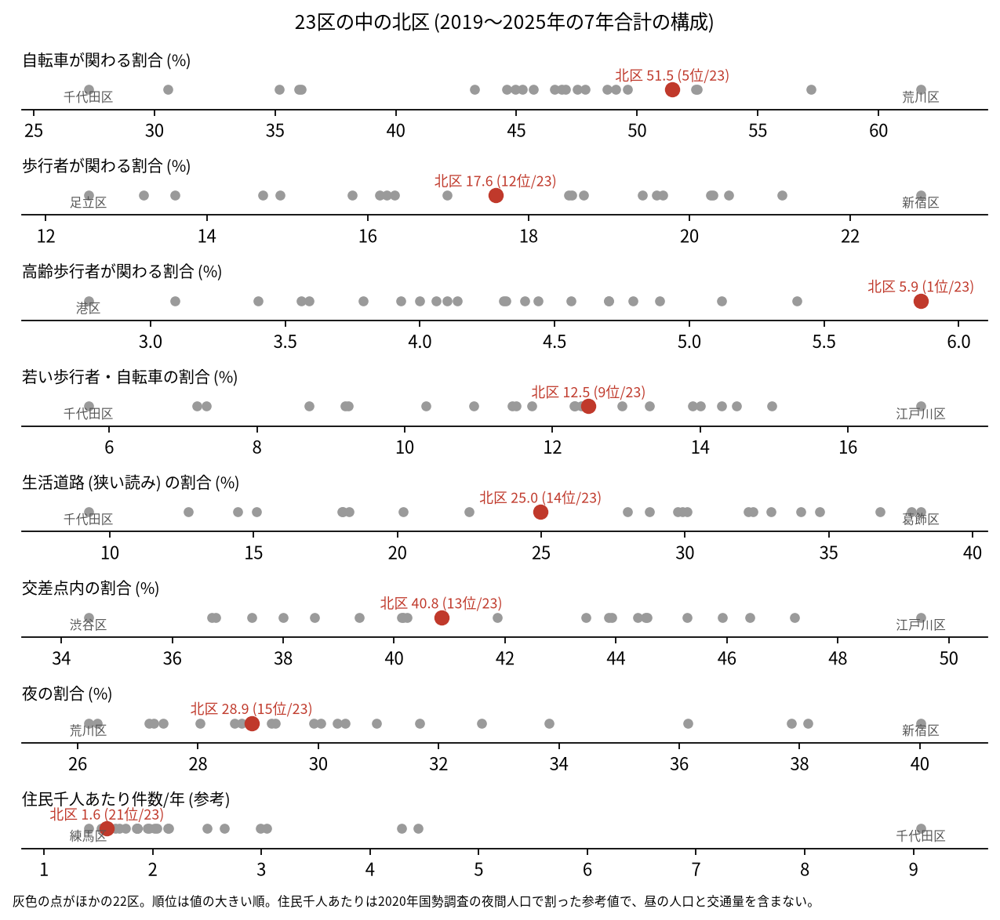
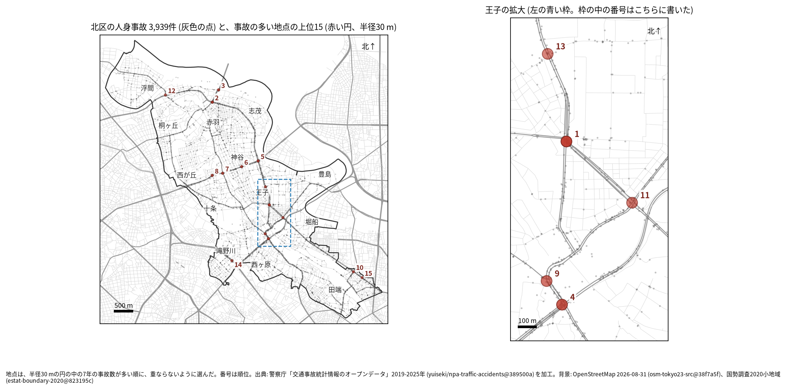
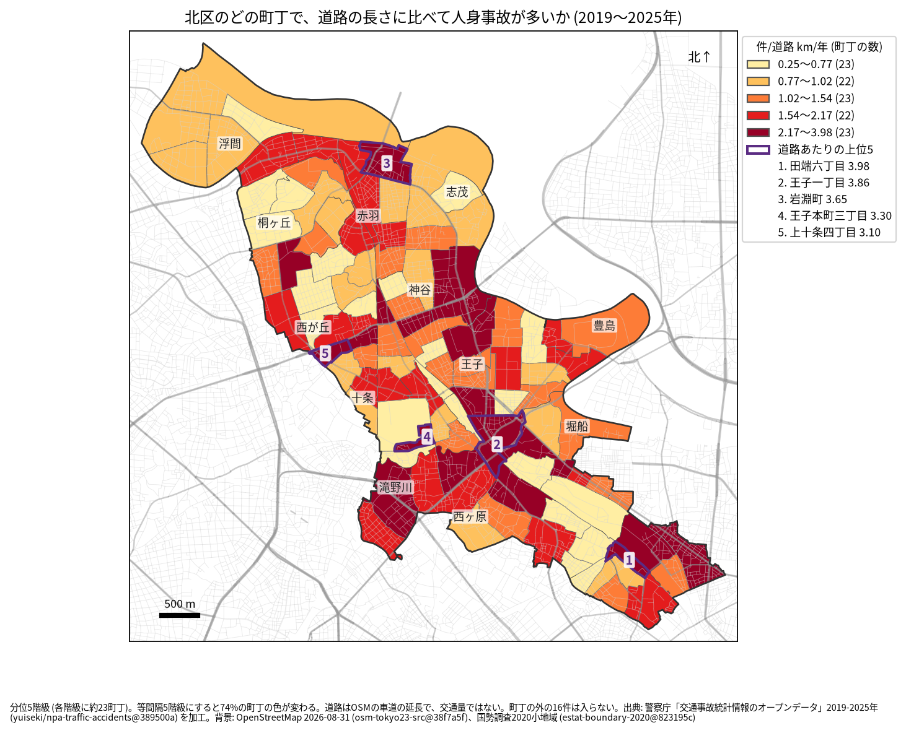
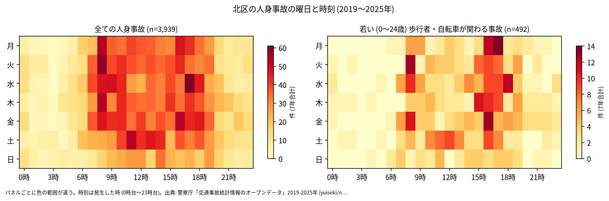
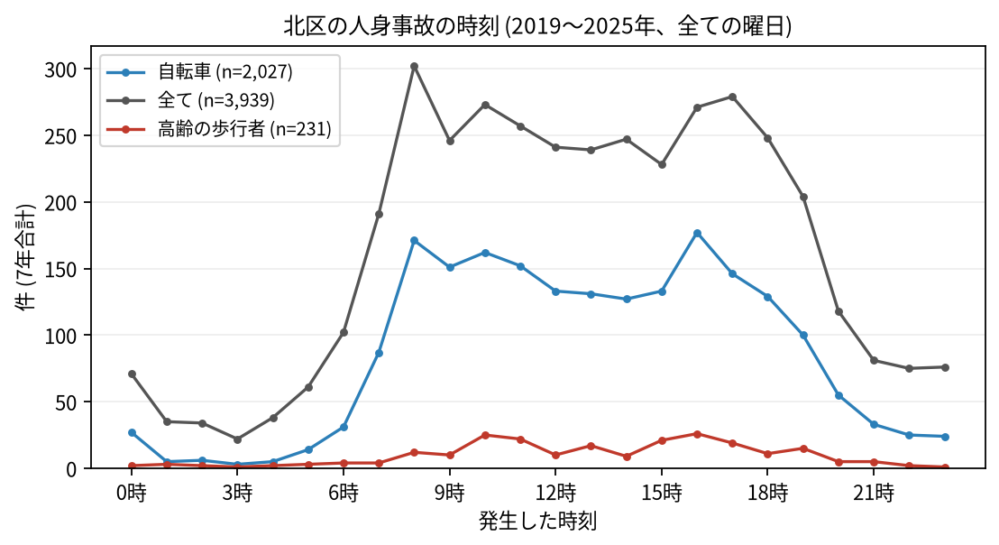
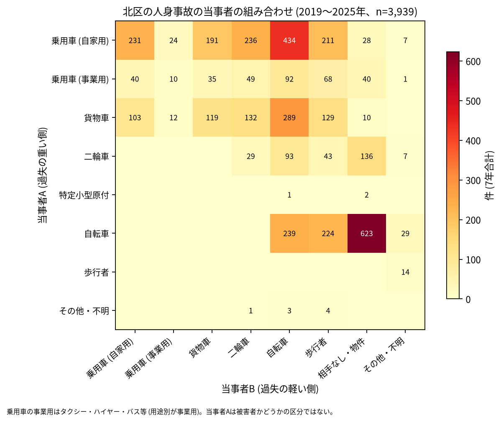

# 北区の交通事故 2019〜2025 年: 図で読む要点

## 問い

2019〜2025 年の警察記録の人身事故で、北区の事故はいつ、どこで、誰が関わって起きているか。

## 結論

### 要点

| # | 要点 | 数字 | 図 |
|---:|---|---|---|
| 1 | 件数は 2022 年と 2023 年に 2019 年より増え、2024 年に戻った | 7 年で 3,939 件、死者 25 人、負傷者 4,301 人。指数 (2019 年=100) は 2023 年 136.7、2025 年 107.0。2023 年の区間 635.6〜739.3 件は 2019 年の 459.0〜547.9 件と重ならない ([yearly.csv](outputs/yearly.csv)、[summary.txt](outputs/summary.txt)) | [図 1](#図-1-件数の推移) |
| 2 | 事故の半分に自転車が関わり、最も多い組み合わせは自転車の単独 | 51.5% (23 区の 5 位)。自転車 (A) と相手なし・物件の事故が 623 件 ([summary.txt](outputs/summary.txt)、[party_matrix.csv](outputs/party_matrix.csv)) | [図 6](#図-6-誰と誰の事故か) |
| 3 | 高齢の歩行者が関わる割合が 23 区で最も高い | 5.9% (1 位)。住民千人あたりの件数は 1.58 件/年 (21 位) ([summary.txt](outputs/summary.txt)、[wards.csv](outputs/wards.csv)、[analysis.json](outputs/analysis.json)) | [図 2](#図-2-23-区の中の北区) |
| 4 | 集まる場所は北本通り、明治通り、環七通り | 事故の多い地点の上位 15 の最も近い道は、明治通り 5、北本通り 4、環七通り 4。王子の周りに 5 地点 ([summary.txt](outputs/summary.txt)、[hotspots-map.json](outputs/hotspots-map.json)) | [図 3](#図-3-事故の集まる地点)、[図 4](#図-4-町丁ごとの事故) |
| 5 | 死亡事故は二輪車と歩行者に多い | 死者 25 人のうち二輪車 10 人、歩行者 9 人 (65 歳以上が 4 人)、自転車 6 人。当事者 A が貨物車の事故が 10 件、0〜5 時台が 9 件 ([summary.txt](outputs/summary.txt)) | [表 1](#表-1-死亡事故) |

### 読み手ごとに知るべきこと

| 読み手 | 結論 | 検討する材料 | 詳しく |
|---|---|---|---|
| 区の交通安全担当 | 生活道路の法定速度 30 km/h (2026-09-01 から) が当たるのは事故の 25.0〜37.6% (読み方による)。地点の上位は北本通り (国道 122 号)、明治通り、環七通りの交差点 | 2022〜2023 年の増加、自転車の単独事故、高齢の歩行者 | [municipality.md](reports/municipality.md) |
| 学校と PTA | 若い (0〜24 歳) 歩行者と自転車の事故は 492 件。最も多いのは 16 時台で、平日でも 16 時台、17 時台、8 時台の順 | 学校の円の中で、平日 14〜17 時台の点が並ぶ道 | [school-pta.md](reports/school-pta.md) |
| 道路安全診断 | 上位は北本通り × 補助第85号線 (41 件)、北本通り × 常盤台赤羽線 (38 件)、北本通り (32 件)。1 位と 2 位で多い組み合わせは乗用車と自転車 | 後半に増えた 1 位と 3 位、首都高速の事故が円に入る 4 位 | [road-safety-auditor.md](reports/road-safety-auditor.md) |
| 住民 | 道路あたりで多いのは田端六丁目 (年 3.98 件/道路 km)、王子一丁目 (3.86 件)、岩淵町 (3.65 件)。事故は 8 時台が最多で、夕方 16〜17 時台にもう一度増える | 自分の町の色、自転車の単独事故、夕方の道 | [resident.md](reports/resident.md) |

### 図 1: 件数の推移

2020 年の落ち込み (93.4) は 23 区全体 (83.7) より浅い。2022 年 (133.1) と 2023 年 (136.7) は 23 区 (101.6、106.4) より大きく上がり、95% 区間も 2019 年と重ならないので、2019 年より増えたと書ける。2025 年の区間 (492.5〜584.4 件) は 2019 年と重なるので、2025 年が 2019 年と違うとは書かない。年ごとのコードと面の件数はどの年も 2 件以内でそろい ([analysis.json](outputs/analysis.json))、増加は区への割り当ての変化では説明できない。増えた理由は調べていない。

### 図 2: 23 区の中の北区

赤い点が北区。高齢の歩行者 (5.9%、1 位) と自転車 (51.5%、5 位) が高い。生活道路 (25.0%、14 位)、交差点内 (40.8%、13 位)、夜 (28.9%、15 位) は 23 区の中ほど。住民千人あたり (1.58 件/年、21 位) は昼の人口を含まない参考値。

### 図 3: 事故の集まる地点

半径 30 m の円の中の 7 年の件数で選んだ上位 15 (17〜41 件)。番号は順位で、王子の 5 地点 (1、4、9、11、13 位) は右の拡大図に番号を書いた。

| 順位 | 近い道路 (OSM) | 町丁 | 件数 | 前半 件/年 | 後半 件/年 |
|---:|---|---|---:|---:|---:|
| 1 | 北本通り × 補助第85号線 | 王子二丁目 | 41 | 4.67 | 6.75 |
| 2 | 北本通り × 常盤台赤羽線 | 岩淵町 | 38 | 5.67 | 5.25 |
| 3 | 北本通り | 岩淵町 | 32 | 3.33 | 5.50 |
| 4 | 明治通り × 本郷通り | 滝野川二丁目 | 31 | 4.00 | 4.75 |
| 5 | 環七通り × 北本通り | 神谷三丁目 | 30 | 4.00 | 4.50 |

前半は 2019〜2021 年、後半は 2022〜2025 年。半径を 20 m にすると上位 15 のうち 12 地点、50 m では 13 地点が残る。6〜15 位は [hotspots.csv](outputs/hotspots.csv)。

### 図 4: 町丁ごとの事故

町丁の事故数を、OSM の車道の延長と 7 年で割った値。紫の枠が上位 5 (田端六丁目、王子一丁目、岩淵町、王子本町三丁目、上十条四丁目)。分位と等間隔で 74% の町丁の色が変わるので、色の細かい差は読まない。道路の長さは交通量ではない。王子一丁目の 213 件のうち 24 件は首都高速の事故で ([towns.csv](outputs/towns.csv))、道路の長さにも高架の道が入る。

### 図 5: いつ起きるか

全体は平日の 8 時台が最も多く (302 件)、16〜17 時台にもう一度増える。若い歩行者と自転車は 16 時台 (65 件) と 17 時台 (56 件) に寄る。

自転車は 16 時台 (177 件) と 8 時台 (171 件)、高齢の歩行者は 16 時台 (26 件) と 10 時台 (25 件) が多い。

### 図 6: 誰と誰の事故か

最も多いのは自転車 (A) と相手なし・物件の 623 件で、自転車の単独の事故にあたる。次が自家用の乗用車 (A) と自転車 (B) の 434 件、貨物車と自転車の 289 件。当事者 A は過失の重い側で、被害者とは限らない。

### 表 1: 死亡事故

| 亡くなった人 | 人数 | 特徴 |
|---|---:|---|
| 二輪車 | 10 | |
| 歩行者 | 9 | 65 歳以上が 4 人 |
| 自転車 | 6 | |

25 件のうち 0〜5 時台が 9 件、当事者 A が貨物車の事故が 10 件。数が少ないので傾向とは断定しない。全件は [deaths.csv](outputs/deaths.csv)。

### 読み方で変わる答え

| 読み方 | 主 | 別の読み方 |
|---|---|---|
| 北区の事故 | `市区町村コード` 117 の 3,939 件 | 点が区の面に入る事故。両方に当てはまるのは 3,923 件 |
| 生活道路 | 狭い読み 25.0% (14 位) | 広い読み 37.6% (14 位) |
| 地点の半径 | 30 m | 20 m で 12 地点、50 m で 13 地点が残る |
| 首都高速の事故 | 含める | 除いても 15 地点が全部残る。首都高速の事故は区で 79 件、上位 15 の円には 4 件 (4 位に 3 件、11 位に 1 件) ([analysis.json](outputs/analysis.json)) |
| 町丁の階級 | 分位 5 階級 | 等間隔で 74% の町丁の色が変わる |

## データ

- 人身事故: 警察庁「交通事故統計情報のオープンデータ」を加工した `yuiseki/npa-traffic-accidents` 版 `389500aae5cec45f1311163f70db6a5f05867838` (配布元の取得 2026-10-02) の本票。年はファイルの年 (統計に計上された年)。北区 3,939 件、23 区 144,716 件。位置の無い行は 0。物損事故は含まない。
- 区の面と人口: `yuiseki/jp-admin-2026-09` 版 `e6c87b1`。町丁: 2020 年国勢調査の小地域 `yuiseki/estat-boundary-2020` 版 `823195c` (113 町丁、355,213 人)。学校 46 校と道路: OpenStreetMap 2026-08-31、`yuiseki/osm-tokyo23-src-2026-08` 版 `38f7a5f`。
- 道具: DuckDB (spatial、版は [analysis.json](outputs/analysis.json))、matplotlib、`analysis-visualize` の `cjk_font.py`、`classify_map.py`、`context_map.py`。スクリプトは台東区の型 (2026-11-03) の写し。
- 出典の表示: 警察庁ウェブサイト (https://www.npa.go.jp/publications/statistics/koutsuu/opendata/index_opendata.html) の交通事故統計情報のオープンデータを加工して作成。国勢調査の小地域境界と人口、OpenStreetMap (© OpenStreetMap contributors) を加工して使用。

## 方法

- 読み方は結果を見る前に [計画](EXPERIMENT_PLAN.md) で固定し、実行は [記録](EXPERIMENT_TRACKER.md) に残した。読み方、区画、判断の規則は台東区と同じ。生活道路は `車道幅員` が 01、02、11 (狭い読み)、広い読みは 14、17 を足す。歩行者や自転車が関わるかは当事者 A と B の両方で見て、1 件を 1 回数えた。
- 距離は EPSG:6677 (メートル) で測った。町丁の道路あたりの上位 5 には、道路が 0.5 km より短い町丁を数えない (北区には該当する町丁が無い)。地点は、半径 30 m の中の件数が最も多い点を中心に選び、その円の事故を除いて次を選ぶ手順を 15 回くり返した。地点の名前は、中心に最も近い道と、それと 30 度以上の向きで交わる道のうち最も近い道 (どちらも 30 m 以内のときだけ)。
- 地図は `analysis-visualize` の map-context に合わせ、地名と道路を重ね、凡例を地図の外に置き、強調した単位に番号を付けた。描いた町丁の数 (113) を分析の数と照らし、文字の重なりと、地名や番号が円や学校の印を隠す重なりは、3 枚の地図で 0 件 (地名 9 つの位置と番号 1 つを動かし、町丁の地図で地名 1 つを省いた後)。背景の道路 (OGC:CRS84) と町丁 (JGD2000) の差は、線の幅より小さいとして変換せずに重ねた。
- 関門: 予測と回帰をしないので、評価の分け方と残差の確認は要らない。単位の間の相関を結論にしないので、Moran's I と格子の掃引は省いた。推移は 23 区全体を基準にし、年の件数に Poisson の 95% 区間を付けた。対策の効果は推定していない。
- 再実行は [README.md](README.md)。数値は [outputs/](outputs/) の CSV、来歴は [analysis.json](outputs/analysis.json)。

## 確かめていないこと

- 2022 年と 2023 年に増えた理由。自転車が関わる事故も同じ年に増えた (2023 年 384 件、[yearly.csv](outputs/yearly.csv)) が、年ごとの当事者の組み合わせは数えていない。
- 交通量、昼の人口で割っていない。北本通りや王子の件数の多さは、人と車の多さかもしれない。高齢の歩行者の割合が高い理由 (住む人の年齢など) も調べていない。
- 位置の精度は分からない。30 m の地点と町丁の境界の近くの事故は、数十 m のずれで入れ替わる。首都高速の高架やトンネルの下の地点では、上下の道の事故が同じ円に入る。
- 事故の型 (出会い頭、追突)、重傷と軽傷の区別、物損事故、ヒヤリハットは、このデータに無い。
- 0〜24 歳より細かい年齢は無く、小学生だけは数えられない。
- 地点の上位は 7 年で選び、同じ 7 年で前半と後半を比べたので、後半が下がって見えやすい (平均への回帰)。
