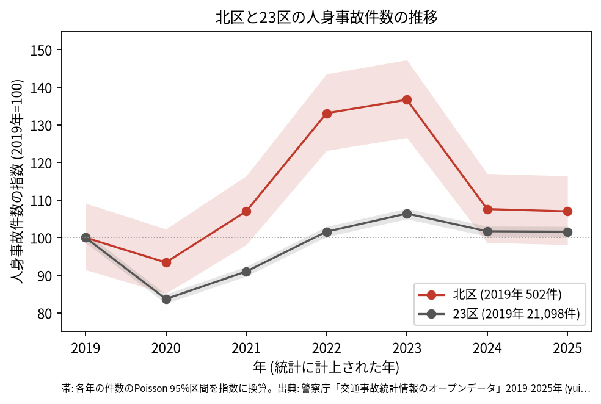
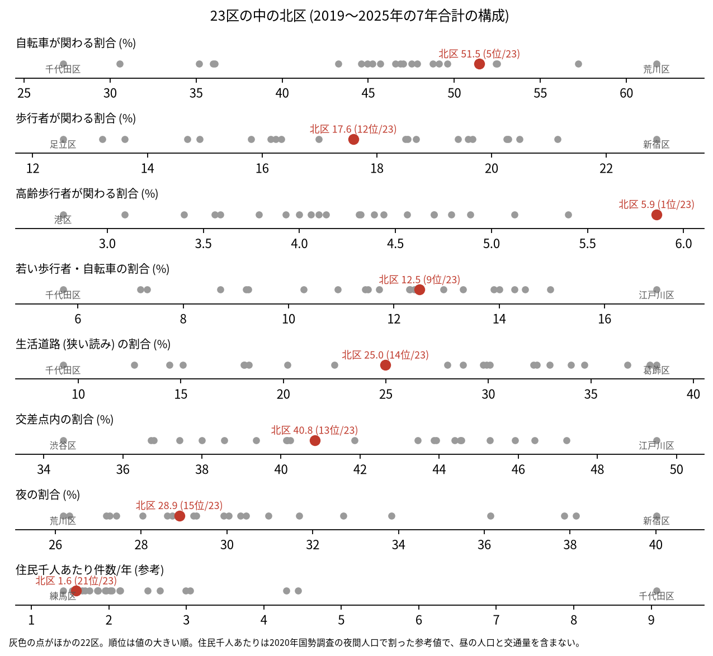
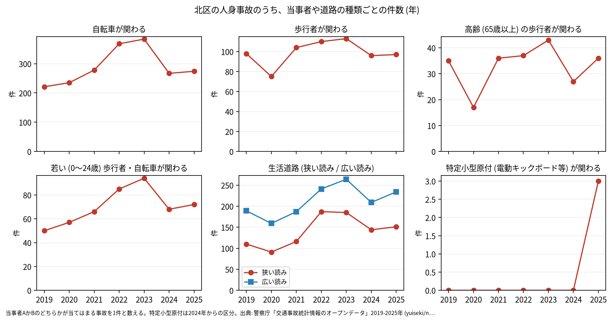

# 区の交通安全担当のための報告: 北区の交通事故の傾向

## 問い

北区の人身事故は 2019〜2025 年にどう推移し、23 区の中でどんな特徴があり、施策をどこに向ける材料になるか。

## 結論

- 件数: 7 年で 3,939 件、死者 25 人、負傷者 4,301 人です。2020 年は 469 件 (2019 年を 100 として 93.4) で、23 区全体 (83.7) ほどは下がりませんでした。2022 年に 668 件 (133.1)、2023 年に 686 件 (136.7) まで増え、この 2 年の 95% 区間 (618.3〜720.6 件、635.6〜739.3 件) は 2019 年の区間 (459.0〜547.9 件) と重ならないので、2019 年より増えたと言えます。2024 年は 540 件 (107.6)、2025 年は 537 件 (107.0) で、区間が 2019 年と重なるので、2019 年と違うとは言えません。年ごとに、区のコードで数えた件数と区の面に入る件数の差は 2 件以内で、増えたのは区への割り当ての変化のためではありません。

- 23 区の中の位置: 高齢の歩行者が関わる割合は 5.9% で 23 区の 1 位、自転車が関わる割合は 51.5% で 5 位です。生活道路 (狭い読み) の割合は 25.0% で 14 位、広い読みでも 37.6% で 14 位、交差点内の割合は 40.8% で 13 位と、23 区の中ほどです。若い歩行者と自転車は 12.5% で 9 位です。

- 施策への読み方: 2026-09-01 からの生活道路の法定速度 30 km/h は、北区の事故のうち 25.0〜37.6% (読み方による) に当たります。事故の多い地点の上位 15 は、北本通り、明治通り、環七通りの交差点に並びます (地点は [道路安全診断の報告](road-safety-auditor.md))。北本通り (国道 122 号) の事故は 7 年で 420 件です ([analysis.json](../outputs/analysis.json))。これは効果の予測ではなく、どの道路で事故が起きているかの構成です。
- 区分ごとの推移: 自転車が関わる事故は 2019 年の 221 件から、2022 年 368 件、2023 年 384 件に増え、2024 年 267 件、2025 年 274 件でした。区全体の増減とほぼ同じ年に動いています。最も多い組み合わせは自転車の単独 (自転車が当事者 A で、相手なし・物件) の 623 件です。特定小型原付 (電動キックボードなど) が関わる事故は、区分のできた 2024 年に 0 件、2025 年に 3 件でした。

- 死亡事故: 25 件のうち、亡くなったのは二輪車 10 人、歩行者 9 人、自転車 6 人です。亡くなった歩行者 9 人のうち 4 人が 65 歳以上でした。当事者 A (過失の重い側) が貨物車の事故が 10 件、0〜5 時台に起きた事故が 9 件です。25 件は少なく、偏りを傾向と断定できる数ではありません。

| 年 | 当事者 A | 当事者 B | 亡くなった人 | 時 |
|---|---|---|---|---:|
| 2019 | 乗用車 (事業用) | 歩行者 (75 歳以上) | 歩行者 | 2 |
| 2020 | 乗用車 (自家用) | 歩行者 (0〜24 歳) | 歩行者 | 4 |
| 2020 | 貨物車 | 歩行者 (45〜54 歳) | 歩行者 | 5 |
| 2024 | 乗用車 (自家用) | 歩行者 (55〜64 歳) | 歩行者 | 0 |
| 2024 | 貨物車 | 二輪車 (45〜54 歳) | 二輪車 | 5 |
| 2024 | 貨物車 | 歩行者 (25〜34 歳) | 歩行者 | 3 |
| 2025 | 乗用車 (自家用) | 二輪車 (35〜44 歳) | 二輪車 | 4 |
| 2025 | 乗用車 (事業用) | 二輪車 (55〜64 歳) | 二輪車 | 2 |
| 2025 | 二輪車 (0〜24 歳) | 相手なし・物件 | 二輪車 | 3 |

表は、0〜5 時台の死亡事故 9 件の抜き出しです。25 件 ([summary.txt](../outputs/summary.txt)) の全ては [deaths.csv](../outputs/deaths.csv) にあります。

- 人口あたり: 2020 年の住民千人あたりの年の件数は 1.58 件で 23 区の 21 位ですが、分母に昼の人口や通過する車が入らないため、区の比較の主な指標にしていません。

## データ

警察庁「交通事故統計情報のオープンデータ」を加工した `yuiseki/npa-traffic-accidents` 版 `389500a` の本票。北区は `市区町村コード` 117 の 3,939 件、23 区は 144,716 件。年はファイルの年 (統計に計上された年)。区の人口は 2020 年国勢調査 (`jp-admin-2026-09` 版 `e6c87b1`)。詳しくは [共通の報告](../report.md)。

## 方法

区分は、当事者 A か B のどちらかが当てはまる事故を 1 件と数えました。生活道路は `車道幅員` で決め、狭い読み (5.5 m 未満の単路と、小と小の交差点) と、広い読み (5.5 m 未満の道とより広い道の交差点も含む) を並べました。年の区間は件数の Poisson の 95% 区間 (Garwood) です。23 区の順位は 7 年合計の割合の大きい順です。

## 確かめていないこと

- 2022 年と 2023 年に増えた理由は調べていません。年ごとの当事者の組み合わせ (自転車の単独が増えたかなど) も数えていません。
- 区の施策 (ゾーン 30、自転車の通行帯など) の効果は推定していません。割合の順位は施策の評価ではありません。
- 高齢の歩行者の割合が高い理由 (住む人の年齢構成など) は、このデータでは確かめていません。
- 重傷と軽傷の区別、物損事故は、このデータにありません。
