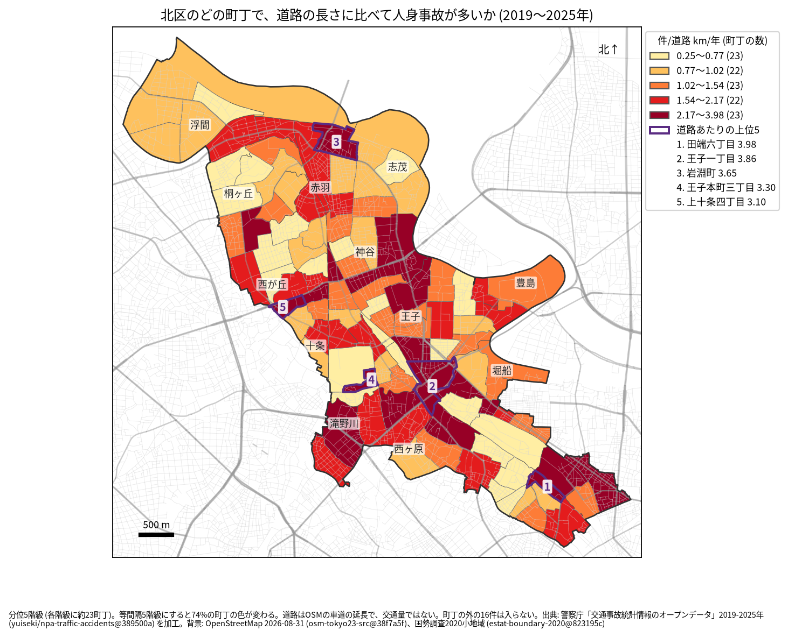
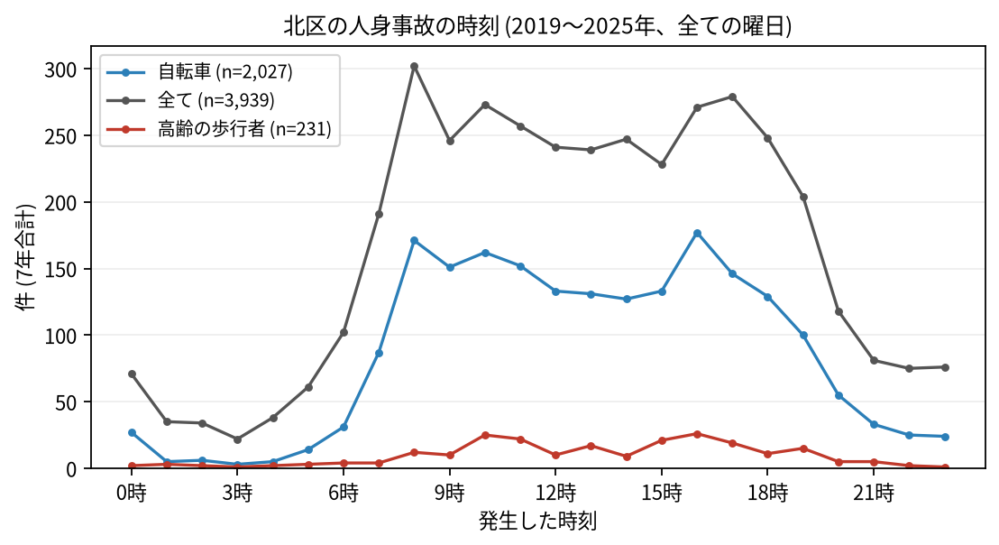

# 住民のための報告: 北区で、いつ、どこで事故が起きているか

## 問い

北区に住む人が、自分の町で、いつ、どんな事故に気をつければよいか。2019〜2025 年の警察記録の人身事故から調べました。

## 結論

- 北区では 7 年で 3,939 件の人身事故があり、25 人が亡くなりました。年に 469〜686 件です。
- 町ごと: 道路 1 km あたりの事故が多いのは、田端六丁目 (年 3.98 件)、王子一丁目 (3.86 件)、岩淵町 (3.65 件)、王子本町三丁目 (3.30 件)、上十条四丁目 (3.10 件) です。件数そのものが最も多いのは王子一丁目 (7 年で 213 件) で、次が岩淵町 (128 件) でした。王子の周り、赤羽の北の岩淵町、田端の東、滝野川に色の濃い町が並びます。

色は分位 5 階級で、各色に約 23 の町が入ります。等間隔の階級にすると 74% の町の色が変わるので、色の差より、自分の町が上の階級か下の階級かを見てください。王子一丁目の 213 件のうち 24 件、堀船一丁目の 60 件のうち 26 件は首都高速の事故で、町の中の道路の長さにも首都高速が入っています。

- 時間: 事故は朝 8 時台が最も多く (302 件)、昼の間も多いまま続き、夕方 16〜17 時台にもう一度増えます (17 時台 279 件)。自転車が関わる事故は 16 時台 (177 件) と 8 時台 (171 件) に多く、高齢の歩行者が関わる事故は 16 時台 (26 件) と 10 時台 (25 件) が多い時間でした。

- 誰が: 自転車が関わる事故が全体の 51.5% で、23 区で 5 番目に高い割合です。最も多い組み合わせは自転車だけの事故 (転倒や物への衝突、623 件) で、車やトラックと自転車の事故 (815 件) と並んで多くあります。歩行者が関わる事故は 17.6% で、高齢の歩行者が関わる割合 (5.9%) は 23 区で最も高い値でした。
- 亡くなった人: 25 人のうち 10 人が二輪車、9 人が歩行者 (うち 4 人が 65 歳以上)、6 人が自転車でした。死亡事故の 9 件は 0〜5 時台に起きています。

## データ

警察庁「交通事故統計情報のオープンデータ」を加工した `yuiseki/npa-traffic-accidents` 版 `389500a` の本票、北区の 3,939 件 (2019〜2025 年のファイル)。町の境界は 2020 年国勢調査の小地域 (113 町丁)、道路は OpenStreetMap 2026-08-31。詳しくは [共通の報告](../report.md)。

## 方法

事故の地点を町丁の境界に入れて数え、町丁の中の車道の長さ (OSM) と 7 年で割りました。区の境界の近くで町丁の外に落ちた 16 件は町の値に入っていません。時刻は事故の起きた時で、7 年の合計です。

## 確かめていないこと

- 道路の長さは、通る車や人の数ではありません。王子や岩淵町の値が高いのは、人と車が多いためかもしれません。
- 自分の町の事故が少なくても、物損事故やヒヤリハットはこのデータにありません。
- 事故の位置の精度は分かりません。町の境界の近くの事故は、隣の町に数えられている可能性があります。
