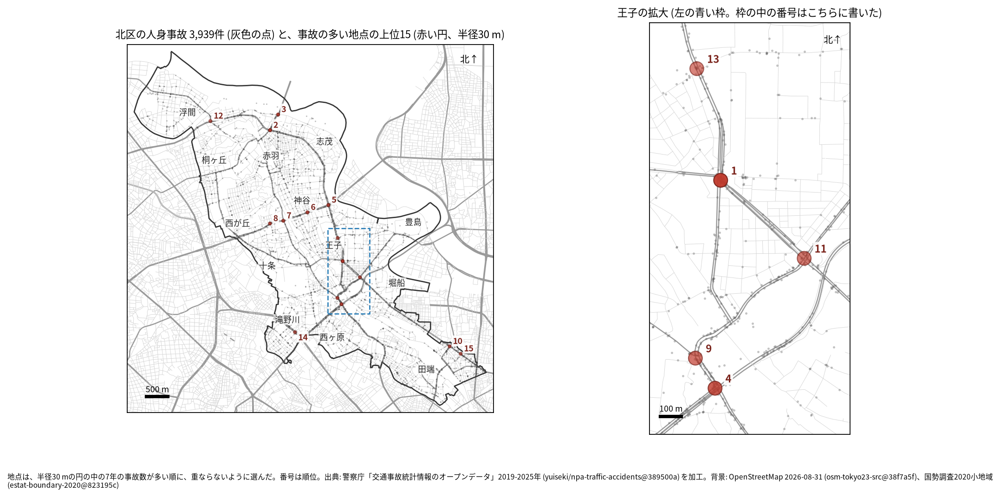
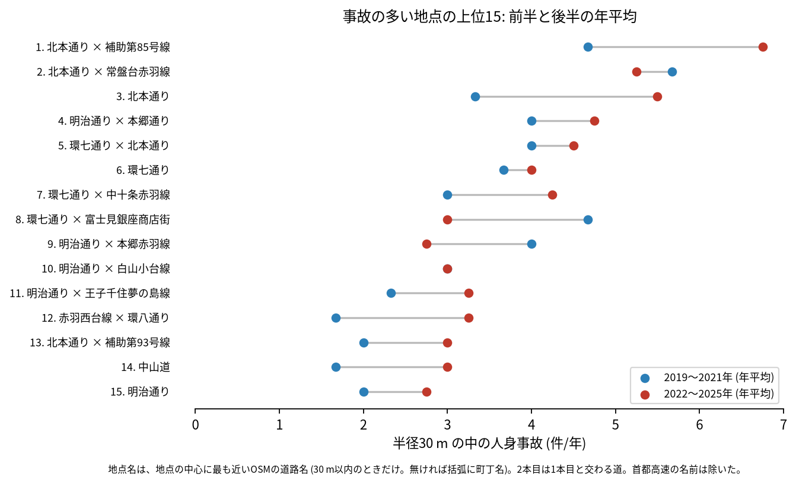
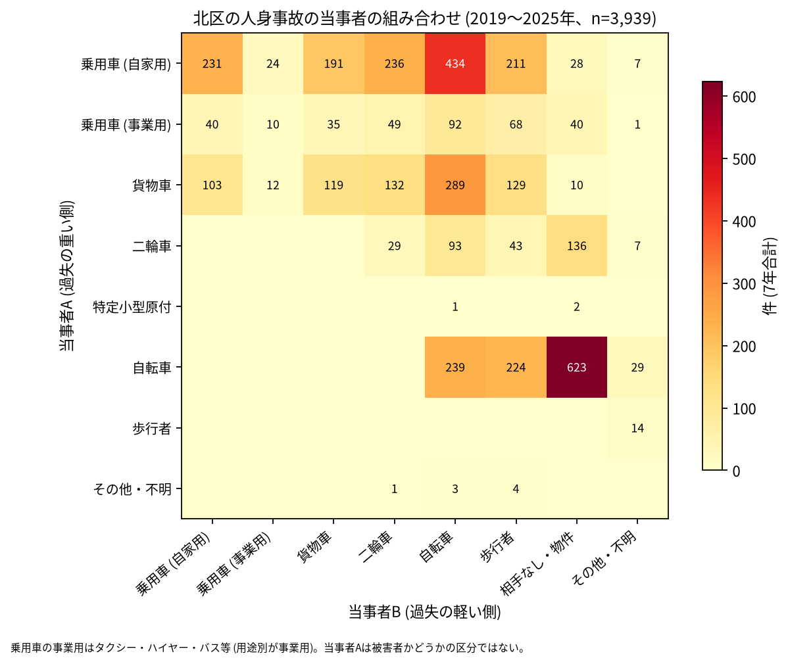

# 道路安全診断のための報告: 北区で事故の集まる地点

## 問い

北区で 2019〜2025 年の人身事故が集まる地点はどこで、そこでは誰と誰の事故が多いか。現地診断の候補を選ぶ材料にします。

## 結論

- 半径 30 m の円の中の 7 年の件数で選んだ上位 15 地点は、17〜41 件です。最も近い道で見ると、明治通りが 5 地点、北本通りが 4 地点、環七通りが 4 地点で、残りは赤羽西台線と中山道です。王子 (北本通りと明治通りが交わる範囲) に 5 地点、赤羽の北の岩淵町に 2 地点、環七通りの神谷から十条に 4 地点、田端に 2 地点があります。

| 順位 | 近い道路 (OSM) | 件数 | 前半 件/年 | 後半 件/年 | 交差点内 | 信号あり | 多い組み合わせ (A × B) |
|---:|---|---:|---:|---:|---:|---:|---|
| 1 | 北本通り × 補助第85号線 | 41 | 4.67 | 6.75 | 34 | 37 | 乗用車 (自家用) × 自転車 |
| 2 | 北本通り × 常盤台赤羽線 | 38 | 5.67 | 5.25 | 34 | 36 | 乗用車 (自家用) × 自転車 |
| 3 | 北本通り | 32 | 3.33 | 5.50 | 28 | 29 | 乗用車 (自家用) × 貨物車 |
| 4 | 明治通り × 本郷通り | 31 | 4.00 | 4.75 | 19 | 26 | 二輪車 × 相手なし・物件 |
| 5 | 環七通り × 北本通り | 30 | 4.00 | 4.50 | 28 | 29 | 乗用車 (自家用) × 自転車 |
| 6 | 環七通り | 27 | 3.67 | 4.00 | 15 | 20 | 乗用車 (自家用) × 二輪車 |
| 7 | 環七通り × 中十条赤羽線 | 26 | 3.00 | 4.25 | 19 | 22 | 乗用車 (自家用) × 二輪車 |
| 8 | 環七通り × 富士見銀座商店街 | 26 | 4.67 | 3.00 | 11 | 15 | 乗用車 (自家用) × 歩行者 |
| 9 | 明治通り × 本郷赤羽線 | 23 | 4.00 | 2.75 | 11 | 16 | 乗用車 (自家用) × 二輪車 |
| 10 | 明治通り × 白山小台線 | 21 | 3.00 | 3.00 | 14 | 19 | 乗用車 (自家用) × 自転車 |

前半は 2019〜2021 年、後半は 2022〜2025 年。11〜15 位と、歩行者、自転車、夜の件数は [hotspots.csv](../outputs/hotspots.csv) にあります。道路名は地点の中心に最も近い OSM の道路名 (30 m 以内のときだけ) で、2 本目は 1 本目と交わる向き (30 度以上) の道のうち最も近いもので、30 m 以内のときだけ書きました (首都高速の名前は除いた)。3 位と 6 位は 30 m 以内に交わる名前の道が無く、1 本だけです。

- 首都高速: 北区の首都高速の事故は 79 件で、上位 15 の円に入るのは 4 位の 3 件と 11 位の 1 件です。首都高速の事故を除いて選び直しても、15 地点が全て 30 m 以内に残ります ([analysis.json](../outputs/analysis.json))。4 位の「二輪車 × 相手なし・物件」(7 件) が地上の道の事故か、首都高速の事故かは、円の中の件数だけでは分けていません。
- 続いているか: 上位 15 は全て前半と後半の両方に事故があります。1 位 (4.67 から 6.75 件/年) と 3 位 (3.33 から 5.50 件/年) は後半に増え、8 位 (4.67 から 3.00 件/年) と 9 位 (4.00 から 2.75 件/年) は減りました。上位は 7 年合計で選んだので、後半が下がって見えやすい (平均への回帰) ことに注意してください。区全体の件数が 2022〜2023 年に多かったため、後半の値はその影響も受けます。

- 組み合わせ: 当事者 A が乗用車か貨物車で B が自転車の事故は 815 件です。自転車の単独 (相手なし・物件) が 623 件、自転車どうしが 239 件、自転車と歩行者 (自転車が A) が 224 件ありました。上位 1 位と 2 位、5 位では、乗用車 (自家用) と自転車の組み合わせが最も多い組でした。事業用の乗用車 (タクシー、ハイヤー、バスなど) は 335 件で当事者 A です。

- 半径を変えると: 20 m の上位 15 の中心が、30 m の上位 15 の中心から 30 m 以内にあるのは 12 地点、50 m では 13 地点でした。上位に入る交差点の多くは保たれます。岩淵町の 2 位と 3 位は、どちらも北本通りの上の、隣り合う別の地点です。

## データ

警察庁「交通事故統計情報のオープンデータ」を加工した `yuiseki/npa-traffic-accidents` 版 `389500a` の本票、北区 (`市区町村コード` 117) の 3,939 件。道路名は OpenStreetMap 2026-08-31 (`osm-tokyo23-src-2026-08` 版 `38f7a5f`)。詳しくは [共通の報告](../report.md)。

## 方法

事故の点を EPSG:6677 (メートル) に変換し、半径 30 m の円の中の件数が最も多い事故の点を中心に選び、その円の事故を除いて次を選ぶ手順を 15 回くり返しました。30 m はコード表の「交差点付近」(交差点の側端から 30 m 以内) の幅です。信号ありは `信号機` が 3 灯式、押ボタン式、歩車分式の点灯。組み合わせは当事者 A (過失の重い側) と B の種別で、乗用車は `用途別` で事業用と自家用に分けました。

## 確かめていないこと

- 交通量で割っていません。件数の多い交差点が、車の多さに比べて危険かは分かりません。
- 事故の型 (出会い頭、右折、追突)、違反の種類、重傷と軽傷の区別は、このデータにありません。現地で確かめてください。
- 位置の精度は分かりません。数十 m のずれで地点の件数は変わります。王子の首都高速の高架やトンネルの付近では、上と下の道の事故が同じ円に入りえます。
- 偶然でもこの程度の集まりが生まれるか (順位の有意さ) は調べていません。
