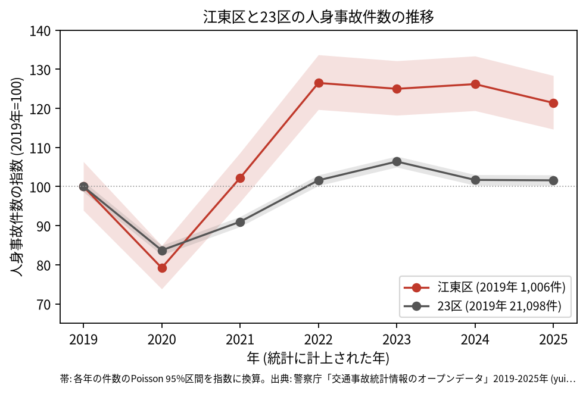
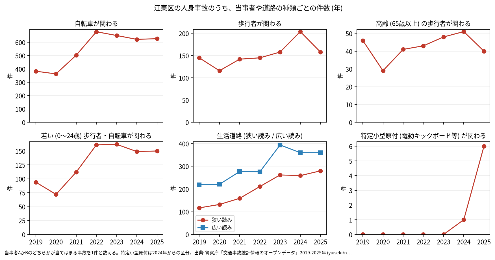
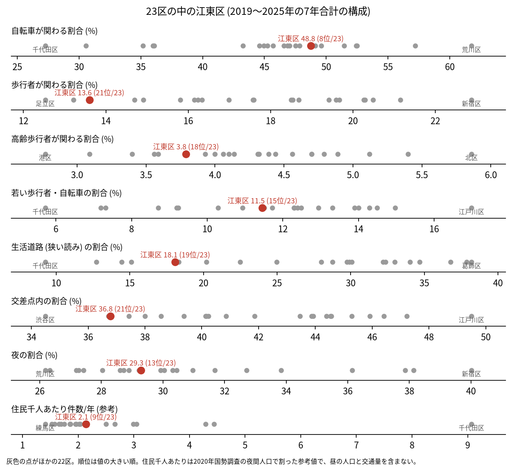
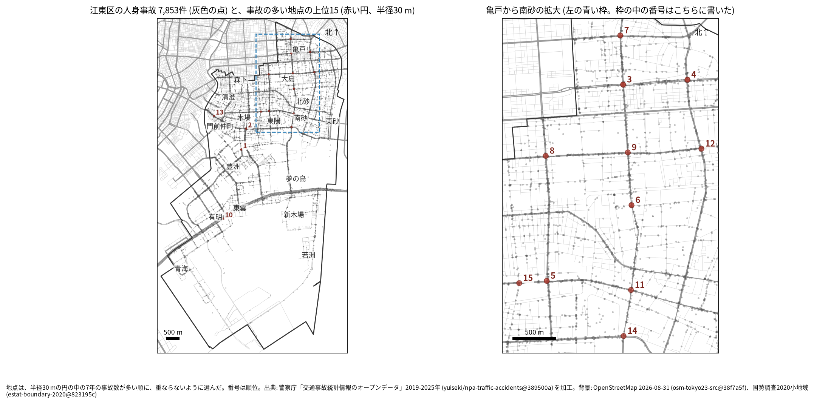
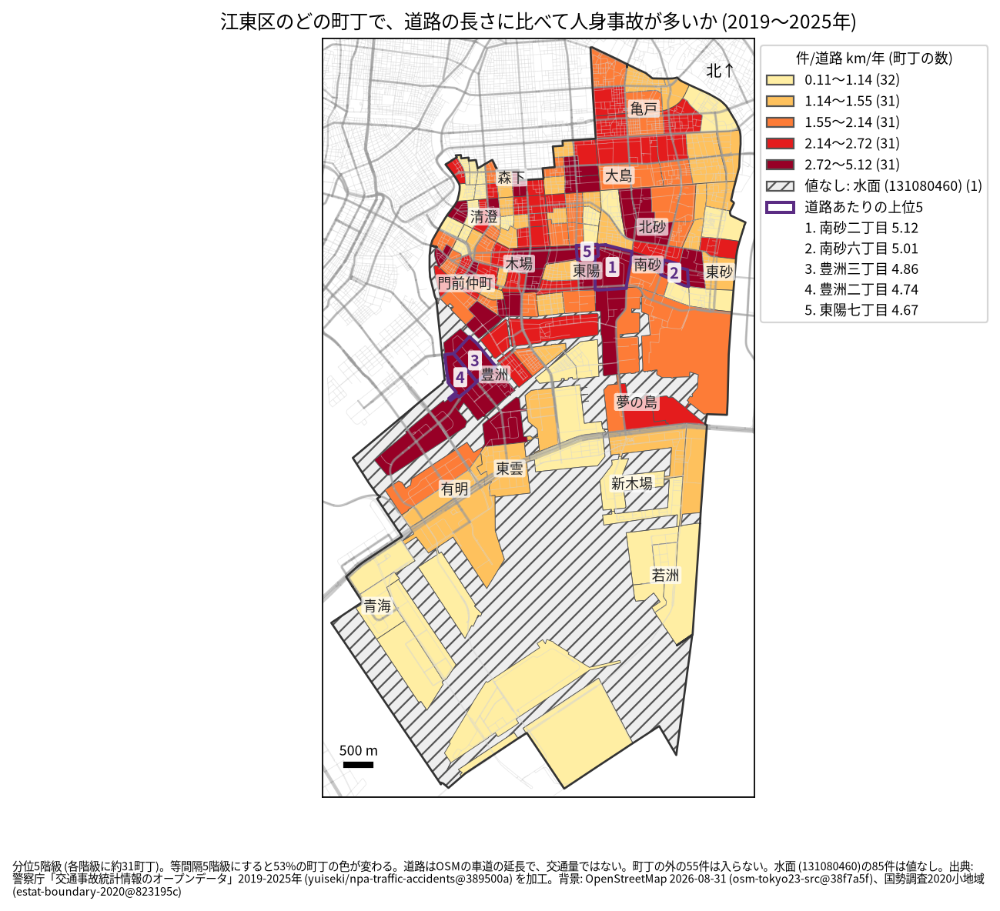
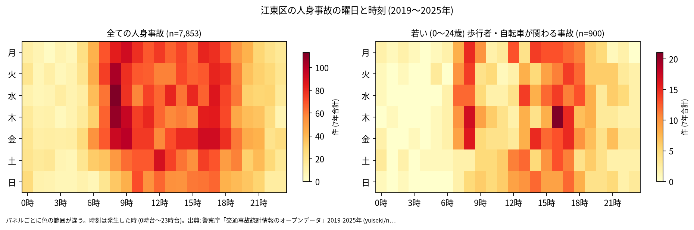
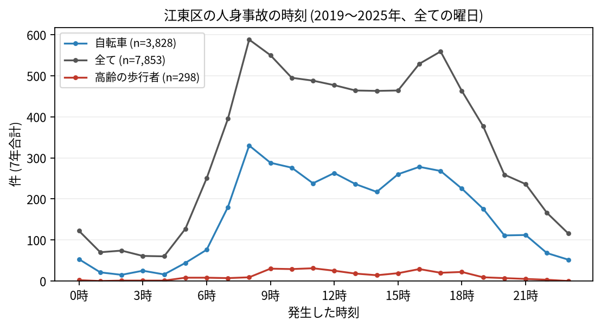
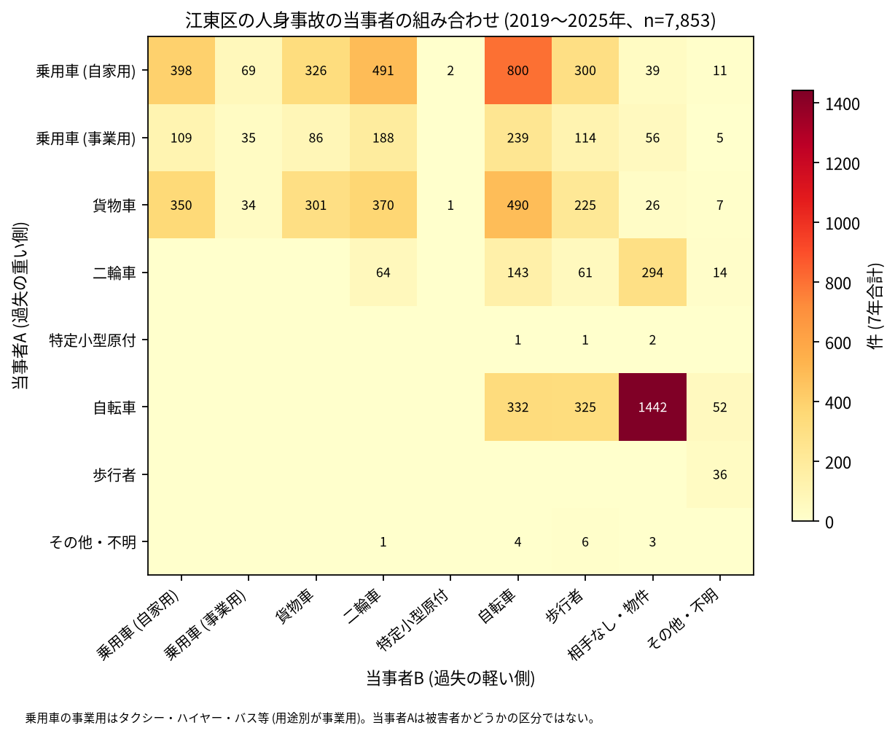

# 江東区の交通事故 2019〜2025 年: 図で読む要点

## 問い

2019〜2025 年の警察記録の人身事故で、江東区の事故はいつ、どこで、誰が関わって起きているか。

## 結論

### 要点

| # | 要点 | 数字 | 図 |
|---:|---|---|---|
| 1 | 件数は 2020 年に減った後、2022 年から 2019 年より多い水準が続く。23 区全体より伸びが大きい | 7 年で 7,853 件、死者 41 人、負傷者 8,762 人。指数 (2019 年=100) は 2022 年 126.5、2025 年 121.4。23 区全体の 2025 年は 101.6 ([yearly.csv](outputs/yearly.csv)、[summary.txt](outputs/summary.txt)) | [図 1](#図-1-件数の推移) |
| 2 | 事故の半分に自転車が関わり、自転車だけの事故が多い | 自転車が関わる 48.8%。自転車の単独 (相手なし・物件) が 1,442 件で全体の 18.4% ([summary.txt](outputs/summary.txt)) | [図 6](#図-6-誰と誰の事故か) |
| 3 | 交差点内と歩行者の割合は 23 区で低い側 | 交差点内 36.8% (21 位)、歩行者 13.6% (21 位)、生活道路 18.1% (19 位) ([analysis.json](outputs/analysis.json)、[summary.txt](outputs/summary.txt)) | [図 2](#図-2-23-区の中の江東区) |
| 4 | 集まる場所は、亀戸から南砂の幹線の交差点 | 事故の多い地点の上位 15 のうち 11 が亀戸から南砂の拡大図の範囲。道路あたりの上位は南砂二丁目 (年 5.123 件/道路 km)、南砂六丁目 (5.012 件) ([towns.csv](outputs/towns.csv)、[hotspots-map.json](outputs/hotspots-map.json)) | [図 3](#図-3-事故の集まる地点)、[図 4](#図-4-町丁ごとの事故) |
| 5 | 死亡事故は二輪車と歩行者に、相手は貨物車に偏る | 死者 41 人のうち二輪車 16 人、歩行者 12 人 (65 歳以上が 7 人)、自転車 9 人。当事者 A が貨物車の事故が 18 件 ([summary.txt](outputs/summary.txt)) | [表 1](#表-1-死亡事故) |

### 読み手ごとに知るべきこと

| 読み手 | 結論 | 検討する材料 | 詳しく |
|---|---|---|---|
| 区の交通安全担当 | 件数は 2022 年から 2019 年の水準を上回る。生活道路の法定速度 30 km/h (2026-09-01 から) が当たるのは事故の 18.1〜26.8% (読み方による) | 自転車の単独事故、二輪車と貨物車の死亡事故、増えた理由の確認 | [municipality.md](reports/municipality.md) |
| 学校と PTA | 若い (0〜24 歳) 歩行者と自転車の事故は 900 件。平日は 8 時台 (74 件) と 16 時台 (72 件) が多い | 学校の円の中で、平日の朝と下校の時間の点が並ぶ道 | [school-pta.md](reports/school-pta.md) |
| 道路安全診断 | 上位は環状三号線 (塩浜二丁目、38 件)、三ツ目通り × 永代通り (34 件)、明治通り × 京葉道路 (28 件)。上位 15 のうち 12 地点で後半の年平均が前半より多い | 後半に増えた亀戸と大島の交差点、交差点の外の有明の東京湾岸道路 | [road-safety-auditor.md](reports/road-safety-auditor.md) |
| 住民 | 道路あたりで多いのは南砂二丁目、南砂六丁目、豊洲三丁目。事故は朝 8 時台 (588 件) と夕方 17 時台 (559 件) に山がある | 自分の町の色、朝の通勤の自転車、自転車の転倒 | [resident.md](reports/resident.md) |

### 図 1: 件数の推移

2020 年の落ち込み (79.2) は 23 区全体 (83.7) より深く、2022 年に 126.5 まで上がった。2019 年の 95% 区間 (944.8〜1,070.1 件) と 2022 年 (1,204.0〜1,344.9 件)、2025 年 (1,153.5〜1,291.5 件) は重ならないので、増えたと書ける。区の面に入る点で数えても 2022 年は 1,271 件で ([analysis.json](outputs/analysis.json))、跳ねは区のコードの付け方の違いではない。増えた理由は調べていない。

増え方が大きいのは、自転車が関わる事故 (2019 年 383 件、2022 年 679 件) と、生活道路の狭い読み (2019 年 117 件、2025 年 280 件) ([yearly.csv](outputs/yearly.csv))。

### 図 2: 23 区の中の江東区

赤い点が江東区。自転車 (8 位) が高い側で、交差点内 (21 位)、歩行者 (21 位)、高齢の歩行者 (18 位) が低い側 ([analysis.json](outputs/analysis.json))。住民千人あたり (2.14 件/年、9 位) は昼の人口を含まない参考値。

### 図 3: 事故の集まる地点

半径 30 m の円の中の 7 年の件数で選んだ上位 15 (20〜38 件)。番号は順位で、亀戸から南砂の 11 地点は右の拡大図に番号を書いた。

| 順位 | 近い道路 (OSM) | 町丁 | 件数 | 前半 件/年 | 後半 件/年 |
|---:|---|---|---:|---:|---:|
| 1 | 環状三号線 | 塩浜二丁目 | 38 | 6.33 | 4.75 |
| 2 | 三ツ目通り × 永代通り | 木場二丁目 | 34 | 4.33 | 5.25 |
| 3 | 明治通り × 京葉道路 | 亀戸一丁目 | 28 | 3.0 | 4.75 |
| 4 | 丸八通り × 京葉道路 | 亀戸七丁目 | 27 | 3.0 | 4.5 |
| 5 | 葛西橋通り × 四ツ目通り | 東陽六丁目 | 25 | 3.33 | 3.75 |

前半は 2019〜2021 年、後半は 2022〜2025 年。半径を 20 m にしても 50 m にしても、上位 15 のうち 11 地点が残る。首都高速の事故を除いても 15 地点が全て残る ([analysis.json](outputs/analysis.json))。6〜15 位は [hotspots.csv](outputs/hotspots.csv)。

### 図 4: 町丁ごとの事故

町丁の事故数を、OSM の車道の延長と 7 年で割った値。紫の枠が上位 5 (南砂二丁目、南砂六丁目、豊洲三丁目、豊洲二丁目、東陽七丁目)。分位と等間隔で 52.6% の町丁の色が変わるので ([town-rate-quantile.json](outputs/town-rate-quantile.json))、色の細かい差は読まない。斜線は水面 (小地域の表の HCODE 8154、[analysis.json](outputs/analysis.json)) で、町丁でないので値を付けていない。道路の長さは交通量ではない。

### 図 5: いつ起きるか

全体は平日の朝 8 時台が最も濃く、夕方 16〜17 時台にもう一つの山がある。若い歩行者と自転車は、平日の 8 時台 (74 件) と 16 時台 (72 件) に寄る ([summary.txt](outputs/summary.txt))。

自転車は 8 時台 (330 件)、高齢の歩行者は 11 時台 (31 件) が最多 ([summary.txt](outputs/summary.txt))。

### 図 6: 誰と誰の事故か

最も多いのは自転車の単独 (相手なし・物件) の 1,442 件、次が自家用の乗用車 (A) と自転車 (B) の 800 件、自家用の乗用車と二輪車の 491 件、貨物車と自転車の 490 件 ([summary.txt](outputs/summary.txt))。当事者 A は過失の重い側で、被害者とは限らない。

### 表 1: 死亡事故

| 亡くなった人 | 人数 | 特徴 |
|---|---:|---|
| 二輪車 | 16 | 車両相互 11、車両単独 5 |
| 歩行者 | 12 | 65 歳以上が 7 人 |
| 自転車 | 9 | |
| 乗用車 (自家用) | 3 | |
| 貨物車 | 1 | |

41 件のうち、当事者 A が貨物車の事故が 18 件、0〜5 時台が 8 件 ([summary.txt](outputs/summary.txt))。数が少ないので傾向とは断定しない。全件は [deaths.csv](outputs/deaths.csv)。

### 読み方で変わる答え

| 読み方 | 主 | 別の読み方 |
|---|---|---|
| 江東区の事故 | `市区町村コード` 108 の 7,853 件 | 点が区の面に入る事故。両方に当てはまるのは 7,798 件 ([analysis.json](outputs/analysis.json)) |
| 生活道路 | 狭い読み 18.1% (19 位) | 広い読み 26.8% (19 位) ([analysis.json](outputs/analysis.json)、[summary.txt](outputs/summary.txt)) |
| 地点の半径 | 30 m | 20 m で 11 地点、50 m で 11 地点が残る ([analysis.json](outputs/analysis.json)) |
| 首都高速の事故 | 含める | 除いても上位 15 の 15 地点が残る ([analysis.json](outputs/analysis.json)) |
| 町丁の階級 | 分位 5 階級 | 等間隔で 52.6%、jenks で 34.0% の町丁の色が変わる ([town-rate-quantile.json](outputs/town-rate-quantile.json)) |

## データ

- 人身事故: 警察庁「交通事故統計情報のオープンデータ」を加工した `yuiseki/npa-traffic-accidents` 版 `389500aae5cec45f1311163f70db6a5f05867838` (配布元の取得 2026-10-02) の本票。年はファイルの年 (統計に計上された年)。江東区 7,853 件、23 区 144,716 件。位置の無い行は 0。物損事故は含まない。東京の本票は 2026-11-03 に用意された版を使い、行数と年の数を検査した。
- 区の面と人口: `yuiseki/jp-admin-2026-09` 版 `e6c87b1`。町丁: 2020 年国勢調査の小地域 `yuiseki/estat-boundary-2020` 版 `823195c` (173 行を KEY_CODE でまとめて 157 単位)。157 単位には水面と、名前の無い陸 (KEY_CODE 131089990) を含む。学校 67 校と道路: OpenStreetMap 2026-08-31、`yuiseki/osm-tokyo23-src-2026-08` 版 `38f7a5f`。
- 道具: DuckDB 2.0.0 (spatial)、matplotlib、`analysis-visualize` の `cjk_font.py`、`classify_map.py`、`context_map.py` (2026-11-03)。
- 出典の表示: 警察庁ウェブサイト (https://www.npa.go.jp/publications/statistics/koutsuu/opendata/index_opendata.html) の交通事故統計情報のオープンデータを加工して作成。国勢調査の小地域境界と人口、OpenStreetMap (© OpenStreetMap contributors) を加工して使用。

## 方法

- 読み方は結果を見る前に [計画](EXPERIMENT_PLAN.md) で固定し、実行は [記録](EXPERIMENT_TRACKER.md) に残した。台東区の分析 ([taito](../taito-accident-trends-by-role/report.md)) と同じ読み方と規則にし、江東区では首都高速を除いた地点の読みを並べた (区の上を首都高速の湾岸線や 9 号深川線が通るため)。生活道路は `車道幅員` が 01、02、11 (狭い読み)、広い読みは 14、17 を足す。歩行者や自転車が関わるかは当事者 A と B の両方で見て、1 件を 1 回数えた。
- 距離は EPSG:6677 (メートル) で測った。地点は、半径 30 m の中の件数が最も多い点を中心に選び、その円の事故を除いて次を選ぶ手順を 15 回くり返した。
- 町丁は KEY_CODE ごとに形を合わせ、人口を足した。水面は町丁でないので道路あたりの値を付けず (NoData)、その中の点 85 件 ([analysis.json](outputs/analysis.json)) は町丁の値に入らない。
- 地図は `analysis-visualize` の map-context に合わせ、地名と道路を重ね、凡例を地図の外に置き、強調した単位に番号を付けた。描いた町丁の数を分析の数と照らし、文字の重なりと、地名が円や学校の印を隠す重なりは、3 枚の地図で 0 件。区の北に学校が密なので、9 つの地名を元の町丁の位置から動かした (最大 480 m)。背景の道路 (OGC:CRS84) と町丁 (JGD2000) の差は、線の幅より小さいとして変換せずに重ねた。
- 関門: 予測と回帰をしないので、評価の分け方と残差の確認は要らない。単位の間の相関を結論にしないので、Moran's I と格子の掃引は省いた。推移は 23 区全体を基準にし、年の件数に Poisson の 95% 区間を付けた。対策の効果は推定していない。
- 再実行は [README.md](README.md)。数値は [outputs/](outputs/) の CSV、来歴は [analysis.json](outputs/analysis.json)。

## 確かめていないこと

- 2022 年からの増加の理由 (住む人や来訪者の変化、自転車の使われ方、記録の仕方) は調べていない。
- 交通量、昼の人口、臨海部の来訪者の数で割っていない。件数の多さは、人と車の多さかもしれない。
- 位置の精度は分からない。30 m の地点と町丁の境界の近くの事故は、数十 m のずれで入れ替わる。
- 事故の型 (出会い頭、追突)、重傷と軽傷の区別、物損事故、ヒヤリハットは、このデータに無い。
- 0〜24 歳より細かい年齢は無く、小学生だけは数えられない。
- 水面に入った点が橋の上か、位置のずれかは確かめていない。名前の無い陸 (131089990) がどこの埋め立て地かは、位置を外の知識 (中央防波堤) と照らしただけで確かめていない。
- 地点の上位は 7 年で選び、同じ 7 年で前半と後半を比べた。平均への回帰は後半を下げて見せる向きに働く。後半が多い地点が多いことは、区全体の増加と合わせて読む。
