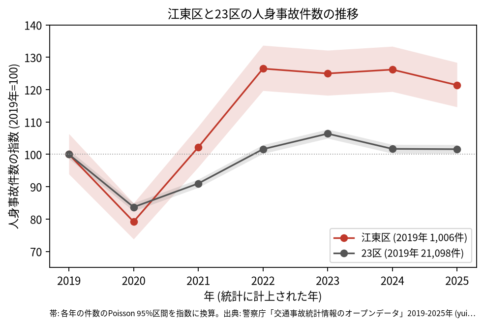
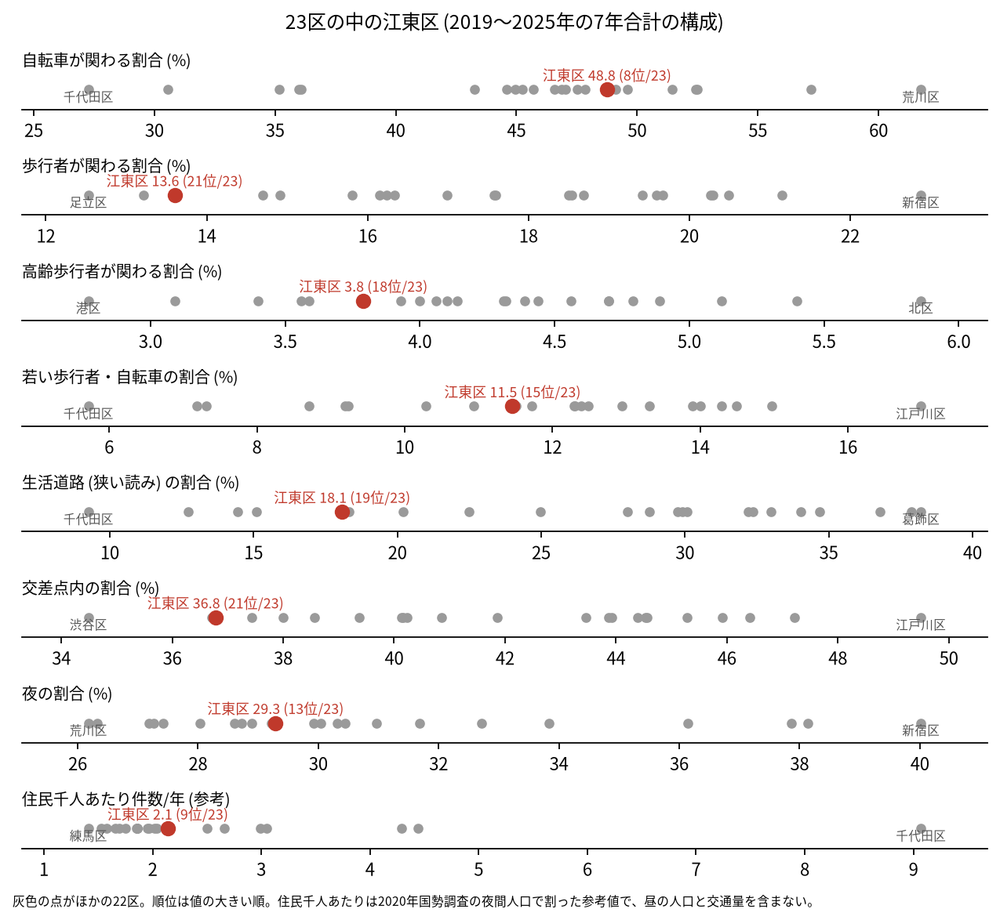
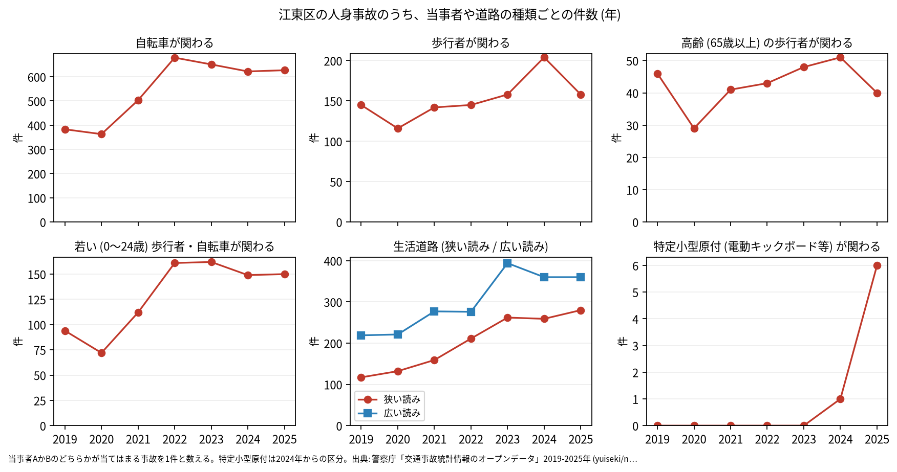

# 区の交通安全担当のための報告: 江東区の交通事故の傾向

## 問い

江東区の人身事故は 2019〜2025 年にどう推移し、23 区の中でどんな特徴があり、施策をどこに向ける材料になるか。

## 結論

- 件数: 7 年で 7,853 件、死者 41 人、負傷者 8,762 人です。2020 年に 797 件 (2019 年を 100 として 79.2) まで減った後、2022 年は 1,273 件 (126.5) に増え、2025 年も 1,221 件 (121.4) です。2019 年の 95% 区間 (944.8〜1,070.1 件) は 2022 年 (1,204.0〜1,344.9 件) とも 2025 年 (1,153.5〜1,291.5 件) とも重ならないので、2019 年より増えたと言えます。23 区全体の 2025 年は 101.6 で、江東区の伸びは 23 区全体より大きいです。区の面に入る点で数えても 2022 年は 1,271 件で、跳ねは区のコードの付け方によるものではありません。

- 23 区の中の位置: 自転車が関わる割合は 48.8% で 23 区の 8 位です。交差点内の割合は 36.8% で 21 位、歩行者が関わる割合は 13.6% で 21 位、高齢の歩行者は 3.8% で 18 位と、低い側にあります。生活道路 (狭い読み) は 18.1% で 19 位、広い読みでも 26.8% で 19 位です。

- 施策への読み方: 2026-09-01 からの生活道路の法定速度 30 km/h が当たるのは、江東区の事故のうち 18.1〜26.8% (読み方による) です。件数の多くは、亀戸から南砂の幹線の交差点と、臨海部の幹線にあります (地点は [道路安全診断の報告](road-safety-auditor.md))。これは効果の予測ではなく、どの道路で事故が起きているかの構成です。
- 区分ごとの推移: 自転車が関わる事故は 2019 年の 383 件から 2022 年に 679 件になり、2023〜2025 年も 622〜651 件です。生活道路 (狭い読み) は 2019 年の 117 件から 2025 年の 280 件です。特定小型原付 (電動キックボードなど) が関わる事故は、区分のできた 2024 年に 1 件、2025 年に 6 件でした。
- 自転車の単独事故: 当事者 A が自転車で相手がない (相手なし・物件) 事故が 1,442 件で、全体の 18.4% です。当事者の組み合わせの中で最も多い組です。

- 死亡事故: 41 件のうち、亡くなったのは二輪車 16 人、歩行者 12 人、自転車 9 人、乗用車 (自家用) 3 人、貨物車 1 人です。亡くなった歩行者 12 人のうち 7 人が 65 歳以上でした。当事者 A (過失の重い側) が貨物車の事故が 18 件です。二輪車の 16 人のうち 5 人は相手のいない車両単独の事故でした。41 件は少なく、偏りを傾向と断定できる数ではありません。

| 年 | 当事者 A | 当事者 B | 亡くなった人 | 時 |
|---|---|---|---|---:|
| 2020 | 二輪車 | 相手なし・物件 | 二輪車 | 0 |
| 2021 | 二輪車 | 相手なし・物件 | 二輪車 | 20 |
| 2021 | 二輪車 | 相手なし・物件 | 二輪車 | 12 |
| 2021 | 二輪車 | 相手なし・物件 | 二輪車 | 0 |
| 2025 | 二輪車 | 相手なし・物件 | 二輪車 | 10 |

表は、二輪車の車両単独の死亡事故 5 件の抜き出しです。41 件 ([summary.txt](../outputs/summary.txt)) の全ては [deaths.csv](../outputs/deaths.csv) にあります。

- 人口あたり: 2020 年の住民千人あたりの年の件数は 2.14 件で 23 区の 9 位ですが、分母に昼の人口、来訪者、通過する車が入らないため、区の比較の主な指標にしていません。

## データ

警察庁「交通事故統計情報のオープンデータ」を加工した `yuiseki/npa-traffic-accidents` 版 `389500a` の本票。江東区は `市区町村コード` 108 の 7,853 件、23 区は 144,716 件。年はファイルの年 (統計に計上された年)。区の人口は 2020 年国勢調査 (`jp-admin-2026-09` 版 `e6c87b1`)。詳しくは [共通の報告](../report.md)。

## 方法

区分は、当事者 A か B のどちらかが当てはまる事故を 1 件と数えました。生活道路は `車道幅員` で決め、狭い読み (5.5 m 未満の単路と、小と小の交差点) と、広い読み (5.5 m 未満の道とより広い道の交差点も含む) を並べました。年の区間は件数の Poisson の 95% 区間 (Garwood) です。23 区の順位は 7 年合計の割合の大きい順です。

## 確かめていないこと

- 2022 年からの増加の理由 (住む人や来訪者の変化、自転車の使われ方、記録の仕方) は調べていません。
- 区の施策 (ゾーン 30、自転車の通行帯など) の効果は推定していません。割合の順位は施策の評価ではありません。
- 重傷と軽傷の区別、物損事故は、このデータにありません。
