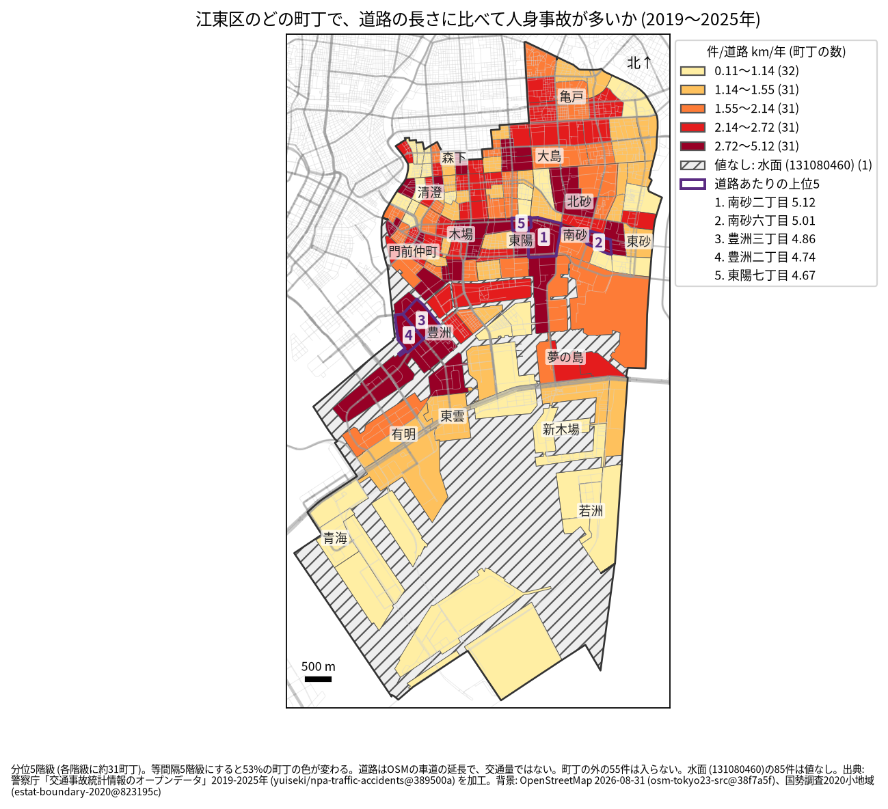
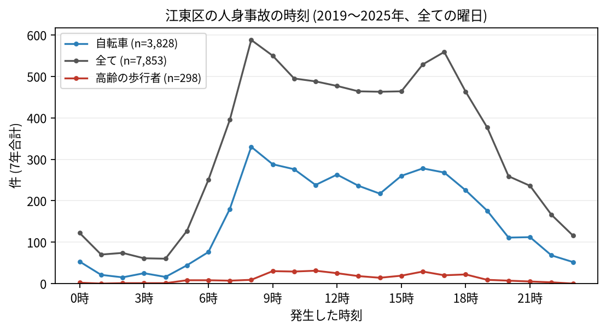

# 住民のための報告: 江東区で、いつ、どこで事故が起きているか

## 問い

江東区に住む人が、自分の町で、いつ、どんな事故に気をつければよいか。2019〜2025 年の警察記録の人身事故から調べました。

## 結論

- 江東区では 7 年で 7,853 件の人身事故があり、41 人が亡くなりました。年に 797〜1,273 件で、2022 年からは 2019 年より多い年が続いています。
- 町ごと: 道路 1 km あたりの事故が多いのは、南砂二丁目 (年 5.123 件)、南砂六丁目 (5.012 件)、豊洲三丁目 (4.864 件)、豊洲二丁目 (4.743 件)、東陽七丁目 (4.669 件) です。件数そのものが最も多いのは南砂二丁目 (7 年で 215 件) で、次が有明三丁目 (209 件) でした。

色は分位 5 階級で、各色に約 31 の町が入ります。等間隔の階級にすると 52.6% の町の色が変わるので ([town-rate-quantile.json](../outputs/town-rate-quantile.json))、色の差より、自分の町が上の階級か下の階級かを見てください。斜線は水面で、町ではないので色を付けていません。

- 時間: 事故は朝 8 時台 (588 件) が最も多く、夕方 17 時台 (559 件) にもう一つの山があります。自転車が関わる事故も 8 時台 (330 件) が最も多く、高齢の歩行者が関わる事故は 11 時台 (31 件) が最も多い時間でした。

- 誰が: 自転車が関わる事故が全体の 48.8% です。自転車に乗る人は、車やトラックとの事故 (1,529 件) に加え、自転車だけの事故 (転倒や物への衝突、1,442 件) にも気をつけてください。歩行者が関わる事故は 13.6% です。
- 亡くなった人: 41 人のうち 16 人が二輪車、12 人が歩行者 (うち 65 歳以上が 7 人)、9 人が自転車でした。

## データ

警察庁「交通事故統計情報のオープンデータ」を加工した `yuiseki/npa-traffic-accidents` 版 `389500a` の本票、江東区の 7,853 件 (2019〜2025 年のファイル)。町の境界は 2020 年国勢調査の小地域、道路は OpenStreetMap 2026-08-31。詳しくは [共通の報告](../report.md)。

## 方法

事故の地点を町丁の境界に入れて数え、町丁の中の車道の長さ (OSM) と 7 年で割りました。区の境界の近くで町丁の外に落ちた 55 件と、水面に落ちた 85 件は町の値に入っていません。時刻は事故の起きた時で、7 年の合計です。

## 確かめていないこと

- 道路の長さは、通る車や人の数ではありません。南砂や豊洲の値が高いのは、人と車が多いためかもしれません。
- 自分の町の事故が少なくても、物損事故やヒヤリハットはこのデータにありません。
- 事故の位置の精度は分かりません。町の境界の近くの事故は、隣の町に数えられている可能性があります。
