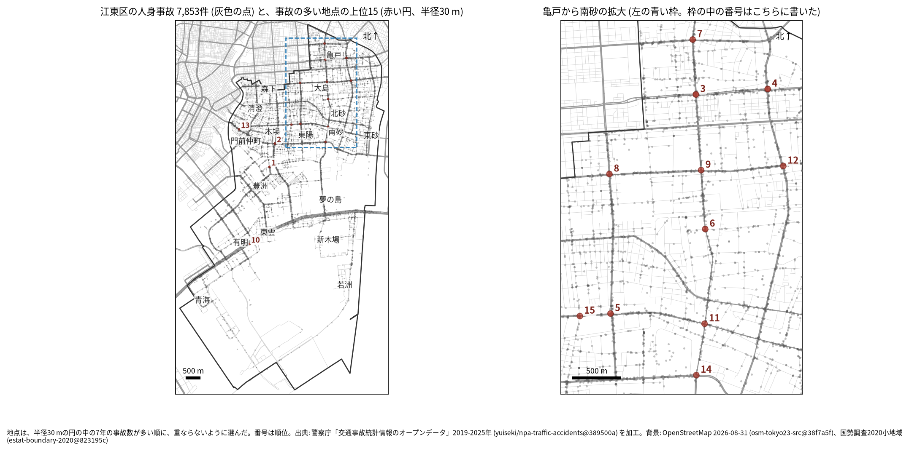
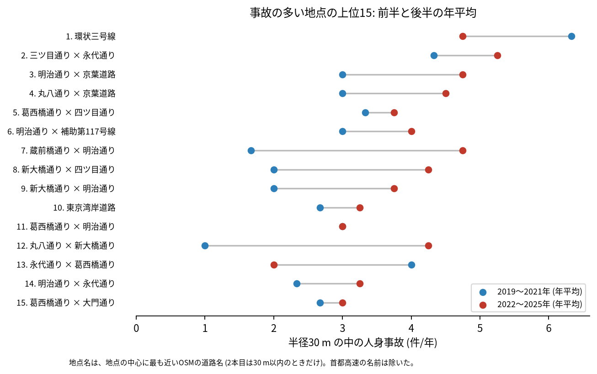
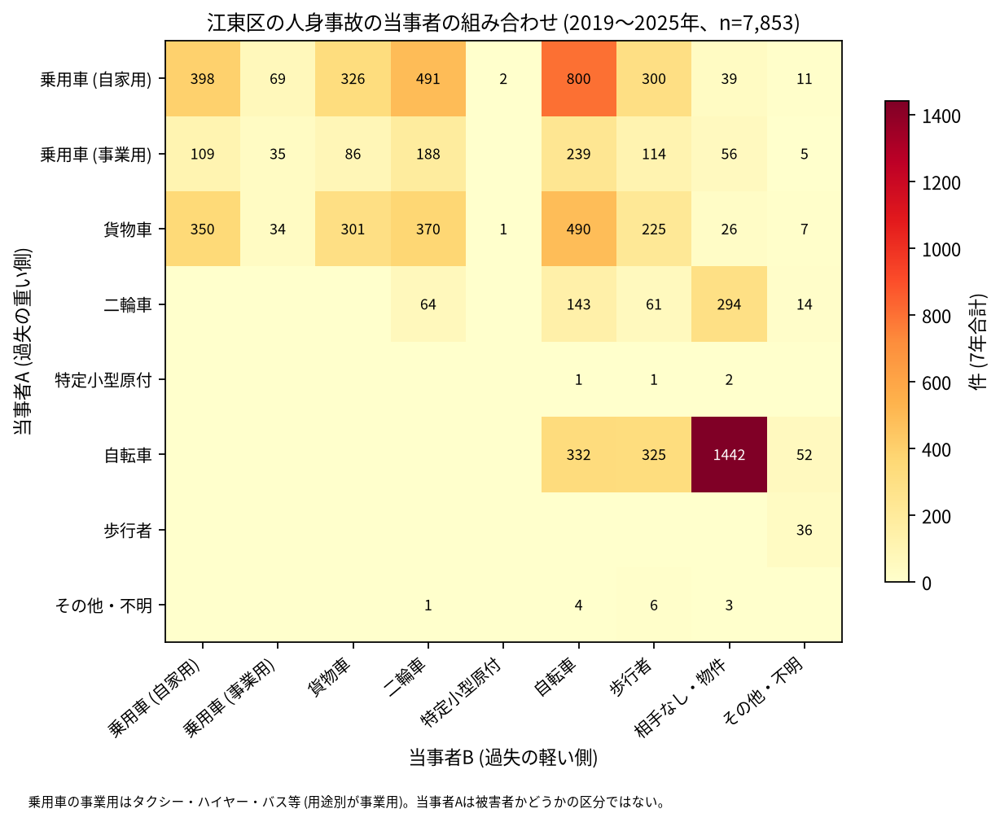

# 道路安全診断のための報告: 江東区で事故の集まる地点

## 問い

江東区で 2019〜2025 年の人身事故が集まる地点はどこで、そこでは誰と誰の事故が多いか。現地診断の候補を選ぶ材料にします。

## 結論

- 半径 30 m の円の中の 7 年の件数で選んだ上位 15 地点は、20〜38 件です。15 のうち 11 は亀戸、大島、北砂、東陽、南砂 (明治通り、京葉道路、丸八通り、新大橋通り、葛西橋通りが交わる範囲) にあり、ほかは塩浜、木場、永代と、有明の東京湾岸道路です。

| 順位 | 近い道路 (OSM) | 件数 | 前半 件/年 | 後半 件/年 | 交差点内 | 信号あり | 多い組み合わせ (A × B) |
|---:|---|---:|---:|---:|---:|---:|---|
| 1 | 環状三号線 (塩浜二丁目) | 38 | 6.33 | 4.75 | 37 | 38 | 乗用車 (自家用) × 自転車 |
| 2 | 三ツ目通り × 永代通り | 34 | 4.33 | 5.25 | 30 | 33 | 乗用車 (自家用) × 自転車 |
| 3 | 明治通り × 京葉道路 | 28 | 3.0 | 4.75 | 22 | 25 | 乗用車 (自家用) × 自転車 |
| 4 | 丸八通り × 京葉道路 | 27 | 3.0 | 4.5 | 19 | 23 | 乗用車 (自家用) × 乗用車 (自家用) |
| 5 | 葛西橋通り × 四ツ目通り | 25 | 3.33 | 3.75 | 17 | 21 | 自転車 × 相手なし・物件 |
| 6 | 明治通り × 補助第117号線 | 25 | 3.0 | 4.0 | 12 | 15 | 自転車 × 相手なし・物件 |
| 7 | 蔵前橋通り × 明治通り | 24 | 1.67 | 4.75 | 18 | 23 | 乗用車 (自家用) × 歩行者 |
| 8 | 新大橋通り × 四ツ目通り | 23 | 2.0 | 4.25 | 16 | 19 | 乗用車 (自家用) × 二輪車 |
| 9 | 新大橋通り × 明治通り | 21 | 2.0 | 3.75 | 17 | 20 | 乗用車 (自家用) × 歩行者 |
| 10 | 東京湾岸道路 (有明三丁目) | 21 | 2.67 | 3.25 | 0 | 17 | 乗用車 (自家用) × 二輪車 |

前半は 2019〜2021 年、後半は 2022〜2025 年。11〜15 位と、歩行者、自転車、夜の件数は [hotspots.csv](../outputs/hotspots.csv) にあります。道路名は地点の中心に最も近い OSM の道路名で、2 本目は 30 m 以内のときだけ書きました (首都高速の名前は除いた)。1 位は 2 本目の三ツ目通りが 190.7 m 離れているため 1 本だけです。10 位は交差点内の事故が 0 件で、最も多い路線は国道 357 号 (20 件) でした。

- 続いているか: 上位 15 は全て前半と後半の両方に事故があります。後半の年平均が前半より多いのは 12 地点、少ないのは 2 地点です ([summary.txt](../outputs/summary.txt))。少ないのは 1 位 (6.33 から 4.75 件/年) と 13 位 (4.0 から 2.0 件/年) です。12 位 (1.0 から 4.25 件/年) と 7 位 (1.67 から 4.75 件/年) は大きく増えました。区全体の件数も 2022 年から増えているので、地点ごとの増加は区全体の増加と合わせて読んでください。上位は 7 年合計で選んだので、後半が下がって見えやすい (平均への回帰) ことにも注意してください。

- 組み合わせ: 当事者 A が乗用車か貨物車で B が自転車の事故は 1,529 件です。自転車の単独 (相手なし・物件) が 1,442 件、自転車どうしが 332 件、自転車と歩行者 (自転車が A) が 325 件ありました。貨物車は 1,804 件で当事者 A です。

- 半径と首都高速の扱いを変えると: 20 m の上位 15 の中心が、30 m の上位 15 の中心から 30 m 以内にあるのは 11 地点、50 m でも 11 地点でした。首都高速の事故 (区で 188 件) を除いて選び直しても、15 地点が全て残ります ([analysis.json](../outputs/analysis.json))。上位に入る交差点の多くは保たれますが、順位は細かく読まないでください。

## データ

警察庁「交通事故統計情報のオープンデータ」を加工した `yuiseki/npa-traffic-accidents` 版 `389500a` の本票、江東区 (`市区町村コード` 108) の 7,853 件。道路名は OpenStreetMap 2026-08-31 (`osm-tokyo23-src-2026-08` 版 `38f7a5f`)。詳しくは [共通の報告](../report.md)。

## 方法

事故の点を EPSG:6677 (メートル) に変換し、半径 30 m の円の中の件数が最も多い事故の点を中心に選び、その円の事故を除いて次を選ぶ手順を 15 回くり返しました。30 m はコード表の「交差点付近」(交差点の側端から 30 m 以内) の幅です。首都高速は `路線コード` 5000〜5499 です。信号ありは `信号機` が 3 灯式、押ボタン式、歩車分式の点灯。組み合わせは当事者 A (過失の重い側) と B の種別で、乗用車は `用途別` で事業用と自家用に分けました。

## 確かめていないこと

- 交通量で割っていません。件数の多い交差点が、車の多さに比べて危険かは分かりません。
- 事故の型 (出会い頭、右折、追突)、違反の種類、重傷と軽傷の区別は、このデータにありません。現地で確かめてください。
- 位置の精度は分かりません。数十 m のずれで地点の件数は変わります。
- 1 位の地点は交差点内が 37 件ですが、最も近い道路名は環状三号線だけで、どの交差点かは現地で確かめてください。
- 偶然でもこの程度の集まりが生まれるか (順位の有意さ) は調べていません。
