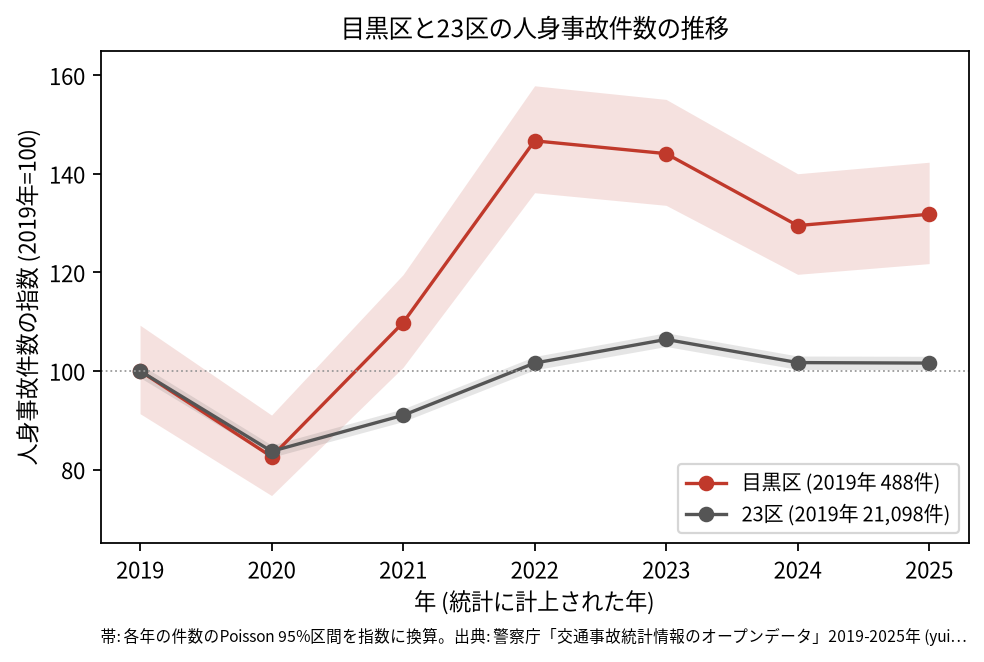
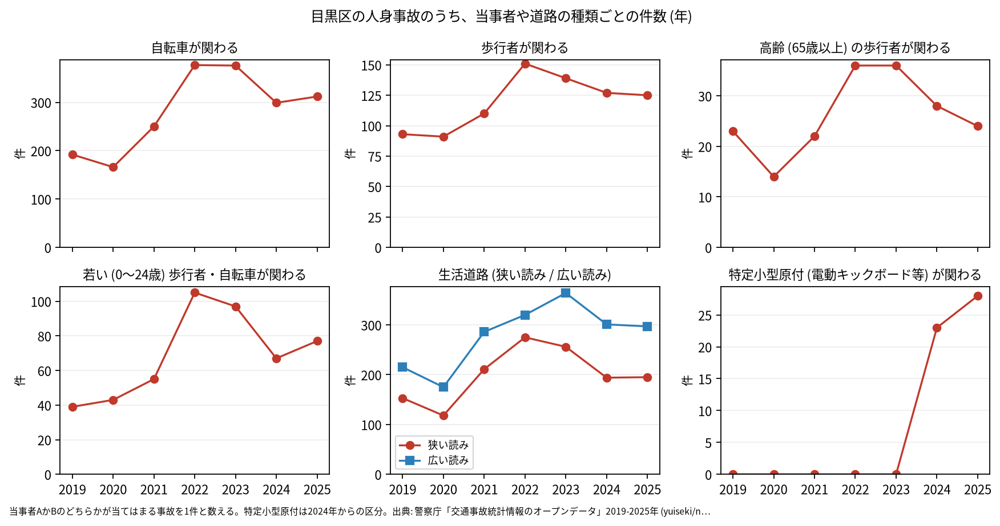
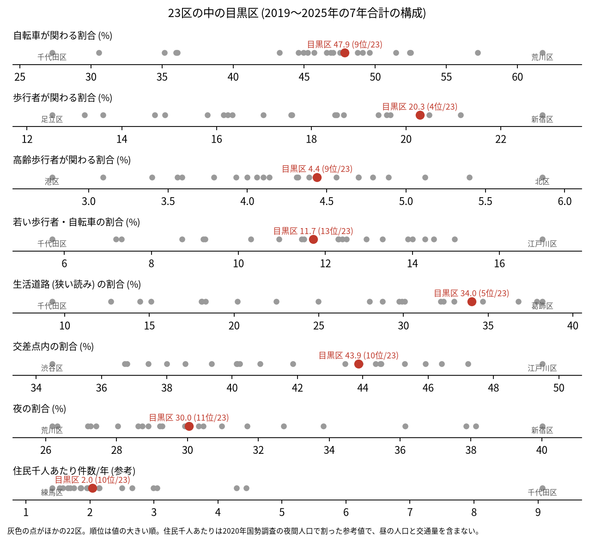
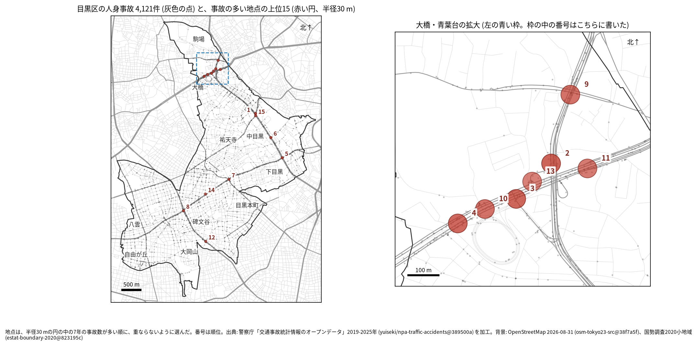
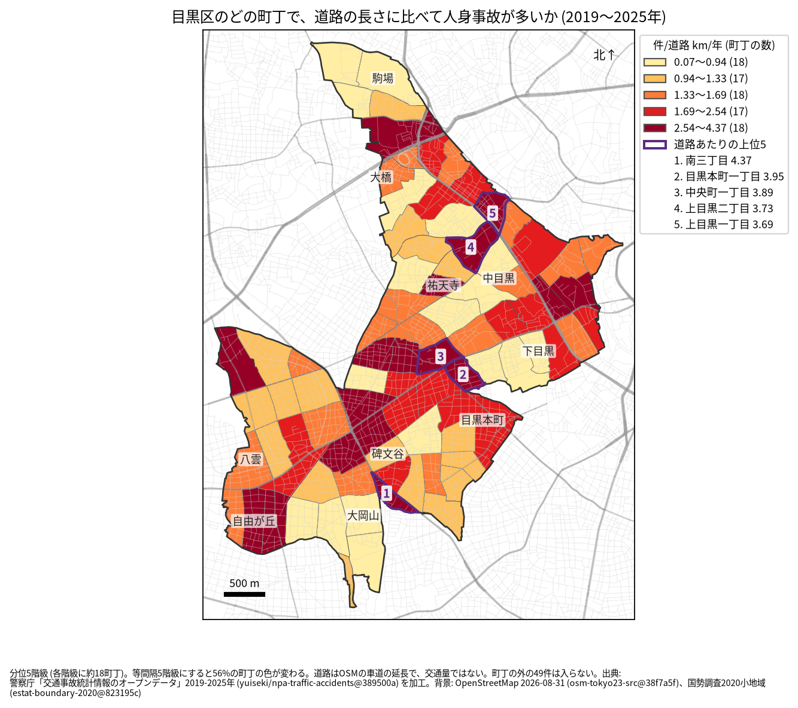
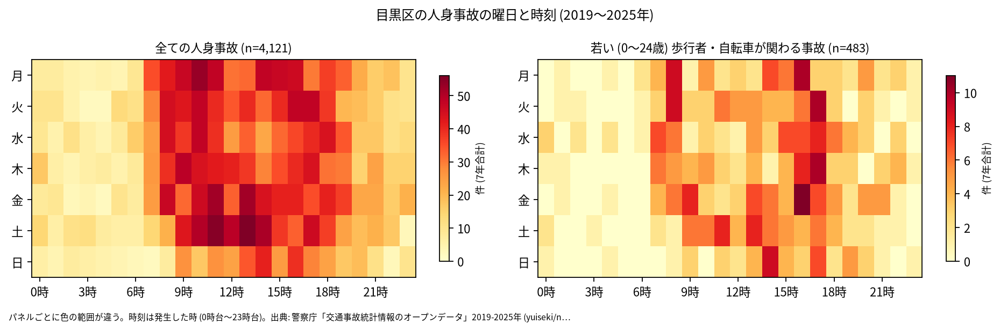
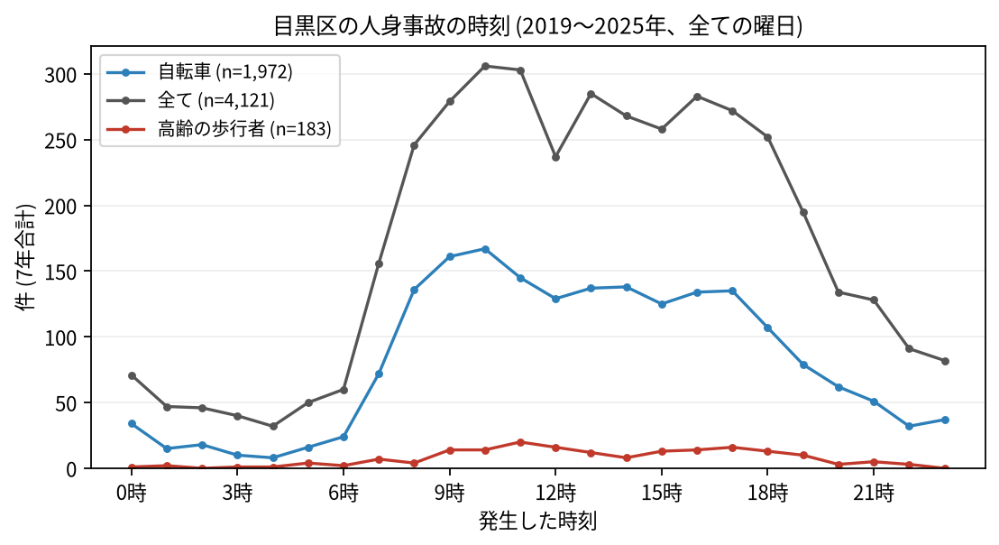
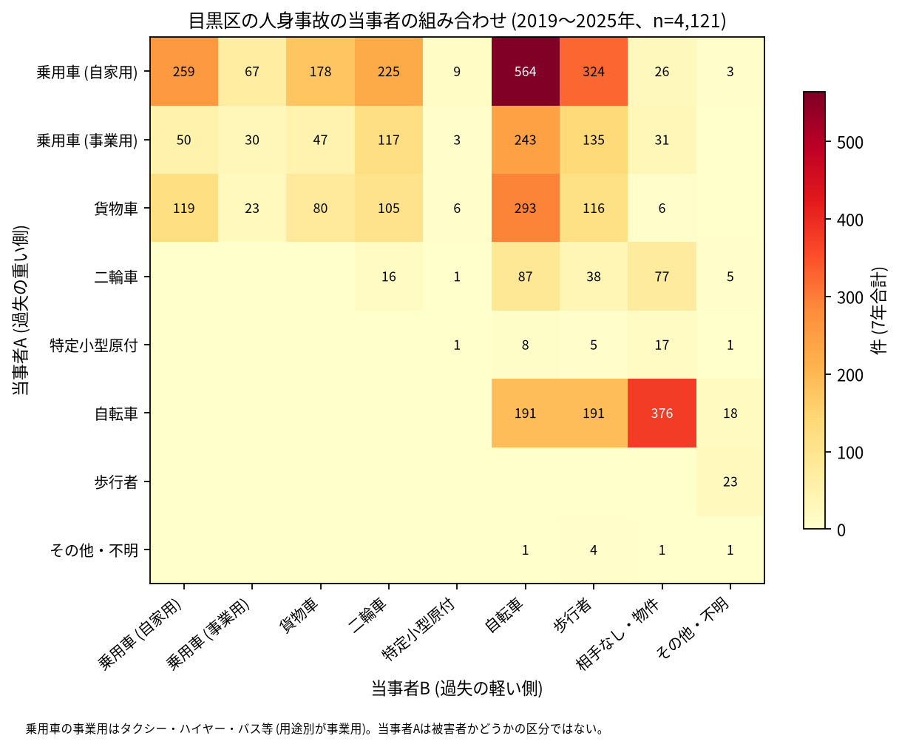

# 目黒区の交通事故 2019〜2025 年: 図で読む要点

## 問い

2019〜2025 年の警察記録の人身事故で、目黒区の事故はいつ、どこで、誰が関わって起きているか。

## 結論

### 要点

| # | 要点 | 数字 | 図 |
|---:|---|---|---|
| 1 | 件数は 2020 年に減り、2022 年に大きく増えた。2025 年も 2019 年より多い | 7 年で 4,121 件、死者 14 人、負傷者 4,547 人。指数 (2019 年=100) は 2020 年 82.6、2022 年 146.7、2025 年 131.8。23 区全体の 2025 年は 101.6 ([yearly.csv](outputs/yearly.csv)、[summary.txt](outputs/summary.txt)) | [図 1](#図-1-件数の推移) |
| 2 | 生活道路と歩行者の関わる事故の割合が 23 区の上位にある | 生活道路 (狭い読み) 34.0% (23 区の 5 位)、歩行者 20.3% (4 位)、交差点内 43.9% (10 位) ([wards.csv](outputs/wards.csv)、[analysis.json](outputs/analysis.json)) | [図 2](#図-2-23-区の中の目黒区) |
| 3 | 地点は大橋・青葉台と山手通りに集まる | 事故の多い地点の上位 15 のうち 7 が大橋・青葉台の拡大図の中。1 位は駒沢通り × 山手通り (30 件)。道路あたりの上位は南三丁目 (年 4.37 件/道路 km) ([hotspots-map.json](outputs/hotspots-map.json)、[hotspots.csv](outputs/hotspots.csv)、[towns.csv](outputs/towns.csv)) | [図 3](#図-3-事故の集まる地点)、[図 4](#図-4-町丁ごとの事故) |
| 4 | 事故の半分に自転車が関わる | 47.9%。車やトラックが当事者 A で自転車が B の事故が 1,100 件。特定小型原付の関わる割合 1.2% は 23 区で 1 位 ([summary.txt](outputs/summary.txt)、[analysis.json](outputs/analysis.json)) | [図 6](#図-6-誰と誰の事故か) |
| 5 | 亡くなったのは自転車と歩行者が多い | 死者 14 人のうち自転車 6 人、歩行者 5 人 (65 歳以上が 2 人)。当事者 A が貨物車の事故が 5 件 ([summary.txt](outputs/summary.txt)) | [表 1](#表-1-死亡事故) |

### 読み手ごとに知るべきこと

| 読み手 | 結論 | 検討する材料 | 詳しく |
|---|---|---|---|
| 区の交通安全担当 | 生活道路の法定速度 30 km/h (2026-09-01 から) が当たるのは事故の 34.0〜47.5% (読み方による) で、23 区の 5 位。2022 年から件数の増えた理由は、このデータでは分からない | 生活道路、自転車、特定小型原付、山手通りの交差点 | [municipality.md](reports/municipality.md) |
| 学校と PTA | 若い (0〜24 歳) 歩行者と自転車の事故は 483 件。最も多いのは 17 時台で、平日は 16 時台、17 時台、8 時台 | 学校の円の中で、平日 7〜8 時台と 14〜17 時台の点が並ぶ道 | [school-pta.md](reports/school-pta.md) |
| 道路安全診断 | 上位は駒沢通り × 山手通り (30 件)、大橋の北の山手通り (29 件)、山手通り × 玉川通り (28 件)。大橋・青葉台の地点には首都高速の事故が混ざる | 後半に増えた 7 位と 14 位、首都高速の事故の多い 2 位 | [road-safety-auditor.md](reports/road-safety-auditor.md) |
| 住民 | 道路あたりで多いのは南三丁目 (年 4.37 件/道路 km)、目黒本町一丁目 (3.95 件)。事故は 8 時台から 18 時台まで多く、10 時台が最多 | 自分の町の色、自転車の単独事故、生活道路の事故 | [resident.md](reports/resident.md) |

### 図 1: 件数の推移

2020 年の落ち込み (82.6) は 23 区全体 (83.7) とほぼ同じ。2022 年 (146.7) に跳ね、2025 年 (131.8) も 23 区全体 (101.6) より高い。2025 年の 95% 区間 (594.3〜694.7 件) は 2019 年 (445.7〜533.3 件) と重ならないので、規則により増えたと書ける。跳ねは区の面に入る点で数えても同じで (2022 年はコード 716 件、面 711 件)、件数の多い 2 つの警察署等コードの両方で起きた ([analysis.json](outputs/analysis.json))。理由は調べていない。

自転車が関わる事故は 2019 年の 192 件から 2022 年の 377 件になった。歩行者、若い人、生活道路の事故も 2022 年に増えている。

### 図 2: 23 区の中の目黒区

赤い点が目黒区。生活道路 (狭い読み 34.0%、広い読み 47.5%、どちらも 5 位) と歩行者 (4 位) が高く、交差点内 (10 位) と夜 (30.0%、11 位) は中ほど。住民千人あたり (2.04 件/年、10 位) は昼の人口を含まない参考値。

### 図 3: 事故の集まる地点

半径 30 m の円の中の 7 年の件数で選んだ上位 15 (18〜30 件)。番号は順位で、大橋・青葉台の 7 地点は右の拡大図に番号を書いた。

| 順位 | 近い道路 (OSM) | 町丁 | 件数 | 前半 件/年 | 後半 件/年 |
|---:|---|---|---:|---:|---:|
| 1 | 駒沢通り × 山手通り | 上目黒一丁目 | 30 | 5.00 | 3.75 |
| 2 | 山手通り | 青葉台四丁目 | 29 | 3.00 | 5.00 |
| 3 | 山手通り × 玉川通り | 大橋二丁目 | 28 | 3.33 | 4.50 |
| 4 | 玉川通り | 大橋二丁目 | 27 | 3.67 | 4.00 |
| 5 | 山手通り × 目黒通り | 目黒二丁目 | 27 | 3.33 | 4.25 |

前半は 2019〜2021 年、後半は 2022〜2025 年。半径を 20 m にすると上位 15 のうち 14 地点、50 m では 13 地点、首都高速の事故を除いた 30 m では 14 地点が残る ([analysis.json](outputs/analysis.json))。5 位の 2 本目の名前は、OSM では「目黒通り;大鳥神社」と 2 つの値が入っている。6〜15 位は [hotspots.csv](outputs/hotspots.csv)。

### 図 4: 町丁ごとの事故

町丁の事故数を、OSM の車道の延長と 7 年で割った値。紫の枠が上位 5 (南三丁目、目黒本町一丁目、中央町一丁目、上目黒二丁目、上目黒一丁目)。分位と等間隔で 56% の町丁の色が変わるので ([town-rate-quantile.json](outputs/town-rate-quantile.json))、色の細かい差は読まない。道路の長さは交通量ではない。

### 図 5: いつ起きるか

全体は 8〜18 時台に広く多い。若い歩行者と自転車は 16〜17 時台と 8 時台に寄り、最多は 17 時台 (51 件)。

全体の最多は 10 時台 (306 件)。自転車は 10 時台 (167 件) と 9 時台 (161 件)、高齢の歩行者は 11 時台 (20 件) が最多。

### 図 6: 誰と誰の事故か

最も多いのは自家用の乗用車 (A) と自転車 (B) の 564 件、次が自転車の単独 (相手なし・物件) の 376 件、自家用の乗用車と歩行者の 324 件。当事者 A は過失の重い側で、被害者とは限らない。

### 表 1: 死亡事故

| 亡くなった人 | 人数 | 特徴 |
|---|---:|---|
| 自転車 | 6 | |
| 歩行者 | 5 | 65 歳以上が 2 人 |
| 二輪車 | 2 | |
| 乗用車 (事業用) | 1 | |

14 件のうち 0〜5 時台が 4 件、当事者 A が貨物車の事故が 5 件 ([summary.txt](outputs/summary.txt))。数が少ないので傾向とは断定しない。全件は [deaths.csv](outputs/deaths.csv)。

### 読み方で変わる答え

| 読み方 | 主 | 別の読み方 |
|---|---|---|
| 目黒区の事故 | `市区町村コード` 110 の 4,121 件 | 点が区の面に入る事故。両方に当てはまるのは 4,072 件 |
| 生活道路 | 狭い読み 34.0% (5 位) | 広い読み 47.5% (5 位) |
| 地点の半径 | 30 m | 20 m で 14 地点、50 m で 13 地点が残る |
| 首都高速 | 含める | 除いた 30 m で 14 地点が残る。上位 15 の事故のうち首都高速は 33 件 |
| 町丁の階級 | 分位 5 階級 | 等間隔で 56% の町丁の色が変わる |

## データ

- 人身事故: 警察庁「交通事故統計情報のオープンデータ」を加工した `yuiseki/npa-traffic-accidents` 版 `389500aae5cec45f1311163f70db6a5f05867838` (配布元の取得 2026-10-02) の本票。2026-11-03 に同じ版から取った東京の本票 (205,541 行) を使った。年はファイルの年 (統計に計上された年)。目黒区 4,121 件、23 区 144,716 件。位置の無い行は 0。物損事故は含まない。
- 区の面と人口: `yuiseki/jp-admin-2026-09` 版 `e6c87b1`。町丁: 2020 年国勢調査の小地域 `yuiseki/estat-boundary-2020` 版 `823195c` (88 町丁、288,088 人)。学校 34 校と道路: OpenStreetMap 2026-08-31、`yuiseki/osm-tokyo23-src-2026-08` 版 `38f7a5f`。
- 道具: DuckDB (spatial)、matplotlib、`analysis-visualize` の `cjk_font.py`、`classify_map.py`、`context_map.py` (2026-11-03)。DuckDB の版と commit は [analysis.json](outputs/analysis.json)。
- 出典の表示: 警察庁ウェブサイト (https://www.npa.go.jp/publications/statistics/koutsuu/opendata/index_opendata.html) の交通事故統計情報のオープンデータを加工して作成。国勢調査の小地域境界と人口、OpenStreetMap (© OpenStreetMap contributors) を加工して使用。

## 方法

- 型は [台東区の分析](../taito-accident-trends-by-role/report.md) と同じ。読み方は結果を見る前に [計画](EXPERIMENT_PLAN.md) で固定し、実行は [記録](EXPERIMENT_TRACKER.md) に残した。生活道路は `車道幅員` が 01、02、11 (狭い読み)、広い読みは 14、17 を足す。歩行者や自転車が関わるかは当事者 A と B の両方で見て、1 件を 1 回数えた。
- 目黒区で足した読み: 首都高速 (`路線コード` 5000〜5499) の事故を除いた 30 m の地点。3 号渋谷線が玉川通りの上を通り、大橋ジャンクションがあるため (外の知識)。流す前に決めた。
- 距離は EPSG:6677 (メートル) で測った。地点は、半径 30 m の中の件数が最も多い点を中心に選び、その円の事故を除いて次を選ぶ手順を 15 回くり返した。
- 地図は `analysis-visualize` の map-context に合わせ、地名と道路を重ね、凡例を地図の外に置き、強調した単位に番号を付けた。町丁は穴を残して塗った。描いた町丁の数 (88) を分析の数と照らし、文字の重なりと、地名が円や学校の印を隠す重なりは、3 枚の地図で 0 件 (地名 3 つと番号 1 つの位置を直した後)。背景の道路 (OGC:CRS84) と町丁 (JGD2000) の差は、線の幅より小さいとして変換せずに重ねた。
- 1 回目の結果で 2022 年の跳ねを見た後、区の面で数えた年の件数と、警察署等コードごとの年の件数を足した (探索)。
- 関門: 予測と回帰をしないので、評価の分け方と残差の確認は要らない。単位の間の相関を結論にしないので、Moran's I と格子の掃引は省いた。推移は 23 区全体を基準にし、年の件数に Poisson の 95% 区間を付けた。対策の効果は推定していない。
- 再実行は [README.md](README.md)。数値は [outputs/](outputs/) の CSV。

## 確かめていないこと

- 2022 年に件数が跳ねた理由 (記録の仕方、人出、取り締まり) は調べていない。区の面で数えても、2 つの署コードのどちらでも跳ねているので、区の境界やコードの付け替えではなさそうだが、それ以上は分からない。
- 交通量、昼の人口、駅の周りの人出で割っていない。大橋や中目黒の件数の多さは、人と車の多さかもしれない。
- 位置の精度は分からない。30 m の地点と町丁の境界の近くの事故は、数十 m のずれで入れ替わる。首都高速の事故は、高架やトンネルと下の道路が平面で重なる。
- 事故の型 (出会い頭、追突)、重傷と軽傷の区別、物損事故、ヒヤリハットは、このデータに無い。
- 0〜24 歳より細かい年齢は無く、小学生だけは数えられない。
- 地点の上位は 7 年で選び、同じ 7 年で前半と後半を比べた。区全体が後半に増えたので、平均への回帰と区全体の増加が混ざる。
