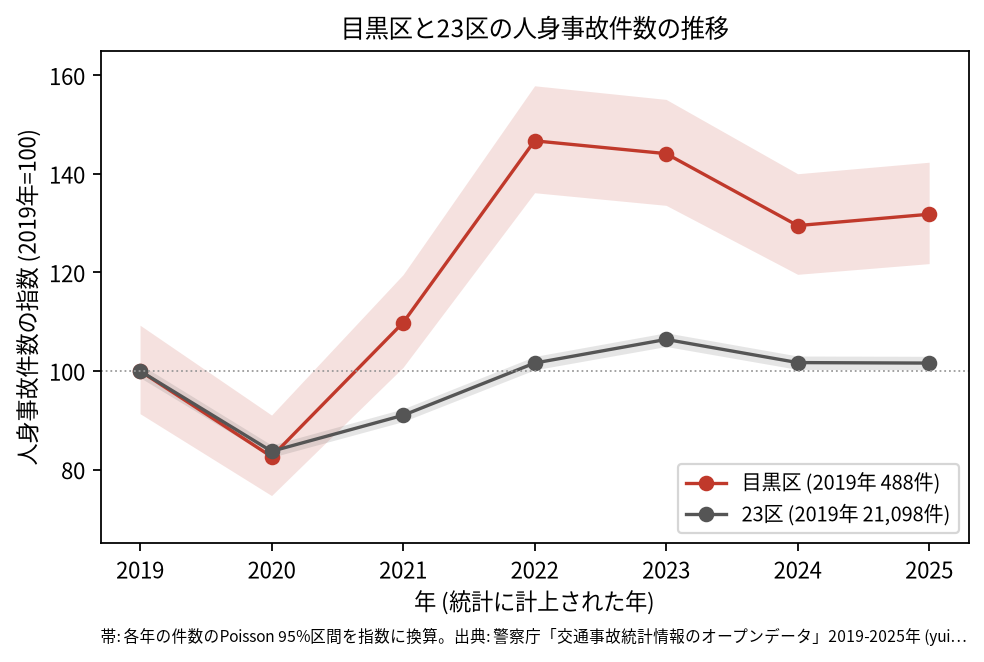
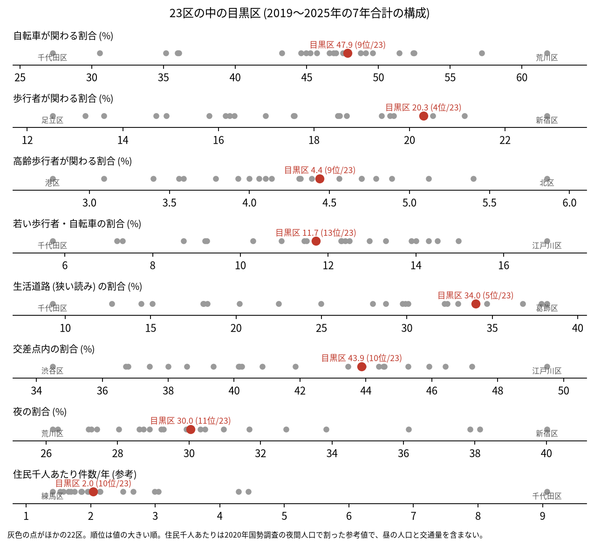
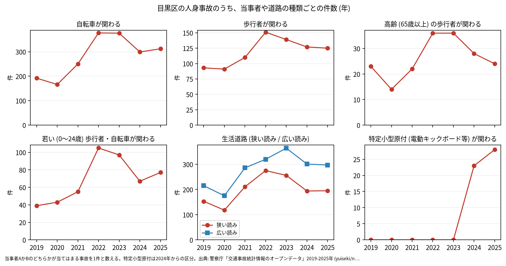

# 区の交通安全担当のための報告: 目黒区の交通事故の傾向

## 問い

目黒区の人身事故は 2019〜2025 年にどう推移し、23 区の中でどんな特徴があり、施策をどこに向ける材料になるか。

## 結論

- 件数: 7 年で 4,121 件、死者 14 人、負傷者 4,547 人です。2020 年に 403 件 (2019 年を 100 として 82.6) まで減り、23 区全体 (83.7) とほぼ同じ下がり方でした。2022 年は 716 件 (146.7) に跳ね、2025 年も 643 件 (131.8) です。23 区全体の 2025 年は 101.6 です。2025 年の 95% 区間 (594.3〜694.7 件) は 2019 年の区間 (445.7〜533.3 件) と重ならないので、2019 年より増えたと言えます。跳ねは区の面に入る点で数えても同じで、件数の多い 2 つの警察署等コードの両方で起きています ([analysis.json](../outputs/analysis.json))。増えた理由は、このデータでは分かりません。

- 23 区の中の位置: 目黒区の事故は、生活道路と歩行者に寄っています。生活道路 (狭い読み) の割合は 34.0% で 23 区の 5 位、広い読みでも 47.5% で 5 位です。歩行者が関わる割合は 20.3% で 4 位です。交差点内の割合 (43.9%) は 10 位、自転車が関わる割合 (47.9%) は 9 位、高齢の歩行者 (4.4%) は 9 位、若い歩行者と自転車 (11.7%) は 13 位で、23 区の中ほどです ([wards.csv](../outputs/wards.csv)、[analysis.json](../outputs/analysis.json))。

- 施策への読み方: 2026-09-01 からの生活道路の法定速度 30 km/h が当たる道路の事故は、目黒区の事故のうち 34.0〜47.5% (読み方による) で、23 区の中で割合の高い区です。一方で、事故の多い地点の上位は山手通り、玉川通り、目黒通り、駒沢通り、環七通りの交差点です (地点は [道路安全診断の報告](road-safety-auditor.md))。これは効果の予測ではなく、どの道路で事故が起きているかの構成です。
- 区分ごとの推移: 自転車が関わる事故は 2019 年の 192 件から 2022 年に 377 件になり、2025 年は 312 件です。特定小型原付 (電動キックボードなど) が関わる事故は、区分のできた 2024 年に 23 件、2025 年に 28 件で、7 年の割合 1.2% は 23 区で 1 位です ([yearly.csv](../outputs/yearly.csv)、[wards.csv](../outputs/wards.csv)、[analysis.json](../outputs/analysis.json))。

- 死亡事故: 14 件のうち、亡くなったのは自転車 6 人、歩行者 5 人、二輪車 2 人、乗用車 (事業用) 1 人です。亡くなった歩行者 5 人のうち 2 人が 65 歳以上でした。当事者 A (過失の重い側) が貨物車の事故が 5 件、0〜5 時台に起きた事故が 4 件です ([summary.txt](../outputs/summary.txt))。14 件は少なく、偏りを傾向と断定できる数ではありません。

| 年 | 当事者 A | 当事者 B | 亡くなった人 | 時 |
|---|---|---|---|---:|
| 2019 | 乗用車 (事業用) | 歩行者 (45〜54 歳) | 歩行者 | 3 |
| 2022 | 乗用車 (事業用) | 歩行者 (0〜24 歳) | 歩行者 | 1 |
| 2022 | 貨物車 | 歩行者 (75 歳以上) | 歩行者 | 10 |
| 2024 | 乗用車 (自家用) | 歩行者 (25〜34 歳) | 歩行者 | 5 |
| 2024 | 貨物車 | 歩行者 (75 歳以上) | 歩行者 | 22 |

表は、歩行者が亡くなった 5 件の抜き出しです。14 件の全ては [deaths.csv](../outputs/deaths.csv) にあります。

- 人口あたり: 2020 年の住民千人あたりの年の件数は 2.04 件で 23 区の 10 位ですが、分母に昼の人口、来訪者、通過する車が入らないため、区の比較の主な指標にしていません。

## データ

警察庁「交通事故統計情報のオープンデータ」を加工した `yuiseki/npa-traffic-accidents` 版 `389500a` の本票。目黒区は `市区町村コード` 110 の 4,121 件、23 区は 144,716 件。年はファイルの年 (統計に計上された年)。区の人口は 2020 年国勢調査 (`jp-admin-2026-09` 版 `e6c87b1`)。詳しくは [共通の報告](../report.md)。

## 方法

区分は、当事者 A か B のどちらかが当てはまる事故を 1 件と数えました。生活道路は `車道幅員` で決め、狭い読み (5.5 m 未満の単路と、小と小の交差点) と、広い読み (5.5 m 未満の道とより広い道の交差点も含む) を並べました。年の区間は件数の Poisson の 95% 区間 (Garwood) です。23 区の順位は 7 年合計の割合の大きい順です。

## 確かめていないこと

- 2022 年に件数が跳ねた理由 (記録の仕方、人出、取り締まりなど) は調べていません。警察署等コードと署の名前の対応も確かめていません。
- 区の施策 (ゾーン 30、自転車の通行帯など) の効果は推定していません。割合の順位は施策の評価ではありません。
- 重傷と軽傷の区別、物損事故は、このデータにありません。
