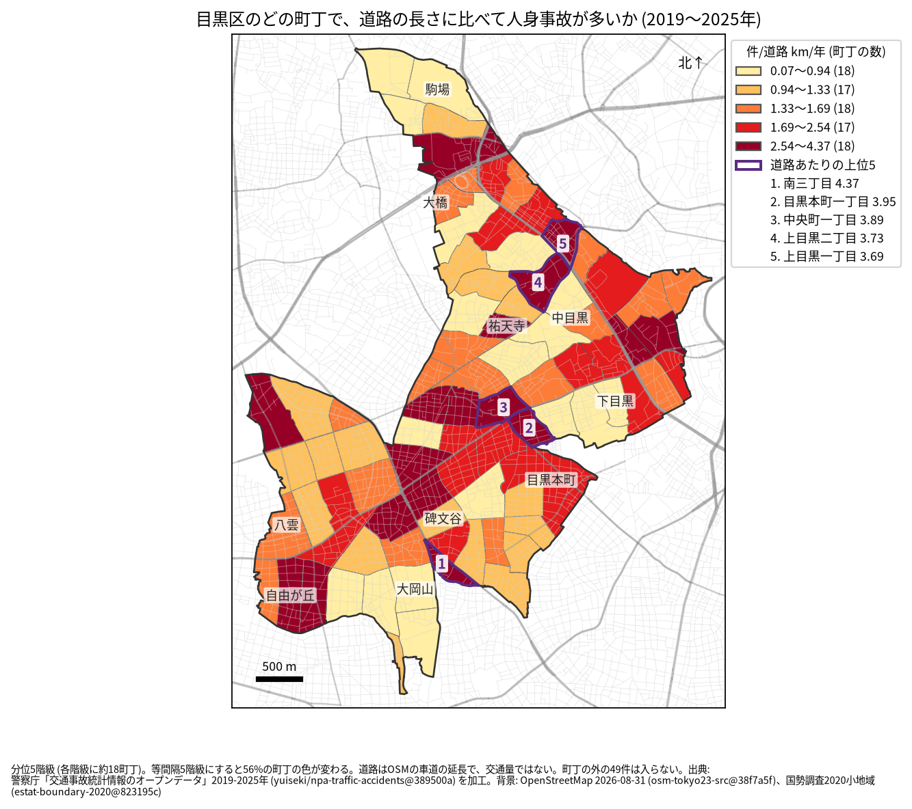
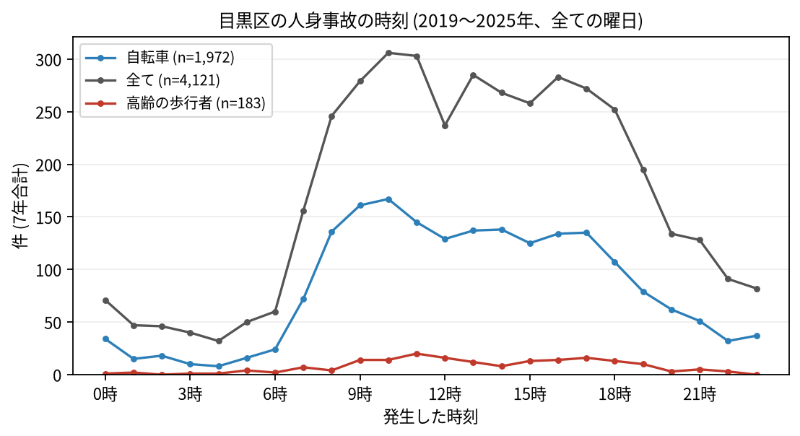

# 住民のための報告: 目黒区で、いつ、どこで事故が起きているか

## 問い

目黒区に住む人が、自分の町で、いつ、どんな事故に気をつければよいか。2019〜2025 年の警察記録の人身事故から調べました。

## 結論

- 目黒区では 7 年で 4,121 件の人身事故があり、14 人が亡くなりました。年に 403〜716 件で、2022 年からは 2019 年より多い年が続いています ([yearly.csv](../outputs/yearly.csv))。
- 町ごと: 道路 1 km あたりの事故が多いのは、南三丁目 (年 4.37 件)、目黒本町一丁目 (3.95 件)、中央町一丁目 (3.89 件)、上目黒二丁目 (3.73 件)、上目黒一丁目 (3.69 件) です。件数そのものが最も多いのは上目黒一丁目 (7 年で 159 件)、次が大橋二丁目 (155 件) でした ([towns.csv](../outputs/towns.csv))。山手通りに沿った大橋から中目黒、目黒通りと環七通りの周りに色の濃い町が並びます。

色は分位 5 階級で、各色に約 18 の町が入ります。等間隔の階級にすると 56% の町の色が変わるので、色の差より、自分の町が上の階級か下の階級かを見てください。

- 時間: 事故は朝 8 時台から増え、夕方 18 時台まで高い水準が続きます。最も多いのは 10 時台 (306 件) です。自転車が関わる事故は 10 時台 (167 件) と 9 時台 (161 件) に多く、高齢の歩行者が関わる事故は 11 時台 (20 件) が最も多い時間でした ([summary.txt](../outputs/summary.txt))。

- 誰が: 自転車が関わる事故が全体の 47.9% で、最も多い区分です。自転車に乗る人は、車やトラックとの事故 (1,100 件) に加え、自転車だけの事故 (転倒や物への衝突、376 件) にも気をつけてください。歩行者が関わる事故は 20.3% で、23 区で 4 番目に高い割合です。電動キックボードなど (特定小型原付) の関わる事故は、2024 年と 2025 年で 51 件でした。
- 道: 事故の 34.0% は生活道路 (狭い道とその交差点) で起きていて、23 区で 5 番目に高い割合です ([wards.csv](../outputs/wards.csv)、[analysis.json](../outputs/analysis.json))。家の近くの細い道でも、事故は少なくありません。
- 亡くなった人: 14 人のうち 6 人が自転車、5 人が歩行者で、歩行者のうち 2 人が 65 歳以上でした。

## データ

警察庁「交通事故統計情報のオープンデータ」を加工した `yuiseki/npa-traffic-accidents` 版 `389500a` の本票、目黒区の 4,121 件 (2019〜2025 年のファイル)。町の境界は 2020 年国勢調査の小地域 (88 町丁)、道路は OpenStreetMap 2026-08-31。詳しくは [共通の報告](../report.md)。

## 方法

事故の地点を町丁の境界に入れて数え、町丁の中の車道の長さ (OSM) と 7 年で割りました。区の境界の近くで町丁の外に落ちた 49 件は町の値に入っていません。時刻は事故の起きた時で、7 年の合計です。

## 確かめていないこと

- 道路の長さは、通る車や人の数ではありません。大橋や中目黒の値が高いのは、人と車が多いためかもしれません。大橋二丁目と青葉台四丁目の件数には、首都高速の事故も入っています。
- 2022 年から件数が増えた理由は調べていません。
- 自分の町の事故が少なくても、物損事故やヒヤリハットはこのデータにありません。
- 事故の位置の精度は分かりません。町の境界の近くの事故は、隣の町に数えられている可能性があります。
